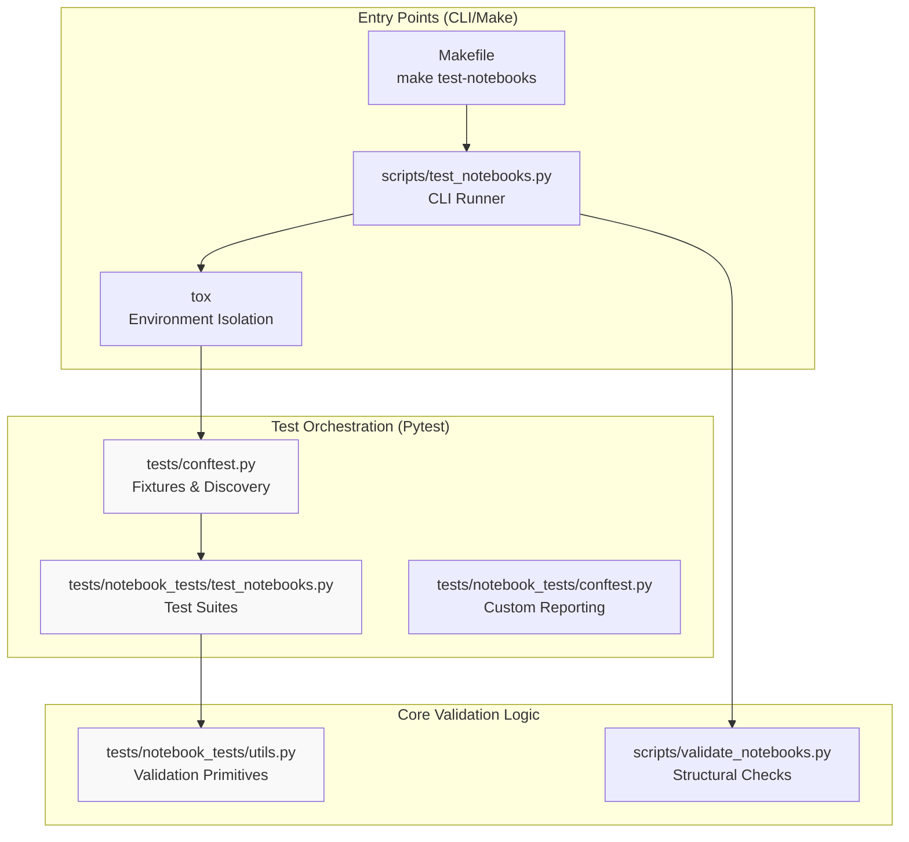
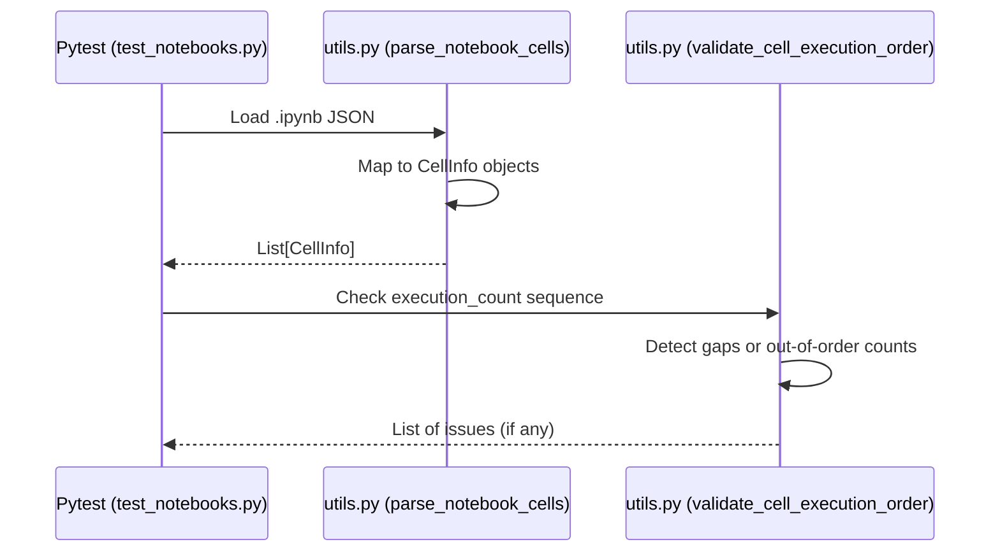

<!-- source: DeepWiki mcp.deepwiki.com · repo anthropics/claude-cookbooks · page 3.3 Testing Infrastructure · fetched 2026-10-26 -->

# Testing Infrastructure

Relevant source files

The following files were used as context for generating this wiki page:

- [.github/workflows/claude-link-review.yml](.github/workflows/claude-link-review.yml)
- [.github/workflows/claude-model-check.yml](.github/workflows/claude-model-check.yml)
- [.github/workflows/claude-pr-review.yml](.github/workflows/claude-pr-review.yml)
- [.github/workflows/links.yml](.github/workflows/links.yml)
- [.github/workflows/lint-format.yml](.github/workflows/lint-format.yml)
- [.github/workflows/notebook-diff-comment.yml](.github/workflows/notebook-diff-comment.yml)
- [.github/workflows/notebook-quality.yml](.github/workflows/notebook-quality.yml)
- [.github/workflows/notebook-tests.yml](.github/workflows/notebook-tests.yml)
- [Makefile](Makefile)
- [scripts/test_notebooks.py](scripts/test_notebooks.py)
- [tests/__init__.py](tests/__init__.py)
- [tests/conftest.py](tests/conftest.py)
- [tests/notebook_tests/__init__.py](tests/notebook_tests/__init__.py)
- [tests/notebook_tests/conftest.py](tests/notebook_tests/conftest.py)
- [tests/notebook_tests/test_notebooks.py](tests/notebook_tests/test_notebooks.py)
- [tests/notebook_tests/utils.py](tests/notebook_tests/utils.py)
- [tox.ini](tox.ini)

## Purpose and Scope

This document describes the testing infrastructure used to validate cookbook quality and correctness. It covers the core testing tools (`pytest`, `nbval`, `nbconvert`), notebook execution testing, structure validation, and the distinction between fast structural checks and slow API-based execution tests. For information about the CI/CD workflows that orchestrate these tests, see [CI/CD Pipeline and GitHub Actions](). For validation scripts used by the testing infrastructure, see [Validation Scripts and Utilities]().

---

## Testing Tools Ecosystem

The repository uses a multi-layered testing approach combining Python testing frameworks, notebook-specific tools, and custom validation scripts.

### Core Testing Dependencies

The testing dependencies are managed by `uv` and defined in the development environment. Key tools include:

| Tool | Purpose |
|------|---------|
| `pytest` | Core test runner and parameterization engine [.github/workflows/notebook-tests.yml:90-93]() |
| `nbval` | Pytest plugin for validating notebook outputs [tox.ini:14-14]() |
| `nbconvert` | Notebook execution and format conversion [.github/workflows/notebook-quality.yml:109-114]() |
| `tox` | Environment isolation and standardized test entry points [tox.ini:1-154]() |
| `ruff` | Linting and formatting for code cells [.github/workflows/lint-format.yml:68-113]() |
| `nbdime` | Generates rich diffs for notebooks in PR comments [.github/workflows/notebook-diff-comment.yml:78-79]() |
| `lychee` | Link checking across markdown and notebooks [.github/workflows/links.yml:113-130]() |

### Pytest Configuration and Fixtures

The testing scaffold in `tests/notebook_tests/` provides comprehensive validation through a set of reusable fixtures defined in `tests/conftest.py`.

- **`notebook_path`**: Parameterized fixture that determines which notebooks to test based on CLI flags like `--notebook` or `--notebook-dir` [tests/conftest.py:116-125]().
- **`notebook_data`**: Loads the raw JSON content of the notebook [tests/conftest.py:134-137]().
- **`notebook_cells`**: Parses the notebook into `CellInfo` dataclasses for easier inspection [tests/conftest.py:140-143]().
- **`execute_notebooks`**: A boolean flag that triggers actual code execution [tests/conftest.py:152-155]().

**Sources:** [tests/conftest.py:1-172](), [tox.ini:1-154](), [Makefile:1-128](), [.github/workflows/notebook-diff-comment.yml:78-79]()

---

## Testing Infrastructure Architecture

The following diagram maps the relationship between the command-line entry points, the test orchestration layer, and the underlying validation logic.

**Diagram: Testing Infrastructure Component Architecture**

**Sources:** [Makefile:83-128](), [tests/notebook_tests/test_notebooks.py:34-172](), [tests/conftest.py:78-113]()

---

## Notebook Execution Testing

The repository distinguishes between **Structural Testing** (fast, no API calls) and **Execution Testing** (slow, requires API keys).

### API Testing vs. Structural Testing

| Feature | Structural Testing (`-m "not slow"`) | Execution Testing (`--execute-notebooks`) |
|------|---------|---------|
| **Speed** | Fast (seconds) | Slow (minutes) |
| **API Keys** | Not Required | Required (`ANTHROPIC_API_KEY`) |
| **Validation** | JSON format, cell order, secrets [tests/notebook_tests/test_notebooks.py:34-145]() | Full code execution, runtime errors [.github/workflows/notebook-quality.yml:96-116]() |
| **Tooling** | `json`, `nbformat.validator` | `nbconvert`, `jupyter` |

### Execution Logic and Security

Actual notebook execution is handled by `jupyter nbconvert` during CI [.github/workflows/notebook-quality.yml:109-114](). Security is enforced by `TestSecurity`, which checks for:
- **Hardcoded Secrets**: Uses regex patterns to detect strings like `sk-ant-...` [tests/notebook_tests/test_notebooks.py:137-145]().
- **Environment Variable Usage**: Ensures API keys are loaded via `os.environ.get("ANTHROPIC_API_KEY")` [tests/notebook_tests/test_notebooks.py:147-170]().

**Sources:** [tests/notebook_tests/test_notebooks.py:134-170](), [.github/workflows/notebook-quality.yml:96-130](), [tests/conftest.py:35-46]()

---

## Structural Validation Logic

Structural validation is performed by the `TestNotebookStructure` and `TestCellExecution` classes, which rely on the `CellInfo` dataclass for metadata analysis.

### CellInfo Dataclass
The `CellInfo` class (defined in `tests/notebook_tests/utils.py`) stores metadata such as `index`, `cell_type`, `execution_count`, and `has_error_output` [tests/notebook_tests/test_notebooks.py:22-31]().

### Sequential Execution Check
The `TestCellExecution` class ensures that:
1. All code cells have been executed [tests/notebook_tests/test_notebooks.py:84-91]().
2. Cells are executed in strictly sequential order [tests/notebook_tests/test_notebooks.py:93-98]().
3. Execution starts from `1` (indicating a fresh kernel run) [tests/notebook_tests/test_notebooks.py:100-110]().

**Diagram: Structural Validation Flow**

**Sources:** [tests/notebook_tests/test_notebooks.py:81-112](), [tests/conftest.py:140-143]()

---

## Automated Review Integration

The infrastructure leverages Claude-powered reviews to provide feedback when tests fail.

### Claude Model Check and PR Review
Specialized workflows trigger Claude to analyze code changes and test failures:
- **`claude-model-check.yml`**: Runs the `/model-check` command to validate model usage in changed files [.github/workflows/claude-model-check.yml:69-87]().
- **`claude-pr-review.yml`**: Runs the `/review-pr-ci` command for a comprehensive PR review [.github/workflows/claude-pr-review.yml:44-58]().
- **`notebook-tests.yml`**: If `pytest` fails, Claude summarizes the `all_test_output.txt` and posts a PR comment with fix instructions [.github/workflows/notebook-tests.yml:125-164]().

**Sources:** [.github/workflows/claude-model-check.yml:1-87](), [.github/workflows/claude-pr-review.yml:1-59](), [.github/workflows/notebook-tests.yml:125-164]()

---

## Summary of Test Suites

| Suite Class | File | Responsibility |
|------|------|---------|
| `TestNotebookStructure` | `test_notebooks.py` | Validates JSON, kernel specs, and cell types [tests/notebook_tests/test_notebooks.py:34-80]() |
| `TestCellExecution` | `test_notebooks.py` | Checks execution order and kernel freshness [tests/notebook_tests/test_notebooks.py:81-112]() |
| `TestCellOutputs` | `test_notebooks.py` | Detects error outputs and empty cells [tests/notebook_tests/test_notebooks.py:113-133]() |
| `TestSecurity` | `test_notebooks.py` | Scans for hardcoded API keys [tests/notebook_tests/test_notebooks.py:134-171]() |
| `TestDependencies` | `test_notebooks.py` | Ensures pip installs are at the top of the notebook [tests/notebook_tests/test_notebooks.py:175-182]() |

**Sources:** [tests/notebook_tests/test_notebooks.py:1-182](), [tests/notebook_tests/conftest.py:21-33]()

---

