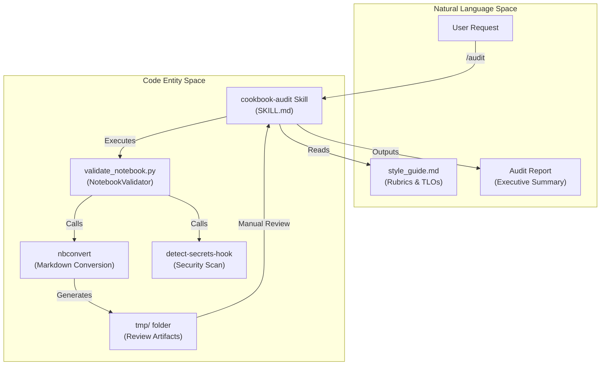
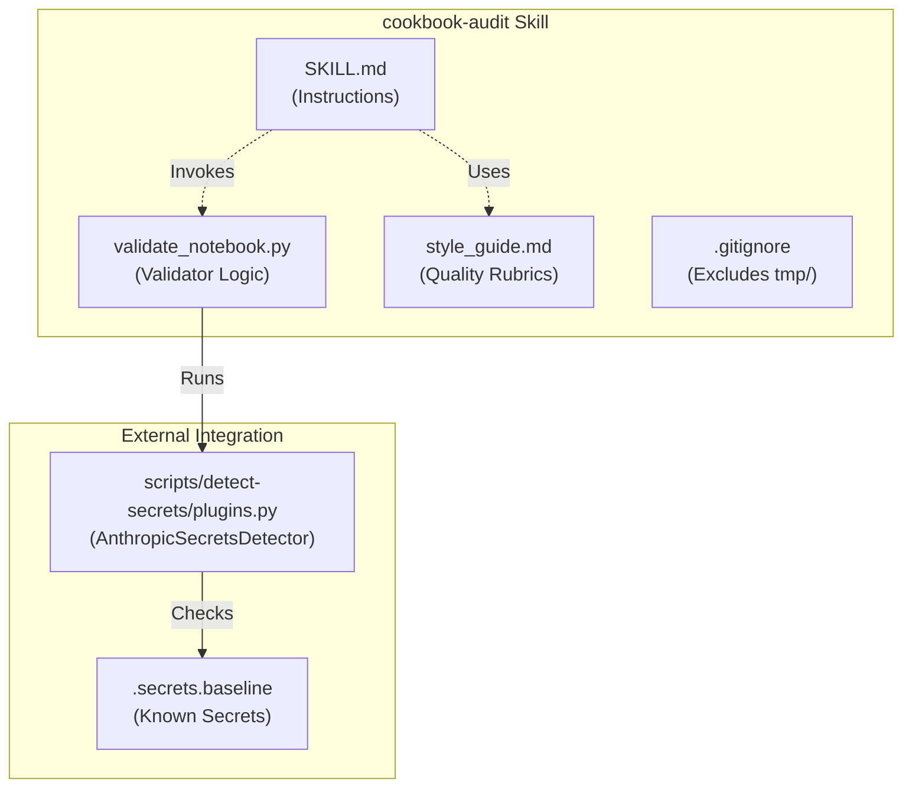
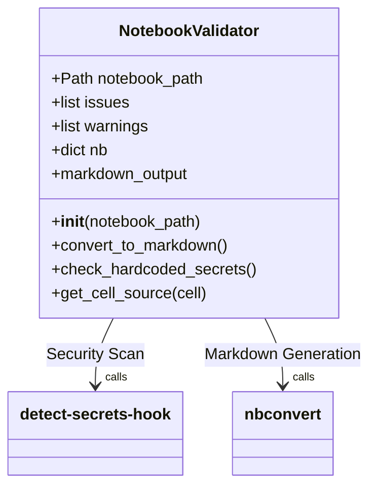

<!-- source: DeepWiki mcp.deepwiki.com · repo anthropics/claude-cookbooks · page 3.4 Cookbook Audit Process · fetched 2026-10-26 -->

# Cookbook Audit Process

Relevant source files

The following files were used as context for generating this wiki page:

- [.claude/commands/link-review.md](.claude/commands/link-review.md)
- [.claude/commands/model-check.md](.claude/commands/model-check.md)
- [.claude/commands/notebook-review.md](.claude/commands/notebook-review.md)
- [.claude/skills/cookbook-audit/.gitignore](.claude/skills/cookbook-audit/.gitignore)
- [.claude/skills/cookbook-audit/SKILL.md](.claude/skills/cookbook-audit/SKILL.md)
- [.claude/skills/cookbook-audit/style_guide.md](.claude/skills/cookbook-audit/style_guide.md)
- [.claude/skills/cookbook-audit/validate_notebook.py](.claude/skills/cookbook-audit/validate_notebook.py)
- [lychee.toml](lychee.toml)
- [scripts/detect-secrets/.secrets.baseline](scripts/detect-secrets/.secrets.baseline)
- [scripts/detect-secrets/plugins.py](scripts/detect-secrets/plugins.py)
- [scripts/validate_all_notebooks.py](scripts/validate_all_notebooks.py)

## Purpose and Scope

The Cookbook Audit Process provides a comprehensive system for manually and automatically evaluating Jupyter notebooks against quality standards. This page documents the `cookbook-audit` Claude skill, the validation scripts it orchestrates, and the scoring rubrics used to assess notebook quality.

For automated CI/CD validation that runs on every pull request, see [3.1 CI/CD Pipeline and GitHub Actions](). For Claude-powered slash command reviews, see [3.2 Claude-Powered Reviews](). For standalone validation scripts, see [3.5 Validation Scripts and Utilities]().

Sources: [.claude/skills/cookbook-audit/SKILL.md:1-20](), [.claude/commands/notebook-review.md:1-15]()

## Audit Workflow Overview

The audit process combines automated checks with manual review guided by Claude AI. The workflow follows a structured progression from automated validation through manual evaluation against a comprehensive rubric.

### Audit Process Data Flow

The diagram below shows how a notebook file is processed through the audit pipeline, from raw file to final report.

Sources: [.claude/skills/cookbook-audit/SKILL.md:20-37](), [.claude/skills/cookbook-audit/validate_notebook.py:49-86]()

**Audit Workflow Stages**

| Stage | Tool | Output | Purpose |
|-------|------|--------|---------|
| Automated Checks | `validate_notebook.py` | Issue list + markdown | Catch technical violations |
| Security Scan | `detect-secrets` | Secret findings | Identify hardcoded credentials |
| Manual Review | Claude + `style_guide.md` | Evaluation notes | Assess quality dimensions |
| Scoring | Rubric application | 4 scores (X/5 each) | Objective assessment |
| Reporting | Audit report format | Structured feedback | Actionable recommendations |

Sources: [.claude/skills/cookbook-audit/SKILL.md:20-68](), [.claude/skills/cookbook-audit/validate_notebook.py:87-168]()

## The cookbook-audit Skill

The `cookbook-audit` skill is a Claude-powered tool that orchestrates the complete audit workflow. It resides in `.claude/skills/cookbook-audit/` and follows the standard Skills API structure.

### Skill Structure and Dependencies

The skill encapsulates both the logic for validation and the instructions for manual review.

Sources: [.claude/skills/cookbook-audit/SKILL.md:1-10](), [scripts/detect-secrets/plugins.py:7-22](), [.claude/skills/cookbook-audit/.gitignore:1-4]()

### Audit Report Format

The skill produces structured reports with executive summary, detailed scoring, and actionable recommendations:

1.  **Executive Summary**: Overall score (X/20), key strengths, and critical issues [[.claude/skills/cookbook-audit/SKILL.md:42-46]()].
2.  **Detailed Scoring**: Narrative Quality, Code Quality, Technical Accuracy, and Actionability (each X/5) [[.claude/skills/cookbook-audit/SKILL.md:47-60]()].
3.  **Specific Recommendations**: Prioritized list of improvements with line references [[.claude/skills/cookbook-audit/SKILL.md:61-64]()].
4.  **Examples & Suggestions**: Concrete excerpts showing proposed changes [[.claude/skills/cookbook-audit/SKILL.md:65-68]()].

Sources: [.claude/skills/cookbook-audit/SKILL.md:38-68]()

## Automated Validation Checks

The `validate_notebook.py` script performs automated structural and security checks. It uses the `NotebookValidator` class to manage the lifecycle of a single notebook audit.

### NotebookValidator Logic

Sources: [.claude/skills/cookbook-audit/validate_notebook.py:27-48]()

### Key Automated Checks

*   **Security Scan** (`check_hardcoded_secrets`): Uses `detect-secrets` with the `AnthropicSecretsDetector` plugin to find keys like `sk-ant-api03-` [[.claude/skills/cookbook-audit/validate_notebook.py:87-133](), [scripts/detect-secrets/plugins.py:13-22]()].
*   **Markdown Generation** (`convert_to_markdown`): Converts the `.ipynb` to a clean `.md` file in the `tmp/` directory for easier LLM processing, excluding cell outputs to save context [[.claude/skills/cookbook-audit/validate_notebook.py:49-86]()].
*   **Model Validation**: The `validate_all_notebooks.py` script specifically flags dated model IDs (e.g., `claude-3-5-sonnet-20240620`) and suggests non-dated aliases like `claude-sonnet-4-6` [[scripts/validate_all_notebooks.py:111-161]()].
*   **Code Structure**: Verifies that `MODEL` is defined as a constant and that `dotenv.load_dotenv()` is used instead of hardcoding environments [[.claude/skills/cookbook-audit/style_guide.md:77-86]()].

Sources: [.claude/skills/cookbook-audit/validate_notebook.py:49-168](), [scripts/validate_all_notebooks.py:111-161]()

## Repository-Wide Audit Infrastructure

For bulk processing, the repository uses `scripts/validate_all_notebooks.py`. This script provides a dashboard and state persistence for auditing the entire collection.

### State Management

The `NotebookValidator` in the global script maintains a state file at `.notebook_validation_state.json` to track history and avoid re-validating unchanged files [[scripts/validate_all_notebooks.py:25-45]()].

| Feature | Implementation |
| :--- | :--- |
| **Caching** | `load_state` and `save_state` track passing counts and dates [[scripts/validate_all_notebooks.py:30-66]()] |
| **Issue Detection** | Categorizes issues into `invalid_json`, `empty_cell`, `error_output`, and `dated_model_id` [[scripts/validate_all_notebooks.py:72-145]()] |
| **History Tracking** | Keeps a 30-day rolling window of validation history [[scripts/validate_all_notebooks.py:62]()] |
| **Security Gate** | Detects hardcoded `sk-ant-` keys as critical errors [[scripts/validate_all_notebooks.py:163-172]()] |

Sources: [scripts/validate_all_notebooks.py:22-180]()

## Quality Rubrics

The manual portion of the audit is guided by `style_guide.md`, which defines the "Anthropic Way" for cookbooks.

### Scoring Dimensions (0-5 points each)

1.  **Narrative Quality**: Does it frame a problem? Are there clear Terminal Learning Objectives (TLOs)? [[.claude/skills/cookbook-audit/style_guide.md:1-45]()]
2.  **Code Quality**: Is it readable? Are variable names meaningful? Is `MODEL` a constant? [[.claude/skills/cookbook-audit/style_guide.md:66-102](), [.claude/skills/cookbook-audit/SKILL.md:102-109]()]
3.  **Technical Accuracy**: Does it run top-to-bottom? Does it use non-deprecated API patterns? [[.claude/skills/cookbook-audit/SKILL.md:123-132]()]
4.  **Actionability**: Does it teach transferable patterns? Does it explain "why" instead of just "what"? [[.claude/skills/cookbook-audit/SKILL.md:133-145]()]

Sources: [.claude/skills/cookbook-audit/SKILL.md:47-60](), [.claude/skills/cookbook-audit/style_guide.md:1-149]()

### Content Philosophy

The audit process enforces a "Problem-First" framing:
*   **Good**: "Your engineering team's GitHub Actions workflows fail... An AI observability agent can cut triage time by 80%." [[.claude/skills/cookbook-audit/style_guide.md:13-19]()]
*   **Bad**: "In this notebook we will build a research agent using the `query()` function." [[.claude/skills/cookbook-audit/style_guide.md:20-28]()]

Sources: [.claude/skills/cookbook-audit/style_guide.md:13-28]()

---

