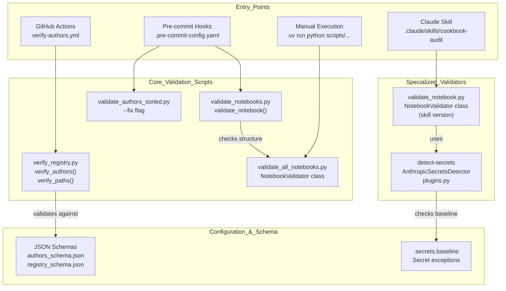
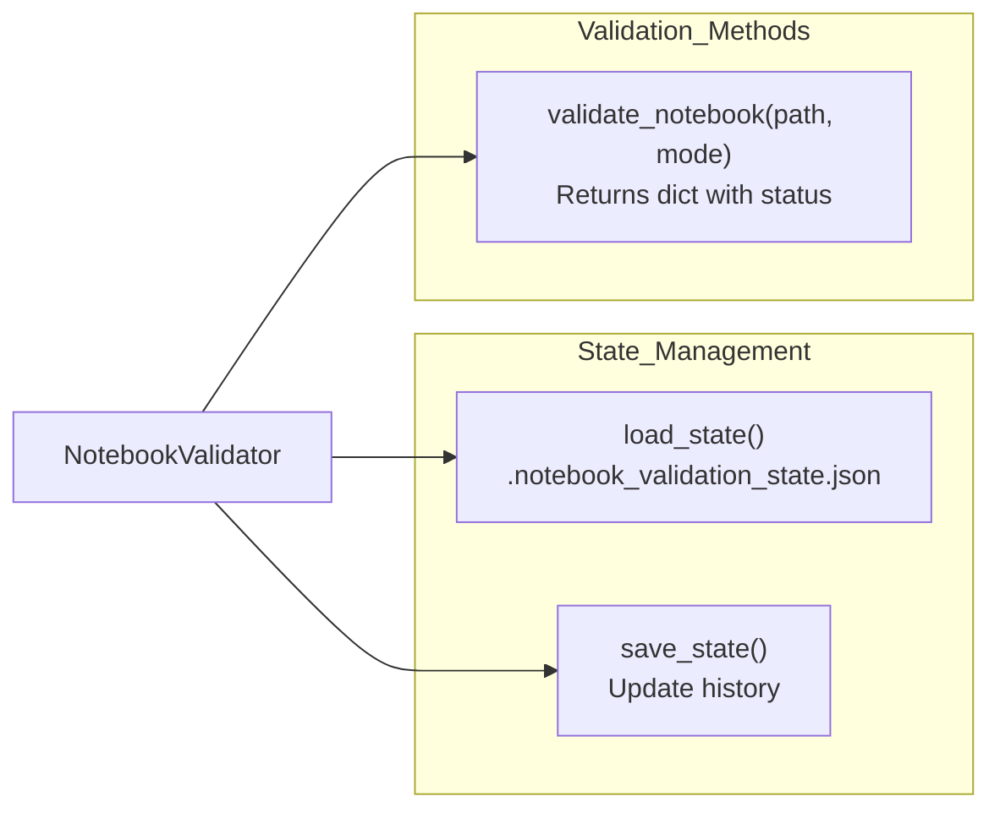

<!-- source: DeepWiki mcp.deepwiki.com · repo anthropics/claude-cookbooks · page 3.5 Validation Scripts and Utilities · fetched 2026-10-26 -->

# Validation Scripts and Utilities

<details>
<summary>Relevant source files</summary>

The following files were used as context for generating this wiki page:

- [.claude/skills/cookbook-audit/.gitignore](.claude/skills/cookbook-audit/.gitignore)
- [.claude/skills/cookbook-audit/SKILL.md](.claude/skills/cookbook-audit/SKILL.md)
- [.claude/skills/cookbook-audit/style_guide.md](.claude/skills/cookbook-audit/style_guide.md)
- [.claude/skills/cookbook-audit/validate_notebook.py](.claude/skills/cookbook-audit/validate_notebook.py)
- [.github/authors_schema.json](.github/authors_schema.json)
- [.github/scripts/verify_registry.py](.github/scripts/verify_registry.py)
- [.github/workflows/verify-authors.yml](.github/workflows/verify-authors.yml)
- [.pre-commit-config.yaml](.pre-commit-config.yaml)
- [CONTRIBUTING.md](CONTRIBUTING.md)
- [README.md](README.md)
- [anthropic_cookbook/__init__.py](anthropic_cookbook/__init__.py)
- [lychee.toml](lychee.toml)
- [requirements-dev.txt](requirements-dev.txt)
- [scripts/detect-secrets/.secrets.baseline](scripts/detect-secrets/.secrets.baseline)
- [scripts/detect-secrets/plugins.py](scripts/detect-secrets/plugins.py)
- [scripts/validate_all_notebooks.py](scripts/validate_all_notebooks.py)
- [scripts/validate_notebooks.py](scripts/validate_notebooks.py)

</details>


This document covers the validation scripts and utilities used to ensure quality and consistency across the Claude Cookbooks repository. These scripts validate notebook structure, metadata integrity, API key security, and compliance with project standards.

For information about the CI/CD workflows that execute these scripts, see [CI/CD Pipeline and GitHub Actions](3.1). For the Claude-powered review system, see [Claude-Powered Reviews](3.2). For the cookbook audit process, see [Cookbook Audit Process](3.4).

## Overview

The validation system consists of standalone Python scripts that perform structural, security, and metadata checks across Jupyter notebooks and YAML configuration files. These scripts run locally via pre-commit hooks, in CI/CD pipelines, and manually during development.

Sources: [scripts/validate_notebooks.py:1-65](), [.pre-commit-config.yaml:1-25]()

## Validation Scripts Architecture



Sources: [.pre-commit-config.yaml:1-25](), [scripts/validate_notebooks.py:1-65](), [scripts/validate_all_notebooks.py:1-25](), [.claude/skills/cookbook-audit/validate_notebook.py:1-42](), [.github/workflows/verify-authors.yml:1-33]()

## validate_notebooks.py

**Purpose**: Fast structural validation of Jupyter notebooks, checking for empty cells and error outputs.

**Key Functions**:

| Function | Purpose | Lines |
|----------|---------|-------|
| `validate_notebook(path: Path)` | Validates a single notebook | [scripts/validate_notebooks.py:14-33]() |
| `main()` | Processes command-line arguments and validates notebooks | [scripts/validate_notebooks.py:36-65]() |

**Validation Checks**:

1. **Empty Cells**: Detects cells with no source content ([scripts/validate_notebooks.py:22-24]()).
2. **Error Outputs**: Identifies code cells containing error outputs ([scripts/validate_notebooks.py:27-31]()).
3. **JSON Structure**: Ensures notebook is valid JSON ([scripts/validate_notebooks.py:18-19]()).

**Usage**:
```bash
# Manual run
uv run python scripts/validate_notebooks.py path/to/notebook.ipynb
```

Sources: [scripts/validate_notebooks.py:1-65](), [.pre-commit-config.yaml:12-18]()

## verify_registry.py

**Purpose**: Ensures the integrity of the repository's metadata files (`authors.yaml` and `registry.yaml`). It verifies that all authors are defined, paths exist, and external URLs are reachable.

**Key Components**:

| Function | Purpose | Lines |
|----------|---------|-------|
| `verify_authors(authors)` | Validates GitHub handles and author website/avatar URLs | [.github/scripts/verify_registry.py:63-108]() |
| `verify_registry_authors(registry, authors)` | Ensures all authors in `registry.yaml` exist in `authors.yaml` | [.github/scripts/verify_registry.py:111-131]() |
| `verify_paths(registry, repo_root)` | Confirms all cookbook paths in the registry exist on disk | [.github/scripts/verify_registry.py:134-158]() |
| `verify_schemas(...)` | Validates YAML files against their respective JSON schemas | [.github/scripts/verify_registry.py:161-213]() |

**Schema Validation**:
The script uses `jsonschema` to validate `authors.yaml` against `.github/authors_schema.json` and `registry.yaml` against `.github/registry_schema.json` ([.github/scripts/verify_registry.py:172-205]()).

Sources: [.github/scripts/verify_registry.py:1-213](), [.github/workflows/verify-authors.yml:31-33]()

## validate_all_notebooks.py

**Purpose**: Comprehensive validation tool with state persistence, dashboard reporting, and checks for deprecated models and hardcoded API keys.

### NotebookValidator Class



Sources: [scripts/validate_all_notebooks.py:22-181]()

### Validation Checks

| Check Type | Severity | Description | Lines |
|------------|----------|-------------|-------|
| Invalid JSON | critical | Notebook JSON parsing fails | [scripts/validate_all_notebooks.py:73-80]() |
| Empty cells | info | Cells with no source content | [scripts/validate_all_notebooks.py:83-92]() |
| Error outputs | warning | Code cells with error outputs | [scripts/validate_all_notebooks.py:95-109]() |
| Deprecated models | warning | Old model versions (e.g., `claude-3-haiku-20240307`) | [scripts/validate_all_notebooks.py:111-161]() |
| Hardcoded API keys | critical | `sk-ant-` patterns in source | [scripts/validate_all_notebooks.py:163-172]() |
| API key not env | critical | API key not using environment variable | [scripts/validate_all_notebooks.py:173-181]() |

**Deprecated Models Mapping**:
The script maps older model strings to current non-dated aliases like `claude-sonnet-4-6`, `claude-haiku-4-5`, and `claude-opus-4-6` ([scripts/validate_all_notebooks.py:112-127]()).

Sources: [scripts/validate_all_notebooks.py:111-181]()

## validate_notebook.py (Cookbook Audit Skill)

**Purpose**: Enhanced validation for the `cookbook-audit` skill, providing markdown conversion for AI review and integrated secret detection.

**Location**: `.claude/skills/cookbook-audit/validate_notebook.py`

### Markdown Conversion

**convert_to_markdown()** ([.claude/skills/cookbook-audit/validate_notebook.py:49-85]()):
Converts the notebook to a markdown file in a `tmp/` directory. It excludes cell outputs to save token context during AI review while keeping code cells visible ([.claude/skills/cookbook-audit/validate_notebook.py:78]()).

### Secret Detection System

The audit skill integrates `detect-secrets` to scan for hardcoded credentials ([.claude/skills/cookbook-audit/validate_notebook.py:88-133]()).

**Plugin and Baseline**:
The system uses a custom plugin at `scripts/detect-secrets/plugins.py` and a baseline at `scripts/detect-secrets/.secrets.baseline` to ignore known false positives ([.claude/skills/cookbook-audit/validate_notebook.py:112-119]()).

**Fallback Detection**:
If `detect-secrets` is unavailable, the script uses regex pattern matching for Anthropic and OpenAI keys ([.claude/skills/cookbook-audit/validate_notebook.py:180-192]()):

```python
patterns = {
    "Anthropic API key": r"sk-ant-[a-zA-Z0-9-]+",
    "OpenAI API key": r"sk-[a-zA-Z0-9]{32,}",
    "Generic secret": r'(secret|password|token)\s*=\s*["\'][^"\']{20,}["\']',
}
```

Sources: [.claude/skills/cookbook-audit/validate_notebook.py:87-192](), [.claude/skills/cookbook-audit/SKILL.md:27-29]()

## Pre-commit Hooks Integration

The repository uses `pre-commit` to enforce code quality before changes are committed.

### Hook Definitions

**Ruff Hooks** ([.pre-commit-config.yaml:2-9]()):
Used for linting (`ruff-check`) and formatting (`ruff-format`) Python and Jupyter files.

**Local Validation Hooks**:
1. **validate-notebooks**: Runs `scripts/validate_notebooks.py` on all `.ipynb` files ([.pre-commit-config.yaml:13-18]()).
2. **validate-authors-sorted**: Runs `scripts/validate_authors_sorted.py --fix` on `authors.yaml` ([.pre-commit-config.yaml:20-24]()).

Sources: [.pre-commit-config.yaml:1-25](), [CONTRIBUTING.md:100-108]()

## Link Validation (Lychee)

**Purpose**: Validates all internal and external links within notebooks and documentation.

**Configuration**:
The `lychee.toml` file configures the link checker to:
- Accept status codes like `403` (gated sites) and `429` (rate limited) to prevent false failures ([lychee.toml:40]()).
- Exclude specific API endpoints and local development URLs ([lychee.toml:52-59]()).
- Use a custom user agent for requests ([lychee.toml:44]()).

Sources: [lychee.toml:1-59]()

---

