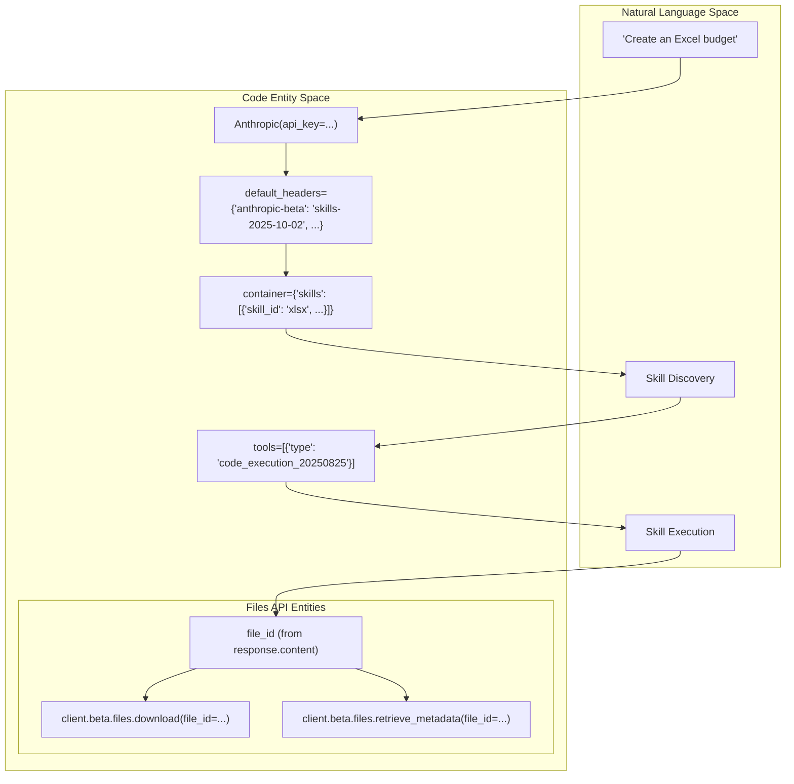
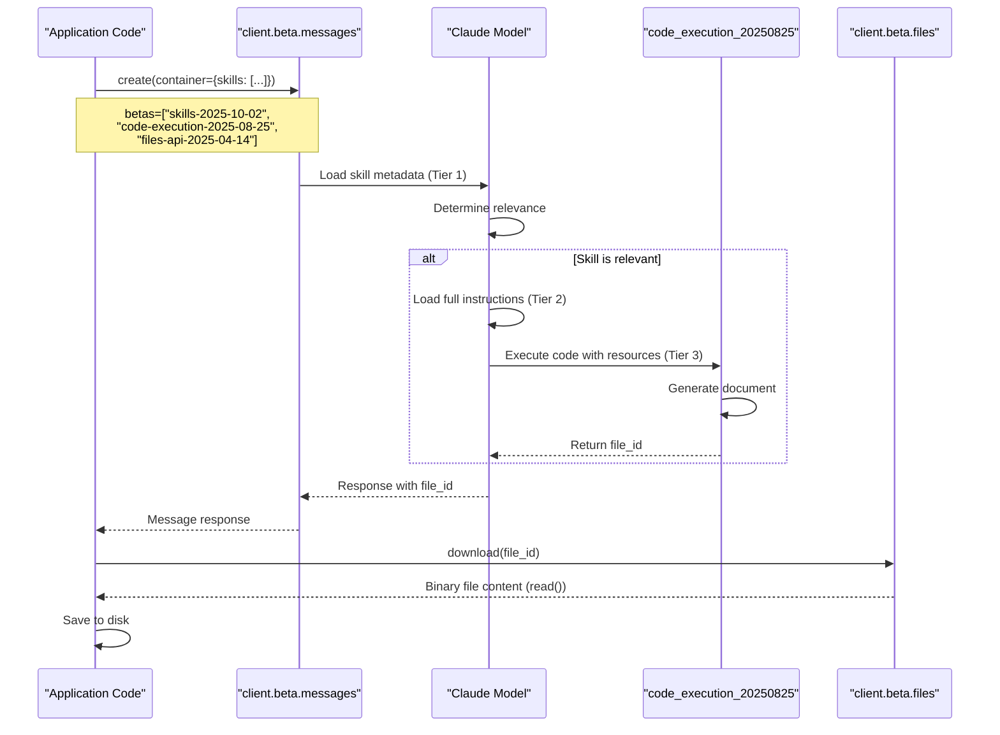
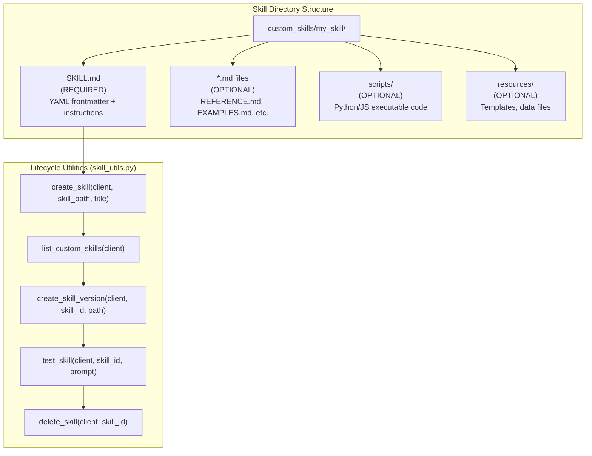

<!-- source: DeepWiki mcp.deepwiki.com · repo anthropics/claude-cookbooks · page 4 Skills System · fetched 2026-10-26 -->

# Skills System

<details>
<summary>Relevant source files</summary>

The following files were used as context for generating this wiki page:

- [skills/CLAUDE.md](skills/CLAUDE.md)
- [skills/README.md](skills/README.md)
- [skills/custom_skills/analyzing-financial-statements/SKILL.md](skills/custom_skills/analyzing-financial-statements/SKILL.md)
- [skills/custom_skills/applying-brand-guidelines/SKILL.md](skills/custom_skills/applying-brand-guidelines/SKILL.md)
- [skills/custom_skills/creating-financial-models/SKILL.md](skills/custom_skills/creating-financial-models/SKILL.md)
- [skills/notebooks/01_skills_introduction.ipynb](skills/notebooks/01_skills_introduction.ipynb)
- [skills/notebooks/02_skills_financial_applications.ipynb](skills/notebooks/02_skills_financial_applications.ipynb)
- [skills/notebooks/03_skills_custom_development.ipynb](skills/notebooks/03_skills_custom_development.ipynb)
- [skills/skill_utils.py](skills/skill_utils.py)

</details>


The Skills System enables Claude to generate professional documents (Excel, PowerPoint, PDF, Word) and execute specialized workflows through organized packages of instructions, executable code, and resources. This system uses a progressive disclosure architecture to minimize token usage while providing deep domain expertise on-demand.

For information about the general Tool Use framework, see [Tool Use Framework](#6). This page focuses specifically on the Skills API for document generation and custom capability packages.

---

## System Architecture

The Skills System operates through a three-tier progressive disclosure model where Claude loads skill components incrementally based on relevance.

### Bridging Natural Language to Code Entities

The following diagram maps the high-level Skills concepts to the specific code entities and API parameters used in the implementation.



**Sources:** [skills/README.md:136-154](), [skills/README.md:168-207](), [skills/CLAUDE.md:59-77]()

---

## API Usage Pattern

Skills require the Messages API with specific beta headers and the `code_execution` tool.



### Minimum API Call Structure

Developers must use the `client.beta` namespace and include the `code_execution_20250825` tool to enable skill execution.

```python
from anthropic import Anthropic

client = Anthropic(
    api_key="your-api-key"
)

response = client.beta.messages.create(
    model="claude-sonnet-4-6",
    max_tokens=4096,
    betas=["code-execution-2025-08-25", "files-api-2025-04-14", "skills-2025-10-02"],
    container={
        "skills": [
            {"type": "anthropic", "skill_id": "xlsx", "version": "latest"}
        ]
    },
    tools=[{"type": "code_execution_20250825", "name": "code_execution"}],
    messages=[{"role": "user", "content": "Create an Excel budget spreadsheet"}]
)
```

**Sources:** [skills/README.md:168-187](), [skills/CLAUDE.md:87-112]()

---

## Core Concepts and Progressive Disclosure

Skills use a three-tier loading model to optimize token usage and cost. For a deep dive into the architecture, see [Core Concepts and Progressive Disclosure](#4.1).

| Tier | Content | Token Cost | When Loaded |
|------|---------|------------|-------------|
| **1. Metadata** | `name` + `description` | Minimal (~100 tokens) | Always visible to Claude |
| **2. Instructions** | Full `SKILL.md` content | <5,000 tokens recommended | When skill is relevant to the prompt |
| **3. Resources** | `scripts/`, `resources/` | Variable | During `code_execution` |

The progressive disclosure architecture means you only pay token costs for skills when they're actually used. Multiple skills can be included in the `container` parameter with minimal overhead.

**Sources:** [skills/README.md:18-20](), [skills/notebooks/01_skills_introduction.ipynb:186-211](), [skills/notebooks/03_skills_custom_development.ipynb:130-132]()

---

## Using Built-in Skills

Anthropic provides four managed skills for document generation. For detailed usage, see [Using Built-in Skills](#4.2).

| `skill_id` | Format | Capabilities |
|------------|--------|--------------|
| `xlsx` | Excel | Workbooks, formulas, charts, pivot tables |
| `pptx` | PowerPoint | Professional presentations, slide layouts |
| `pdf` | PDF | Formatted reports, tables, layout control |
| `docx` | Word | Document creation, rich text formatting |

### File Download Workflow

Skills generate files in Claude's execution environment. The `client.beta.files` API is required to retrieve them.

```python
# Helper from file_utils.py
from file_utils import extract_file_ids, download_all_files

# Extract file IDs from response
file_ids = extract_file_ids(response)

# Download all files
results = download_all_files(client, response, output_dir="./outputs")
```

**Sources:** [skills/README.md:156-207](), [skills/file_utils.py:18-87](), [skills/CLAUDE.md:66-77]()

---

## Creating Custom Skills

Custom skills package organizational knowledge into reusable components. For a guide on building your own, see [Creating Custom Skills](#4.3).

### Custom Skill Directory Structure

A custom skill is defined by a directory containing specific files that the API uploads and Claude consumes.



**Sources:** [skills/notebooks/03_skills_custom_development.ipynb:128-154](), [skills/skill_utils.py:19-218]()

---

## Financial Applications Example

The cookbook provides a robust example of a financial reporting pipeline. This workflow demonstrates how multiple skills (Excel, PowerPoint, PDF) can be chained to transform raw data into a full suite of business documents. For a full walkthrough, see [Financial Applications Example](#4.4).

**Key Workflows:**
- **CSV → Excel**: Generating financial models with formulas and charts.
- **Excel → PowerPoint**: Creating executive summaries from analyzed data.
- **Data → PDF**: Producing static investment reports and portfolio analytics.

**Sources:** [skills/README.md:37-45](), [skills/notebooks/02_skills_financial_applications.ipynb:6-22]()

---

