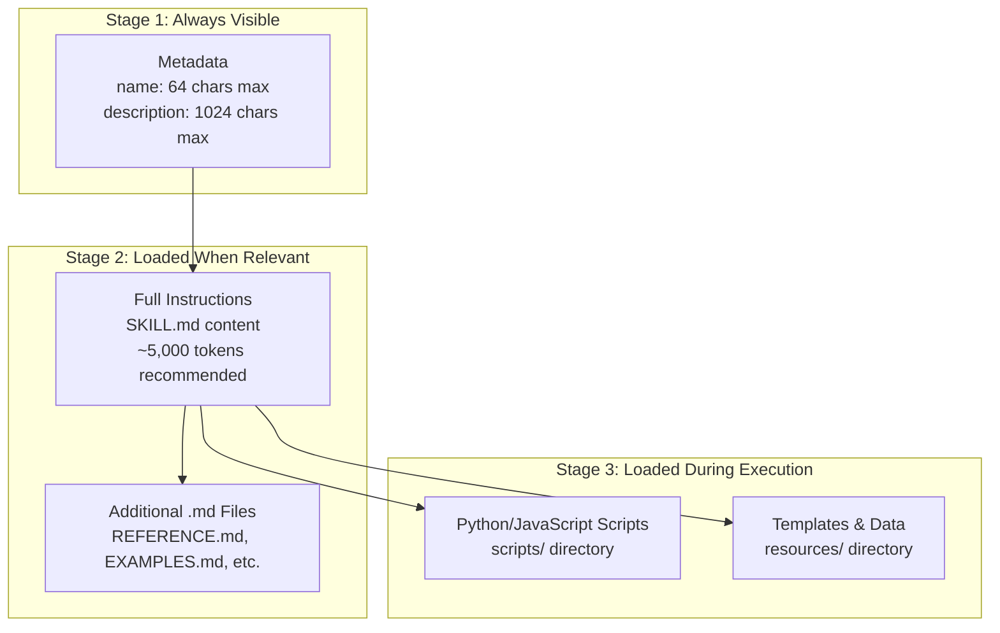
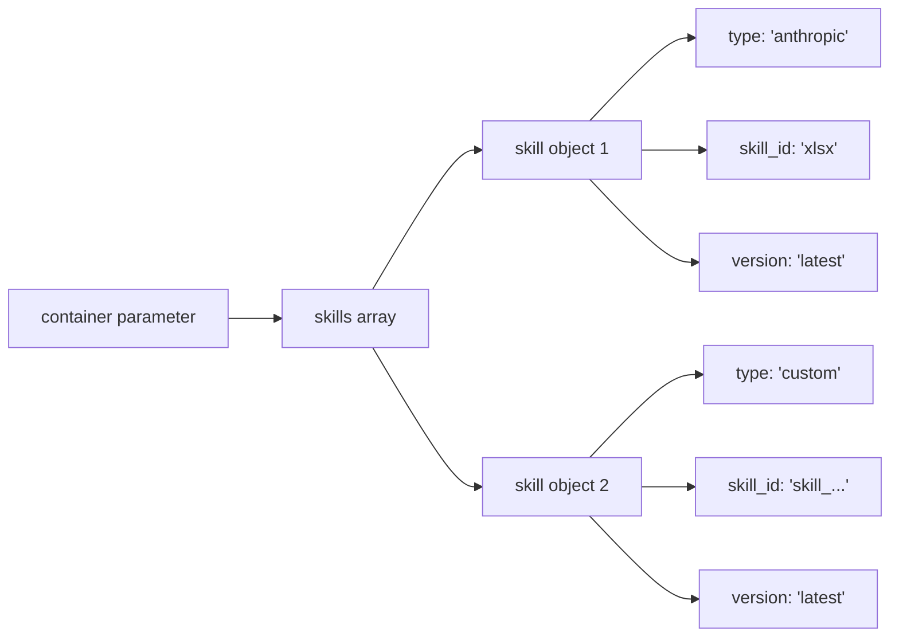
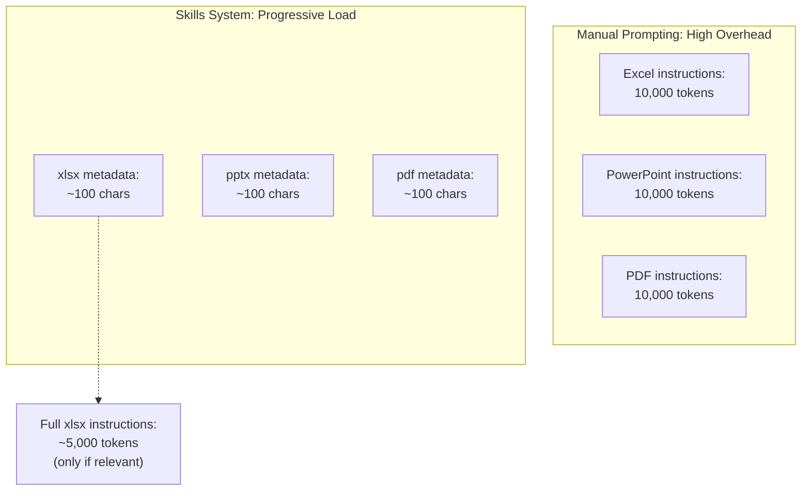
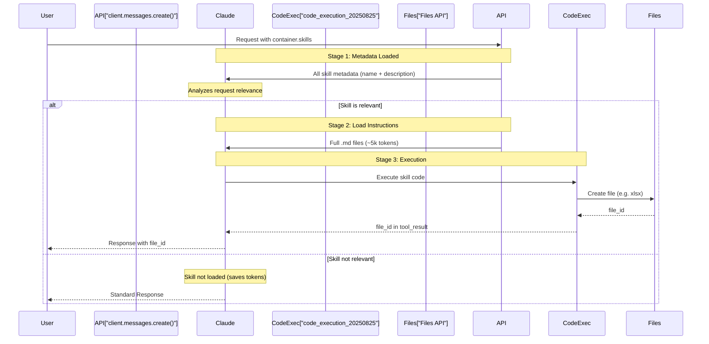

<!-- source: DeepWiki mcp.deepwiki.com · repo anthropics/claude-cookbooks · page 4.1 Core Concepts and Progressive Disclosure · fetched 2026-10-26 -->

# Core Concepts and Progressive Disclosure

<details>
<summary>Relevant source files</summary>

The following files were used as context for generating this wiki page:

- [skills/README.md](skills/README.md)
- [skills/assets/not-just-markdown.png](skills/assets/not-just-markdown.png)
- [skills/assets/prog-disc-1.png](skills/assets/prog-disc-1.png)
- [skills/assets/prog-disc-2.png](skills/assets/prog-disc-2.png)
- [skills/assets/skills-bundled-files.png](skills/assets/skills-bundled-files.png)
- [skills/assets/skills-conceptual-diagram.png](skills/assets/skills-conceptual-diagram.png)
- [skills/notebooks/01_skills_introduction.ipynb](skills/notebooks/01_skills_introduction.ipynb)
- [skills/notebooks/02_skills_financial_applications.ipynb](skills/notebooks/02_skills_financial_applications.ipynb)
- [skills/notebooks/03_skills_custom_development.ipynb](skills/notebooks/03_skills_custom_development.ipynb)
- [skills/skill_utils.py](skills/skill_utils.py)

</details>


## Purpose and Scope

This page explains the fundamental architecture of Claude's Skills system, focusing on the **progressive disclosure mechanism** that enables efficient, on-demand loading of specialized capabilities. It covers how Skills are structured, discovered, and loaded during API requests, and how this architecture minimizes token usage while maximizing Claude's effectiveness.

For practical guides on using specific built-in skills, see [4.2 Using Built-in Skills](). For creating your own skills, see [4.3 Creating Custom Skills](). For a complete example workflow, see [4.4 Financial Applications Example]().

---

## What are Skills?

Skills are **structured capability packages** that give Claude specialized expertise for specific domains or tasks [skills/README.md:7-16](). Unlike tools (which execute functions) or prompts (which provide instructions), Skills bundle three types of content together:

| Component | Purpose | Example |
|-----------|---------|---------|
| **Instructions** | Guide Claude on how to use the skill | Financial ratio calculation methodology |
| **Code** | Executable scripts for complex operations | Python DCF valuation model |
| **Resources** | Templates, data, reference materials | Excel templates, industry benchmarks |

Skills exist in two forms:

1. **Anthropic-managed skills** (`type: "anthropic"`) - Pre-built capabilities like `xlsx`, `pptx`, `pdf`, `docx` [skills/README.md:178-180]().
2. **Custom skills** (`type: "custom"`) - User-created expertise packages for organization-specific workflows [skills/notebooks/03_skills_custom_development.ipynb:34-42]().

Skills are referenced in API requests via the `container` parameter with skill identifiers like `{"type": "anthropic", "skill_id": "xlsx", "version": "latest"}` [skills/README.md:173-181]().

**Sources:** [skills/README.md:7-16](), [skills/notebooks/01_skills_introduction.ipynb:136-142](), [skills/notebooks/03_skills_custom_development.ipynb:34-42]()

---

## Progressive Disclosure Architecture

### The Three-Tier Loading Model

Progressive disclosure is the core optimization that makes Skills efficient. Instead of loading all skill content upfront, Skills expose information in three stages, each loaded only when needed [skills/README.md:20]().

Title: Progressive Disclosure Loading Stages


**Sources:** [skills/README.md:20](), [skills/notebooks/01_skills_introduction.ipynb:188-211](), [skills/notebooks/03_skills_custom_development.ipynb:129-150]()

---

### Stage 1: Metadata (Always Visible)

Claude can see the **name** and **description** of all skills in the `container.skills` array immediately, before any skill is actually loaded. This minimal overhead allows skills to be "advertised" cheaply.

The metadata comes from YAML frontmatter in `SKILL.md` [skills/notebooks/03_skills_custom_development.ipynb:158-164]():

```yaml
---
name: analyzing-financial-statements
description: This skill calculates key financial ratios and metrics from financial statement data for investment analysis
---
```

**Constraints:**
- `name`: 64 characters maximum, lowercase alphanumeric with hyphens [skills/notebooks/03_skills_custom_development.ipynb:158-164]().
- `description`: 1024 characters maximum, concise summary of capabilities [skills/notebooks/03_skills_custom_development.ipynb:158-164]().

This metadata-only visibility costs virtually no tokens but enables Claude to discover which skills are available and when they might be relevant.

**Sources:** [skills/notebooks/03_skills_custom_development.ipynb:130-132](), [skills/skill_utils.py:22-25](), [skills/notebooks/03_skills_custom_development.ipynb:158-164]()

---

### Stage 2: Instructions (Loaded When Relevant)

When Claude determines a skill is needed for the current request, it loads the **full instructions** from all `.md` files in the skill's root directory [skills/notebooks/03_skills_custom_development.ipynb:172-181]():

| File | Purpose | Required |
|------|---------|----------|
| `SKILL.md` | Primary instructions with YAML frontmatter | **Yes** [skills/notebooks/03_skills_custom_development.ipynb:138-140]() |
| `REFERENCE.md` | API reference, detailed documentation | No |
| `EXAMPLES.md` | Usage examples, patterns | No |
| Additional `.md` files | Any organizational structure | No |

All markdown files in the root directory are concatenated and available to Claude when the skill is loaded [skills/notebooks/03_skills_custom_development.ipynb:149-150](). The recommendation is to keep total instruction content under **5,000 tokens** to maintain efficiency [skills/notebooks/03_skills_custom_development.ipynb:165-168]().

**Sources:** [skills/notebooks/03_skills_custom_development.ipynb:134-150](), [skills/notebooks/03_skills_custom_development.ipynb:172-181]()

---

### Stage 3: Resources (Loaded During Execution)

The final tier consists of **executable code** and **resource files** that are loaded only when Claude actually executes skill-related code [skills/notebooks/03_skills_custom_development.ipynb:152-156]():

```
skill_name/
├── scripts/           # Python, JavaScript, or other executable code
│   └── process.py
└── resources/         # Templates, data files, or assets
    └── template.xlsx
```

These files are accessed via the `code_execution_20250825` tool when Claude runs code that references them [skills/notebooks/03_skills_custom_development.ipynb:152-156](). They are never added to the message context directly, avoiding token overhead.

**Sources:** [skills/notebooks/03_skills_custom_development.ipynb:130-132](), [skills/notebooks/03_skills_custom_development.ipynb:152-156]()

---

## Skills Container Parameter

### API Integration

Skills are specified in API requests using the `container` parameter in `client.messages.create()` [skills/README.md:174-181]():

```python
response = client.messages.create(
    model="claude-sonnet-4-6",
    max_tokens=4096,
    container={
        "skills": [
            {"type": "anthropic", "skill_id": "xlsx", "version": "latest"}
        ]
    },
    tools=[{"type": "code_execution_20250825", "name": "code_execution"}],
    messages=[{"role": "user", "content": "Create an Excel file..."}]
)
```

### Container Structure

Title: Container Parameter Structure


Each skill in the `skills` array has three required fields [skills/README.md:178-180]():

| Field | Values | Description |
|-------|--------|-------------|
| `type` | `"anthropic"` or `"custom"` | Skill source |
| `skill_id` | String (e.g., `"xlsx"`, `"skill_abc123..."`) | Unique identifier |
| `version` | String (e.g., `"latest"`, `"1"`, `"2"`) | Version to use |

**Sources:** [skills/notebooks/01_skills_introduction.ipynb:147-182](), [skills/README.md:173-181]()

---

## Code Execution Requirement

Skills **require** the `code_execution_20250825` tool to be enabled in the request [skills/README.md:182](). This is because Skills often involve generating or manipulating files, which happens through code execution.

Title: Skills Execution Dependency

```mermaid
graph TB
    REQUEST["client.messages.create()"]
    CONTAINER["container with skills"]
    TOOLS["tools array"]
    CODE_EXEC["code_execution_20250825"]
    SKILL_LOGIC["Skill Logic"]
    FILE_CREATION["File Creation"]
    
    REQUEST --> CONTAINER
    REQUEST --> TOOLS
    TOOLS --> CODE_EXEC
    CONTAINER --> SKILL_LOGIC
    CODE_EXEC --> SKILL_LOGIC
    SKILL_LOGIC --> FILE_CREATION
```


**Required beta headers:**
- `code-execution-2025-08-25` - Enables code execution for Skills [skills/README.md:151]().
- `files-api-2025-04-14` - Required for downloading generated files [skills/README.md:152]().
- `skills-2025-10-02` - Enables Skills feature [skills/README.md:153]().

**Sources:** [skills/README.md:149-154](), [skills/README.md:182]()

---

## Token Optimization Benefits

### Comparison: Traditional vs. Progressive Disclosure

Progressive disclosure dramatically reduces token usage compared to providing equivalent instructions in prompts [skills/README.md:20]():

| Approach | Initial Cost | When Used | Quality |
|----------|--------------|-----------|---------|
| **Manual Instructions** | 5,000-10,000 tokens per request | Every request | Variable |
| **Skills (Metadata)** | ~100-200 tokens (name/desc) | Always visible | Expert-level, consistent |
| **Skills (Full Load)** | ~5,000 tokens | Only when relevant | Expert-level, consistent |

### Multi-Skill Efficiency

The benefit compounds when multiple skills are available. Instead of loading 30,000 tokens of instructions for Excel, PowerPoint, and PDF upfront, Claude only loads the metadata for all three, and the full instructions for the specific skill it decides to use [skills/notebooks/01_skills_introduction.ipynb:188-211]().

Title: Token Efficiency Logic


**Sources:** [skills/notebooks/01_skills_introduction.ipynb:188-211](), [skills/README.md:20]()

---

## Skill Discovery and Loading Workflow

### Request Processing Flow

Title: Skill Lifecycle Sequence


**Sources:** [skills/README.md:159-165](), [skills/notebooks/01_skills_introduction.ipynb:147-182](), [skills/skill_utils.py:212-225]()

---

## Skill Metadata Structure

### Retrieving Skill Information via API

Skills can be discovered programmatically using the `client.beta.skills.list` and `client.beta.skills.retrieve` methods [skills/skill_utils.py:78-112]():

```python
# List all custom skills in the workspace
skills_response = client.beta.skills.list(source="custom")

for skill in skills_response.data:
    print(f"Skill ID: {skill.id}")
    print(f"Display Title: {skill.display_title}")
    print(f"Latest Version: {skill.latest_version}")
```

### Version Details

Each skill version contains metadata about the skill's structure and instructions [skills/skill_utils.py:115-149]():

```python
version_info = client.beta.skills.versions.retrieve(
    skill_id="skill_abc123",
    version="latest"
)

# version_info.name
# version_info.description
# version_info.directory (file listing)
```

**Sources:** [skills/skill_utils.py:78-149](), [skills/notebooks/01_skills_introduction.ipynb:241-283]()

---

