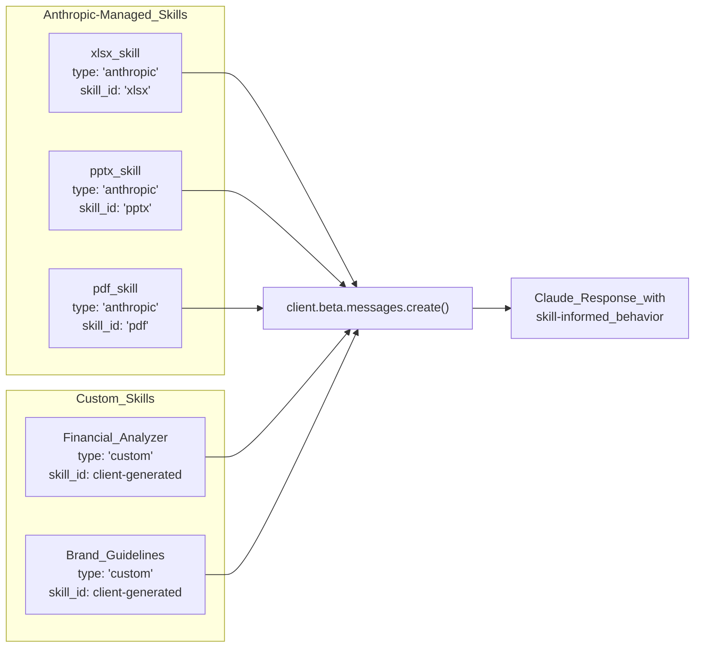
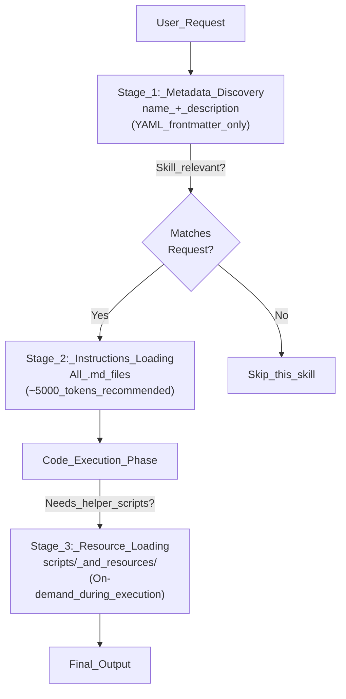
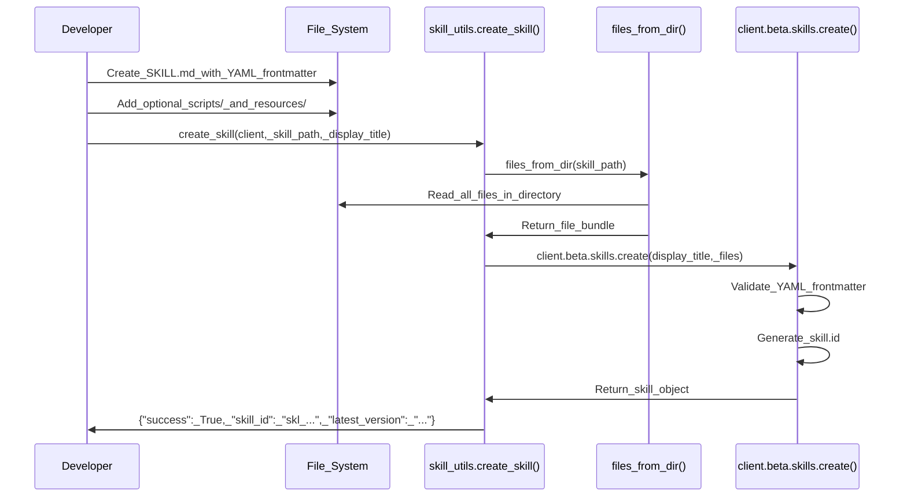
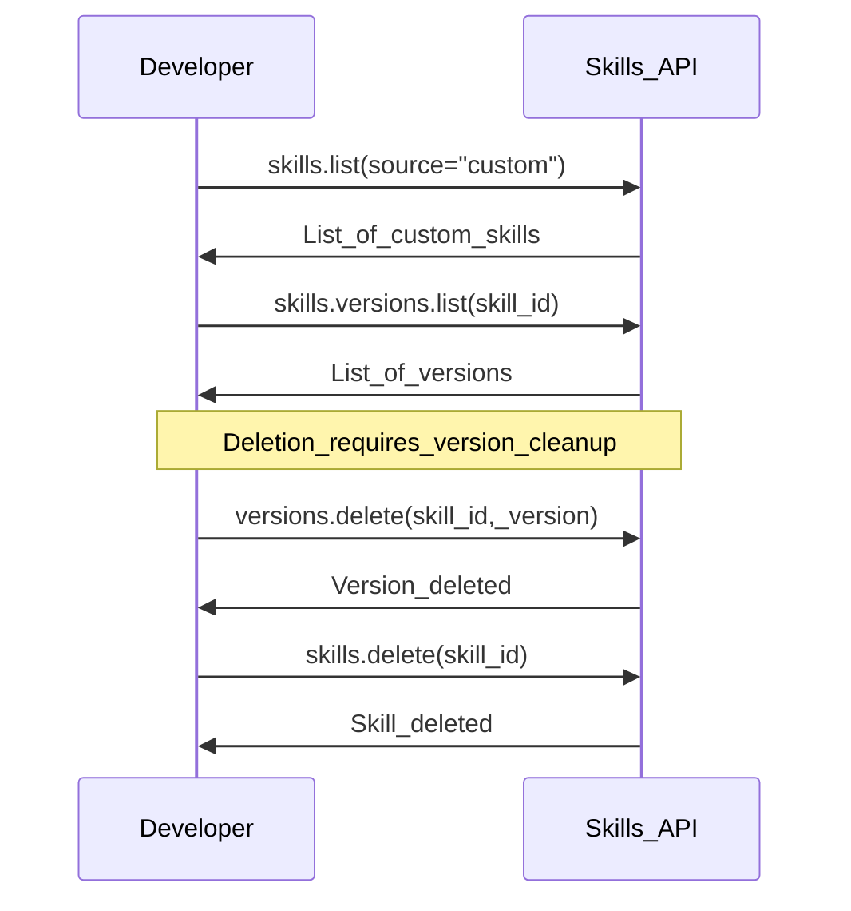

<!-- source: DeepWiki mcp.deepwiki.com · repo anthropics/claude-cookbooks · page 4.3 Creating Custom Skills · fetched 2026-10-26 -->

# Creating Custom Skills

<details>
<summary>Relevant source files</summary>

The following files were used as context for generating this wiki page:

- [skills/.claude/hooks/pre-bash.sh](skills/.claude/hooks/pre-bash.sh)
- [skills/.claude/hooks/pre-write.sh](skills/.claude/hooks/pre-write.sh)
- [skills/.claude/hooks/session-start.sh](skills/.claude/hooks/session-start.sh)
- [skills/.claude/settings.json](skills/.claude/settings.json)
- [skills/.env.example](skills/.env.example)
- [skills/.gitignore](skills/.gitignore)
- [skills/CLAUDE.md](skills/CLAUDE.md)
- [skills/README.md](skills/README.md)
- [skills/custom_skills/analyzing-financial-statements/SKILL.md](skills/custom_skills/analyzing-financial-statements/SKILL.md)
- [skills/custom_skills/applying-brand-guidelines/SKILL.md](skills/custom_skills/applying-brand-guidelines/SKILL.md)
- [skills/custom_skills/creating-financial-models/SKILL.md](skills/custom_skills/creating-financial-models/SKILL.md)
- [skills/file_utils.py](skills/file_utils.py)
- [skills/notebooks/01_skills_introduction.ipynb](skills/notebooks/01_skills_introduction.ipynb)
- [skills/notebooks/02_skills_financial_applications.ipynb](skills/notebooks/02_skills_financial_applications.ipynb)
- [skills/notebooks/03_skills_custom_development.ipynb](skills/notebooks/03_skills_custom_development.ipynb)
- [skills/requirements.txt](skills/requirements.txt)
- [skills/skill_utils.py](skills/skill_utils.py)

</details>


## Purpose and Scope

This document covers how to build, deploy, and manage custom skills that extend Claude's capabilities with organization-specific knowledge and workflows. Custom skills allow you to package instructions, executable code, and resources into reusable expertise modules that Claude can load on-demand.

For information about using Anthropic's pre-built skills (Excel, PowerPoint, PDF), see [4.2 Using Built-in Skills](). For the conceptual foundation of the Skills system, see [4.1 Core Concepts and Progressive Disclosure]().

## Custom Skills Architecture

Custom skills differ from Anthropic-managed skills in that you control the entire skill definition, including instructions, scripts, and resources. They follow the same progressive disclosure architecture but are hosted in your workspace. [skills/notebooks/03_skills_custom_development.ipynb:34-51]()

### Skill Structure

Every custom skill consists of a directory containing a required `SKILL.md` file and optional supporting files:

```
skill_name/
├── SKILL.md           # REQUIRED: Instructions with YAML frontmatter
├── *.md               # Optional: Additional markdown documentation
├── scripts/           # Optional: Executable Python/JavaScript code
│   ├── process.py
│   └── utils.js
└── resources/         # Optional: Templates, data files
    └── template.xlsx
```

**Key Point**: `SKILL.md` is the only required file. All other files are optional and loaded only when needed during skill execution. Multiple `.md` files are allowed and all are available to Claude when the skill is loaded. [skills/notebooks/03_skills_custom_development.ipynb:130-142]()

Sources: [skills/README.md:112-132](), [skills/notebooks/03_skills_custom_development.ipynb:130-142]()

### Skill Type Comparison

Title: Skill Type Comparison


Sources: [skills/notebooks/03_skills_custom_development.ipynb:35-51](), [skills/README.md:173-181]()

## SKILL.md Structure and Requirements

The `SKILL.md` file must contain YAML frontmatter followed by markdown instructions. [skills/notebooks/03_skills_custom_development.ipynb:144-146]()

### YAML Frontmatter Requirements

```yaml
---
name: skill-name-here
description: Brief description of what the skill does (up to 1024 characters)
---
```

**Constraints:**
- `name`: Lowercase alphanumeric with hyphens only, max 64 characters. [skills/notebooks/03_skills_custom_development.ipynb:144-146]()
- `description`: Plain text, max 1024 characters. [skills/notebooks/03_skills_custom_development.ipynb:144-146]()
- Both fields are required for Stage 1 metadata discovery.

Sources: [skills/notebooks/03_skills_custom_development.ipynb:130-146](), [skills/custom_skills/analyzing-financial-statements/SKILL.md:1-4]()

### Markdown Instructions

Following the frontmatter, provide clear instructions in markdown format. It is recommended to keep total instructions under 5,000 tokens for optimal performance. [skills/notebooks/03_skills_custom_development.ipynb:144-146]()

Example structure from [skills/custom_skills/analyzing-financial-statements/SKILL.md:6-69]():
- **Capabilities**: List what the skill can calculate or perform.
- **How to Use**: Input data requirements and selection steps.
- **Scripts**: Reference to bundled helper scripts (e.g., `calculate_ratios.py`).
- **Best Practices & Limitations**: Constraints for Claude to follow.

Sources: [skills/notebooks/03_skills_custom_development.ipynb:130-146](), [skills/custom_skills/analyzing-financial-statements/SKILL.md:6-69]()

### Multiple Documentation Files

You can include multiple `.md` files for better organization. All markdown files in the root directory (e.g., `REFERENCE.md`, `EXAMPLES.md`) are loaded together during Stage 2 of progressive disclosure. [skills/notebooks/03_skills_custom_development.ipynb:154-162]()

Sources: [skills/notebooks/03_skills_custom_development.ipynb:130-162]()

## Skill Directory Organization

### Complete Skill Examples

The repository demonstrates several custom skill patterns:

1.  **Financial Ratio Analyzer**: Focuses on calculation and interpretation scripts. [skills/custom_skills/analyzing-financial-statements/SKILL.md:53-54]()
2.  **Corporate Brand Guidelines**: Focuses on visual standards and styling rules. [skills/custom_skills/applying-brand-guidelines/SKILL.md:16-41]()
3.  **Financial Modeling Suite**: Advanced toolkit for DCF and Monte Carlo simulations. [skills/custom_skills/creating-financial-models/SKILL.md:12-35]()

Sources: [skills/custom_skills/analyzing-financial-statements/SKILL.md:1-69](), [skills/custom_skills/applying-brand-guidelines/SKILL.md:1-171](), [skills/custom_skills/creating-financial-models/SKILL.md:1-173]()

### Progressive Disclosure Loading Stages

Title: Progressive Disclosure Loading Stages


Sources: [skills/README.md:20](), [skills/notebooks/03_skills_custom_development.ipynb:130-132]()

## Creating and Uploading Skills

### API Workflow for Skill Creation

Title: Skill Upload Sequence with Code Entities


Sources: [skills/skill_utils.py:19-76](), [skills/notebooks/03_skills_custom_development.ipynb:148-176]()

### Code: Creating a Skill

The `create_skill()` helper function in [skills/skill_utils.py:19-76]() wraps the API workflow:

```python
from anthropic import Anthropic
from anthropic.lib import files_from_dir
from skill_utils import create_skill

client = Anthropic(
    api_key=API_KEY,
    default_headers={"anthropic-beta": "skills-2025-10-02"}
)

# Using the helper function
result = create_skill(
    client, 
    "custom_skills/analyzing-financial-statements", 
    "Financial Ratio Analyzer"
)
```

**Implementation Details:**
- `files_from_dir()` recursively bundles all files in the skill directory. [skills/skill_utils.py:62]()
- `create_skill()` validates directory existence and `SKILL.md` presence before upload. [skills/skill_utils.py:52-58]()
- Beta header `"skills-2025-10-02"` is required. [skills/skill_utils.py:45]()

Sources: [skills/skill_utils.py:19-76](), [skills/notebooks/03_skills_custom_development.ipynb:114]()

## Using Custom Skills in Messages

### Container Parameter Structure

Custom skills are loaded via the `container` parameter in `client.beta.messages.create()`. [skills/README.md:173-181]()

```python
response = client.beta.messages.create(
    model="claude-sonnet-4-6",
    max_tokens=4096,
    container={
        "skills": [
            {
                "type": "custom",
                "skill_id": "skl_01ABC123...",
                "version": "latest"
            }
        ]
    },
    tools=[{"type": "code_execution_20250825", "name": "code_execution"}],
    messages=[{"role": "user", "content": "Calculate financial ratios..."}]
)
```

**Required Parameters:**
- `container.skills[].type`: Must be `"custom"` for user-created skills. [skills/skill_utils.py:94]()
- `tools`: Must include `code_execution_20250825`. [skills/README.md:182]()
- `betas`: Required headers include `code-execution-2025-08-25`, `files-api-2025-04-14`, and `skills-2025-10-02`. [skills/README.md:149-154]()

Sources: [skills/README.md:136-187](), [skills/notebooks/03_skills_custom_development.ipynb:114]()

## Versioning and Lifecycle Management

### Managing Skill Versions

Skills support multiple versions, typically identified by epoch timestamps or version strings. [skills/skill_utils.py:115-177]()

| Task | Helper Function | API Method |
|------|-----------------|------------|
| Create New Version | `create_skill_version()` | `client.beta.skills.versions.create()` |
| Retrieve Version | `get_skill_version()` | `client.beta.skills.versions.retrieve()` |
| Delete Version | Part of `delete_skill()` | `client.beta.skills.versions.delete()` |

Sources: [skills/skill_utils.py:115-177](), [skills/skill_utils.py:196-200]()

### Deletion Workflow

All versions must be deleted before a skill can be removed from the workspace. [skills/skill_utils.py:183]() The `delete_skill()` helper automates this process. [skills/skill_utils.py:194-205]()

Title: Skill Deletion Workflow


Sources: [skills/skill_utils.py:179-210](), [skills/notebooks/03_skills_custom_development.ipynb:98-99]()

## Skill Management Operations

### Utility Function Mapping

The `skill_utils.py` module provides a high-level interface for managing custom skills.

| Function | Purpose | Source |
|----------|---------|--------|
| `create_skill` | Uploads directory and creates skill. | [skills/skill_utils.py:19-73]() |
| `list_custom_skills` | Returns all custom skills in workspace. | [skills/skill_utils.py:78-108]() |
| `get_skill_version` | Fetches metadata for a specific version. | [skills/skill_utils.py:115-148]() |
| `create_skill_version` | Updates an existing skill with new files. | [skills/skill_utils.py:151-176]() |
| `delete_skill` | Removes all versions and the skill itself. | [skills/skill_utils.py:179-209]() |
| `test_skill` | Executes a prompt against a specific skill. | [skills/skill_utils.py:212-258]() |

Sources: [skills/skill_utils.py:1-258]()

## Best Practices

- **Token Optimization**: Keep `SKILL.md` focused and under 5,000 tokens. Move detailed logic to scripts that load on-demand. [skills/notebooks/03_skills_custom_development.ipynb:144-146]()
- **Modularity**: Use multiple focused skills (e.g., Brand Guidelines + Excel Generator) instead of one monolithic skill. [skills/notebooks/03_skills_custom_development.ipynb:49-50]()
- **Validation**: Use `files_from_dir()` to ensure all supporting scripts and resources are bundled correctly. [skills/skill_utils.py:62]()
- **Versioning**: Pin production workloads to specific version IDs rather than using `"latest"` to ensure consistency. [skills/skill_utils.py:124]()

Sources: [skills/skill_utils.py:19-258](), [skills/notebooks/03_skills_custom_development.ipynb:130-142]()

---

