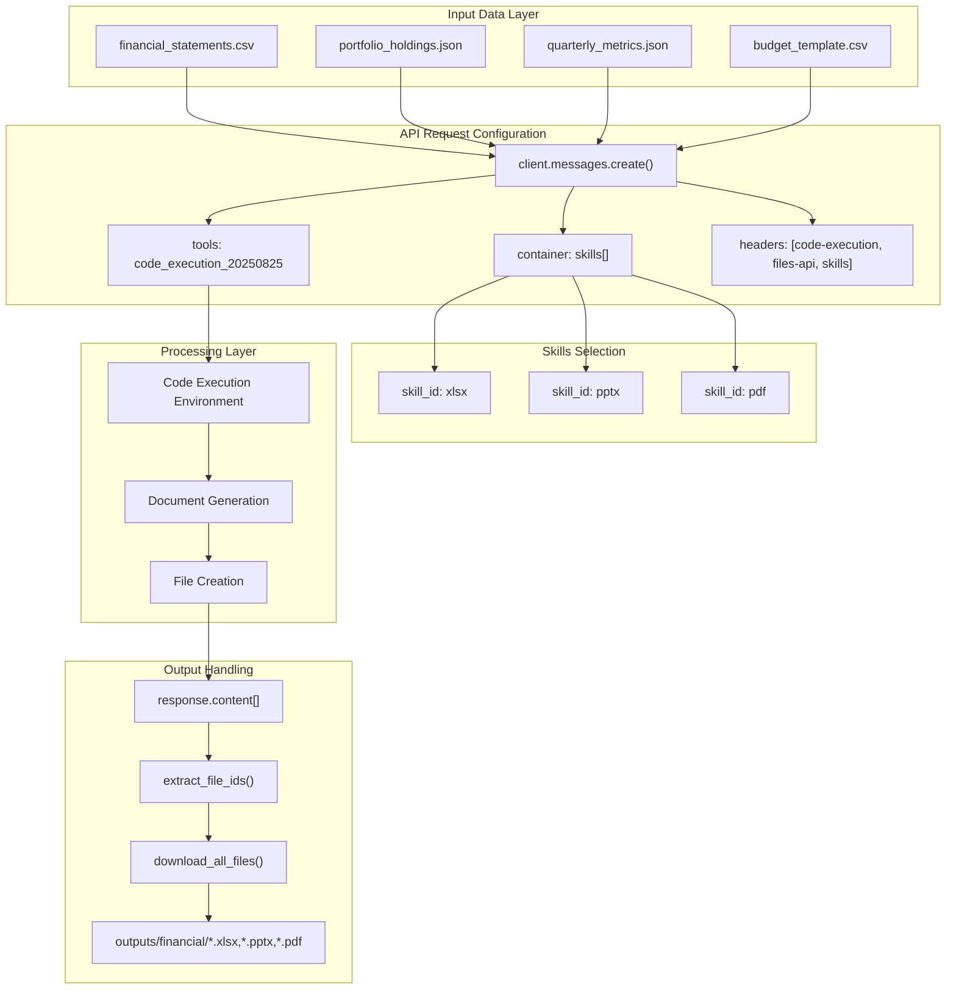
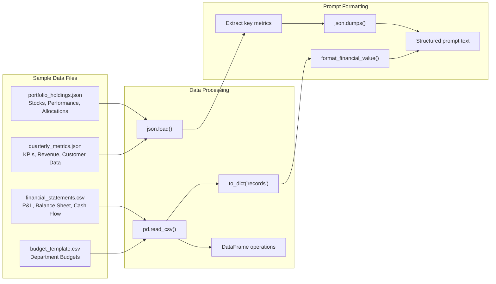
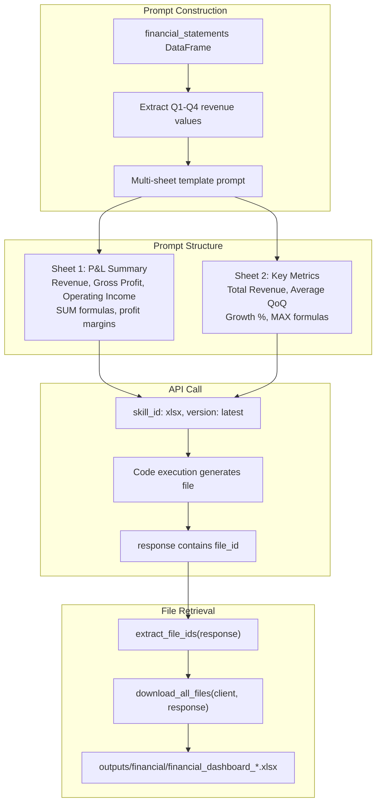
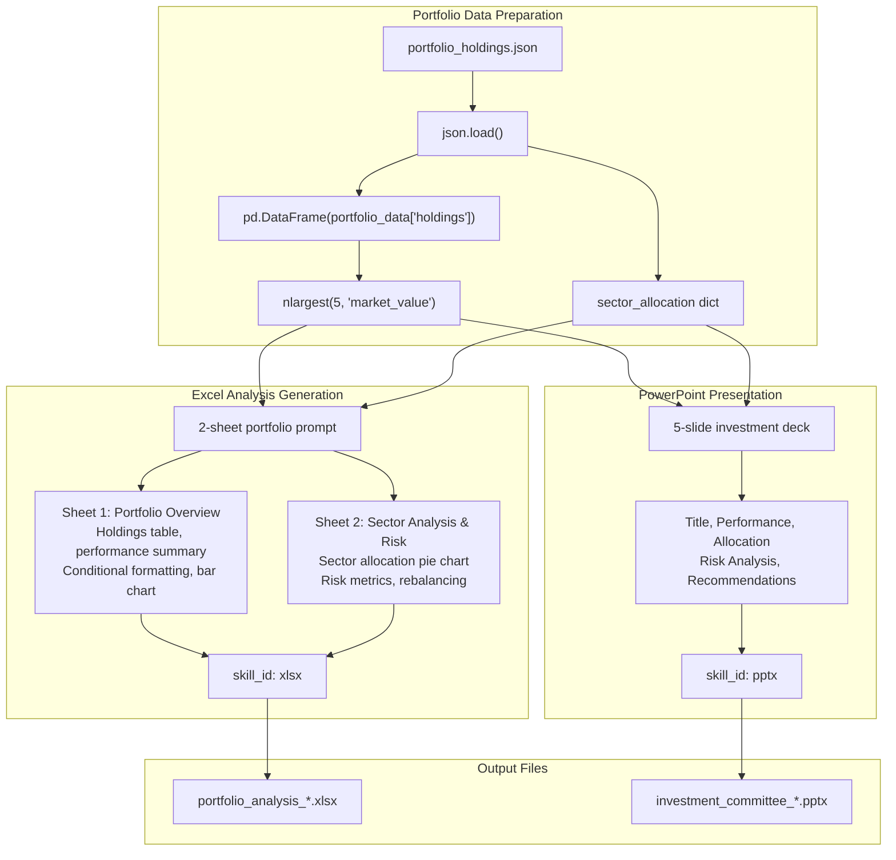
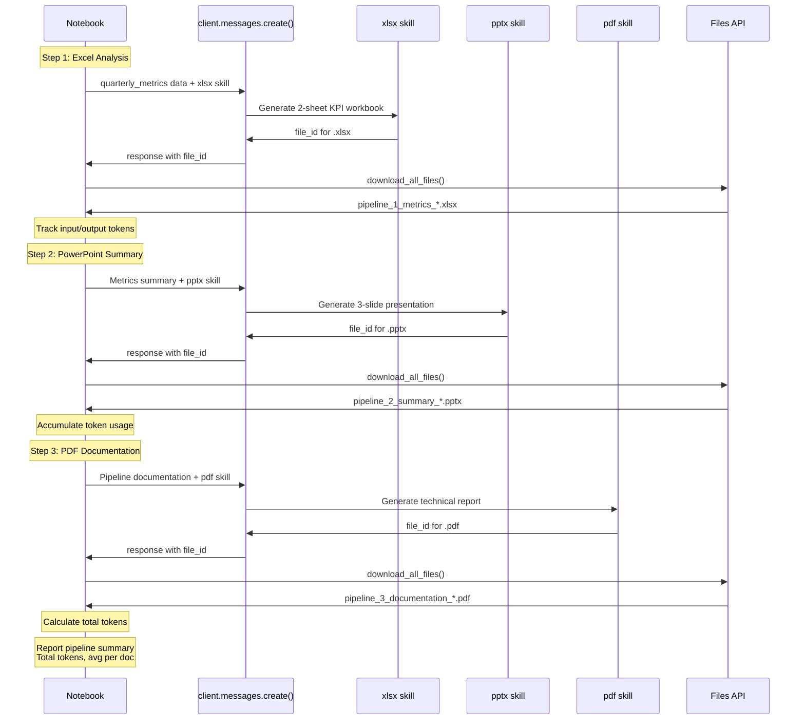

<!-- source: DeepWiki mcp.deepwiki.com · repo anthropics/claude-cookbooks · page 4.4 Financial Applications Example · fetched 2026-10-26 -->

# Financial Applications Example

<details>
<summary>Relevant source files</summary>

The following files were used as context for generating this wiki page:

- [skills/README.md](skills/README.md)
- [skills/notebooks/01_skills_introduction.ipynb](skills/notebooks/01_skills_introduction.ipynb)
- [skills/notebooks/02_skills_financial_applications.ipynb](skills/notebooks/02_skills_financial_applications.ipynb)
- [skills/notebooks/03_skills_custom_development.ipynb](skills/notebooks/03_skills_custom_development.ipynb)
- [skills/sample_data/quarterly_metrics.json](skills/sample_data/quarterly_metrics.json)
- [skills/skill_utils.py](skills/skill_utils.py)

</details>


## Purpose and Scope

This document explains the financial applications cookbook, which demonstrates real-world business automation using Claude's Skills feature to generate Excel spreadsheets, PowerPoint presentations, and PDF documents from financial data. The examples show how to build production-ready reporting pipelines that combine data analysis, visualization, and professional document generation.

For basic Skills API usage and setup, see [Using Built-in Skills](#4.2). For creating your own financial analysis skills, see [Creating Custom Skills](#4.3).

**Sources:** [skills/notebooks/02_skills_financial_applications.ipynb:1-23](), [skills/README.md:37-44]()

## Overview

The financial applications notebook provides three comprehensive use cases:

| Use Case | Documents Generated | Key Features |
|----------|-------------------|--------------|
| **Financial Dashboard** | Excel, PowerPoint, PDF | P&L statements, KPI dashboards, executive summaries |
| **Portfolio Analysis** | Excel, PowerPoint | Holdings analysis, sector allocation, risk metrics |
| **Automated Pipeline** | Excel → PowerPoint → PDF | Chained document generation, token optimization |

All examples use the `claude-sonnet-4-6` model with the Skills beta API and demonstrate token-efficient patterns for financial reporting automation.

**Sources:** [skills/notebooks/02_skills_financial_applications.ipynb:4-23](), [skills/README.md:38-44](), [skills/notebooks/02_skills_financial_applications.ipynb:85-85]()

## Architecture Overview



**Financial Applications Architecture**

This diagram shows how financial data flows through the Skills API to produce professional documents. The `client.messages.create()` call configures skills via the `container` parameter, requires `code_execution_20250825` tool, and uses three beta features. The `extract_file_ids()` and `download_all_files()` utilities handle file retrieval.

**Sources:** [skills/notebooks/02_skills_financial_applications.ipynb:54-102](), [skills/notebooks/02_skills_financial_applications.ipynb:194-246](), [skills/README.md:168-187]()

## API Configuration Pattern

The financial applications use a consistent API configuration pattern with Skills beta features:

```python
# From file_utils and client initialization
response = client.messages.create(
    model="claude-sonnet-4-6",
    max_tokens=4096,
    container={
        "skills": [
            {"type": "anthropic", "skill_id": "xlsx", "version": "latest"}
        ]
    },
    tools=[{"type": "code_execution_20250825", "name": "code_execution"}],
    messages=[{"role": "user", "content": prompt}],
    default_headers={
        "anthropic-beta": "code-execution-2025-08-25,files-api-2025-04-14,skills-2025-10-02"
    }
)
```

### Required Beta Headers

| Beta Feature | Purpose | Required For |
|-------------|---------|--------------|
| `code-execution-2025-08-25` | Enables code execution for Skills | All Skills operations |
| `files-api-2025-04-14` | Required for downloading generated files | Retrieving generated documents |
| `skills-2025-10-02` | Enables Skills feature | Loading xlsx, pptx, pdf skills |

The `create_skills_message()` helper function at [skills/notebooks/02_skills_financial_applications.ipynb:199-234]() encapsulates this pattern for reuse across all use cases.

**Sources:** [skills/notebooks/02_skills_financial_applications.ipynb:199-234](), [skills/README.md:136-154]()

## Data Loading and Preparation



**Data Loading and Preparation Pipeline**

The notebook loads financial data using `pandas` for CSV files and `json` for structured data. The `format_financial_value()` utility function at [skills/notebooks/02_skills_financial_applications.ipynb:237-243]() standardizes currency and numeric formatting for prompts.

### Data Structures

The notebook uses three primary data sources:

1. **financial_statements.csv** - Quarterly P&L, balance sheet, and cash flow data with columns `Q1_2024`, `Q2_2024`, `Q3_2024`, `Q4_2024` [skills/notebooks/02_skills_financial_applications.ipynb:119-125]()
2. **portfolio_holdings.json** - Investment portfolio with `holdings[]`, `performance_metrics`, and `cash_position` [skills/notebooks/02_skills_financial_applications.ipynb:138-148]()
3. **quarterly_metrics.json** - KPIs including `revenue`, `gross_margin`, `customer_count`, `churn_rate` [skills/sample_data/quarterly_metrics.json:1-73]()

Data extraction examples at [skills/notebooks/02_skills_financial_applications.ipynb:119-182]() show how to convert DataFrames and JSON to prompt-ready formats.

**Sources:** [skills/notebooks/02_skills_financial_applications.ipynb:54-102](), [skills/notebooks/02_skills_financial_applications.ipynb:119-182](), [skills/notebooks/02_skills_financial_applications.ipynb:237-246]()

## Use Case 1: Financial Dashboard Creation

### Excel Financial Model



**Excel Financial Dashboard Generation Flow**

The financial dashboard creation at [skills/notebooks/02_skills_financial_applications.ipynb:268-337]() demonstrates a 2-sheet Excel workbook pattern optimized for Skills API performance. The prompt specifies explicit cell formulas (SUM, AVERAGE, percentage calculations) and formatting requirements.

### Generation Parameters

| Parameter | Value | Purpose |
|-----------|-------|---------|
| Sheets | 2 | Optimal for ~1-2 minute generation time |
| Formulas | SUM, AVERAGE, MAX | Dynamic calculations in Excel |
| Charts | Bar chart for revenue | Visual quarterly comparison |
| Formatting | Currency, bold headers, borders | Professional appearance |

The `revenue_by_quarter` dictionary at [skills/notebooks/02_skills_financial_applications.ipynb:283-296]() extracts specific DataFrame values for inclusion in the prompt, enabling precise control over generated content.

**Sources:** [skills/notebooks/02_skills_financial_applications.ipynb:268-337](), [skills/README.md:343-354]()

### Executive PowerPoint Presentation

The PowerPoint generation at [skills/notebooks/02_skills_financial_applications.ipynb:380-460]() creates a 4-slide executive presentation using the `pptx` skill. The prompt structure includes:

1. **Title Slide** - Company name, report period, date
2. **Financial Highlights** - Two-column layout with metrics and revenue chart
3. **Profitability Trends** - Line chart showing net margin progression Q1-Q4
4. **Key Takeaways** - Bullet points with checkmarks, strong numbers highlighted

The calculation of YoY metrics at [skills/notebooks/02_skills_financial_applications.ipynb:388-395]() demonstrates preprocessing financial data for presentation context rather than embedding raw calculations in prompts.

**Sources:** [skills/notebooks/02_skills_financial_applications.ipynb:380-460]()

## Use Case 2: Portfolio Analysis Workflow



**Portfolio Analysis Workflow**

The portfolio analysis workflow demonstrates a two-stage document generation pattern. First, create analytical Excel workbooks with detailed holdings and risk metrics at [skills/notebooks/02_skills_financial_applications.ipynb:489-557](). Then generate executive-level PowerPoint presentations that distill key insights at [skills/notebooks/02_skills_financial_applications.ipynb:576-651]().

### Portfolio Data Structure

The `portfolio_holdings.json` structure includes:

- `portfolio_name` - Portfolio identifier
- `total_value` - Aggregate market value
- `holdings[]` - Array with `ticker`, `name`, `shares`, `current_price`, `market_value`, `unrealized_gain`, `allocation_percent`
- `performance_metrics` - `total_return_percent`, `year_to_date_return`, `sharpe_ratio`, `beta`, `standard_deviation`

Data extraction at [skills/notebooks/02_skills_financial_applications.ipynb:138-154]() converts the holdings array to a DataFrame for easier manipulation and sorting operations like `nlargest(5, 'market_value')` at [skills/notebooks/02_skills_financial_applications.ipynb:153]().

### Portfolio Excel Generation

The portfolio Excel prompt at [skills/notebooks/02_skills_financial_applications.ipynb:502-542]() uses DataFrame `.to_string()` conversion to embed tabular data directly in the prompt. This technique ensures Claude sees exact column names and data structure, improving accuracy of generated formulas and formatting.

Key features:
- **Conditional formatting** for gains/losses (green/red cells)
- **Sector pie chart** generated from `sector_allocation` data
- **Risk metrics section** with portfolio beta, standard deviation, VaR
- **Rebalancing recommendations** based on target allocations

**Sources:** [skills/notebooks/02_skills_financial_applications.ipynb:489-651](), [skills/notebooks/02_skills_financial_applications.ipynb:138-154]()

## Use Case 3: Automated Reporting Pipeline

The automated pipeline at [skills/notebooks/02_skills_financial_applications.ipynb:678-860]() demonstrates sequential document generation with token usage tracking across multiple skill invocations.



**Automated Reporting Pipeline Sequence**

### Pipeline Implementation

The pipeline uses three distinct API calls, each with a different skill:

1. **Excel Analysis** ([skills/notebooks/02_skills_financial_applications.ipynb:695-740]()) - 2-sheet quarterly metrics workbook with KPIs and YoY comparison
2. **PowerPoint Summary** ([skills/notebooks/02_skills_financial_applications.ipynb:742-784]()) - 3-slide presentation highlighting key trends
3. **PDF Documentation** ([skills/notebooks/02_skills_financial_applications.ipynb:786-839]()) - Technical report documenting pipeline automation

Each step:
- Calls `create_skills_message()` with `show_token_usage=False` to suppress individual output
- Accumulates token counts in `pipeline_tokens` dictionary
- Downloads files with prefix pattern `pipeline_{step}_`
- Returns results for final summary

### Token Tracking Pattern

```python
# Initialize tracker
pipeline_tokens = {"input": 0, "output": 0}

# After each API call
pipeline_tokens["input"] += response.usage.input_tokens
pipeline_tokens["output"] += response.usage.output_tokens

# Final summary
total = pipeline_tokens["input"] + pipeline_tokens["output"]
average_per_doc = total // 3
```

This pattern at [skills/notebooks/02_skills_financial_applications.ipynb:689-850]() enables monitoring of cumulative API usage across a multi-document workflow, essential for cost optimization in production systems.

**Sources:** [skills/notebooks/02_skills_financial_applications.ipynb:678-860]()

## Best Practices and Performance

### Excel Generation Optimization

Based on testing documented at [skills/notebooks/02_skills_financial_applications.ipynb:343-362](), the recommended approach is:

| Approach | Generation Time | Reliability | Use When |
|----------|----------------|-------------|----------|
| **2-3 sheets** | 1-2 minutes | High | Standard dashboards |
| **Multiple focused files** | 1-2 min per file | Very high | Complex requirements |
| **Pipeline pattern** | 2-3 min total | High | Multi-format outputs |

Avoid creating 4+ sheet workbooks in a single request. Instead, generate multiple 2-3 sheet files and combine programmatically if needed.

### Prompt Engineering for Documents

Effective prompts for document generation follow these patterns:

1. **Explicit structure** - "Sheet 1: [name]", "Slide 2: [title]"
2. **Formula specifications** - "Use SUM formula", "Calculate percentage increase"
3. **Formatting directives** - "Bold headers", "Currency formatting", "Conditional formatting for gains/losses"
4. **Data embedding** - Include actual values when possible rather than referencing external state

Example from [skills/notebooks/02_skills_financial_applications.ipynb:298-322]():

```python
financial_dashboard_prompt = f"""
Create a financial dashboard Excel workbook with 2 sheets:

Sheet 1 - "P&L Summary":
Create a Profit & Loss summary table for 2024 quarters with these rows:
- Revenue: {", ".join([f"Q{i+1}: ${v/1000000:.1f}M" for i, v in enumerate(revenue_by_quarter.values())])}
- Add a Total column with SUM formulas
- Apply currency formatting and bold headers
"""
```

This embeds concrete values while specifying desired formulas and formatting.

### File Download Utilities

The `download_all_files()` function at [skills/notebooks/02_skills_financial_applications.ipynb:199-234]() provides:

- Automatic file_id extraction from response content
- Prefix-based naming for organized outputs
- Size and path reporting for verification
- Error handling for missing or failed downloads

The `print_download_summary()` utility formats download results for user feedback.

**Sources:** [skills/notebooks/02_skills_financial_applications.ipynb:343-362](), [skills/notebooks/02_skills_financial_applications.ipynb:199-246](), [skills/notebooks/02_skills_financial_applications.ipynb:298-322]()

## Helper Functions and Utilities

### create_skills_message Function

```python
def create_skills_message(client, prompt, skills, prefix="", show_token_usage=True):
    """
    Helper function to create messages with Skills.
    
    Args:
        client: Anthropic client
        prompt: User prompt
        skills: List of skill dicts [{"type": "anthropic", "skill_id": "xlsx", "version": "latest"}]
        prefix: Prefix for downloaded files
        show_token_usage: Whether to print token usage
    
    Returns:
        Tuple of (response, download_results)
    """
```

This utility at [skills/notebooks/02_skills_financial_applications.ipynb:199-234]() encapsulates the common pattern of:
1. Calling `client.messages.create()` with skills configuration and beta headers
2. Optionally printing token usage
3. Downloading generated files with prefix
4. Returning both response and download results

### format_financial_value Function

```python
def format_financial_value(value, is_currency=True, decimals=0):
    """Format financial values for display."""
    if is_currency:
        return f"${value:,.{decimals}f}"
    else:
        return f"{value:,.{decimals}f}"
```

Simple formatting utility at [skills/notebooks/02_skills_financial_applications.ipynb:237-243]() for consistent currency and numeric display in prompts and output.

### File Utilities from file_utils Module

The notebook imports several utilities from `file_utils.py`:

- `download_all_files(client, response, output_dir, prefix)` - Extracts file IDs and downloads all files from response
- `print_download_summary(results)` - Formats download results for display
- `extract_file_ids(response)` - Parses response content to find file_id values
- `get_file_info(client, file_id)` - Retrieves metadata for a specific file

**Sources:** [skills/notebooks/02_skills_financial_applications.ipynb:74-79](), [skills/notebooks/02_skills_financial_applications.ipynb:199-246]()

## Sample Data Files

The notebook uses four sample datasets located in the `sample_data/` directory:

| File | Structure | Key Fields | Purpose |
|------|-----------|-----------|---------|
| `financial_statements.csv` | Rows: metrics, Cols: quarters | `Category`, `Q1_2024` - `Q4_2024` | P&L, balance sheet, cash flow data |
| `portfolio_holdings.json` | Nested object | `holdings[]`, `total_value`, `performance_metrics` | Investment portfolio analysis |
| `quarterly_metrics.json` | Array of objects | `quarter`, `revenue`, `customer_count`, `churn_rate` | Business KPIs |
| `budget_template.csv` | Rows: departments, Cols: categories | Department budgets and variances | Budget analysis templates |

Data loading examples at [skills/notebooks/02_skills_financial_applications.ipynb:119-182]() demonstrate pandas and json operations for converting these files into prompt-ready formats.

**Sources:** [skills/README.md:101-109](), [skills/notebooks/02_skills_financial_applications.ipynb:119-182](), [skills/sample_data/quarterly_metrics.json:1-84]()

## Expected Generation Times

Based on testing documented in the notebook:

| Document Type | Complexity | Time Range | Notes |
|--------------|------------|------------|-------|
| Excel (2 sheets) | Formulas + 1 chart | 1-2 minutes | Recommended pattern |
| PowerPoint (3-4 slides) | Charts + bullet points | 1-2 minutes | Reliable for executive decks |
| PDF (simple) | Text + tables | 40-60 seconds | Fast for documentation |
| Pipeline (3 docs) | Sequential generation | 2-3 minutes | Total for all three |

**Sources:** [skills/notebooks/02_skills_financial_applications.ipynb:216-235](), [skills/notebooks/02_skills_financial_applications.ipynb:275-276](), [skills/notebooks/02_skills_financial_applications.ipynb:386](), [skills/notebooks/02_skills_financial_applications.ipynb:674]()

---

