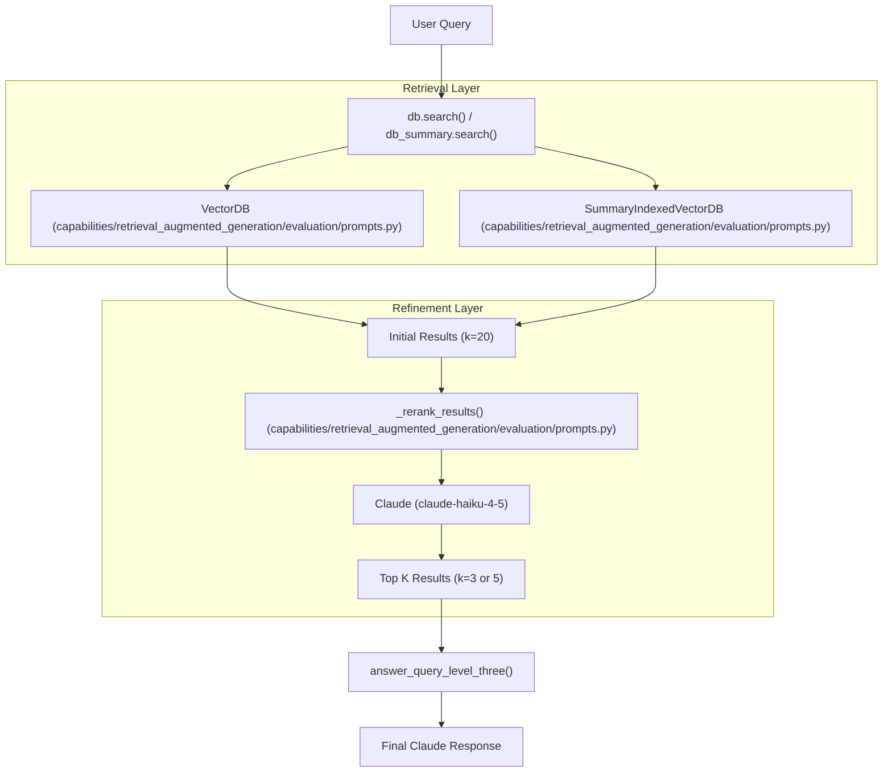
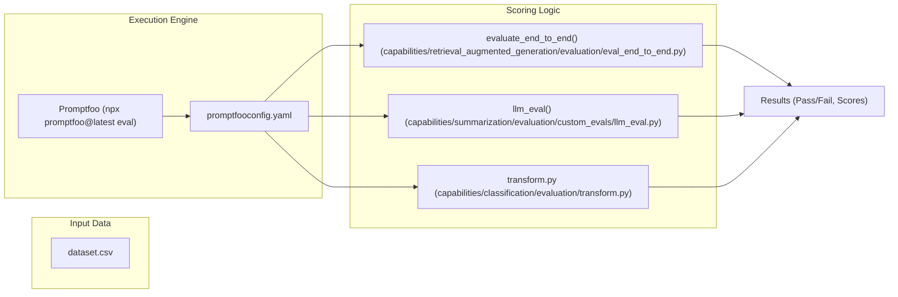

<!-- source: DeepWiki mcp.deepwiki.com · repo anthropics/claude-cookbooks · page 5.1 Classification and RAG · fetched 2026-10-26 -->

# Classification and RAG

Relevant source files

The following files were used as context for generating this wiki page:

- [capabilities/classification/README.md](capabilities/classification/README.md)
- [capabilities/classification/data/results.csv](capabilities/classification/data/results.csv)
- [capabilities/classification/data/test.tsv](capabilities/classification/data/test.tsv)
- [capabilities/classification/data/train.tsv](capabilities/classification/data/train.tsv)
- [capabilities/classification/data/vector_db.pkl](capabilities/classification/data/vector_db.pkl)
- [capabilities/classification/evaluation/README.md](capabilities/classification/evaluation/README.md)
- [capabilities/classification/evaluation/dataset.csv](capabilities/classification/evaluation/dataset.csv)
- [capabilities/classification/evaluation/transform.py](capabilities/classification/evaluation/transform.py)
- [capabilities/classification/guide.ipynb](capabilities/classification/guide.ipynb)
- [capabilities/contextual-embeddings/guide.ipynb](capabilities/contextual-embeddings/guide.ipynb)
- [capabilities/retrieval_augmented_generation/evaluation/eval_end_to_end.py](capabilities/retrieval_augmented_generation/evaluation/eval_end_to_end.py)
- [capabilities/retrieval_augmented_generation/evaluation/prompts.py](capabilities/retrieval_augmented_generation/evaluation/prompts.py)
- [capabilities/retrieval_augmented_generation/evaluation/provider_retrieval.py](capabilities/retrieval_augmented_generation/evaluation/provider_retrieval.py)
- [capabilities/retrieval_augmented_generation/guide.ipynb](capabilities/retrieval_augmented_generation/guide.ipynb)
- [capabilities/summarization/evaluation/custom_evals/llm_eval.py](capabilities/summarization/evaluation/custom_evals/llm_eval.py)
- [capabilities/summarization/guide.ipynb](capabilities/summarization/guide.ipynb)
- [capabilities/text_to_sql/guide.ipynb](capabilities/text_to_sql/guide.ipynb)
- [misc/speculative_prompt_caching.ipynb](misc/speculative_prompt_caching.ipynb)
- [skills/custom_skills/applying-brand-guidelines/validate_brand.py](skills/custom_skills/applying-brand-guidelines/validate_brand.py)

This page documents the implementation and optimization of classification systems and Retrieval-Augmented Generation (RAG) pipelines using Claude. It covers the transition from basic prompt engineering to advanced retrieval techniques like contextual embeddings, summary indexing, and re-ranking, along with comprehensive evaluation frameworks.

## Classification with Claude

Claude is utilized to build high-accuracy classification systems, particularly for scenarios with complex business rules or limited training data [capabilities/classification/guide.ipynb:72-72](). The core methodology involves a progressive improvement from basic zero-shot prompting to RAG-enhanced classification [capabilities/classification/guide.ipynb:9-11]().

### Implementation Workflow
1.  **Data Preparation**: Training and test datasets (e.g., insurance support tickets) are prepared to establish baselines [capabilities/classification/guide.ipynb:76-76]().
2.  **Prompt Engineering**: Designing templates that incorporate class definitions and few-shot examples [capabilities/classification/guide.ipynb:78-78]().
3.  **RAG Integration**: Using vector databases to retrieve the most relevant historical examples for a given query to provide context to the model [capabilities/classification/guide.ipynb:80-80]().
4.  **Evaluation**: Rigorous testing using metrics like accuracy and F1 scores [capabilities/classification/guide.ipynb:82-82]().

**Sources:** [capabilities/classification/guide.ipynb:70-84]()

---

## Retrieval-Augmented Generation (RAG) Pipeline

The RAG pipeline enhances Claude's performance on domain-specific queries by retrieving relevant documents from internal knowledge bases before generation [capabilities/retrieval_augmented_generation/guide.ipynb:9-9]().

### Advanced Retrieval Techniques

| Technique | Description | Impact |
| :--- | :--- | :--- |
| **Contextual Embeddings** | Prepends document-level context to individual chunks before embedding [capabilities/contextual-embeddings/guide.ipynb:15-15](). | Reduced top-20 retrieval failure by 35% [capabilities/contextual-embeddings/guide.ipynb:15-15](). |
| **Summary Indexing** | Uses a `SummaryIndexedVectorDB` to store and search over document summaries rather than just raw chunks [capabilities/retrieval_augmented_generation/evaluation/prompts.py:46-50](). | Improved MRR from 0.74 to 0.87 [capabilities/retrieval_augmented_generation/guide.ipynb:21-25](). |
| **Re-Ranking** | A two-step process where an initial set of documents (e.g., top 20) is re-evaluated by Claude to select the top $k$ (e.g., top 3-5) [capabilities/retrieval_augmented_generation/evaluation/prompts.py:158-163](). | Increased end-to-end accuracy from 71% to 81% [capabilities/retrieval_augmented_generation/guide.ipynb:25-25](). |
| **Contextual BM25** | Combines traditional keyword search with chunk-specific context to improve retrieval [capabilities/contextual-embeddings/guide.ipynb:17-17](). | Further improves performance in hybrid search scenarios [capabilities/contextual-embeddings/guide.ipynb:27-27](). |

### RAG Data Flow and Entity Mapping

The following diagram illustrates the flow from a user query to a grounded response, mapping logical components to specific code entities.

**RAG Retrieval and Re-Ranking Architecture**

**Sources:** [capabilities/retrieval_augmented_generation/evaluation/prompts.py:9-192](), [capabilities/retrieval_augmented_generation/guide.ipynb:11-25](), [capabilities/contextual-embeddings/guide.ipynb:15-29]()

---

## Evaluation Frameworks

The repository emphasizes moving beyond "vibes-based" evaluations to systematic, automated metrics [capabilities/retrieval_augmented_generation/guide.ipynb:15-15]().

### Promptfoo Integration
`Promptfoo` is used to orchestrate evaluations, allowing for parallel testing across different models and temperature settings [capabilities/classification/evaluation/README.md:17-25]().

- **Prompts**: Defined in `prompts.py` as functions that return strings for `Promptfoo` to process [capabilities/classification/evaluation/README.md:21-23]().
- **Providers**: Configured in `promptfooconfig.yaml` to test various Claude models [capabilities/classification/evaluation/README.md:24-25]().
- **Transforms**: Python functions used to extract specific JSON outputs or scores from the LLM response [capabilities/classification/evaluation/README.md:30-31]().

### LLM-as-a-Judge
For complex tasks like summarization or end-to-end RAG correctness, Claude is used as an evaluator.

- **End-to-End Eval**: The `evaluate_end_to_end` function compares a generated answer against a "golden" answer using criteria like substance, contradictions, and missing critical info [capabilities/retrieval_augmented_generation/evaluation/eval_end_to_end.py:8-33]().
- **Summarization Eval**: The `llm_eval` function scores summaries across dimensions like Conciseness, Accuracy, Completeness, and Clarity [capabilities/summarization/evaluation/custom_evals/llm_eval.py:8-49]().

**Evaluation Logic Mapping**

**Sources:** [capabilities/classification/evaluation/README.md:16-55](), [capabilities/retrieval_augmented_generation/evaluation/eval_end_to_end.py:8-90](), [capabilities/summarization/evaluation/custom_evals/llm_eval.py:8-82]()

---

## Performance Optimization

### Contextual Retrieval and Caching
To make contextual retrieval (adding context to every chunk) cost-effective, the pipeline leverages **Prompt Caching** [capabilities/contextual-embeddings/guide.ipynb:39-39]().

- **Speculative Prompt Caching**: A pattern that warms up the cache while the user is still typing to reduce Time-to-First-Token (TTFT) [misc/speculative_prompt_caching.ipynb:10-21]().
- **Implementation**: Uses the `cache_control: {"type": "ephemeral"}` parameter on large context blocks [misc/speculative_prompt_caching.ipynb:146-146]().
- **One-Token Warmup**: The `sample_one_token` function sends a minimal request to trigger cache creation before the actual query is sent [misc/speculative_prompt_caching.ipynb:153-161]().

### Contextual Retrieval Lambda
For AWS Bedrock users, a Lambda-based implementation provides custom chunking that injects context into documents during the ingestion phase [capabilities/contextual-embeddings/guide.ipynb:41-41](). The core logic for this is found in `lambda_function.py` within the `contextual-rag-lambda-function` directory [capabilities/contextual-embeddings/guide.ipynb:41-41]().

**Sources:** [capabilities/contextual-embeddings/guide.ipynb:15-41](), [misc/speculative_prompt_caching.ipynb:8-161]()

---

