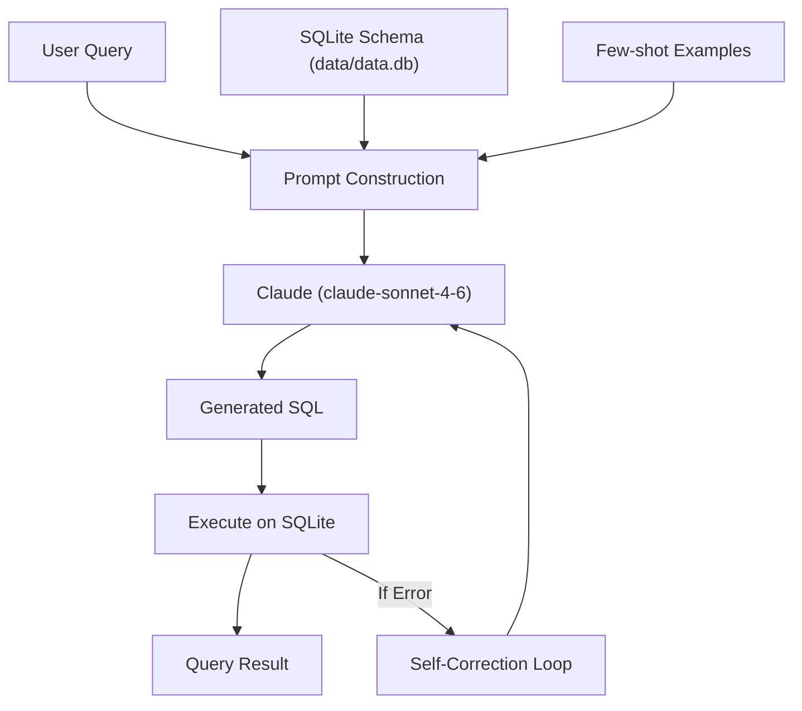
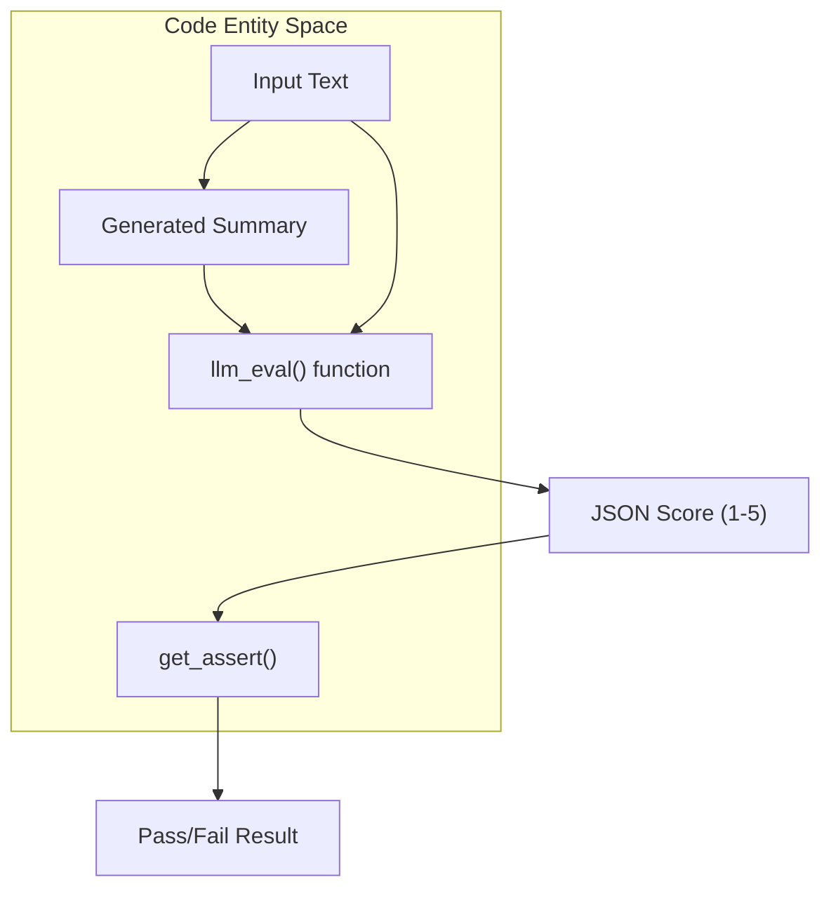
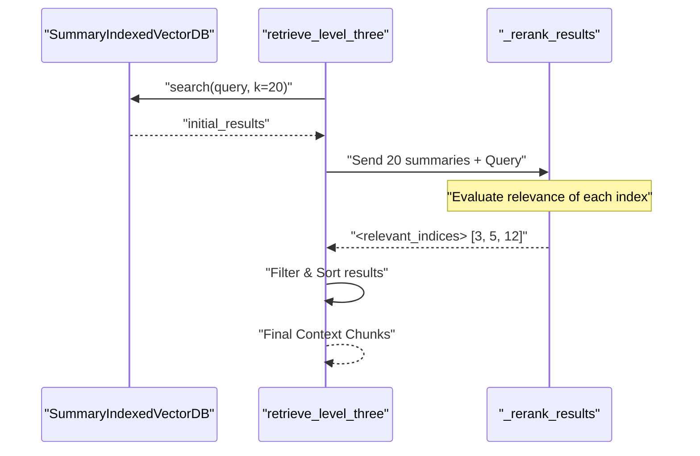

<!-- source: DeepWiki mcp.deepwiki.com · repo anthropics/claude-cookbooks · page 5.3 Text-to-SQL and Summarization · fetched 2026-10-26 -->

# Text-to-SQL and Summarization

Relevant source files

The following files were used as context for generating this wiki page:

- [capabilities/retrieval_augmented_generation/evaluation/eval_end_to_end.py](capabilities/retrieval_augmented_generation/evaluation/eval_end_to_end.py)
- [capabilities/retrieval_augmented_generation/evaluation/promptfooconfig_end_to_end.yaml](capabilities/retrieval_augmented_generation/evaluation/promptfooconfig_end_to_end.yaml)
- [capabilities/retrieval_augmented_generation/evaluation/provider_retrieval.py](capabilities/retrieval_augmented_generation/evaluation/provider_retrieval.py)
- [capabilities/retrieval_augmented_generation/guide.ipynb](capabilities/retrieval_augmented_generation/guide.ipynb)
- [capabilities/summarization/evaluation/custom_evals/llm_eval.py](capabilities/summarization/evaluation/custom_evals/llm_eval.py)
- [capabilities/summarization/evaluation/promptfooconfig.yaml](capabilities/summarization/evaluation/promptfooconfig.yaml)
- [capabilities/summarization/guide.ipynb](capabilities/summarization/guide.ipynb)
- [capabilities/text_to_sql/evaluation/promptfooconfig.yaml](capabilities/text_to_sql/evaluation/promptfooconfig.yaml)
- [capabilities/text_to_sql/guide.ipynb](capabilities/text_to_sql/guide.ipynb)

This section documents the implementation of two core language capabilities using Claude: converting natural language into structured SQL queries and performing sophisticated summarization of long-form or multi-document content. These techniques leverage Retrieval Augmented Generation (RAG), few-shot prompting, and automated evaluation frameworks to ensure accuracy and reliability in production environments.

## Text-to-SQL Implementation

Text-to-SQL allows non-technical users to interact with databases using natural language [capabilities/text_to_sql/guide.ipynb:11-13](). The implementation focuses on generating accurate SQL statements while handling complex database schemas through context injection.

### System Architecture and Data Flow

The Text-to-SQL pipeline follows a multi-stage refinement process to ensure query validity.

**Text-to-SQL Logic Flow**

*Sources: [capabilities/text_to_sql/guide.ipynb:108-113](), [capabilities/text_to_sql/guide.ipynb:29-37]()*

### Key Components

1.  **Schema Context**: The system extracts schema information (table names, column names, and types) from the `DATABASE_PATH` (e.g., `data/data.db`) and injects it into the prompt [capabilities/text_to_sql/guide.ipynb:112-113]().
2.  **Few-shot Learning**: Accuracy is improved by providing Claude with pairs of natural language questions and their corresponding SQL queries [capabilities/text_to_sql/guide.ipynb:53-53]().
3.  **Self-Correction**: If the generated SQL fails execution in the SQLite environment, the error message is fed back to Claude to regenerate a corrected query [capabilities/text_to_sql/guide.ipynb:56-56]().
4.  **RAG for Large Schemas**: For databases with hundreds of tables, a retrieval step is used to select only the relevant table schemas to include in the prompt, staying within token limits [capabilities/text_to_sql/guide.ipynb:55-55]().

## Summarization Techniques

Summarization involves condensing large amounts of text (particularly legal or technical documents) while retaining essential information and factual accuracy [capabilities/summarization/guide.ipynb:11-13]().

### Advanced Summarization Patterns

The codebase demonstrates several levels of summarization complexity:

*   **Guided Summarization**: Uses specific criteria or "metadata" requirements (e.g., extract parties, effective dates, and termination clauses) to focus the summary [capabilities/summarization/guide.ipynb:34-35]().
*   **Meta-Summarization**: Synthesizes multiple summaries from different document sections into a single cohesive overview [capabilities/summarization/guide.ipynb:36-36]().
*   **Summary-Indexed RAG**: A specialized RAG approach where document chunks are indexed by their *summaries* rather than raw text, improving retrieval relevance for high-level queries [capabilities/summarization/guide.ipynb:37-38]().

### Evaluation Framework

Summarization quality is measured using both traditional metrics and "LLM-as-a-judge" patterns.

**Summarization Evaluation Pipeline**

*Sources: [capabilities/summarization/evaluation/custom_evals/llm_eval.py:8-18](), [capabilities/summarization/evaluation/custom_evals/llm_eval.py:72-82]()*

| Metric | Implementation | File |
| :--- | :--- | :--- |
| **LLM Evaluation** | `llm_eval` function using `claude-sonnet-4-6` | [capabilities/summarization/evaluation/custom_evals/llm_eval.py:8-19]() |
| **ROUGE Scores** | Standard NLP metrics for overlap | [capabilities/summarization/guide.ipynb:52-52]() |
| **Criteria Scoring** | JSON-based scores for Conciseness, Accuracy, Completeness, and Clarity | [capabilities/summarization/evaluation/custom_evals/llm_eval.py:22-49]() |

## RAG Optimization for Complex Contexts

To support both Text-to-SQL and Summarization at scale, the repository implements a three-level RAG optimization strategy.

### Multi-Level Retrieval Architecture

1.  **Level 1 (Basic)**: Standard vector search using `VectorDB` [capabilities/retrieval_augmented_generation/evaluation/provider_retrieval.py:8-12]().
2.  **Level 2 (Summary Indexing)**: Uses `SummaryIndexedVectorDB` to search against document summaries, which often capture the "intent" of a section better than raw text [capabilities/retrieval_augmented_generation/evaluation/provider_retrieval.py:27-31]().
3.  **Level 3 (Re-Ranking)**: Retrieves a larger set of candidates (e.g., `k=20`) and uses a specialized Claude prompt (`_rerank_results`) to select the top 3 most relevant chunks [capabilities/retrieval_augmented_generation/evaluation/provider_retrieval.py:124-129]().

**Reranking Logic in provider_retrieval.py**

*Sources: [capabilities/retrieval_augmented_generation/evaluation/provider_retrieval.py:45-108](), [capabilities/retrieval_augmented_generation/evaluation/provider_retrieval.py:124-144]()*

### Performance Gains
By implementing these advanced techniques, the system achieves measurable improvements over basic RAG:
*   **End-to-End Accuracy**: 71% to 81% [capabilities/retrieval_augmented_generation/guide.ipynb:25-25]().
*   **Mean Reciprocal Rank (MRR)**: 0.74 to 0.87 [capabilities/retrieval_augmented_generation/guide.ipynb:24-24]().

*Sources: [capabilities/retrieval_augmented_generation/guide.ipynb:21-25]()*

---

