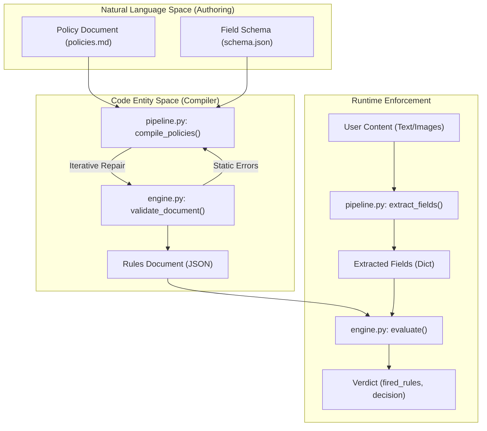
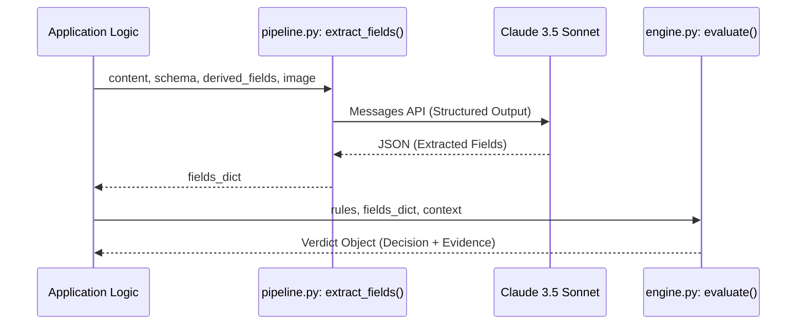

<!-- source: DeepWiki mcp.deepwiki.com · repo anthropics/claude-cookbooks · page 5.4 Content Moderation Pipeline · fetched 2026-10-26 -->

# Content Moderation Pipeline

Relevant source files

The following files were used as context for generating this wiki page:

- [capabilities/content_moderation/README.md](capabilities/content_moderation/README.md)
- [capabilities/content_moderation/data/ad_creatives/build_creatives.py](capabilities/content_moderation/data/ad_creatives/build_creatives.py)
- [capabilities/content_moderation/data/ad_creatives/context.json](capabilities/content_moderation/data/ad_creatives/context.json)
- [capabilities/content_moderation/data/ad_creatives/images/betpeak_bonus.png](capabilities/content_moderation/data/ad_creatives/images/betpeak_bonus.png)
- [capabilities/content_moderation/data/ad_creatives/images/luma_before_after.png](capabilities/content_moderation/data/ad_creatives/images/luma_before_after.png)
- [capabilities/content_moderation/data/ad_creatives/images/northpeak_trail.png](capabilities/content_moderation/data/ad_creatives/images/northpeak_trail.png)
- [capabilities/content_moderation/data/ad_creatives/images/peaklend_rate.png](capabilities/content_moderation/data/ad_creatives/images/peaklend_rate.png)
- [capabilities/content_moderation/data/ad_creatives/images/vinepeak_wine.png](capabilities/content_moderation/data/ad_creatives/images/vinepeak_wine.png)
- [capabilities/content_moderation/data/ad_creatives/policies.md](capabilities/content_moderation/data/ad_creatives/policies.md)
- [capabilities/content_moderation/engine.py](capabilities/content_moderation/engine.py)
- [capabilities/content_moderation/evaluation/run_eval.py](capabilities/content_moderation/evaluation/run_eval.py)
- [capabilities/content_moderation/guide.ipynb](capabilities/content_moderation/guide.ipynb)
- [capabilities/content_moderation/pipeline.py](capabilities/content_moderation/pipeline.py)

The Content Moderation Pipeline documents a robust architecture for enforcing natural language policies using a **policy-to-rules compiler** pattern. Unlike simple prompt-based moderation, this system decouples policy interpretation from enforcement, ensuring that decisions are deterministic, auditable, and versionable across diverse domains such as advertising, product listings, and user-generated content (UGC).

## Overview

Traditional LLM moderation often involves passing a policy and a piece of content into a single prompt. This approach fails production requirements for consistency (identical inputs getting different results) and auditability (lack of a clear evidence trail).

This pipeline restructures the problem into three distinct stages:
1.  **The Compiler:** Claude (`claude-3-opus`) converts prose policy clauses into a machine-readable JSON rule language.
2.  **The Extractor:** Claude (`claude-3-5-sonnet`) reads content (text and images) and extracts typed fields according to a defined schema.
3.  **The Engine:** A deterministic Python-based rule engine evaluates the extracted fields against the compiled rules to produce a final verdict.

### Architecture Data Flow

The following diagram illustrates how natural language policies are transformed into code entities and processed at runtime.

**Natural Language to Code Entity Mapping**

**Sources:** [capabilities/content_moderation/pipeline.py:4-10](), [capabilities/content_moderation/README.md:32-49]()

---

## The Rule Engine and Schema

The system relies on a schema-based approach where every moderation decision is based on specific fields. The engine supports standard logical operators and three-valued logic (True, False, Null) to handle cases where information is missing or ambiguous.

### Condition Grammar
Rules are defined using a JSON-based grammar that supports:
*   **Logical Operators:** `all`, `any`, `not`.
*   **Comparison Operators:** `eq`, `neq`, `gt`, `gte`, `lt`, `lte`, `in`, `not_in`, `contains`, `regex`, `exists`.
*   **Scopes:** Optional conditions defining where a rule applies (e.g., specific countries or advertiser tiers).

### Extraction Schema and Derived Fields
The pipeline distinguishes between two types of fields:
1.  **Base Fields:** Defined in `schema.json`, these are objective attributes extracted from the content.
2.  **Derived Fields (LLM Assertions):** Created by the compiler for clauses requiring subjective judgment (e.g., "appears to be under 25"). These include a `judge` instruction used by the extractor.

**Sources:** [capabilities/content_moderation/pipeline.py:44-99](), [capabilities/content_moderation/engine.py:1-21]()

---

## Implementation Detail: The Compiler

The `compile_policies` function in `pipeline.py` implements a **validator-driven repair loop**. It attempts to map policy prose to the available schema. If the model generates a rule that references a non-existent field or uses an invalid operator, the `validate_document` function catches the error, and the feedback is sent back to Claude for correction.

### Key Function: `compile_policies`
[capabilities/content_moderation/pipeline.py:137-178]()
*   **Input:** Policy text, content schema, and context schema.
*   **Process:** 
    1.  Calls `COMPILER_MODEL` with a specialized prompt containing the `RULE_FORMAT_SPEC`.
    2.  Parses the JSON response.
    3.  Runs `validate_document` to check for schema alignment.
    4.  If errors exist, it re-prompts the model with the specific error messages (up to `max_repair_rounds`).

### Handling Uncompilable Clauses
If a policy clause requires external information (e.g., "check against a government registry"), the compiler is instructed to place it in the `uncompilable` list rather than inventing fields or dropping the requirement.

**Sources:** [capabilities/content_moderation/pipeline.py:70-74](), [capabilities/content_moderation/pipeline.py:137-178]()

---

## Implementation Detail: The Extractor

The `extract_fields` function performs a single API call to transform raw content into the typed schema (Base + Derived fields).

### Multimodal Extraction
For domains like `ad_creatives`, the extractor processes both text and images. Images are encoded as base64 and passed to Claude to evaluate visual requirements, such as the presence of an "age badge" or "before/after" panels.

**System Integration Diagram**

**Sources:** [capabilities/content_moderation/pipeline.py:181-228](), [capabilities/content_moderation/data/ad_creatives/build_creatives.py:1-8]()

---

## Evaluation and Domains

The pipeline is evaluated across three distinct domains to demonstrate its versatility.

| Domain | Focus | Key Challenges |
| :--- | :--- | :--- |
| **Ad Creatives** | Visual compliance | Age badges, disclaimers, prohibited imagery (before/after). |
| **Product Listings** | Marketplace safety | Counterfeits, medical claims, off-platform payment. |
| **UGC** | Community health | Harassment, PII, spam detection. |

### Evaluation Workflow
The `run_eval.py` script automates the testing of the pipeline against `samples.jsonl` files in each domain. It compares the engine's `verdict.decision` against an `expected` label.

**Key Components:**
*   **Golden Ruleset:** For `ad_creatives`, a hand-written reference ruleset is used to benchmark the engine.
*   **Automated Compilation:** For other domains, rules are compiled on-the-fly and cached.
*   **Deterministic Engine:** `engine.evaluate()` ensures that given the same extracted fields, the result is always the same.

**Sources:** [capabilities/content_moderation/evaluation/run_eval.py:69-118](), [capabilities/content_moderation/README.md:53-72]()

---

