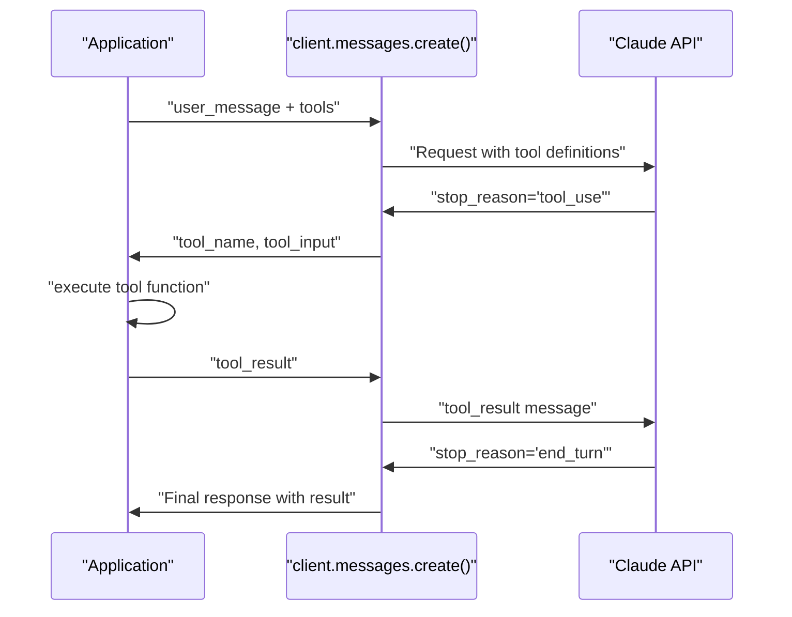
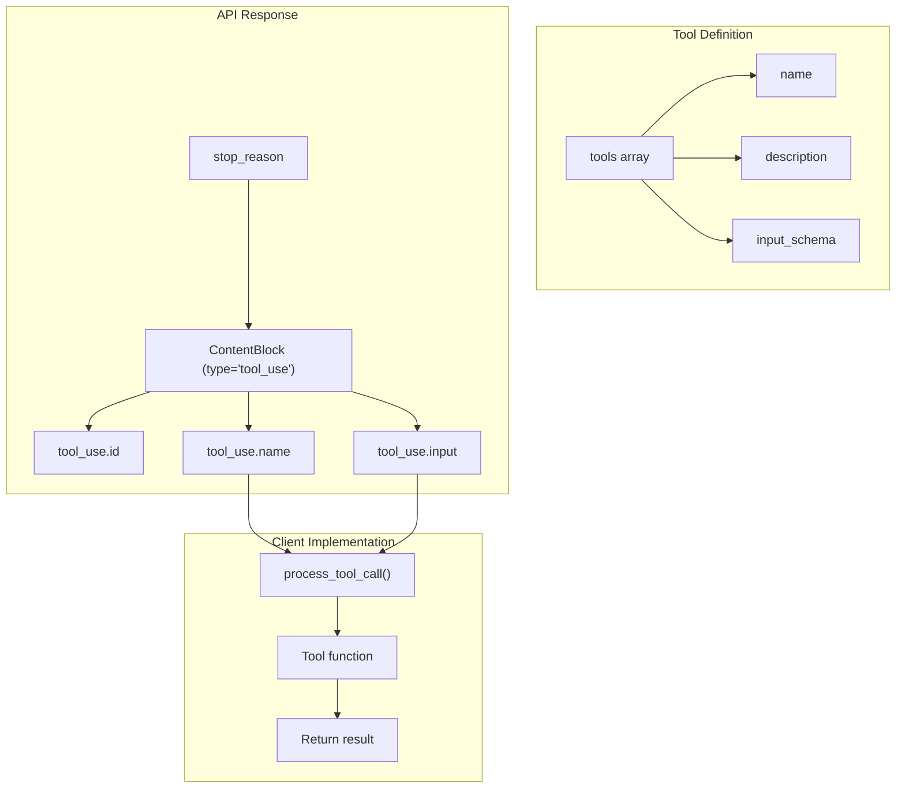

<!-- source: DeepWiki mcp.deepwiki.com · repo anthropics/claude-cookbooks · page 6 Tool Use Framework · fetched 2026-10-26 -->

# Tool Use Framework

<details>
<summary>Relevant source files</summary>

The following files were used as context for generating this wiki page:

- [images/tool_use/nutrition_label.png](images/tool_use/nutrition_label.png)
- [third_party/WolframAlpha/using_llm_api.ipynb](third_party/WolframAlpha/using_llm_api.ipynb)
- [tool_use/.env.example](tool_use/.env.example)
- [tool_use/calculator_tool.ipynb](tool_use/calculator_tool.ipynb)
- [tool_use/customer_service_agent.ipynb](tool_use/customer_service_agent.ipynb)
- [tool_use/extracting_structured_json.ipynb](tool_use/extracting_structured_json.ipynb)
- [tool_use/memory_cookbook.ipynb](tool_use/memory_cookbook.ipynb)
- [tool_use/memory_demo/__init__.py](tool_use/memory_demo/__init__.py)
- [tool_use/memory_demo/code_review_demo.py](tool_use/memory_demo/code_review_demo.py)
- [tool_use/memory_demo/demo_helpers.py](tool_use/memory_demo/demo_helpers.py)
- [tool_use/memory_tool.py](tool_use/memory_tool.py)
- [tool_use/tool_choice.ipynb](tool_use/tool_choice.ipynb)
- [tool_use/tool_use_with_pydantic.ipynb](tool_use/tool_use_with_pydantic.ipynb)
- [tool_use/vision_with_tools.ipynb](tool_use/vision_with_tools.ipynb)

</details>


The Tool Use Framework enables Claude to interact with external functions, APIs, and systems through a structured interface. Claude can request tool execution, receive results, and incorporate them into responses—extending capabilities beyond text generation to include calculations, data retrieval, API calls, and system interactions.

**Related sections:**
- For basic tool patterns including schema definition and validation, see [Basic Tool Patterns](#6.1)
- For memory tools and cross-session learning, see [Memory Tool and Cross-Session Learning](#6.2)
- For context management and compaction, see [Context Management and Compaction](#6.3)
- For programmatic execution and visualization, see [Programmatic Tool Calling](#6.4)
- For Skills that build on tool use, see [Skills System](#4)
- For third-party service integrations, see [Third-Party Integrations](#12)

## Core Concepts

### Client-Side Execution Model

Tools are executed in the application environment, not on Anthropic's servers. The application defines tools with JSON schemas, Claude requests tool execution when needed, and the application executes the tool and returns results.

### Tool Use Lifecycle

Tool use follows a structured request-response cycle:



Sources: [tool_use/calculator_tool.ipynb:81-141](), [tool_use/customer_service_agent.ipynb:198-255]()

### Tool Components



Sources: [tool_use/calculator_tool.ipynb:56-56](), [tool_use/calculator_tool.ipynb:100-103](), [tool_use/calculator_tool.ipynb:122-125]()

## Tool Definition

### Schema Structure

Tools are defined using JSON Schema format with three required components:

| Component | Purpose | Example |
|-----------|---------|---------|
| `name` | Unique identifier for the tool | `"calculator"`, `"memory"` |
| `description` | Explains when and how to use the tool | `"A simple calculator that performs basic arithmetic operations."` |
| `input_schema` | JSON Schema defining expected parameters | `{"type": "object", "properties": {...}, "required": [...]}` |

Sources: [tool_use/calculator_tool.ipynb:56-56](), [tool_use/customer_service_agent.ipynb:57-100](), [tool_use/memory_demo/demo_helpers.py:59-59]()

### Calculator Tool Example

```python
tools = [
    {
        "name": "calculator",
        "description": "A simple calculator that performs basic arithmetic operations.",
        "input_schema": {
            "type": "object",
            "properties": {
                "expression": {
                    "type": "string",
                    "description": "The mathematical expression to evaluate (e.g., '2 + 3 * 4').",
                }
            },
            "required": ["expression"],
        },
    }
]
```

Sources: [tool_use/calculator_tool.ipynb:56-56]()

### Input Schema Patterns

The `input_schema` field uses JSON Schema to define parameters:

| Schema Type | Description | Code Example |
|-------------|-------------|--------------|
| Simple properties | Single string/number/boolean fields | `"expression": {"type": "string"}` |
| Nested objects | Structured data with sub-properties | `"author": {"type": "object", "properties": {...}}` |
| Arrays | Lists of items | `"entities": {"type": "array", "items": {...}}` |
| Optional fields | Default values provided | `"priority": {"type": "integer", "default": 3}` |
| Required fields | Must be present in input | `"required": ["expression"]` |

Sources: [tool_use/calculator_tool.ipynb:56-56](), [tool_use/tool_use_with_pydantic.ipynb:90-126](), [tool_use/extracting_structured_json.ipynb:87-116]()

## Tool Implementation

### Execution Handler Pattern

The `process_tool_call()` or `execute_tool()` function dispatches tool execution based on the tool name:

```python
def execute_tool(tool_use: Any, memory_handler: MemoryToolHandler) -> str:
    if tool_use.name == "memory":
        result = memory_handler.execute(**tool_use.input)
        return result.get("success") or result.get("error", "Unknown error")
    return f"Unknown tool: {tool_use.name}"
```

Sources: [tool_use/memory_demo/demo_helpers.py:14-29](), [tool_use/customer_service_agent.ipynb:171-177]()

### Memory Tool Implementation

The `MemoryToolHandler` provides a production-ready implementation for persistent storage using the `memory_20250818` tool type. It supports commands like `view`, `create`, `str_replace`, `insert`, `delete`, and `rename` within a resolved `/memories` directory [tool_use/memory_tool.py:76-113]().

Sources: [tool_use/memory_tool.py:13-24](), [tool_use/memory_tool.py:76-113]()

### Result Handling

Tool results are returned to Claude as `tool_result` content blocks within a `user` role message:

```python
tool_results.append(
    {"type": "tool_result", "tool_use_id": content.id, "content": result}
)
```

Sources: [tool_use/memory_demo/demo_helpers.py:115-117](), [tool_use/calculator_tool.ipynb:112-130]()

## Multi-Turn Conversation Loops

### Standard Execution Loop

For agents that require multiple steps, the `run_conversation_loop` pattern continues until Claude stops requesting tools:

```python
def run_conversation_loop(client, model, messages, memory_handler, system, ...):
    while turn <= max_turns:
        response, assistant_content, tool_results = run_conversation_turn(...)
        messages.append({"role": "assistant", "content": assistant_content})

        if tool_results:
            messages.append({"role": "user", "content": tool_results})
            turn += 1
        else:
            break
    return response
```

Sources: [tool_use/memory_demo/demo_helpers.py:122-180]()

### Context Management and Compaction

For long-running sessions, the framework supports `context_management` via the `context-management-2025-06-27` beta. This allows for automatic `clear_tool_uses_20250919` edits when token thresholds are met [tool_use/memory_demo/code_review_demo.py:41-50]().

Sources: [tool_use/memory_demo/demo_helpers.py:67-67](), [tool_use/memory_demo/code_review_demo.py:41-50]()

## Validation with Pydantic

Pydantic models provide type safety and validation for tool inputs, ensuring that the model's response conforms to the expected schema before execution.

```python
class Note(BaseModel):
    note: str
    author: Author
    tags: list[str] | None = None
    priority: int = Field(ge=1, le=5, default=3)
    is_public: bool = False
```

Sources: [tool_use/tool_use_with_pydantic.ipynb:62-68]()

## Tool Choice Control

The `tool_choice` parameter allows developers to specify how Claude should use tools:

| Mode | Behavior | Use Case |
|------|----------|----------|
| `auto` | Claude decides whether to use a tool or answer directly | Default assistant behavior |
| `any` | Claude must use at least one of the provided tools | Forcing extraction or action |
| `tool` | Claude must use a specific tool named in the parameter | Strict structured output extraction |

Sources: [tool_use/tool_choice.ipynb:16-22](), [tool_use/tool_choice.ipynb:107-114]()

## Advanced Capabilities

### Vision with Tools
Claude can process image inputs (e.g., nutrition labels) and extract structured data into tool parameters [tool_use/vision_with_tools.ipynb:63-89]().

### External API Integration
Tools can wrap third-party services like Wolfram Alpha to provide mathematical and scientific reasoning capabilities [third_party/WolframAlpha/using_llm_api.ipynb:51-51]().

### Extended Thinking
Tool use can be combined with Claude's extended thinking blocks. When using thinking, the thinking blocks must be included in the assistant content when passing messages back to the API [tool_use/memory_demo/demo_helpers.py:81-95]().

Sources: [tool_use/vision_with_tools.ipynb:63-89](), [third_party/WolframAlpha/using_llm_api.ipynb:51-51](), [tool_use/memory_demo/demo_helpers.py:81-95]()

---

