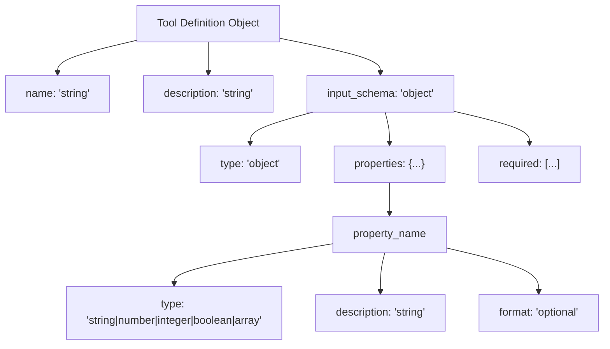
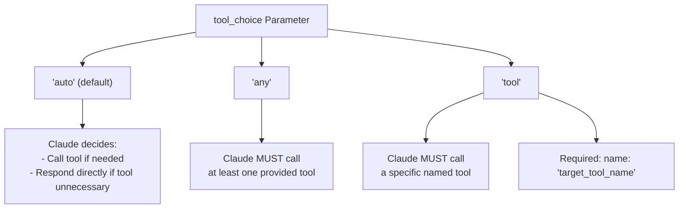
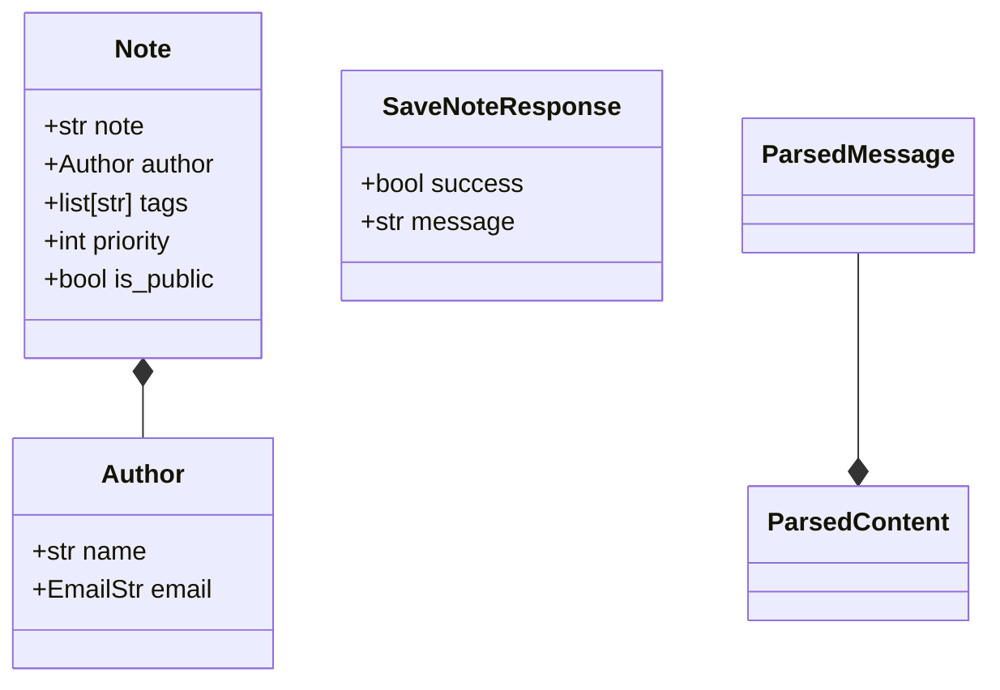

<!-- source: DeepWiki mcp.deepwiki.com · repo anthropics/claude-cookbooks · page 6.1 Basic Tool Patterns · fetched 2026-10-26 -->

# Basic Tool Patterns

<details>
<summary>Relevant source files</summary>

The following files were used as context for generating this wiki page:

- [images/tool_use/nutrition_label.png](images/tool_use/nutrition_label.png)
- [third_party/WolframAlpha/using_llm_api.ipynb](third_party/WolframAlpha/using_llm_api.ipynb)
- [tool_use/__init__.py](tool_use/__init__.py)
- [tool_use/calculator_tool.ipynb](tool_use/calculator_tool.ipynb)
- [tool_use/customer_service_agent.ipynb](tool_use/customer_service_agent.ipynb)
- [tool_use/extracting_structured_json.ipynb](tool_use/extracting_structured_json.ipynb)
- [tool_use/programmatic_tool_calling_ptc.ipynb](tool_use/programmatic_tool_calling_ptc.ipynb)
- [tool_use/tool_choice.ipynb](tool_use/tool_choice.ipynb)
- [tool_use/tool_use_with_pydantic.ipynb](tool_use/tool_use_with_pydantic.ipynb)
- [tool_use/utils/__init__.py](tool_use/utils/__init__.py)
- [tool_use/utils/team_expense_api.py](tool_use/utils/team_expense_api.py)
- [tool_use/utils/visualize.py](tool_use/utils/visualize.py)
- [tool_use/vision_with_tools.ipynb](tool_use/vision_with_tools.ipynb)

</details>


## Purpose and Scope

This document covers fundamental patterns for using Claude's tool use (function calling) capabilities. It explains how to define tool schemas, control tool selection via the `tool_choice` parameter, extract structured JSON output using tools, and implement simple tool execution loops.

---

## Tool Schema Definition

Tools are defined using JSON Schema to describe their name, description, and input parameters. Claude uses these schemas to understand when and how to invoke tools.

### Basic Tool Structure



**Sources:** [tool_use/calculator_tool.ipynb:52-56](), [tool_use/tool_use_with_pydantic.ipynb:90-126]()

### Tool Definition Example
A tool configuration typically resides in a list of dictionaries passed to the API.

| Field | Purpose |
| :--- | :--- |
| `name` | The identifier Claude uses to request the tool. |
| `description` | Detailed instruction on what the tool does and when to use it. |
| `input_schema` | A JSON Schema object defining the parameters Claude must provide. |

**Sources:** [tool_use/calculator_tool.ipynb:56-56](), [tool_use/extracting_structured_json.ipynb:62-62]()

---

## Basic Tool Execution Loop

Claude's tool use follows a request-response cycle where Claude decides to call a tool, the client executes it, and Claude processes the result.

### Execution Flow Diagram

```mermaid
sequenceDiagram
    participant User
    participant Client["anthropic.Anthropic client"]
    participant Claude["Claude API (MODEL_NAME)"]
    participant Tool["Tool Function (e.g., calculate)"]
    
    User->>Client: "What is 1,984,135 * 9,343,116?"
    Client->>Claude: client.messages.create(tools=tools, messages=...)
    Claude->>Claude: Analyze request & match against tools
    Claude-->>Client: message.stop_reason='tool_use'
    
    Client->>Client: Extract tool_use block (id, name, input)
    Client->>Tool: Invoke local function with tool_input
    Tool-->>Client: Return stringified tool_result
    
    Client->>Claude: client.messages.create(messages=[..., tool_result])
    Claude-->>Client: message.stop_reason='end_turn'
    Client->>User: "The result is 18,538,003,464,660"
```

**Sources:** [tool_use/calculator_tool.ipynb:81-141](), [tool_use/customer_service_agent.ipynb:198-256]()

### Implementation Pattern

The core logic for handling a `tool_use` stop reason involves constructing a follow-up message that includes the original conversation history, the assistant's `tool_use` block, and a new `user` message containing the `tool_result`.

```python
# Processing a tool result block
{
    "role": "user",
    "content": [
        {
            "type": "tool_result",
            "tool_use_id": tool_use.id,
            "content": tool_result,
        }
    ],
}
```

**Sources:** [tool_use/calculator_tool.ipynb:120-127](), [tool_use/customer_service_agent.ipynb:235-243]()

---

## The tool_choice Parameter

The `tool_choice` parameter allows developers to control whether Claude is permitted, required, or forced to call specific tools.

### Tool Choice Modes



**Sources:** [tool_use/tool_choice.ipynb:16-22]()

### Mode Details
*   **Auto**: The model decides based on context. For example, a `web_search` tool is only called for queries Claude cannot answer from training data [tool_use/tool_choice.ipynb:41-122]().
*   **Tool**: Useful for "extraction" workflows where you want to force Claude into a structured output format immediately without any preamble [tool_use/tool_choice.ipynb:245-247]().
*   **Any**: Forces the model to use at least one tool from the list, useful for ensuring the agent uses its available resources [tool_use/tool_choice.ipynb:509-511]().

---

## Structured JSON Extraction with Pydantic

Using Pydantic models ensures that tool inputs conform to expected schemas and provide type safety within the Python application.

### Pydantic Model Association



**Sources:** [tool_use/tool_use_with_pydantic.ipynb:57-73](), [tool_use/utils/visualize.py:15-39]()

### Implementation Pattern
The application uses the `tool_input` dictionary to instantiate Pydantic models. This leverages Pydantic's validation (like `EmailStr` or `Field` constraints) to verify Claude's output before executing local logic.

```python
def process_tool_call(tool_name, tool_input):
    if tool_name == "save_note":
        # Validate input against Pydantic models
        note = Note(
            note=tool_input["note"],
            author=Author(name=tool_input["author"]["name"], email=tool_input["author"]["email"]),
            priority=tool_input.get("priority", 3),
            is_public=tool_input.get("is_public", False),
        )
        # Execute business logic with validated data
        save_note(note.note, note.author.model_dump(), note.priority, note.is_public)
        return SaveNoteResponse(success=True, message="Note saved successfully!")
```

**Sources:** [tool_use/tool_use_with_pydantic.ipynb:161-170]()

---

## Vision with Tools

Claude models can analyze images and return structured data by invoking tools based on visual inputs. 

### Nutrition Label Extraction
In this pattern, an image is passed in a message block alongside a tool definition. Claude identifies the relevant information in the image (e.g., calories, fat, protein) and maps them to the `input_schema` of the tool.

```python
nutrition_tool = {
    "name": "print_nutrition_info",
    "description": "Extracts nutrition information from an image of a nutrition label",
    "input_schema": {
        "type": "object",
        "properties": {
            "calories": {"type": "integer"},
            "total_fat": {"type": "integer"},
            "protein": {"type": "integer"}
        },
        "required": ["calories", "total_fat", "protein"],
    },
}
```

**Sources:** [tool_use/vision_with_tools.ipynb:63-90]()

---

## Programmatic Tool Calling (PTC)

Programmatic Tool Calling allows Claude to write code that invokes tools within a Code Execution environment. This is particularly effective for reducing latency when multiple tool calls are required sequentially or when large amounts of data need to be filtered before returning to the model's context.

| Benefit | Description |
| :--- | :--- |
| **Reduced Latency** | Eliminates multiple API round-trips for sequential tool invocations. |
| **Context Optimization** | The code can filter large datasets (e.g., hundreds of expense records) and return only relevant aggregates. |
| **Complexity Management** | Handles sequential dependencies (e.g., fetch members -> fetch expenses for each -> fetch custom budget) in a single turn. |

**Sources:** [tool_use/programmatic_tool_calling_ptc.ipynb:10-14](), [tool_use/programmatic_tool_calling_ptc.ipynb:103-111]()

---

