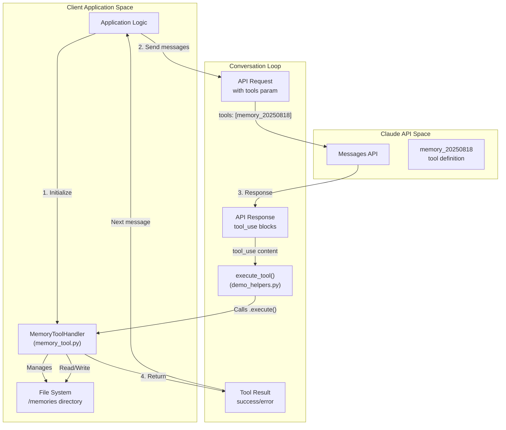
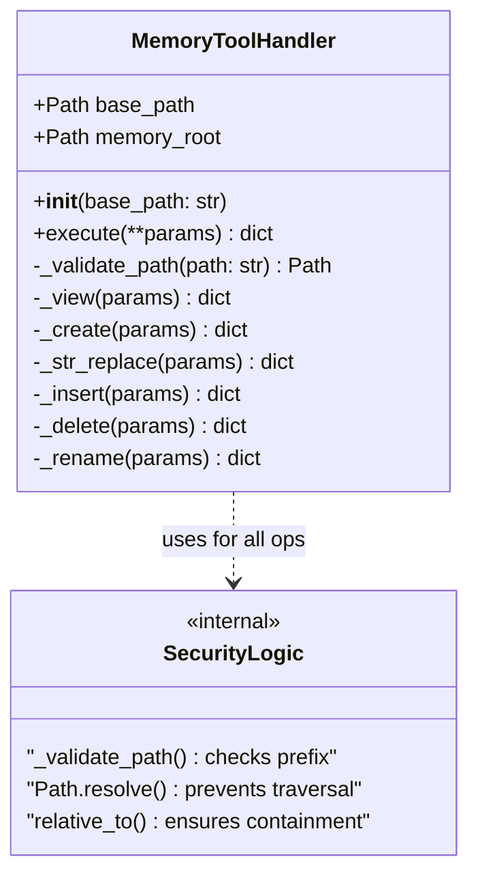
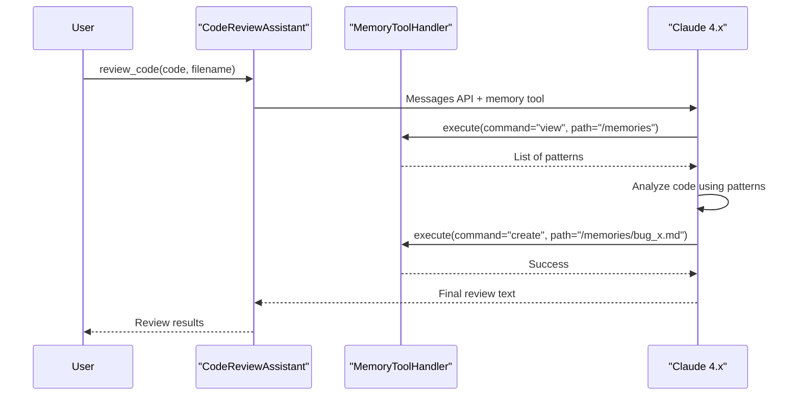

<!-- source: DeepWiki mcp.deepwiki.com · repo anthropics/claude-cookbooks · page 6.2 Memory Tool and Cross-Session Learning · fetched 2026-10-26 -->

# Memory Tool and Cross-Session Learning

<details>
<summary>Relevant source files</summary>

The following files were used as context for generating this wiki page:

- [tool_use/.env.example](tool_use/.env.example)
- [tool_use/memory_cookbook.ipynb](tool_use/memory_cookbook.ipynb)
- [tool_use/memory_demo/.gitignore](tool_use/memory_demo/.gitignore)
- [tool_use/memory_demo/__init__.py](tool_use/memory_demo/__init__.py)
- [tool_use/memory_demo/code_review_demo.py](tool_use/memory_demo/code_review_demo.py)
- [tool_use/memory_demo/demo_helpers.py](tool_use/memory_demo/demo_helpers.py)
- [tool_use/memory_demo/sample_code/api_client_v1.py](tool_use/memory_demo/sample_code/api_client_v1.py)
- [tool_use/memory_demo/sample_code/cache_manager.py](tool_use/memory_demo/sample_code/cache_manager.py)
- [tool_use/memory_demo/sample_code/data_processor_v1.py](tool_use/memory_demo/sample_code/data_processor_v1.py)
- [tool_use/memory_demo/sample_code/sql_query_builder.py](tool_use/memory_demo/sample_code/sql_query_builder.py)
- [tool_use/memory_demo/sample_code/web_scraper_v1.py](tool_use/memory_demo/sample_code/web_scraper_v1.py)
- [tool_use/memory_tool.py](tool_use/memory_tool.py)

</details>


## Purpose and Scope

This document covers the `memory_20250818` tool that enables Claude to persist information across conversations through a file-based memory system. The memory tool allows Claude to read, write, and manage files in a designated memory directory, enabling agents to learn patterns and apply them in future sessions.

This page focuses on the tool implementation, API integration patterns, and the code review assistant demonstration. For related topics, see [Context Management and Compaction](6.3) for automatic context editing, and [Basic Tool Patterns](6.1) for general tool use fundamentals.

**Key Components:**
- `MemoryToolHandler` class for client-side tool execution.
- File system operations with security validation.
- Cross-conversation learning patterns.
- Integration with Claude's Messages API using the `memory_20250818` tool type.

**Sources:** [tool_use/memory_cookbook.ipynb:7-11](), [tool_use/memory_tool.py:1-6]()

## Architecture Overview

The memory tool operates as a client-side implementation where the application executes file operations requested by Claude. This provides full control over security, storage location, and access patterns.

### System Data Flow



**Sources:** [tool_use/memory_cookbook.ipynb:98-105](), [tool_use/memory_tool.py:13-24](), [tool_use/memory_demo/demo_helpers.py:14-29]()

## MemoryToolHandler Implementation

The `MemoryToolHandler` class in `tool_use/memory_tool.py` provides secure, client-side execution of memory operations with path validation and error handling.

### Class Structure and Capabilities



**Initialization:**
- `base_path`: Root directory for memory storage (default: `./memory_storage`) [tool_use/memory_tool.py:26-31]().
- `memory_root`: The `/memories` subdirectory within `base_path` where all operations are confined [tool_use/memory_tool.py:34-35]().

**Sources:** [tool_use/memory_tool.py:13-35]()

### Path Validation and Security

The `_validate_path` method enforces security constraints to prevent directory traversal attacks [tool_use/memory_tool.py:37-49]().

| Security Check | Implementation | Purpose |
|----------------|----------------|---------|
| **Prefix validation** | `path.startswith("/memories")` | Ensures all paths target the virtual memory root [tool_use/memory_tool.py:50-54](). |
| **Path resolution** | `Path.resolve()` | Normalizes paths and resolves symlinks [tool_use/memory_tool.py:61-63](). |
| **Containment check** | `full_path.relative_to(memory_root)` | Verifies the resolved path hasn't escaped the root [tool_use/memory_tool.py:66-72](). |

**Sources:** [tool_use/memory_tool.py:37-74]()

## Tool Commands

The memory tool supports six commands for file system operations. Each command returns a dictionary with either a `"success"` or `"error"` key [tool_use/memory_tool.py:76-117]().

### Command Reference

| Command | Key Parameters | Description |
|---------|----------------|-------------|
| `view` | `path`, `view_range` | Lists directory contents or displays file contents with line numbers [tool_use/memory_tool.py:119-122](). |
| `create` | `path`, `file_text` | Creates a new file or overwrites an existing one [tool_use/memory_tool.py:174-177](). |
| `str_replace` | `path`, `old_str`, `new_str` | Replaces exact text in a file (must be unique) [tool_use/memory_tool.py:202-206](). |
| `insert` | `path`, `insert_line`, `insert_text` | Inserts text at a specific line number [tool_use/memory_tool.py:240-244](). |
| `delete` | `path` | Removes a file or directory recursively [tool_use/memory_tool.py:275-278](). |
| `rename` | `old_path`, `new_path` | Moves or renames a file/directory [tool_use/memory_tool.py:312-315](). |

**Sources:** [tool_use/memory_tool.py:76-117](), [tool_use/memory_tool.py:119-342]()

## API Integration Pattern

Integrating the memory tool requires configuring the Messages API with the tool definition and handling tool execution in a conversation loop.

### Tool Definition and Model Support

The memory tool is specified using the `memory_20250818` type [tool_use/memory_demo/demo_helpers.py:59]().

**Supported Models:**
- `claude-opus-4-1`
- `claude-opus-4`
- `claude-sonnet-4-6`
- `claude-sonnet-4`
- `claude-haiku-4-5`

**Sources:** [tool_use/memory_cookbook.ipynb:106](), [tool_use/.env.example:9](), [tool_use/memory_demo/demo_helpers.py:59-66]()

### Conversation Loop Implementation

The `run_conversation_loop` function in `tool_use/memory_demo/demo_helpers.py` manages multi-turn tool execution.

```python
def run_conversation_turn(
    client: Anthropic,
    model: str,
    messages: list[dict[str, Any]],
    memory_handler: MemoryToolHandler,
    system: str,
    # ... other params
):
    # Tool definition
    memory_tool = {"type": "memory_20250818", "name": "memory"}
    
    # API Request
    response = client.beta.messages.create(
        model=model,
        system=system,
        messages=messages,
        tools=[memory_tool],
        betas=["context-management-2025-06-27"],
        # ... context_management config
    )
    
    # Process content blocks (thinking, text, tool_use)
    # ... tool execution logic ...
```

**Key implementation details:**
1. **Thinking Blocks:** When using models with thinking enabled, the `thinking` content blocks must be included in the message history, including the `signature` field [tool_use/memory_demo/demo_helpers.py:82-95]().
2. **Tool Execution:** `execute_tool()` maps Claude's `tool_use` name to the `memory_handler.execute()` method [tool_use/memory_demo/demo_helpers.py:14-29]().
3. **Loop Termination:** The loop continues as long as `tool_results` are generated, up to a `max_turns` limit [tool_use/memory_demo/demo_helpers.py:155-180]().

**Sources:** [tool_use/memory_demo/demo_helpers.py:31-119](), [tool_use/memory_demo/demo_helpers.py:122-180]()

## Code Review Assistant Demo

The `CodeReviewAssistant` class in `tool_use/memory_demo/code_review_demo.py` demonstrates cross-session learning by storing debugging patterns.

### Assistant Workflow



**System Prompt Pattern:**
The assistant uses a specialized system prompt that defines the "MEMORY PROTOCOL", instructing Claude to check the `/memories` directory before reviewing and to update it with new insights [tool_use/memory_demo/code_review_demo.py:74-89]().

**Sources:** [tool_use/memory_demo/code_review_demo.py:53-114](), [tool_use/memory_demo/code_review_demo.py:124-191]()

### Cross-Session Learning Scenarios

The demo provides three distinct sessions:
1. **Session 1 (Learning):** Claude reviews `web_scraper_v1.py`, identifies a race condition in shared mutable state, and stores the pattern in memory [tool_use/memory_demo/code_review_demo.py:204-225]().
2. **Session 2 (Applying):** In a fresh conversation, Claude reviews `api_client_v1.py`. It checks memory, finds the previously stored race condition pattern, and applies it to the new async code [tool_use/memory_demo/code_review_demo.py:228-257]().
3. **Session 3 (Context Editing):** Claude reviews `data_processor_v1.py`. This session demonstrates `context_management` where old tool results are cleared once input tokens exceed a threshold (e.g., 30,000 tokens), while the `/memories` files persist on disk [tool_use/memory_demo/code_review_demo.py:41-50](), [tool_use/memory_demo/code_review_demo.py:260-299]().

**Sources:** [tool_use/memory_demo/code_review_demo.py:204-299](), [tool_use/memory_demo/sample_code/web_scraper_v1.py:1-52](), [tool_use/memory_demo/sample_code/api_client_v1.py:1-58](), [tool_use/memory_demo/sample_code/data_processor_v1.py:1-67]()

## Context Management Integration

The memory tool is often used alongside the `context_management` beta feature to handle long-running agents.

### Configuration Example
```python
CONTEXT_MANAGEMENT = {
    "edits": [
        {
            "type": "clear_tool_uses_20250919",
            "trigger": {"type": "input_tokens", "value": 30000},
            "keep": {"type": "tool_uses", "value": 3},
            "clear_at_least": {"type": "input_tokens", "value": 5000},
        }
    ]
}
```

When triggered, Claude returns an `applied_edits` field in the response, which can be monitored via `print_context_management_info()` to track token savings [tool_use/memory_demo/demo_helpers.py:183-212]().

**Sources:** [tool_use/memory_demo/code_review_demo.py:41-50](), [tool_use/memory_demo/demo_helpers.py:183-227]()

---

