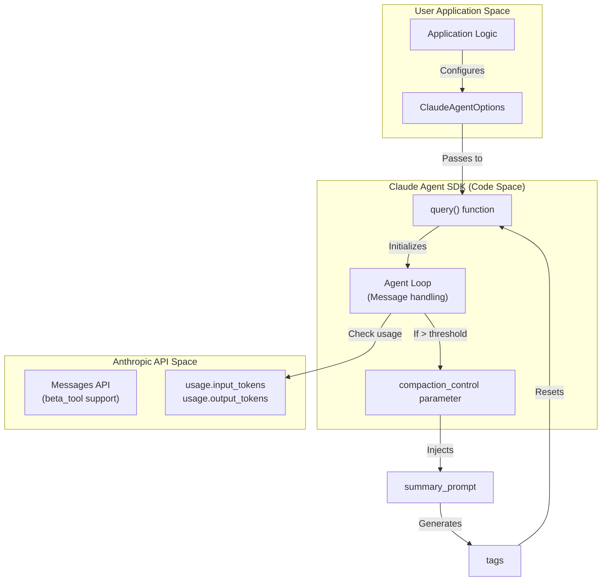
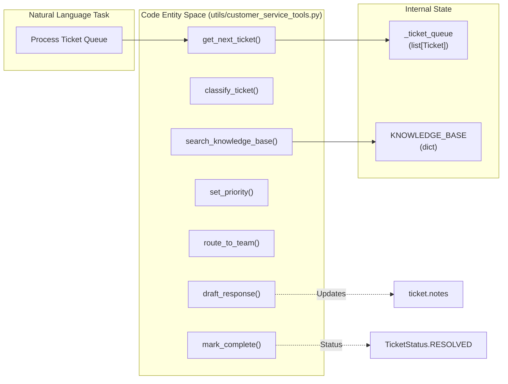

<!-- source: DeepWiki mcp.deepwiki.com · repo anthropics/claude-cookbooks · page 6.3 Context Management and Compaction · fetched 2026-10-26 -->

# Context Management and Compaction

<details>
<summary>Relevant source files</summary>

The following files were used as context for generating this wiki page:

- [.env.example](.env.example)
- [finetuning/datasets/json_mode_dataset.jsonl](finetuning/datasets/json_mode_dataset.jsonl)
- [finetuning/finetuning_on_bedrock.ipynb](finetuning/finetuning_on_bedrock.ipynb)
- [misc/session_memory_compaction.ipynb](misc/session_memory_compaction.ipynb)
- [observability/usage_cost_api.ipynb](observability/usage_cost_api.ipynb)
- [third_party/MongoDB/rag_using_mongodb.ipynb](third_party/MongoDB/rag_using_mongodb.ipynb)
- [third_party/Pinecone/claude_3_rag_agent.ipynb](third_party/Pinecone/claude_3_rag_agent.ipynb)
- [tool_use/automatic-context-compaction.ipynb](tool_use/automatic-context-compaction.ipynb)
- [tool_use/context_engineering/.gitignore](tool_use/context_engineering/.gitignore)
- [tool_use/context_engineering/context_engineering_tools.ipynb](tool_use/context_engineering/context_engineering_tools.ipynb)
- [tool_use/context_engineering/research_corpus.py](tool_use/context_engineering/research_corpus.py)
- [tool_use/utils/customer_service_api.py](tool_use/utils/customer_service_api.py)
- [tool_use/utils/customer_service_tools.py](tool_use/utils/customer_service_tools.py)

</details>


## Purpose and Scope

This document details the implementation of automatic and manual context management for long-running Claude agents. As conversations and tool-heavy workflows progress, they can exceed context limits or suffer from "context rot"—a degradation in model recall as token counts increase. Compaction addresses this by distilling history into high-fidelity summaries.

This page covers the `compaction_control` configuration for the Claude Agent SDK, token thresholds, session memory patterns, and a comprehensive customer service workflow example.

---

## Overview

Long-running agentic workflows typically experience linear token growth. Each tool call adds a request block, a result block, and a model response to the history. In iterative tasks, such as processing a queue of 30 support tickets, the 20th ticket's request will include the full history of the previous 19 tickets.

**Key Strategies for Context Engineering:**
*   **Compaction**: Distills context into a summary when a token threshold is met.
*   **Tool-Result Clearing**: Drops bulky, re-fetchable tool outputs while keeping the record of the call.
*   **Memory**: Uses persistent external storage (like the `memory_20250818` tool) for cross-session knowledge.

**Sources**: [tool_use/automatic-context-compaction.ipynb:8-25](), [tool_use/context_engineering/context_engineering_tools.ipynb:12-22]()

---

## SDK-Based Automatic Compaction

The Claude Agent SDK provides automatic context management via the `compaction_control` parameter. This monitors token usage and triggers a summarization turn when limits are reached.

### Data Flow and Code Entities

The following diagram bridges the natural language workflow to the specific code entities in the `anthropic` and `claude-agent-sdk` libraries.

**Diagram: Compaction Logic and SDK Integration**



**Sources**: [tool_use/automatic-context-compaction.ipynb:18-25](), [tool_use/automatic-context-compaction.ipynb:825-845]()

### Compaction Parameters

| Parameter | Description | Source |
| :--- | :--- | :--- |
| `enabled` | Boolean to toggle the feature. | [tool_use/automatic-context-compaction.ipynb:18-25]() |
| `context_token_threshold` | The token count (input + output) that triggers compaction. | [tool_use/automatic-context-compaction.ipynb:20-21]() |
| `summary_prompt` | Custom instructions for the summarization phase. | [tool_use/automatic-context-compaction.ipynb:21-22]() |
| `model` | Optional: A cheaper model (e.g., Haiku) to perform the summary. | [tool_use/automatic-context-compaction.ipynb:50-52]() |

---

## Customer Service Workflow Example

The `automatic-context-compaction.ipynb` cookbook uses a ticket processing agent to demonstrate the benefits of compaction. The agent uses specialized tools to resolve issues.

### System Architecture: Tool Interaction

This diagram maps the logical tools to the Python functions defined in the utility module.

**Diagram: Customer Service Tool Mapping**



**Sources**: [tool_use/utils/customer_service_tools.py:60-260](), [tool_use/automatic-context-compaction.ipynb:104-116]()

### Performance Comparison

When processing a batch of tickets, linear token growth is mitigated by compaction:

| Metric | Without Compaction | With Compaction |
| :--- | :--- | :--- |
| **Token Usage** | Linear Growth | Bounded by Threshold |
| **Context Window** | Fills quickly | Maintained via Summary |
| **Workflow** | Baseline | **Significant Token Reduction** |

**Sources**: [tool_use/automatic-context-compaction.ipynb:168-175](), [tool_use/automatic-context-compaction.ipynb:18-25]()

---

## Session Memory Compaction Patterns

While the SDK handles automatic compaction for agents, manual conversational applications often require proactive "Session Memory" management. This involves building a summary in the background to avoid user latency.

### Background Compaction Pattern

Instead of waiting for the context to fill, applications can maintain a "running summary" in a background thread.

1.  **Threaded Update**: After every user turn, a background process sends the current history to Claude with a `SESSION_MEMORY_PROMPT`.
2.  **Prompt Caching**: Use `cache_control` on the history sent for summarization to reduce costs.
3.  **Instant Swap**: When the main conversation hits the token limit, the latest background summary is swapped in immediately.

**Sources**: [misc/session_memory_compaction.ipynb:7-22](), [misc/session_memory_compaction.ipynb:120-145]()

### Implementation Detail: Cache Control

To optimize background summarization, the cookbook provides the `add_cache_control` helper:

```python
def add_cache_control(messages: list[dict]) -> list[MessageParam]:
    """Add cache_control to the last user message for prompt caching."""
    # ... logic to find last user message and inject 'ephemeral' cache type
```

**Sources**: [misc/session_memory_compaction.ipynb:120-145]()

---

## Advanced Context Engineering Primitives

Beyond simple summarization, complex agents use a combination of strategies.

### Tool-Result Clearing (`clear_tool_uses`)
This strategy targets "bloat" from large tool outputs. The system can be configured to drop the content of previous tool results while keeping the metadata, allowing the agent to re-fetch data if needed.

### Comparison Table

| Strategy | Target Problem | Action | API / SDK Primitive |
| :--- | :--- | :--- | :--- |
| **Compaction** | Long conversation history | Distill into summary | `compaction_control` |
| **Clearing** | Bulky tool results | Drop result content | `clear_tool_uses` |
| **Memory** | Cross-session knowledge | Write to external file | `memory_20250818` |

**Sources**: [tool_use/context_engineering/context_engineering_tools.ipynb:18-22](), [tool_use/context_engineering/context_engineering_tools.ipynb:28-32]()

---

## Limitations

*   **Server-Side Compaction**: Newer models like Opus 4.6 recommend server-side compaction which handles management automatically without SDK configuration.
*   **Information Loss**: Summaries are lossy. Critical details may be discarded in favor of status and outcomes.
*   **Threshold Minimums**: Thresholds must be set carefully to avoid "compaction loops" where the summary itself triggers another compaction.

**Sources**: [tool_use/automatic-context-compaction.ipynb:50-52](), [tool_use/context_engineering/context_engineering_tools.ipynb:12-22]()

---

