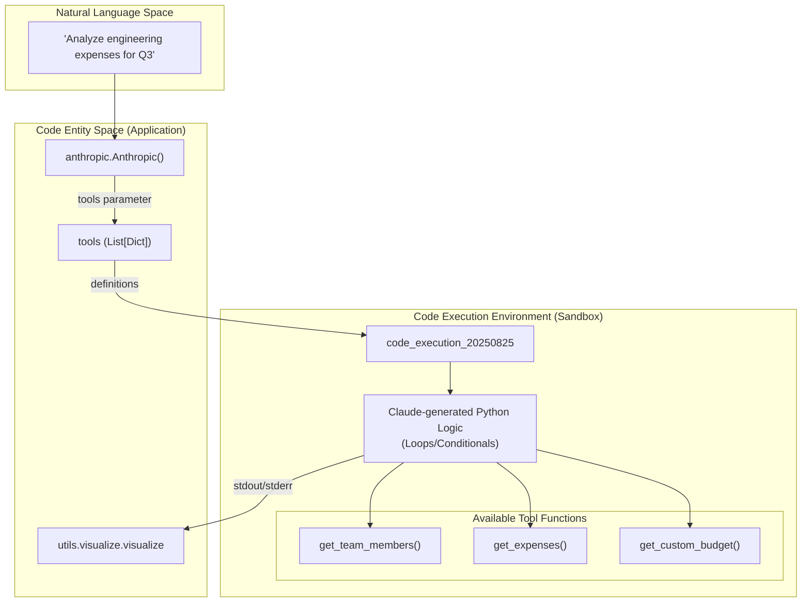
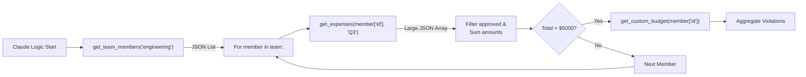

<!-- source: DeepWiki mcp.deepwiki.com · repo anthropics/claude-cookbooks · page 6.4 Programmatic Tool Calling · fetched 2026-10-26 -->

# Programmatic Tool Calling

Relevant source files

The following files were used as context for generating this wiki page:

- [tool_evaluation/evaluation.xml](tool_evaluation/evaluation.xml)
- [tool_evaluation/tool_evaluation.ipynb](tool_evaluation/tool_evaluation.ipynb)
- [tool_use/__init__.py](tool_use/__init__.py)
- [tool_use/programmatic_tool_calling_ptc.ipynb](tool_use/programmatic_tool_calling_ptc.ipynb)
- [tool_use/utils/__init__.py](tool_use/utils/__init__.py)
- [tool_use/utils/team_expense_api.py](tool_use/utils/team_expense_api.py)
- [tool_use/utils/visualize.py](tool_use/utils/visualize.py)

## Purpose and Scope

Programmatic Tool Calling (PTC) is an advanced capability that allows Claude to write and execute Python code to interact with tools within a secure code execution environment. Unlike standard tool calling, which requires a separate API round-trip for every single tool invocation, PTC enables Claude to perform complex logic—such as loops, conditional branching, and data filtering—in a single execution step.

This pattern is particularly effective for:
*   **Reducing Latency:** Executing dozens of tool calls in one go instead of sequential model turns.
*   **Context Optimization:** Writing code to "grep" or filter large tool outputs (like hundred-line expense reports) before passing only the relevant data back to the model's context window [tool_use/programmatic_tool_calling_ptc.ipynb:10-14]().
*   **Complex Workflows:** Handling tasks that require standard programming constructs like `try/except` blocks or list comprehensions.

**Sources:** [tool_use/programmatic_tool_calling_ptc.ipynb:8-14](), [tool_use/utils/visualize.py:1-15]()

## Core Architecture

The PTC framework bridges the gap between Claude's natural language reasoning and a concrete Python execution environment.

### Execution Flow
The following diagram illustrates how a user request results in generated code that interacts with the toolset.

**Natural Language to Code Entity Space Mapping**

**Sources:** [tool_use/programmatic_tool_calling_ptc.ipynb:121-150](), [tool_use/utils/visualize.py:147-156](), [tool_use/utils/team_expense_api.py:20-38]()

### The Caller Field
A critical metadata field in the tool use lifecycle is `caller`. This identifies where the tool invocation originated:
*   `direct`: The model requested a standard tool call via a `tool_use` block.
*   `code_execution_20250825`: The tool was invoked programmatically from within the Python sandbox [tool_use/utils/visualize.py:150-156]().

## Content Block Types

### server_tool_use
When Claude decides to use PTC, it generates a `server_tool_use` block. This block contains the raw Python code intended for the sandbox.
*   **Implementation:** The `visualize.py` utility identifies these blocks and uses the `rich` library's `Syntax` class to provide syntax highlighting for the code [tool_use/utils/visualize.py:164-187]().

### code_execution_tool_result
This block captures the outcome of the programmatic execution. It contains three primary fields:
1.  `return_code`: 0 for success, non-zero for errors.
2.  `stdout`: The printed output from the script.
3.  `stderr`: Any error tracebacks or error stream data [tool_use/utils/visualize.py:229-245]().

**Sources:** [tool_use/utils/visualize.py:164-194](), [tool_use/utils/visualize.py:229-263]()

## Team Expense API (Mock Implementation)

The cookbook uses a mock API to demonstrate PTC's ability to handle high-volume data and sequential dependencies.

### Tool Definitions
| Tool Name | Purpose | Key Data |
| :--- | :--- | :--- |
| `get_team_members` | Lists employees by department | ID, Level (Junior to Principal) [tool_use/utils/team_expense_api.py:20-38]() |
| `get_expenses` | Fetches line items for a quarter | 20-50 items, Amount, Category, Status [tool_use/utils/team_expense_api.py:217-245]() |
| `get_custom_budget` | Retrieves specific travel exceptions | Custom limit vs. standard $5,000 [tool_use/utils/team_expense_api.py:454-475]() |

**Sources:** [tool_use/utils/team_expense_api.py:20-38](), [tool_use/utils/team_expense_api.py:217-245](), [tool_use/utils/team_expense_api.py:454-475]()

### Data Flow Diagram
This diagram maps the programmatic logic to the specific API functions defined in the codebase.

**PTC Logic Flow**

**Sources:** [tool_use/utils/team_expense_api.py:536-581](), [tool_use/programmatic_tool_calling_ptc.ipynb:103-111]()

## Tool Evaluation and Metrics

For testing and quality assurance, the `tool_evaluation.ipynb` notebook implements an evaluation loop that tracks tool performance across a set of tasks defined in `evaluation.xml` [tool_evaluation/evaluation.xml:1-34]().

### The Agent Loop
The `agent_loop` function facilitates the interaction between the model and the tools, specifically tracking timing metrics for each call [tool_evaluation/tool_evaluation.ipynb:80-80]().

*   **Metric Tracking**: Captures `count` and `durations` for each tool used [tool_evaluation/tool_evaluation.ipynb:80-80]().
*   **Dynamic Dispatch**: Uses `eval()` (in demonstration) or a function dictionary to execute local Python functions based on Claude's `tool_use` blocks [tool_evaluation/tool_evaluation.ipynb:80-80]().

**Sources:** [tool_evaluation/tool_evaluation.ipynb:80-80](), [tool_evaluation/evaluation.xml:1-34]()

## Debugging and Visualization

The `utils/visualize.py` module is a standalone utility designed to make the tool-calling process transparent in the terminal or notebook.

### Key Classes and Functions
*   **`ParsedMessage`**: A container for Claude's response including role, content blocks, and token usage [tool_use/utils/visualize.py:23-39]().
*   **`parse_response()`**: A robust parser that handles both raw dictionary responses and Anthropic SDK `Message` objects [tool_use/utils/visualize.py:67-111]().
*   **`render_code_execution_result()`**: Specifically handles the output of PTC, color-coding the `return_code` (green for success, red for error) and formatting `stdout` [tool_use/utils/visualize.py:229-263]().

### Token Usage Tracking
The visualizer automatically calculates and displays token consumption for every turn:
*   `input_tokens` (Cyan)
*   `output_tokens` (Green)
*   Total tokens (Yellow)

This is implemented in `render_usage()` [tool_use/utils/visualize.py:289-296]().

**Sources:** [tool_use/utils/visualize.py:15-39](), [tool_use/utils/visualize.py:229-263](), [tool_use/utils/visualize.py:289-296]()

## Comparison of Patterns

| Feature | Standard Tool Use | Programmatic Tool Use (PTC) |
| :--- | :--- | :--- |
| **Logic Location** | Claude's Reasoning | Python Code in Sandbox |
| **API Turns** | 1 turn per tool call | 1 turn for N tool calls |
| **Data Handling** | Full JSON returned to Claude | Code can filter data before returning |
| **Best For** | Simple lookups | Batch processing, Math, Data filtering |

**Sources:** [tool_use/programmatic_tool_calling_ptc.ipynb:8-14](), [tool_use/utils/team_expense_api.py:536-581]()

---

