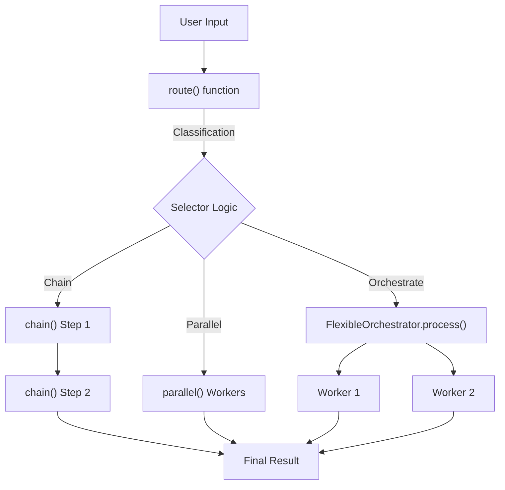
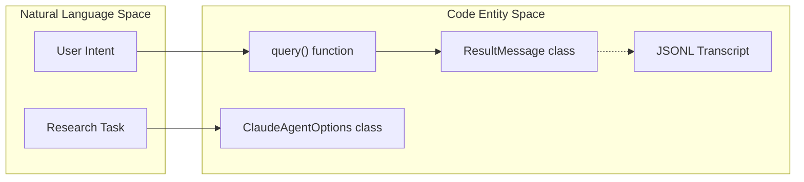

<!-- source: DeepWiki mcp.deepwiki.com · repo anthropics/claude-cookbooks · page 7 Agent Patterns and SDK · fetched 2026-10-26 -->

# Agent Patterns and SDK

Relevant source files

The following files were used as context for generating this wiki page:

- [claude_agent_sdk/.env.example](claude_agent_sdk/.env.example)
- [claude_agent_sdk/.gitignore](claude_agent_sdk/.gitignore)
- [claude_agent_sdk/04_migrating_from_openai_agents_sdk.ipynb](claude_agent_sdk/04_migrating_from_openai_agents_sdk.ipynb)
- [claude_agent_sdk/05_Building_a_session_browser.ipynb](claude_agent_sdk/05_Building_a_session_browser.ipynb)
- [claude_agent_sdk/08_Dynamic_workflows.ipynb](claude_agent_sdk/08_Dynamic_workflows.ipynb)
- [claude_agent_sdk/README.md](claude_agent_sdk/README.md)
- [claude_agent_sdk/pyproject.toml](claude_agent_sdk/pyproject.toml)
- [claude_agent_sdk/session_browser_demo/.gitkeep](claude_agent_sdk/session_browser_demo/.gitkeep)
- [patterns/agents/README.md](patterns/agents/README.md)
- [patterns/agents/async_multi_agent_orchestration.ipynb](patterns/agents/async_multi_agent_orchestration.ipynb)
- [patterns/agents/basic_workflows.ipynb](patterns/agents/basic_workflows.ipynb)
- [patterns/agents/evaluator_optimizer.ipynb](patterns/agents/evaluator_optimizer.ipynb)
- [patterns/agents/orchestrator_workers.ipynb](patterns/agents/orchestrator_workers.ipynb)
- [patterns/agents/util.py](patterns/agents/util.py)

This section provides an overview of the architectures and tools available for building sophisticated agentic systems with Claude. It covers both high-level design patterns—the "blueprints" for multi-step reasoning—and the **Claude Agent SDK**, which provides the production-grade infrastructure for session management, tool execution, and long-running agent persistence.

## Agent Workflow Patterns

Building effective agents often requires moving beyond a single prompt-response cycle. The repository documents several fundamental patterns that trade off latency and cost for improved task performance. These patterns utilize structured communication (often via XML) to coordinate between multiple LLM calls.

*   **Prompt Chaining**: Decomposes tasks into sequential subtasks where each step builds on the previous result [patterns/agents/basic_workflows.ipynb:11-11]().
*   **Parallelization**: Distributes independent subtasks across multiple LLMs for concurrent processing [patterns/agents/basic_workflows.ipynb:12-12]().
*   **Routing**: Dynamically selects specialized LLM paths based on input classification [patterns/agents/basic_workflows.ipynb:13-13]().
*   **Orchestrator-Workers**: A central LLM analyzes a task and dynamically delegates subtasks to specialized workers [patterns/agents/orchestrator_workers.ipynb:11-11]().
*   **Evaluator-Optimizer**: An iterative loop where one LLM generates a response and another provides feedback for refinement [patterns/agents/evaluator_optimizer.ipynb:8-8]().
*   **Dynamic Workflows**: A high-scale orchestration pattern where Claude writes a JavaScript orchestration script executed by a `Workflow` tool to manage up to 1,000 subagents [claude_agent_sdk/08_Dynamic_workflows.ipynb:12-14]().

For details, see [Agent Workflow Patterns](#7.1).

**Workflow Pattern Logic**

Sources: [patterns/agents/basic_workflows.ipynb:35-81](), [patterns/agents/orchestrator_workers.ipynb:136-158]()

## Claude Agent SDK

The **Claude Agent SDK** is a specialized framework for building agents that require robust session management and tool integration. It moves away from manual message array management by providing high-level primitives like `query()` and `ClaudeAgentOptions`.

Key features include:
*   **Session Management**: Automatic persistence of conversation transcripts to JSONL on disk [claude_agent_sdk/05_Building_a_session_browser.ipynb:11-12]().
*   **Tool Integration**: Seamless execution of tools, including support for the Model Context Protocol (MCP) [claude_agent_sdk/README.md:49-49]().
*   **Agent Configuration**: Fine-grained control over model selection, `max_turns`, and `cwd` (current working directory) for project isolation [claude_agent_sdk/05_Building_a_session_browser.ipynb:119-124]().
*   **Stateful Interaction**: The `ClaudeSDKClient` provides a stateful interface for managing ongoing conversation context [claude_agent_sdk/README.md:63-63]().

For details, see [Claude Agent SDK Tutorial Series](#7.2).

**SDK Entity Mapping**

Sources: [claude_agent_sdk/05_Building_a_session_browser.ipynb:114-135]()

## Production Agent Examples

The SDK is demonstrated through several "real-world" implementations that showcase different agentic capabilities:
*   **Chief of Staff Agent**: Demonstrates multi-agent systems with subagents, hooks, and "plan mode" [claude_agent_sdk/README.md:66-78]().
*   **Observability Agent**: Connects to external systems via MCP servers for GitHub monitoring and CI workflows [claude_agent_sdk/README.md:79-89]().
*   **Site Reliability Agent**: An autonomous incident response agent using read-write MCP tools for diagnosis and remediation [claude_agent_sdk/README.md:90-101]().
*   **Vulnerability Detection Agent**: A security-focused agent that threat-models targets and hunts for memory-safety bugs [claude_agent_sdk/README.md:122-124]().

For details, see [Production Agent Examples](#7.3).

## Context Engineering for Agents

As agents run for longer periods, managing the context window becomes critical to prevent "context rot" and manage costs. The repository explores primitives for context engineering:

| Primitive | Function | Best For |
| :--- | :--- | :--- |
| **Compaction** | Distills context into a high-fidelity summary | Long analytical conversations |
| **Tool-Result Clearing** | Drops old, re-fetchable tool outputs while keeping the call record | Agents calling many bulky tools (e.g., file reads) |
| **Memory** | Structured note-taking in persistent external storage | Knowledge that must survive between sessions |
| **Durable Resume** | Resuming agents from saved session states | Multi-turn sessions with interruptions |

For details, see [Context Engineering for Agents](#7.4).

Sources: [claude_agent_sdk/README.md:108-108](), [claude_agent_sdk/05_Building_a_session_browser.ipynb:11-21]()

---

