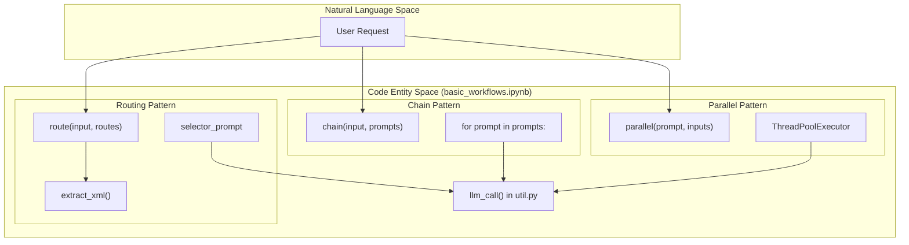
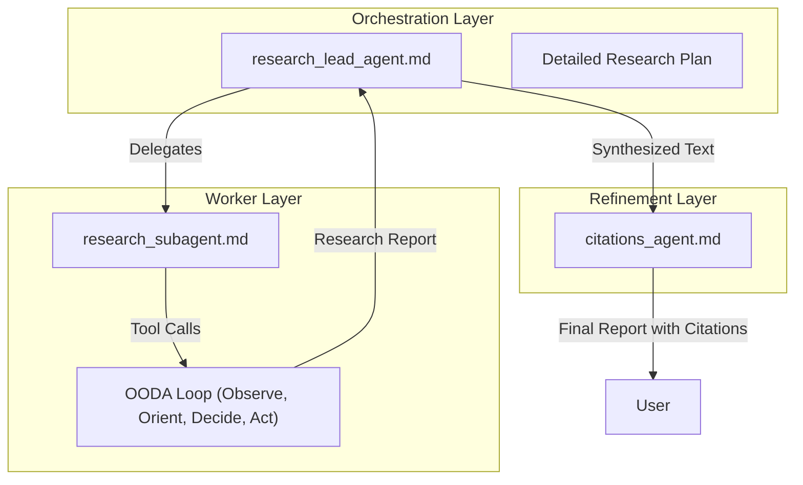

<!-- source: DeepWiki mcp.deepwiki.com · repo anthropics/claude-cookbooks · page 7.1 Agent Workflow Patterns · fetched 2026-10-26 -->

# Agent Workflow Patterns

Relevant source files

The following files were used as context for generating this wiki page:

- [patterns/agents/README.md](patterns/agents/README.md)
- [patterns/agents/async_multi_agent_orchestration.ipynb](patterns/agents/async_multi_agent_orchestration.ipynb)
- [patterns/agents/basic_workflows.ipynb](patterns/agents/basic_workflows.ipynb)
- [patterns/agents/evaluator_optimizer.ipynb](patterns/agents/evaluator_optimizer.ipynb)
- [patterns/agents/orchestrator_workers.ipynb](patterns/agents/orchestrator_workers.ipynb)
- [patterns/agents/prompts/citations_agent.md](patterns/agents/prompts/citations_agent.md)
- [patterns/agents/prompts/research_lead_agent.md](patterns/agents/prompts/research_lead_agent.md)
- [patterns/agents/prompts/research_subagent.md](patterns/agents/prompts/research_subagent.md)
- [patterns/agents/util.py](patterns/agents/util.py)

This page documents the fundamental agentic patterns and multi-LLM workflows provided in the `patterns/agents` directory. These patterns provide a blueprint for moving beyond single-prompt interactions toward reliable, autonomous systems by decomposing tasks into structured sequences, parallel streams, or iterative loops.

## Overview of Agentic Workflows

The Claude Cookbooks categorize agentic patterns into two tiers: basic building blocks and advanced workflows. These patterns trade off increased latency or cost for significantly improved performance on complex tasks [patterns/agents/basic_workflows.ipynb:7-15]().

| Pattern | Description | Key Benefit |
| :--- | :--- | :--- |
| **Prompt Chaining** | Sequential subtasks where output of $N$ is input for $N+1$. | Decomposition of complex logic. |
| **Parallelization** | Concurrent execution of independent subtasks. | Reduced latency for bulk processing. |
| **Routing** | Dynamic selection of specialized paths based on input. | Efficiency and specialization. |
| **Orchestrator-Workers** | A lead agent plans and delegates to specialized sub-agents. | Handling unpredictable, complex tasks. |
| **Evaluator-Optimizer** | Iterative loop between a generator and a critic. | High-quality, refined outputs. |

Sources: [patterns/agents/basic_workflows.ipynb:7-15](), [patterns/agents/README.md:5-14]()

---

## Basic Building Blocks

### Prompt Chaining
Prompt chaining decomposes a large task into a fixed sequence of steps. This is effective when a task can be broken down into discrete transformations where each step benefits from a specific focus [patterns/agents/basic_workflows.ipynb:11-11]().

**Implementation Logic:**
The `chain` function iterates through a list of prompts, passing the `result` of the previous `llm_call` as the input for the next [patterns/agents/basic_workflows.ipynb:35-42]().

### Parallelization
Parallelization involves running multiple LLM calls simultaneously. This is used for "Section-by-Section" processing or "Voting" patterns where independent perspectives are aggregated [patterns/agents/basic_workflows.ipynb:12-12]().

**Implementation Logic:**
The `parallel` function utilizes a `ThreadPoolExecutor` to submit multiple `llm_call` tasks concurrently, returning a list of results once all futures are complete [patterns/agents/basic_workflows.ipynb:45-49]().

### Routing
Routing uses an initial LLM call to classify the input and direct it to a specialized prompt or downstream process. This ensures that the model processing the final request has the most relevant context and instructions [patterns/agents/basic_workflows.ipynb:13-13]().

**Implementation Logic:**
1. A `selector_prompt` asks the LLM to analyze the input and select a key from the `routes` dictionary [patterns/agents/basic_workflows.ipynb:56-69]().
2. The implementation uses `extract_xml` to retrieve the `reasoning` and `selection` tags [patterns/agents/basic_workflows.ipynb:71-73]().
3. The `route_key` is then used to index into the `routes` map to execute the final specialized call [patterns/agents/basic_workflows.ipynb:80-81]().

### Workflow Entity Mapping
The following diagram bridges the conceptual workflows to the specific implementation functions found in `basic_workflows.ipynb`.

**Diagram: Basic Workflow Code Entities**

Sources: [patterns/agents/basic_workflows.ipynb:35-82](), [patterns/agents/util.py:9-30]()

---

## Advanced Workflows

### Orchestrator-Workers
In this pattern, a central "Orchestrator" LLM analyzes a task, determines the necessary subtasks, and delegates them to "Worker" LLMs. This is superior to simple parallelization when the required subtasks cannot be predicted in advance [patterns/agents/orchestrator_workers.ipynb:11-15]().

**Key Components:**
- **Analysis Phase**: The orchestrator generates structured subtask descriptions in XML format [patterns/agents/orchestrator_workers.ipynb:54-54]().
- **Execution Phase**: Workers receive the original task context plus their specific subtask instructions [patterns/agents/orchestrator_workers.ipynb:56-61]().

**Implementation:**
The `FlexibleOrchestrator` class manages this lifecycle [patterns/agents/orchestrator_workers.ipynb:136-157](). It uses `parse_tasks` to convert the orchestrator's XML output into a list of dictionaries containing `type` and `description` [patterns/agents/orchestrator_workers.ipynb:111-133](). The `process` method then iterates through these tasks, calling the worker LLMs [patterns/agents/orchestrator_workers.ipynb:157-180]().

Sources: [patterns/agents/orchestrator_workers.ipynb:11-61](), [patterns/agents/orchestrator_workers.ipynb:136-157]()

### Evaluator-Optimizer
This workflow creates a feedback loop where a `generate` call produces an initial response and an `evaluate` call provides critique. The loop continues until the evaluation criteria are met [patterns/agents/evaluator_optimizer.ipynb:7-8]().

**Workflow Steps:**
1. **`generate()`**: Calls the LLM with the task and any previous context/feedback [patterns/agents/evaluator_optimizer.ipynb:31-43]().
2. **`evaluate()`**: Assesses the generated content against requirements, returning a status (e.g., "PASS" or "NEEDS_IMPROVEMENT") and specific feedback [patterns/agents/evaluator_optimizer.ipynb:46-58]().
3. **`loop()`**: Orchestrates the interaction. If the status is not "PASS", it appends the previous result and feedback to the context for the next `generate` call [patterns/agents/evaluator_optimizer.ipynb:61-81]().

Sources: [patterns/agents/evaluator_optimizer.ipynb:7-81]()

### Async Multi-Agent Orchestration
For complex, stateful interactions, the `async_multi_agent_orchestration.ipynb` notebook introduces a `Hub` for message passing between agents [patterns/agents/async_multi_agent_orchestration.ipynb:69-107]().

**Core Mechanics:**
- **`Hub`**: A central registry and message bus where agents can `post` and `drain` messages [patterns/agents/async_multi_agent_orchestration.ipynb:69-107]().
- **Messaging Tools**: Agents use `send_message` and `wait_for_message` to communicate [patterns/agents/async_multi_agent_orchestration.ipynb:126-150]().
- **`run_agent()`**: A standard tool-use loop that executes an agent's lifecycle, automatically appending received messages to tool results to avoid polling [patterns/agents/async_multi_agent_orchestration.ipynb:177-199]().

Sources: [patterns/agents/async_multi_agent_orchestration.ipynb:69-199]()

---

## Research Agent Implementation

The cookbook provides a sophisticated multi-agent implementation for research tasks, utilizing the Orchestrator-Workers pattern with specialized prompt templates.

**Diagram: Research Agent Architecture**

### Research Lead Agent
The lead agent is responsible for high-level strategy and planning. It categorizes queries into three types to determine the delegation strategy [patterns/agents/prompts/research_lead_agent.md:1-12]():
- **Depth-first**: Requires multiple perspectives on a single topic [patterns/agents/prompts/research_lead_agent.md:13-18]().
- **Breadth-first**: Independent sub-questions handled by parallel agents [patterns/agents/prompts/research_lead_agent.md:19-24]().
- **Straightforward**: Single focused investigation [patterns/agents/prompts/research_lead_agent.md:25-30]().

### Research Sub-Agent
The sub-agent executes a research loop. It is instructed to maintain a "research budget" (number of tool calls) and prioritize internal tools (Google Drive, Gmail) over public web searches when relevant [patterns/agents/prompts/research_subagent.md:4-7](). It follows an OODA loop to gather and refine information [patterns/agents/prompts/research_subagent.md:10-12]().

### Citations Agent
A specialized worker that takes synthesized text and adds citations. It is strictly forbidden from modifying the original text content, focusing only on mapping claims to source documents [patterns/agents/prompts/citations_agent.md:1-9]().

Sources: [patterns/agents/prompts/research_lead_agent.md:1-58](), [patterns/agents/prompts/research_subagent.md:1-14](), [patterns/agents/prompts/citations_agent.md:1-23]()

---

