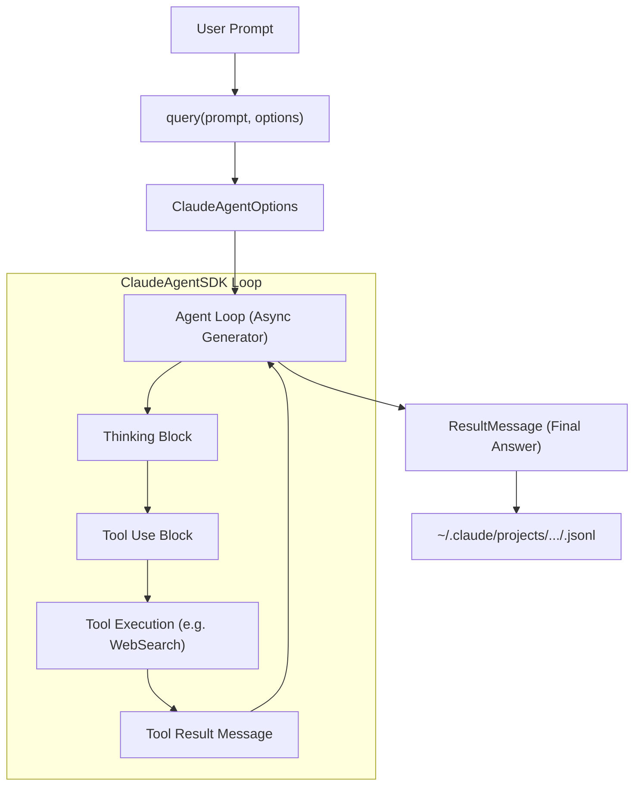
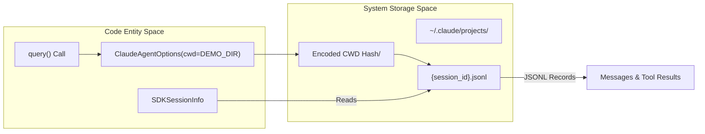

<!-- source: DeepWiki mcp.deepwiki.com · repo anthropics/claude-cookbooks · page 7.2 Claude Agent SDK Tutorial Series · fetched 2026-10-26 -->

# Claude Agent SDK Tutorial Series

Relevant source files

The following files were used as context for generating this wiki page:

- [.claude/commands/add-registry.md](.claude/commands/add-registry.md)
- [.github/pull_request_template.md](.github/pull_request_template.md)
- [.github/registry_schema.json](.github/registry_schema.json)
- [.gitignore](.gitignore)
- [claude_agent_sdk/.env.example](claude_agent_sdk/.env.example)
- [claude_agent_sdk/.gitignore](claude_agent_sdk/.gitignore)
- [claude_agent_sdk/00_The_one_liner_research_agent.ipynb](claude_agent_sdk/00_The_one_liner_research_agent.ipynb)
- [claude_agent_sdk/01_The_chief_of_staff_agent.ipynb](claude_agent_sdk/01_The_chief_of_staff_agent.ipynb)
- [claude_agent_sdk/02_The_observability_agent.ipynb](claude_agent_sdk/02_The_observability_agent.ipynb)
- [claude_agent_sdk/03_The_site_reliability_agent.ipynb](claude_agent_sdk/03_The_site_reliability_agent.ipynb)
- [claude_agent_sdk/04_migrating_from_openai_agents_sdk.ipynb](claude_agent_sdk/04_migrating_from_openai_agents_sdk.ipynb)
- [claude_agent_sdk/05_Building_a_session_browser.ipynb](claude_agent_sdk/05_Building_a_session_browser.ipynb)
- [claude_agent_sdk/06_The_vulnerability_detection_agent.ipynb](claude_agent_sdk/06_The_vulnerability_detection_agent.ipynb)
- [claude_agent_sdk/08_Dynamic_workflows.ipynb](claude_agent_sdk/08_Dynamic_workflows.ipynb)
- [claude_agent_sdk/README.md](claude_agent_sdk/README.md)
- [claude_agent_sdk/chief_of_staff_agent/agent.py](claude_agent_sdk/chief_of_staff_agent/agent.py)
- [claude_agent_sdk/observability_agent/agent.py](claude_agent_sdk/observability_agent/agent.py)
- [claude_agent_sdk/pyproject.toml](claude_agent_sdk/pyproject.toml)
- [claude_agent_sdk/research_agent/agent.py](claude_agent_sdk/research_agent/agent.py)
- [claude_agent_sdk/session_browser_demo/.gitkeep](claude_agent_sdk/session_browser_demo/.gitkeep)
- [claude_agent_sdk/site_reliability_agent/examples/architecture_diagram.png](claude_agent_sdk/site_reliability_agent/examples/architecture_diagram.png)
- [claude_agent_sdk/site_reliability_agent/examples/sre_bot_slack.py](claude_agent_sdk/site_reliability_agent/examples/sre_bot_slack.py)
- [claude_agent_sdk/site_reliability_agent/infra_setup.py](claude_agent_sdk/site_reliability_agent/infra_setup.py)
- [claude_agent_sdk/site_reliability_agent/sre_mcp_server.py](claude_agent_sdk/site_reliability_agent/sre_mcp_server.py)
- [claude_agent_sdk/vulnerability_detection_agent/canary/canary.c](claude_agent_sdk/vulnerability_detection_agent/canary/canary.c)

This page documents the progressive tutorial series (notebooks 00-08) for the **Claude Agent SDK**. The series guides developers from building basic "one-liner" research agents to complex multi-agent systems with dynamic workflows, vulnerability detection, and external integrations via the Model Context Protocol (MCP).

## Series Overview

The tutorial series is designed to demonstrate the agentic power of Claude beyond simple chat interactions. It focuses on the SDK's ability to break down complex tasks, use tools autonomously, and maintain persistent state across sessions [claude_agent_sdk/README.md:38-40]().

| Notebook | Title | Key SDK Primitives | Primary Use Case |
| :--- | :--- | :--- | :--- |
| 00 | The One-Liner Research Agent | `query()`, `ClaudeAgentOptions` | Autonomous web research [claude_agent_sdk/README.md:55-57]() |
| 01 | The Chief of Staff Agent | Hooks, Subagents, `CLAUDE.md` | Multi-agent orchestration [claude_agent_sdk/README.md:66-68]() |
| 02 | The Observability Agent | MCP (Git/GitHub), CI/CD | DevOps monitoring [claude_agent_sdk/README.md:79-82]() |
| 03 | The Site Reliability Agent | Read-Write MCP, Safety Hooks | Incident remediation [claude_agent_sdk/README.md:90-93]() |
| 04 | Migrating from OpenAI Agents | Mapping handoffs & guardrails | Porting existing agents [claude_agent_sdk/README.md:102-104]() |
| 05 | Building a Session Browser | `list_sessions()`, Transcript forks | UI/UX history sidebars [claude_agent_sdk/README.md:112-114]() |
| 06 | Vulnerability Detection Agent | `Read`/`Grep`/`Glob` tools | Security threat modeling [claude_agent_sdk/06_The_vulnerability_detection_agent.ipynb:5-7]() |
| 08 | Dynamic Workflows | `Workflow` tool, JS orchestration | Large-scale parallel auditing [claude_agent_sdk/08_Dynamic_workflows.ipynb:12-14]() |

Sources: [claude_agent_sdk/README.md:38-114](), [claude_agent_sdk/06_The_vulnerability_detection_agent.ipynb:5-7](), [claude_agent_sdk/08_Dynamic_workflows.ipynb:12-14]()

---

## Core Implementation Primitives

The SDK's architecture centers on the `query()` function and the `ClaudeAgentOptions` configuration class.

### The `query()` Function
The `query()` function is the primary entry point for agentic interactions. It returns an async generator that yields message blocks, including tool calls, thinking blocks, and final results [claude_agent_sdk/00_The_one_liner_research_agent.ipynb:135-144]().

### `ClaudeAgentOptions`
This class configures the agent's behavior, including:
*   **`model`**: The Claude model to use (e.g., `claude-opus-4-6` or `claude-haiku-4-5`) [claude_agent_sdk/00_The_one_liner_research_agent.ipynb:140]().
*   **`allowed_tools`**: A list of tools the agent is permitted to call [claude_agent_sdk/00_The_one_liner_research_agent.ipynb:140]().
*   **`max_turns`**: Limits the number of agentic loops to prevent infinite execution [claude_agent_sdk/05_Building_a_session_browser.ipynb:122]().
*   **`cwd`**: Defines the project directory, which determines where session transcripts are stored [claude_agent_sdk/05_Building_a_session_browser.ipynb:121]().

### Data Flow: Natural Language to Code Execution
The following diagram illustrates how a user prompt moves through the SDK into the agent loop and eventually to tool execution.

**Agent Execution Flow**

Sources: [claude_agent_sdk/00_The_one_liner_research_agent.ipynb:102-144](), [claude_agent_sdk/05_Building_a_session_browser.ipynb:100-102]()

---

## Session Management and Browsing

The SDK automatically persists conversations as JSONL transcripts. Notebook 05 demonstrates how to build a session browser using these first-party primitives [claude_agent_sdk/05_Building_a_session_browser.ipynb:10-21]().

### Key Session Functions
*   **`list_sessions(directory=...)`**: Scans the project's transcript directory and returns `SDKSessionInfo` objects containing metadata like session ID, title, and last-modified time [claude_agent_sdk/05_Building_a_session_browser.ipynb:172-176]().
*   **Transcript Forking**: Allows a developer to fork a session at a specific point and resume it as a new live `query()` call [claude_agent_sdk/05_Building_a_session_browser.ipynb:19]().

### Session Persistence Mapping
This diagram maps the logical session entities to the physical file system structure used by the SDK.

**Session Storage Architecture**

Sources: [claude_agent_sdk/05_Building_a_session_browser.ipynb:84-102](), [claude_agent_sdk/05_Building_a_session_browser.ipynb:172-176]()

---

## Advanced Agent Patterns

### 1. Dynamic Workflows (Notebook 08)
Dynamic workflows allow Claude to write a JavaScript orchestration script that the `Workflow` tool executes in the background [claude_agent_sdk/08_Dynamic_workflows.ipynb:12](). This pattern is used for tasks that outgrow a single context window, such as fact-checking dozens of claims in parallel (fan-out) [claude_agent_sdk/08_Dynamic_workflows.ipynb:14-16]().

### 2. Vulnerability Detection (Notebook 06)
This pattern uses a **bootstrap-then-interview threat model** within a `ClaudeSDKClient` session [claude_agent_sdk/06_The_vulnerability_detection_agent.ipynb:6](). It leverages built-in `Read`, `Grep`, and `Glob` tools to hunt for memory-safety bugs in source code [claude_agent_sdk/06_The_vulnerability_detection_agent.ipynb:5]().

### 3. External System Integration (MCP)
Notebooks 02 and 03 utilize the **Model Context Protocol (MCP)** to connect Claude to external infrastructure:
*   **Git/GitHub MCP**: Allows analysis of repositories and PR management [claude_agent_sdk/README.md:84-85]().
*   **SRE Tool Server**: Provides tools for metrics (Prometheus), infrastructure (Docker), and diagnostics [claude_agent_sdk/README.md:95-97]().

### 4. Safety and Compliance Hooks
The SDK supports **Hooks** for automated audit trails. For example, **PreToolUse hooks** can validate write operations (like changing DB pool sizes) before they are executed by the agent [claude_agent_sdk/README.md:98]().

Sources: [claude_agent_sdk/README.md:68-101](), [claude_agent_sdk/06_The_vulnerability_detection_agent.ipynb:5-7](), [claude_agent_sdk/08_Dynamic_workflows.ipynb:12-16]()

---

