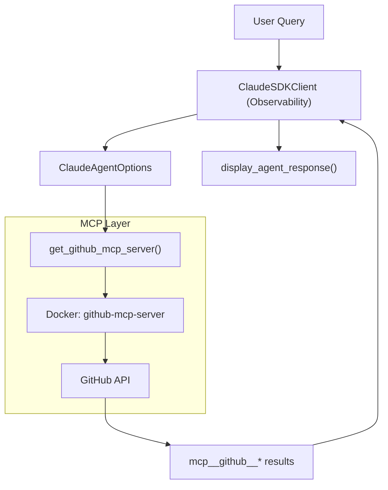
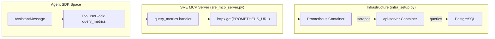
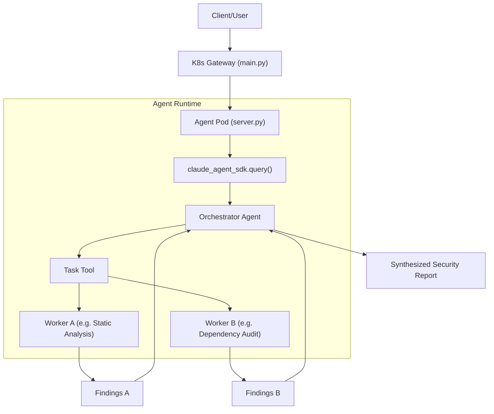

<!-- source: DeepWiki mcp.deepwiki.com · repo anthropics/claude-cookbooks · page 7.3 Production Agent Examples · fetched 2026-10-26 -->

# Production Agent Examples

Relevant source files

The following files were used as context for generating this wiki page:

- [claude_agent_sdk/00_The_one_liner_research_agent.ipynb](claude_agent_sdk/00_The_one_liner_research_agent.ipynb)
- [claude_agent_sdk/01_The_chief_of_staff_agent.ipynb](claude_agent_sdk/01_The_chief_of_staff_agent.ipynb)
- [claude_agent_sdk/02_The_observability_agent.ipynb](claude_agent_sdk/02_The_observability_agent.ipynb)
- [claude_agent_sdk/03_The_site_reliability_agent.ipynb](claude_agent_sdk/03_The_site_reliability_agent.ipynb)
- [claude_agent_sdk/07_Hosting_the_agent.ipynb](claude_agent_sdk/07_Hosting_the_agent.ipynb)
- [claude_agent_sdk/chief_of_staff_agent/agent.py](claude_agent_sdk/chief_of_staff_agent/agent.py)
- [claude_agent_sdk/hosting/kubernetes/gateway/k8s.py](claude_agent_sdk/hosting/kubernetes/gateway/k8s.py)
- [claude_agent_sdk/hosting/kubernetes/gateway/main.py](claude_agent_sdk/hosting/kubernetes/gateway/main.py)
- [claude_agent_sdk/hosting/kubernetes/gateway/proxy.py](claude_agent_sdk/hosting/kubernetes/gateway/proxy.py)
- [claude_agent_sdk/hosting/kubernetes/kind-quickstart.sh](claude_agent_sdk/hosting/kubernetes/kind-quickstart.sh)
- [claude_agent_sdk/hosting/requirements.txt](claude_agent_sdk/hosting/requirements.txt)
- [claude_agent_sdk/hosting/server.py](claude_agent_sdk/hosting/server.py)
- [claude_agent_sdk/observability_agent/agent.py](claude_agent_sdk/observability_agent/agent.py)
- [claude_agent_sdk/research_agent/agent.py](claude_agent_sdk/research_agent/agent.py)
- [claude_agent_sdk/site_reliability_agent/examples/architecture_diagram.png](claude_agent_sdk/site_reliability_agent/examples/architecture_diagram.png)
- [claude_agent_sdk/site_reliability_agent/examples/sre_bot_slack.py](claude_agent_sdk/site_reliability_agent/examples/sre_bot_slack.py)
- [claude_agent_sdk/site_reliability_agent/infra_setup.py](claude_agent_sdk/site_reliability_agent/infra_setup.py)
- [claude_agent_sdk/site_reliability_agent/sre_mcp_server.py](claude_agent_sdk/site_reliability_agent/sre_mcp_server.py)

This section provides a technical walkthrough of complete agent implementations built using the Claude Agent SDK. These examples demonstrate how to transition from basic research agents to sophisticated systems capable of multi-agent orchestration, infrastructure monitoring, and autonomous incident remediation.

## 1. Chief of Staff Agent (Multi-Agent Executive Assistant)

The Chief of Staff (CoS) agent is designed for executive-level startup management. It demonstrates how to leverage the filesystem as a source of truth for agent configuration, utilizing sub-agents, custom scripts, and specialized output formats.

### Core Architecture
The CoS agent uses `ClaudeAgentOptions` with `setting_sources=["project", "local"]` to automatically ingest project-specific context from the `.claude/` directory [claude_agent_sdk/chief_of_staff_agent/agent.py:100-106]().

**Chief of Staff Entity Mapping**

| Logic Component | Code Entity / Path | Role |
|:---|:---|:---|
| **Orchestrator** | `ClaudeSDKClient` | Manages the primary interaction loop [claude_agent_sdk/chief_of_staff_agent/agent.py:113-125](). |
| **Memory/Context** | `CLAUDE.md` | Persistent project instructions and startup context [claude_agent_sdk/01_The_chief_of_staff_agent.ipynb:71-82](). |
| **Sub-Agents** | `.claude/agents/` | Specialized workers (e.g., `financial-analyst`) invoked via the `Task` tool [claude_agent_sdk/chief_of_staff_agent/agent.py:63-63](). |
| **Domain Logic** | `scripts/*.py` | Python scripts for financial forecasting and talent scoring called via `Bash` [claude_agent_sdk/chief_of_staff_agent/agent.py:72-78](). |
| **Custom Commands** | `.claude/commands/` | Slash commands like `/budget-impact` for templated workflows [claude_agent_sdk/chief_of_staff_agent/agent.py:65-65](). |

### Implementation Flow
1. **Initialization**: The agent is configured with `allowed_tools=["Task", "Read", "Write", "Edit", "Bash", "WebSearch"]` [claude_agent_sdk/chief_of_staff_agent/agent.py:87-94]().
2. **Context Loading**: It sets the `cwd` to the project root to enable relative path resolution for data files in `financial_data/` [claude_agent_sdk/chief_of_staff_agent/agent.py:98-98]().
3. **Delegation**: When a complex query arrives (e.g., "Analyze our hiring budget"), the CoS uses the `Task` tool to spawn a `financial-analyst` sub-agent.
4. **Synthesis**: The CoS aggregates results from sub-agents and local Python scripts (e.g., `decision_matrix.py`) to produce an executive summary [claude_agent_sdk/chief_of_staff_agent/agent.py:75-75]().

**Sources:** [claude_agent_sdk/chief_of_staff_agent/agent.py:41-128](), [claude_agent_sdk/01_The_chief_of_staff_agent.ipynb:39-82]().

---

## 2. Observability Agent (DevOps Monitoring with MCP)

The Observability Agent focuses on read-only monitoring of external systems using the **Model Context Protocol (MCP)**. It specifically demonstrates integration with GitHub for CI/CD and repository analysis.

### MCP Integration
The agent connects to the `github-mcp-server` running in a Docker container [claude_agent_sdk/observability_agent/agent.py:53-62](). This provides Claude with structured tools for repository management without requiring the agent to use raw `gh` CLI commands.

**Observability Agent Data Flow**

### Key Technical Patterns
* **Strict Tool Scoping**: The implementation uses `disallowed_tools=["Bash", "Task"]` to force the agent to use the formal MCP interface rather than falling back to shell scripts [claude_agent_sdk/observability_agent/agent.py:111-111]().
* **Tool Mapping**: MCP tools are automatically prefixed (e.g., `mcp__github__get_issue`) to prevent namespace collisions [claude_agent_sdk/observability_agent/agent.py:107-107]().

**Sources:** [claude_agent_sdk/observability_agent/agent.py:14-146](), [claude_agent_sdk/02_The_observability_agent.ipynb:42-84]().

---

## 3. Site Reliability Agent (Incident Response)

The SRE Agent is a "write-capable" agent designed to investigate and remediate production incidents. It interacts with a simulated infrastructure stack including Prometheus, PostgreSQL, and a FastAPI server.

### System Components
The implementation consists of three primary layers:
1. **Simulated Infrastructure**: Managed via `infra_setup.py`, which generates a `docker-compose.yml` environment [claude_agent_sdk/site_reliability_agent/infra_setup.py:35-137]().
2. **SRE MCP Server**: A custom MCP server (`sre_mcp_server.py`) that provides tools for querying metrics, fetching logs, and executing runbooks [claude_agent_sdk/site_reliability_agent/sre_mcp_server.py:58-200]().
3. **Remediation Hooks**: Safety scripts in `hooks/` that validate agent-proposed changes before they are applied to the `api-server.env` configuration [claude_agent_sdk/site_reliability_agent/infra_setup.py:140-165]().

### Incident Workflow
The agent follows a structured investigation-to-remediation pipeline:

| Phase | Tool Used | Action |
|:---|:---|:---|
| **Triage** | `get_service_health` | Checks error rates and P99 latency across services [claude_agent_sdk/site_reliability_agent/sre_mcp_server.py:101-113](). |
| **Investigation** | `query_metrics` | Runs PromQL to identify DB connection exhaustion [claude_agent_sdk/site_reliability_agent/sre_mcp_server.py:60-91](). |
| **Verification** | `get_logs` | Fetches application logs to confirm "too many connections" errors [claude_agent_sdk/site_reliability_agent/sre_mcp_server.py:115-152](). |
| **Remediation** | `execute_runbook` | Updates `DB_POOL_SIZE` in the environment config [claude_agent_sdk/site_reliability_agent/sre_mcp_server.py:179-196](). |

**SRE Agent Code-to-Infrastructure Mapping**

### Safety & Human-in-the-loop
To prevent destructive autonomous actions, the SRE agent uses `permission_mode="acceptEdits"`. This ensures that any file modifications (like fixing a connection pool size) must be explicitly approved by the operator in the UI or CLI [claude_agent_sdk/03_The_site_reliability_agent.ipynb:7-7]().

**Sources:** [claude_agent_sdk/site_reliability_agent/sre_mcp_server.py:1-200](), [claude_agent_sdk/site_reliability_agent/infra_setup.py:1-165](), [claude_agent_sdk/03_The_site_reliability_agent.ipynb:1-81]().

---

## 4. Vulnerability Detection Agent (Security Analysis)

The Vulnerability Detection Agent is specialized for security auditing, using the `Task` tool to orchestrate specialized sub-agents that perform static analysis, dependency checking, and threat modeling.

### Architecture and Hosting
This agent utilizes the hosting infrastructure defined in `claude_agent_sdk/hosting/`. It can be deployed via Docker, Modal, or Kubernetes [claude_agent_sdk/07_Hosting_the_agent.ipynb:12-19]().

**Hosting Entity Mapping**

| Component | Code Entity | Responsibility |
|:---|:---|:---|
| **Server** | `hosting/server.py` | FastAPI wrapper exposing the agent over HTTP/SSE [claude_agent_sdk/hosting/server.py:1-25](). |
| **Gateway** | `hosting/kubernetes/gateway/main.py` | Single entry point mapping `session_id` to pods [claude_agent_sdk/hosting/kubernetes/gateway/main.py:1-15](). |
| **Relay** | `hosting/kubernetes/gateway/proxy.py` | Transparent SSE relay between client and agent pod [claude_agent_sdk/hosting/kubernetes/gateway/proxy.py:1-8](). |
| **Lifecycle** | `hosting/kubernetes/gateway/k8s.py` | Pod management and standby pool replenishment [claude_agent_sdk/hosting/kubernetes/gateway/k8s.py:2-6](). |

### Production Deployment Flow
1. **Containerization**: The agent is packaged into a Docker image using the `Dockerfile` in the `hosting/` root [claude_agent_sdk/hosting/kubernetes/kind-quickstart.sh:70-71]().
2. **Session Persistence**: Transcripts are stored in `CLAUDE_CONFIG_DIR` (default `/data`) to allow `resume=` functionality across restarts [claude_agent_sdk/hosting/server.py:57-58]().
3. **Security Constraints**: The hosted server intentionally drops the `Read` tool to prevent directory traversal attacks and environment variable exfiltration [claude_agent_sdk/hosting/server.py:59-65]().
4. **Tenant Isolation**: The Kubernetes gateway enforces tenant ownership by mapping bearer tokens to specific session IDs in Redis [claude_agent_sdk/hosting/kubernetes/gateway/main.py:129-153]().

**Sources:** [claude_agent_sdk/hosting/server.py:1-163](), [claude_agent_sdk/hosting/kubernetes/gateway/main.py:1-180](), [claude_agent_sdk/07_Hosting_the_agent.ipynb:44-71]().

---

## 5. Dynamic Workflows (Parallel Orchestration)

Dynamic workflows involve parallel sub-agent orchestration where an orchestrator agent fans out tasks to multiple worker agents and synthesizes the results.

### Orchestrator Pattern
The orchestrator uses the `Task` tool to delegate independent sub-problems. This pattern is essential for complex research or multi-faceted engineering tasks where serial execution is too slow or exceeds context limits.

**Workflow Data Flow**

### Implementation Details
* **Session Management**: The `post_message` endpoint in the server handles `session_id` mapping to internal SDK IDs to ensure conversation continuity [claude_agent_sdk/hosting/server.py:123-133]().
* **Streaming SSE**: Responses are streamed back to the caller using `EventSourceResponse` to provide real-time feedback during long-running parallel tasks [claude_agent_sdk/hosting/server.py:148-161]().
* **Idle Reaping**: To manage resources in production, the gateway includes a `_reap_idle_loop` that deletes pods with no traffic past the `IDLE_TIMEOUT_S` [claude_agent_sdk/hosting/kubernetes/gateway/main.py:44-48]().

**Sources:** [claude_agent_sdk/hosting/server.py:123-161](), [claude_agent_sdk/hosting/kubernetes/gateway/main.py:42-56](), [claude_agent_sdk/hosting/kubernetes/gateway/proxy.py:26-41]().

---

