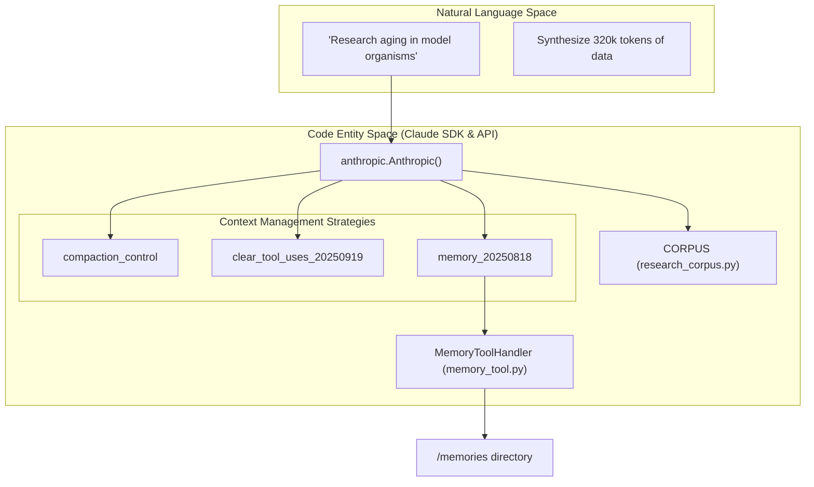
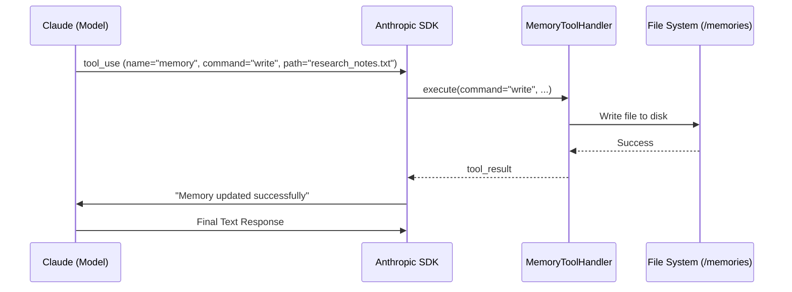

<!-- source: DeepWiki mcp.deepwiki.com · repo anthropics/claude-cookbooks · page 7.4 Context Engineering for Agents · fetched 2026-10-26 -->

# Context Engineering for Agents

<details>
<summary>Relevant source files</summary>

The following files were used as context for generating this wiki page:

- [.env.example](.env.example)
- [finetuning/datasets/json_mode_dataset.jsonl](finetuning/datasets/json_mode_dataset.jsonl)
- [finetuning/finetuning_on_bedrock.ipynb](finetuning/finetuning_on_bedrock.ipynb)
- [misc/session_memory_compaction.ipynb](misc/session_memory_compaction.ipynb)
- [observability/usage_cost_api.ipynb](observability/usage_cost_api.ipynb)
- [third_party/MongoDB/rag_using_mongodb.ipynb](third_party/MongoDB/rag_using_mongodb.ipynb)
- [third_party/Pinecone/claude_3_rag_agent.ipynb](third_party/Pinecone/claude_3_rag_agent.ipynb)
- [tool_use/context_engineering/.gitignore](tool_use/context_engineering/.gitignore)
- [tool_use/context_engineering/context_engineering_tools.ipynb](tool_use/context_engineering/context_engineering_tools.ipynb)
- [tool_use/context_engineering/research_corpus.py](tool_use/context_engineering/research_corpus.py)

</details>


Context engineering is the discipline of managing an agent's finite context window to maximize the density of high-signal tokens. As agents perform long-running tasks, they accumulate "context rot"—a degradation in recall accuracy as the window fills with tool results, reasoning chains, and conversation history `[tool_use/context_engineering/context_engineering_tools.ipynb:10-12]`.

This page details three primary primitives for managing long-horizon agent context: **Server-side Compaction**, **Tool-Result Clearing**, and **Structured External Memory**.

## 1. Context Engineering Architecture

The following diagram maps the relationship between the natural language intent of an agent and the code entities that implement context management.

### Agent Context Flow

Sources: `[tool_use/context_engineering/context_engineering_tools.ipynb:18-24]`, `[tool_use/memory_tool.py:1-20]`, `[tool_use/context_engineering/research_corpus.py:1-11]`, `[misc/session_memory_compaction.ipynb:71-77]`.

## 2. Server-Side Compaction

Compaction distills conversation history into a high-fidelity summary when token thresholds are met. This allows agents to continue long-running dialogues without hitting hard context limits `[tool_use/context_engineering/context_engineering_tools.ipynb:18-18]`.

### Implementation Details
Compaction is triggered via the `compaction_control` configuration in the API request. It replaces older message blocks with a `compaction` block containing the distilled summary. For manual implementations, a `SESSION_MEMORY_PROMPT` is used to guide the model in compressing the transcript into a structured summary that preserves critical context `[misc/session_memory_compaction.ipynb:163-170]`.

| Feature | Description |
| :--- | :--- |
| **Trigger** | Defined by token count or message depth via `compaction_control`. |
| **Preservation** | Uses `SESSION_MEMORY_PROMPT` to optimize for assistant continuity `[misc/session_memory_compaction.ipynb:163-166]`. |
| **Output** | A `compaction` block that must be serialized back in subsequent requests `[tool_use/context_engineering/context_engineering_tools.ipynb:29-29]`. |

Sources: `[tool_use/context_engineering/context_engineering_tools.ipynb:22-22]`, `[tool_use/context_engineering/context_engineering_tools.ipynb:29-29]`, `[misc/session_memory_compaction.ipynb:163-170]`.

## 3. Tool-Result Clearing

Tool-result clearing addresses bloat from large, re-fetchable data (e.g., file reads or API responses). It drops the content of old `tool_result` blocks while retaining the `tool_use` metadata, effectively "forgetting" the data but "remembering" that the action occurred `[tool_use/context_engineering/context_engineering_tools.ipynb:19-19]`.

### Configuration Pattern
Clearing is configured using the `clear_tool_uses_20250919` edit type within the `context_management` parameter. This is critical for agents whose context is dominated by re-fetchable tool results like file reads `[tool_use/context_engineering/context_engineering_tools.ipynb:28-28]`.

```python
# Example Configuration for context editing
CONTEXT_MANAGEMENT = {
    "edits": [
        {
            "type": "clear_tool_uses_20250919",
            "trigger": {"type": "input_tokens", "value": 30000},
            "keep": {"type": "tool_uses", "value": 3},
            "clear_at_least": {"type": "input_tokens", "value": 5000},
        }
    ]
}
```
Sources: `[tool_use/context_engineering/context_engineering_tools.ipynb:28-28]`.

## 4. Structured External Memory

External memory allows agents to persist knowledge across sessions using the `memory_20250818` tool. Unlike compaction or clearing, memory is driven by the agent itself; it chooses what to write to persistent storage `[tool_use/context_engineering/context_engineering_tools.ipynb:20-20]`.

### Memory Tool Components
- **`MemoryToolHandler`**: A Python class that manages file-based operations (read, write, list) under a `/memories` directory `[tool_use/memory_tool.py:1-20]`.
- **`add_cache_control`**: A helper function used in conversational applications to add `cache_control` to user messages, reducing the cost of background memory updates by ~80% `[misc/session_memory_compaction.ipynb:120-145]`.

### Memory Operations Flow

Sources: `[tool_use/memory_tool.py:1-20]`, `[misc/session_memory_compaction.ipynb:120-145]`, `[tool_use/context_engineering/context_engineering_tools.ipynb:30-30]`.

## 5. Research Corpus Example

The `research_corpus.py` file provides a synthetic dataset for testing these primitives. It contains ~320K tokens of fictional research on model organisms, specifically designed to hit context limits and trigger management strategies `[tool_use/context_engineering/research_corpus.py:1-17]`.

### Use Case Mapping
| Problem | Strategy | Implementation in Research Agent |
| :--- | :--- | :--- |
| **Large Document Reads** | Tool Clearing | Clears the ~40K token `CORPUS` entries after synthesis to cap token growth `[tool_use/context_engineering/context_engineering_tools.ipynb:28-28]`. |
| **Long Analysis** | Compaction | Distills multi-turn comparisons of organisms into high-level summaries using `compaction_control` `[tool_use/context_engineering/context_engineering_tools.ipynb:29-29]`. |
| **Cross-Session Knowledge** | Memory | Stores learned "Lifespan vs. Throughput" patterns in `/memories` so Session 2 picks up where Session 1 left off `[tool_use/context_engineering/context_engineering_tools.ipynb:30-30]`. |

Sources: `[tool_use/context_engineering/context_engineering_tools.ipynb:24-32]`, `[tool_use/context_engineering/research_corpus.py:1-17]`.

---

