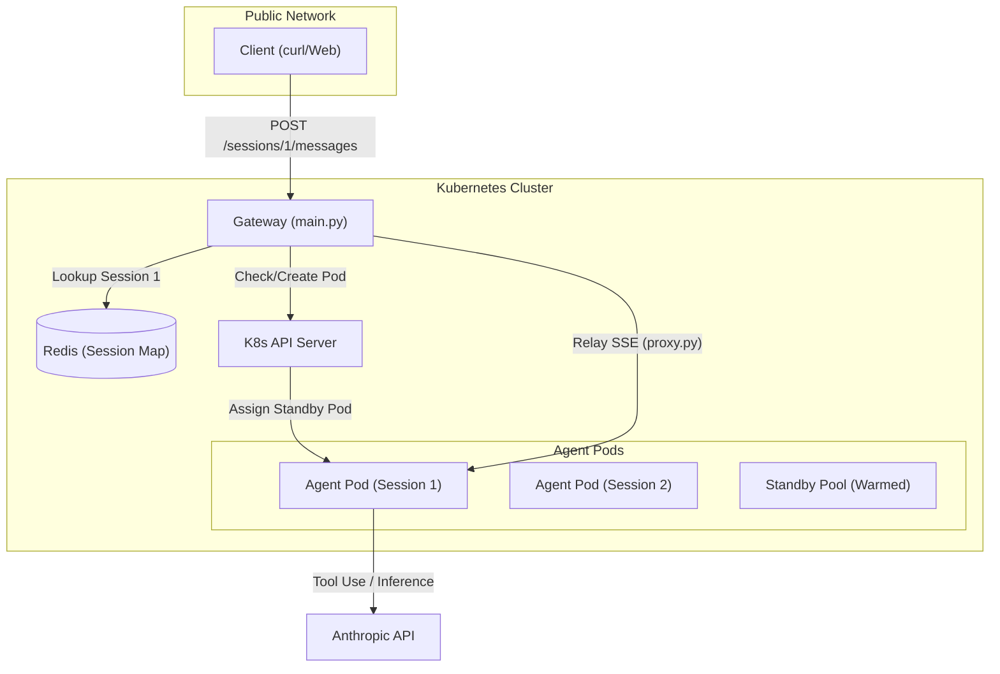
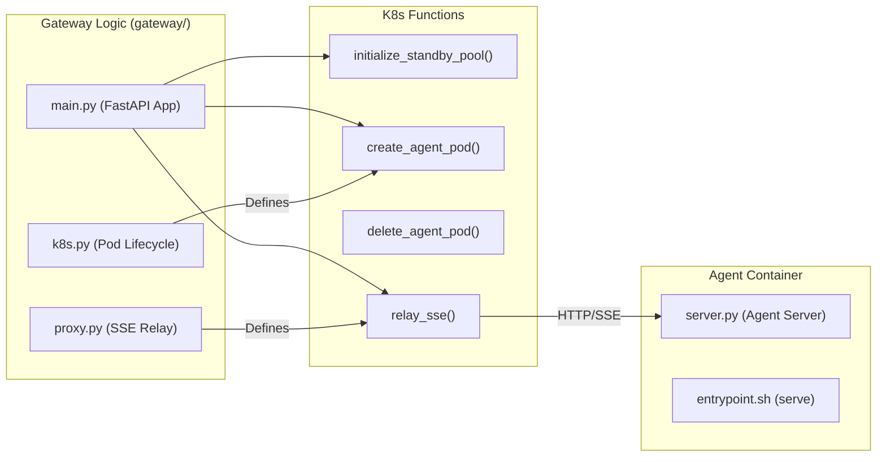

<!-- source: DeepWiki mcp.deepwiki.com · repo anthropics/claude-cookbooks · page 7.5 Hosting and Deploying Agents · fetched 2026-10-26 -->

# Hosting and Deploying Agents

Relevant source files

The following files were used as context for generating this wiki page:

- [claude_agent_sdk/07_Hosting_the_agent.ipynb](claude_agent_sdk/07_Hosting_the_agent.ipynb)
- [claude_agent_sdk/hosting/.env.example](claude_agent_sdk/hosting/.env.example)
- [claude_agent_sdk/hosting/.gitignore](claude_agent_sdk/hosting/.gitignore)
- [claude_agent_sdk/hosting/Dockerfile](claude_agent_sdk/hosting/Dockerfile)
- [claude_agent_sdk/hosting/Dockerfile.dockerignore](claude_agent_sdk/hosting/Dockerfile.dockerignore)
- [claude_agent_sdk/hosting/README.md](claude_agent_sdk/hosting/README.md)
- [claude_agent_sdk/hosting/docker/README.md](claude_agent_sdk/hosting/docker/README.md)
- [claude_agent_sdk/hosting/docker/docker-compose.yml](claude_agent_sdk/hosting/docker/docker-compose.yml)
- [claude_agent_sdk/hosting/entrypoint.sh](claude_agent_sdk/hosting/entrypoint.sh)
- [claude_agent_sdk/hosting/kubernetes/.gitignore](claude_agent_sdk/hosting/kubernetes/.gitignore)
- [claude_agent_sdk/hosting/kubernetes/gateway/k8s.py](claude_agent_sdk/hosting/kubernetes/gateway/k8s.py)
- [claude_agent_sdk/hosting/kubernetes/gateway/main.py](claude_agent_sdk/hosting/kubernetes/gateway/main.py)
- [claude_agent_sdk/hosting/kubernetes/gateway/proxy.py](claude_agent_sdk/hosting/kubernetes/gateway/proxy.py)
- [claude_agent_sdk/hosting/kubernetes/kind-quickstart.sh](claude_agent_sdk/hosting/kubernetes/kind-quickstart.sh)
- [claude_agent_sdk/hosting/requirements.txt](claude_agent_sdk/hosting/requirements.txt)
- [claude_agent_sdk/hosting/server.py](claude_agent_sdk/hosting/server.py)

This page documents the hosting and deployment strategies for agents built with the Claude Agent SDK. It covers a three-tier approach—Docker, Modal, and Kubernetes—using a portable container architecture and a standardized HTTP interface to ensure agents can move from local development to multi-tenant production without code changes.

## Overview and Mental Model

A Claude Agent SDK agent is a stateful process. Unlike typical stateless web services, the agent maintains a session history and tool-use state that must persist across requests. Hosting these agents requires a system that can manage process lifecycle, session persistence, and request routing.

### The Four Hosting Jobs
Every deployment tier must address these core requirements:
1.  **Spawn**: Create a containerized agent process when a request arrives.
2.  **Route**: Direct requests to the specific container holding the session state.
3.  **Lifecycle**: Terminate idle containers and restart crashed ones.
4.  **Persist**: Store session transcripts (in `/data`) so conversations survive restarts.

### Portable Agent Architecture
The deployment strategy relies on a unified container image and a thin FastAPI wrapper (`hosting/server.py`) that exposes the SDK via HTTP and Server-Sent Events (SSE).

**Agent Deployment Components**
| Entity | Role | Code Reference |
| :--- | :--- | :--- |
| **Process** | A running Python interpreter with the SDK loaded. | [claude_agent_sdk/07_Hosting_the_agent.ipynb:48-48]() |
| **Session** | Conversation history and tool results saved to disk. | [claude_agent_sdk/07_Hosting_the_agent.ipynb:49-49]() |
| **Container** | Packaged agent code, Node.js (for Claude Code), and data volume. | [claude_agent_sdk/07_Hosting_the_agent.ipynb:50-50]() |
| **Gateway** | Authenticating entry point that routes to session-specific pods. | [claude_agent_sdk/hosting/kubernetes/gateway/main.py:4-9]() |

**Sources:** [claude_agent_sdk/07_Hosting_the_agent.ipynb:44-72](), [claude_agent_sdk/hosting/server.py:1-25]()

---

## Portable HTTP Interface

All deployment tiers expose the same interface contract, defined in `claude_agent_sdk/hosting/server.py`. This server transforms the `query()` generator into an SSE stream.

### Interface Contract
*   **`GET /health`**: Unauthenticated liveness probe [claude_agent_sdk/hosting/server.py:117-120]().
*   **`POST /sessions/{session_id}/messages`**: The primary interaction endpoint. It accepts a `prompt` and returns a `text/event-stream` of serialized SDK messages [claude_agent_sdk/hosting/server.py:123-132]().
*   **Session Management**: The server maps external `session_id` strings to internal SDK IDs and uses the `resume` parameter in `ClaudeAgentOptions` to maintain continuity [claude_agent_sdk/hosting/server.py:20-24]().

### Security Model
The agent server is deliberately thin and **unauthenticated by default** [claude_agent_sdk/hosting/server.py:4-8](). It relies on the hosting environment (Tier 3 Gateway or Tier 2 `AGENT_AUTH_TOKEN`) to provide security. 

**Sources:** [claude_agent_sdk/hosting/server.py:104-115](), [claude_agent_sdk/hosting/README.md:12-53]()

---

## Tier 1: Local Docker and VM Deployment

For development and single-tenant internal tools, agents are deployed using `docker-compose`. This tier provides simple persistence via host volume mounts.

### Implementation
The `docker-compose.yml` builds the agent from the root context to include `research_agent/` and `utils/` [claude_agent_sdk/hosting/docker/docker-compose.yml:4-6](). It maps port `8000` to `127.0.0.1` to prevent accidental LAN exposure and mounts a local `./sessions` directory to `/data` for persistence [claude_agent_sdk/hosting/docker/docker-compose.yml:15-18]().

**Sources:** [claude_agent_sdk/hosting/docker/docker-compose.yml:1-18](), [claude_agent_sdk/hosting/Dockerfile:1-48]()

---

## Tier 2: Serverless with Modal

Modal is used for managed serverless hosting, providing a public URL and scale-to-zero capabilities without infrastructure management.

### Characteristics
*   **Scaling**: Containers are spawned on-demand when HTTP requests arrive.
*   **Persistence**: Uses `modal.Volume` to persist the `/data` directory.
*   **Auth**: Typically uses `AGENT_AUTH_TOKEN` environment variable since there is no custom gateway in front of the Modal tunnel [claude_agent_sdk/hosting/server.py:10-13]().

**Sources:** [claude_agent_sdk/07_Hosting_the_agent.ipynb:14-20]()

---

## Tier 3: Multi-tenant Kubernetes

The Kubernetes deployment is the most robust, designed for multi-tenant, regulated environments. It uses a custom **Gateway Service** to manage a pool of agent pods.

### The Gateway Architecture
The Gateway (`claude_agent_sdk/hosting/kubernetes/gateway/main.py`) acts as the single entry point. It manages pod lifecycles via the Kubernetes API and maintains session-to-pod mappings in Redis.

**Kubernetes Deployment Data Flow**
"Data Flow from Client to Agent Pod"

**Sources:** [claude_agent_sdk/hosting/kubernetes/gateway/main.py:4-15](), [claude_agent_sdk/hosting/kubernetes/gateway/k8s.py:2-6]()

### Key Components
1.  **Standby Pool**: The gateway maintains a pool of pre-warmed pods (`STANDBY_POOL_SIZE`) to avoid the 30-60s cold start delay of pulling images [claude_agent_sdk/hosting/kubernetes/gateway/k8s.py:5-6]().
2.  **Idle Reaper**: A background loop in the gateway (`_reap_idle_loop`) deletes agent pods that haven't received traffic within the `IDLE_TIMEOUT_S` period [claude_agent_sdk/hosting/kubernetes/gateway/main.py:48-49]().
3.  **SSE Proxy**: The `relay_sse` function in `proxy.py` provides a transparent byte-pipe between the client and the agent pod, ensuring the gateway doesn't need to parse the agent's internal message format [claude_agent_sdk/hosting/kubernetes/gateway/proxy.py:3-7]().
4.  **Egress Lockdown**: The `kind-quickstart.sh` script demonstrates using an egress proxy and `NetworkPolicy` to ensure agents can only talk to approved endpoints (e.g., Anthropic API), mitigating prompt injection risks [claude_agent_sdk/hosting/kubernetes/kind-quickstart.sh:40-43]().

### Code Entity Association
"Mapping Deployment Logic to Code Entities"

**Sources:** [claude_agent_sdk/hosting/kubernetes/gateway/main.py:22-35](), [claude_agent_sdk/hosting/kubernetes/gateway/k8s.py:69-73](), [claude_agent_sdk/hosting/kubernetes/gateway/proxy.py:26-30]()

---

## Container Strategy

The `Dockerfile` is optimized for the Claude Agent SDK's unique requirements, specifically the need to execute the `claude-code` CLI for tool use.

### Dockerfile Highlights
*   **Runtime Requirements**: Installs `Node.js` and `@anthropic-ai/claude-code` so the `query()` function can drive the CLI [claude_agent_sdk/hosting/Dockerfile:11-17]().
*   **Persistence**: Sets `CLAUDE_CONFIG_DIR=/data`. Each hosting tier is responsible for mounting persistent storage to this path to ensure `resume=` works [claude_agent_sdk/hosting/Dockerfile:43-43]().
*   **Build Context**: Must be run from the repository root so the image can copy sibling directories `research_agent/` and `utils/` [claude_agent_sdk/hosting/Dockerfile:3-7]().

**Sources:** [claude_agent_sdk/hosting/Dockerfile:1-48](), [claude_agent_sdk/hosting/entrypoint.sh:1-12]()

---

