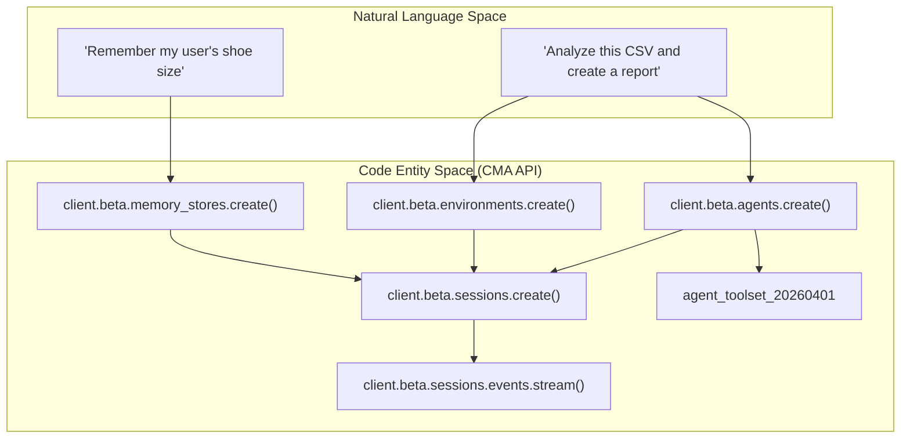
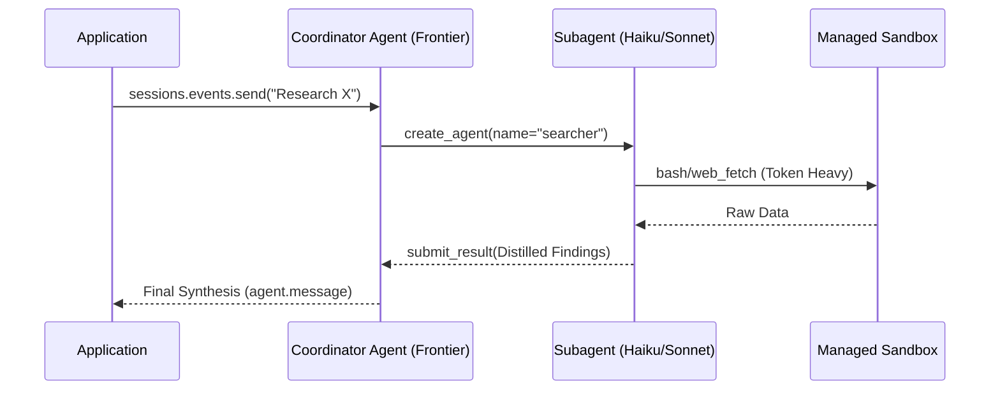

<!-- source: DeepWiki mcp.deepwiki.com · repo anthropics/claude-cookbooks · page 8 Claude Managed Agents · fetched 2026-10-26 -->

# Claude Managed Agents

Relevant source files

The following files were used as context for generating this wiki page:

- [authors.yaml](authors.yaml)
- [managed_agents/CMA_coordinate_specialist_team.ipynb](managed_agents/CMA_coordinate_specialist_team.ipynb)
- [managed_agents/CMA_explore_unfamiliar_codebase.ipynb](managed_agents/CMA_explore_unfamiliar_codebase.ipynb)
- [managed_agents/CMA_gate_human_in_the_loop.ipynb](managed_agents/CMA_gate_human_in_the_loop.ipynb)
- [managed_agents/CMA_iterate_fix_failing_tests.ipynb](managed_agents/CMA_iterate_fix_failing_tests.ipynb)
- [managed_agents/CMA_plan_big_execute_small.ipynb](managed_agents/CMA_plan_big_execute_small.ipynb)
- [managed_agents/CMA_remember_user_preferences.ipynb](managed_agents/CMA_remember_user_preferences.ipynb)
- [managed_agents/CMA_verify_with_outcome_grader.ipynb](managed_agents/CMA_verify_with_outcome_grader.ipynb)
- [managed_agents/CMA_watch_subagents_live.ipynb](managed_agents/CMA_watch_subagents_live.ipynb)
- [managed_agents/README.md](managed_agents/README.md)
- [managed_agents/data_analyst_agent.ipynb](managed_agents/data_analyst_agent.ipynb)
- [managed_agents/slack_data_bot.ipynb](managed_agents/slack_data_bot.ipynb)
- [managed_agents/sre_incident_responder.ipynb](managed_agents/sre_incident_responder.ipynb)
- [registry.yaml](registry.yaml)

## Purpose and Scope

Claude Managed Agents (CMA) is Anthropic's hosted infrastructure for building stateful, tool-using agents. Unlike stateless API calls, CMA provides a managed runtime that handles sandboxed execution, persistent file storage, and conversation state across multiple turns. It is designed for developers who want to deploy autonomous agents without managing the underlying container orchestration or complex tool-loop logic.

For detailed technical guides, see:
- [CMA Core Concepts and Tutorial Notebooks](#8.1) — Primitives (Agents, Environments, Sessions, Resources) and the streaming event loop.
- [Multi-Agent Coordination Patterns](#8.2) — The `multiagent` coordinator field, fan-out parallelism, and cost metering.
- [Applied CMA Examples](#8.3) — End-to-end implementations for Data Analysis, Slack bots, and SRE response.
- [Production Operations and Webhooks](#8.4) — Vaults, geography pinning, budget caps, and webhook-driven human-in-the-loop (HITL).
- [Self-Hosted Sandboxes](#8.5) — Running CMA sessions against custom compute providers like Docker, Cloudflare, and Modal.
- [CMA Integration Connectors](#8.6) — Ready-to-deploy connectors for Slack, Linear, MongoDB Atlas, and Sentry.

## Core Primitives

CMA architecture is built on four fundamental entities [managed_agents/data_analyst_agent.ipynb:14-19]():

1.  **Agent**: The definition of the model, system prompt, and toolset (including built-in toolsets, custom tools, and MCP servers) [managed_agents/data_analyst_agent.ipynb:107-111]().
2.  **Environment**: A reusable container specification that defines pre-installed packages (e.g., `pandas`, `plotly`) and networking policies [managed_agents/data_analyst_agent.ipynb:75-79]().
3.  **Session**: A stateful instance of an Agent running in an Environment. Sessions persist files and tool state across multiple turns [managed_agents/README.md:3-6]().
4.  **Resources**: External data attached to a session, such as files, GitHub repositories, or persistent **Memory Stores** [managed_agents/CMA_remember_user_preferences.ipynb:23-27]().

**Sources:** [managed_agents/data_analyst_agent.ipynb:14-19](), [managed_agents/README.md:3-6](), [managed_agents/CMA_remember_user_preferences.ipynb:23-27]()

## Architecture Overview

The following diagram maps the developer's Natural Language requirements to the CMA code entities and API calls.

**Sources:** [managed_agents/data_analyst_agent.ipynb:89-99](), [managed_agents/data_analyst_agent.ipynb:146-165](), [managed_agents/CMA_remember_user_preferences.ipynb:172-175](), [managed_agents/CMA_remember_user_preferences.ipynb:108-117]()

## Multi-Agent Coordination

CMA supports a native **Coordinator Pattern** via the `multiagent` field in the agent definition. A "Frontier" model (e.g., Claude 3.5 Sonnet) acts as a coordinator, delegating sub-tasks to specialized "Worker" agents defined in a roster [managed_agents/CMA_plan_big_execute_small.ipynb:110-118]().

### Economics and Performance
The coordinator pattern allows for a "Plan-Big, Execute-Small" model where expensive models handle reasoning while cheaper, parallel workers handle token-heavy tasks like web reading or log analysis [managed_agents/CMA_plan_big_execute_small.ipynb:12-14]().

**Sources:** [managed_agents/CMA_plan_big_execute_small.ipynb:110-118](), [managed_agents/CMA_coordinate_specialist_team.ipynb:110-144](), [managed_agents/CMA_watch_subagents_live.ipynb:7-7]()

## Production Features

CMA includes several features for enterprise-grade deployments:
*   **Memory Stores**: Persistent per-user storage that agents can read/write across different sessions [managed_agents/CMA_remember_user_preferences.ipynb:12-14]().
*   **Human-in-the-Loop (HITL)**: Using `custom` tools to pause execution and wait for human approval via webhooks [managed_agents/CMA_gate_human_in_the_loop.ipynb:16-21]().
*   **Outcomes**: A secondary "grader" agent that verifies the primary agent's work against a defined rubric [managed_agents/CMA_verify_with_outcome_grader.ipynb:10-15]().
*   **Budgeting**: The `budget` field on session creation allows enforcing spend ceilings per session [managed_agents/README.md:56-56]().
*   **Geography Pinning**: `model.inference_geo` ensures data residency requirements are met by pinning inference to specific regions [managed_agents/README.md:58-58]().

**Sources:** [managed_agents/CMA_remember_user_preferences.ipynb:12-14](), [managed_agents/CMA_gate_human_in_the_loop.ipynb:16-21](), [managed_agents/CMA_verify_with_outcome_grader.ipynb:10-15](), [managed_agents/README.md:56-58]()

---

