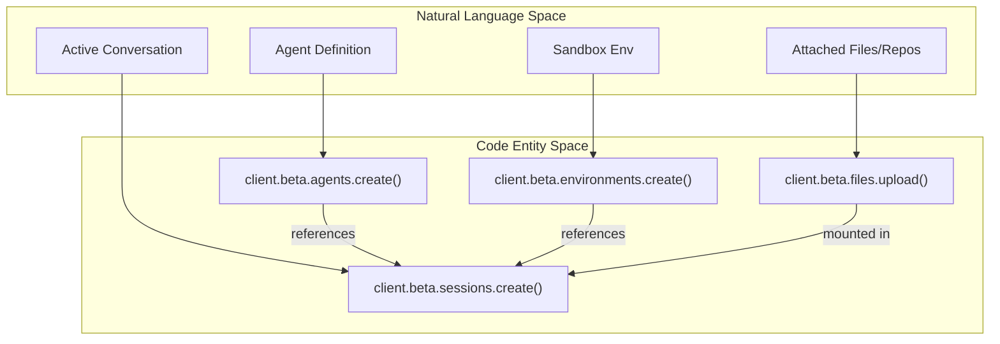
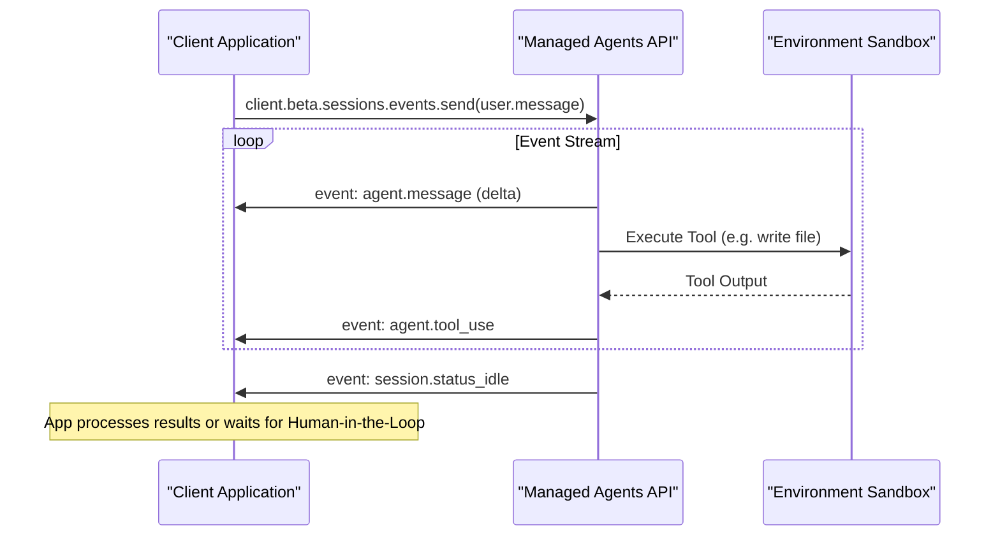

<!-- source: DeepWiki mcp.deepwiki.com · repo anthropics/claude-cookbooks · page 8.1 CMA Core Concepts and Tutorial Notebooks · fetched 2026-10-26 -->

# CMA Core Concepts and Tutorial Notebooks

Relevant source files

The following files were used as context for generating this wiki page:

- [authors.yaml](authors.yaml)
- [managed_agents/CMA_cap_session_spend.ipynb](managed_agents/CMA_cap_session_spend.ipynb)
- [managed_agents/CMA_consult_an_advisor.ipynb](managed_agents/CMA_consult_an_advisor.ipynb)
- [managed_agents/CMA_coordinate_specialist_team.ipynb](managed_agents/CMA_coordinate_specialist_team.ipynb)
- [managed_agents/CMA_operate_in_production.ipynb](managed_agents/CMA_operate_in_production.ipynb)
- [managed_agents/CMA_orchestrate_issue_to_pr.ipynb](managed_agents/CMA_orchestrate_issue_to_pr.ipynb)
- [managed_agents/CMA_pin_inference_geo.ipynb](managed_agents/CMA_pin_inference_geo.ipynb)
- [managed_agents/CMA_plan_big_execute_small.ipynb](managed_agents/CMA_plan_big_execute_small.ipynb)
- [managed_agents/CMA_prompt_versioning_and_rollback.ipynb](managed_agents/CMA_prompt_versioning_and_rollback.ipynb)
- [managed_agents/CMA_remember_user_preferences.ipynb](managed_agents/CMA_remember_user_preferences.ipynb)
- [managed_agents/CMA_use_skills_from_a_repo.ipynb](managed_agents/CMA_use_skills_from_a_repo.ipynb)
- [managed_agents/CMA_verify_with_outcome_grader.ipynb](managed_agents/CMA_verify_with_outcome_grader.ipynb)
- [managed_agents/CMA_watch_subagents_live.ipynb](managed_agents/CMA_watch_subagents_live.ipynb)
- [managed_agents/README.md](managed_agents/README.md)
- [registry.yaml](registry.yaml)

Claude Managed Agents (CMA) is Anthropic's hosted runtime for stateful, tool-using agents. It provides a managed infrastructure where agents, environments, and sessions persist across turns, allowing for complex multi-step workflows like autonomous coding, research, and production operations [managed_agents/README.md:3-7]().

## Core Primitives

The CMA architecture is built on four primary entities that define the lifecycle and capabilities of an agentic system.

| Primitive | Purpose | Key Attributes |
| :--- | :--- | :--- |
| **Agent** | The blueprint for behavior. Defines the "who" and "how". | `model`, `system` prompt, `tools`, `mcp_servers`, `inference_geo` [managed_agents/CMA_operate_in_production.ipynb:127-148]() |
| **Environment** | The sandboxed compute where the agent works. | `networking` (limited/unrestricted), `packages` (pip/apt), `config` [managed_agents/CMA_orchestrate_issue_to_pr.ipynb:109-116]() |
| **Session** | A specific instance of an agent running in an environment. | `resources` (mounts), `vault_ids`, `budget`, `initial_events` [managed_agents/CMA_operate_in_production.ipynb:154-162]() |
| **Resource** | External data or state attached to a session. | `file`, `github_repository`, `memory_store` [managed_agents/CMA_orchestrate_issue_to_pr.ipynb:121](), [managed_agents/CMA_remember_user_preferences.ipynb:150-155]() |

### Natural Language to Code Mapping: Primitives

**Sources:** [managed_agents/CMA_orchestrate_issue_to_pr.ipynb:88-124](), [managed_agents/CMA_remember_user_preferences.ipynb:172-175]()

## The Streaming Event Loop

CMA is strictly event-driven. Unlike a standard Request/Response model, interaction with a session involves sending events and consuming a stream of events until the session reaches an `idle` state [managed_agents/CMA_iterate_fix_failing_tests.ipynb:24-26]().

### Event Handling Workflow
1. **Send Event**: Use `client.beta.sessions.events.send` to provide `user.message` or `user.define_outcome` [managed_agents/CMA_remember_user_preferences.ipynb:109-117](), [managed_agents/CMA_verify_with_outcome_grader.ipynb:157]().
2. **Stream Response**: Use `client.beta.sessions.events.stream(session_id)` to listen for agent activity [managed_agents/CMA_remember_user_preferences.ipynb:108]().
3. **Monitor Types**:
    - `agent.message`: Text content from the model [managed_agents/CMA_remember_user_preferences.ipynb:119-123]().
    - `agent.tool_use`: Notifications of tool execution (e.g., file reads/writes) [managed_agents/CMA_remember_user_preferences.ipynb:125-131]().
    - `session.status_idle`: The signal that the agent has finished its turn and is waiting for input [managed_agents/CMA_remember_user_preferences.ipynb:133-136]().
    - `thread_created` / `thread_message_received`: Used in multi-agent coordination to track subagent turns [managed_agents/CMA_plan_big_execute_small.ipynb:19]().

### Event Loop Data Flow

**Sources:** [managed_agents/CMA_remember_user_preferences.ipynb:100-142](), [managed_agents/README.md:60-61]()

## Guided Tutorial Series

The repository provides a progressive series of notebooks designed to move from basic iteration to production-grade operations.

### 1. Development and Iteration
*   **Iterate and Fix**: Introduces the `Do → observe → fix` loop by having an agent fix bugs in a calculator package [managed_agents/README.md:43]().
*   **Orchestrate-to-PR**: Demonstrates a full software engineering lifecycle: reading an issue, grepping code, running `pytest` in the sandbox, and opening a mock PR [managed_agents/CMA_orchestrate_issue_to_pr.ipynb:8-19]().
*   **Explore Codebase**: Focuses on grounding an agent in unfamiliar code, including handling `github_repository` resources [managed_agents/README.md:45]().

### 2. Control and Quality Assurance
*   **Gate HITL**: Implements Human-in-the-Loop patterns using the `requires_action` idle state for sensitive operations like expense approval [managed_agents/README.md:46]().
*   **Outcome Graders**: Uses a secondary "grader" agent to verify the "writer" agent's work against a specific **rubric** [managed_agents/CMA_verify_with_outcome_grader.ipynb:8-15]().
*   **Prompt Versioning**: Covers server-side prompt management, allowing for A/B testing and rollbacks via `agents.update` and session version pinning [managed_agents/README.md:48]().

### 3. State and Memory
*   **Memory Stores**: Enables persistent user-specific state. Agents can read/write to `/mnt/memory/{store-name}` across different sessions [managed_agents/CMA_remember_user_preferences.ipynb:23-27]().
*   **Repository Skills**: Automatically discovers skills from a mounted repo's `.claude/skills/` directory, allowing agents to pick up new capabilities without API-side configuration [managed_agents/CMA_use_skills_from_a_repo.ipynb:8-19]().

### 4. Production Operations
*   **MCP Toolsets & Vaults**: Connects agents to SaaS APIs (GitHub, Slack) using per-user credentials stored in **Vaults**, ensuring security and multi-tenancy [managed_agents/CMA_operate_in_production.ipynb:48-55]().
*   **Inference Geo Pinning**: Restricts model execution to specific regions (e.g., `us`) to satisfy data residency requirements [managed_agents/CMA_pin_inference_geo.ipynb:8-12]().
*   **Budget Management**: Uses the `budget` field on `sessions.create` to enforce a hard spend ceiling on a per-session basis [managed_agents/README.md:56]().

**Sources:** [managed_agents/README.md:41-58](), [managed_agents/CMA_operate_in_production.ipynb:10-18](), [managed_agents/CMA_remember_user_preferences.ipynb:16-21](), [managed_agents/CMA_verify_with_outcome_grader.ipynb:18-21]()

---

