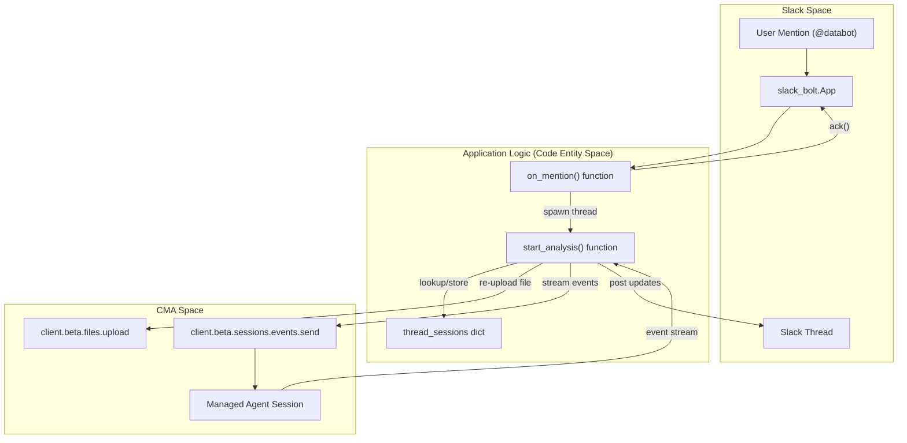
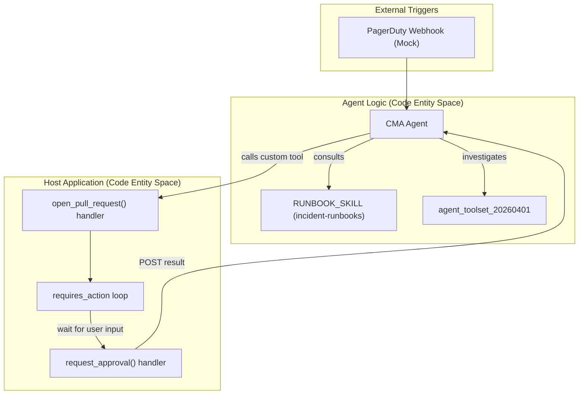

<!-- source: DeepWiki mcp.deepwiki.com · repo anthropics/claude-cookbooks · page 8.3 Applied CMA Examples · fetched 2026-10-26 -->

# 8.3 Applied CMA Examples

Relevant source files

The following files were used as context for generating this wiki page:

- [images/cma_with_mongodb_atlas.jpg](images/cma_with_mongodb_atlas.jpg)
- [managed_agents/.env.example](managed_agents/.env.example)
- [managed_agents/CMA_explore_unfamiliar_codebase.ipynb](managed_agents/CMA_explore_unfamiliar_codebase.ipynb)
- [managed_agents/CMA_gate_human_in_the_loop.ipynb](managed_agents/CMA_gate_human_in_the_loop.ipynb)
- [managed_agents/CMA_iterate_fix_failing_tests.ipynb](managed_agents/CMA_iterate_fix_failing_tests.ipynb)
- [managed_agents/CMA_with_mongodb_atlas.ipynb](managed_agents/CMA_with_mongodb_atlas.ipynb)
- [managed_agents/data_analyst_agent.ipynb](managed_agents/data_analyst_agent.ipynb)
- [managed_agents/example_data/OVERVIEW.md](managed_agents/example_data/OVERVIEW.md)
- [managed_agents/example_data/mongodb_on_cma/seed_transactions.jsonl](managed_agents/example_data/mongodb_on_cma/seed_transactions.jsonl)
- [managed_agents/mongodb_on_cma/README.md](managed_agents/mongodb_on_cma/README.md)
- [managed_agents/mongodb_on_cma/__init__.py](managed_agents/mongodb_on_cma/__init__.py)
- [managed_agents/mongodb_on_cma/ap2_mandates.py](managed_agents/mongodb_on_cma/ap2_mandates.py)
- [managed_agents/mongodb_on_cma/config.py](managed_agents/mongodb_on_cma/config.py)
- [managed_agents/mongodb_on_cma/tools.py](managed_agents/mongodb_on_cma/tools.py)
- [managed_agents/slack_data_bot.ipynb](managed_agents/slack_data_bot.ipynb)
- [managed_agents/sre_incident_responder.ipynb](managed_agents/sre_incident_responder.ipynb)

This section provides a technical deep dive into three specific implementations of **Claude Managed Agents (CMA)**. These examples demonstrate how to move beyond basic agent loops to build production-ready integrations that handle real-world data, external communication platforms, and critical infrastructure response.

## 1. Data Analyst Agent (CSV to HTML Report)

The Data Analyst Agent demonstrates the "Analytic Sandbox" pattern. It uses CMA's hosted runtime to execute Python code against uploaded datasets, producing a publication-quality HTML report with interactive visualizations.

### Implementation Details
*   **Environment Configuration**: The agent uses a `cloud` environment with `pandas` and `plotly` pre-installed [managed_agents/data_analyst_agent.ipynb:89-100]().
*   **System Prompting**: The agent is instructed to write `.py` scripts, sample large tables to manage memory, and embed Plotly charts as HTML fragments [managed_agents/data_analyst_agent.ipynb:121-144]().
*   **Tooling**: It utilizes the `agent_toolset_20260401`, specifically the `bash` and `write` tools to generate and execute analysis scripts [managed_agents/data_analyst_agent.ipynb:150-165]().

### Data Flow: Analysis to Report
1.  **Resource Upload**: A CSV file is uploaded via the Files API [managed_agents/data_analyst_agent.ipynb:183-186]().
2.  **Session Creation**: The session is initialized with the CSV mounted at `/mnt/session/uploads/data.csv` [managed_agents/data_analyst_agent.ipynb:191-200]().
3.  **Iterative Analysis**: The agent reads the data, writes analysis scripts to `/mnt/user/`, and executes them.
4.  **Artifact Persistence**: The final `report.html` is written to `/mnt/session/outputs/`, which persists after the session ends [managed_agents/data_analyst_agent.ipynb:141-143]().

### Sources
*   [managed_agents/data_analyst_agent.ipynb:1-250]()

---

## 2. Slack Data Bot (Bolt for Python Integration)

The Slack Data Bot serves as a production-style wrapper for the Data Analyst Agent. It uses the **Slack Bolt** framework to bridge the gap between a chat interface and the CMA Sessions API.

### Implementation Details
*   **Event Handling**: The bot listens for `app_mention` events [managed_agents/slack_data_bot.ipynb:134-147]().
*   **Threading**: Because Slack requires an acknowledgement (`ack()`) within 3 seconds, the bot hands off the agent execution to a background `threading.Thread` [managed_agents/slack_data_bot.ipynb:146]().
*   **Session Continuity**: It maintains a `thread_sessions` mapping (`thread_ts` -> `session_id`) to ensure follow-up messages in a Slack thread target the same CMA session [managed_agents/slack_data_bot.ipynb:105-108]().

### System Architecture: Slack to CMA
"Slack to CMA Bridge"

Sources: [managed_agents/slack_data_bot.ipynb:70-165]()

---

## 3. SRE Incident Responder (Webhook & HITL)

The SRE Incident Responder demonstrates a high-stakes automation pattern: an agent that investigates production failures and proposes fixes, gated by a **Human-in-the-Loop (HITL)** approval step.

### Key Components
*   **Skills**: A `RUNBOOK_SKILL` is attached to the agent, providing team-specific triage instructions via progressive disclosure [managed_agents/sre_incident_responder.ipynb:120-145]().
*   **Hybrid Tooling**: Combines built-in `bash` tools for investigation with **Custom Tools** (`open_pull_request`, `request_approval`) that the host application handles [managed_agents/sre_incident_responder.ipynb:157-159]().
*   **HITL Gate**: The agent must call `request_approval` before merging any code, triggering a `requires_action` status in the session [managed_agents/sre_incident_responder.ipynb:244-255]().

### Incident Investigation Workflow
"SRE Incident Response Logic"

Sources: [managed_agents/sre_incident_responder.ipynb:155-260]()

### Comparison of Applied Patterns

| Feature | Data Analyst | Slack Bot | SRE Responder |
| :--- | :--- | :--- | :--- |
| **Trigger** | Manual Notebook Run | Slack `@mention` | Webhook Payload |
| **Data Source** | Local CSV Upload | Slack Attachment | Filesystem/Git Sandbox |
| **Output** | HTML Report | Slack Message/Thread | GitHub Pull Request |
| **Human Gate** | None (Post-hoc review) | Implicit (Chat flow) | Explicit (`requires_action`) |
| **Tool Types** | Built-in Only | Built-in Only | Built-in + Custom |

### Sources
*   [managed_agents/sre_incident_responder.ipynb:8-30]()
*   [managed_agents/sre_incident_responder.ipynb:88-145]()
*   [managed_agents/CMA_gate_human_in_the_loop.ipynb:14-27]()
*   [managed_agents/.env.example:1-36]()

---

