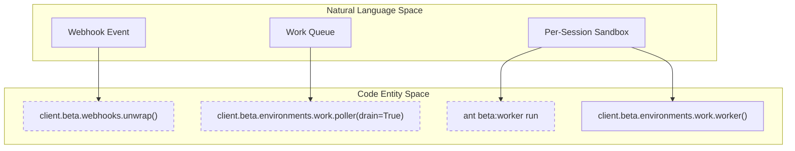
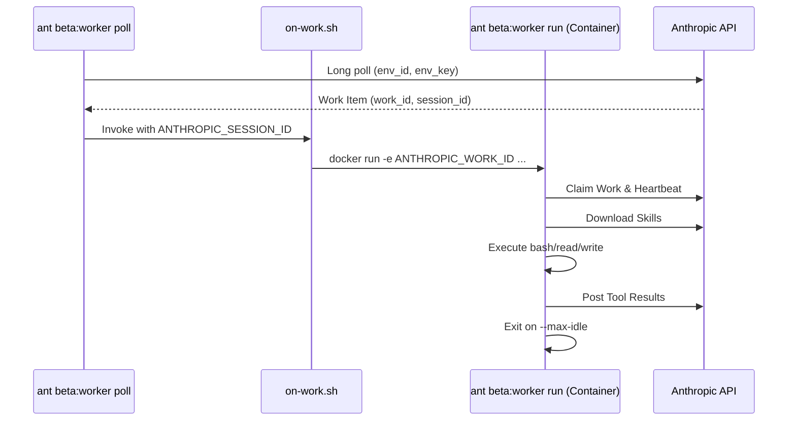

<!-- source: DeepWiki mcp.deepwiki.com · repo anthropics/claude-cookbooks · page 8.5 Self-Hosted Sandboxes · fetched 2026-10-26 -->

# Self-Hosted Sandboxes

Relevant source files

The following files were used as context for generating this wiki page:

- [managed_agents/self_hosted_sandboxes/README.md](managed_agents/self_hosted_sandboxes/README.md)
- [managed_agents/self_hosted_sandboxes/cf-worker/README.md](managed_agents/self_hosted_sandboxes/cf-worker/README.md)
- [managed_agents/self_hosted_sandboxes/cf-worker/package.json](managed_agents/self_hosted_sandboxes/cf-worker/package.json)
- [managed_agents/self_hosted_sandboxes/cf-worker/wrangler.toml](managed_agents/self_hosted_sandboxes/cf-worker/wrangler.toml)
- [managed_agents/self_hosted_sandboxes/cf/README.md](managed_agents/self_hosted_sandboxes/cf/README.md)
- [managed_agents/self_hosted_sandboxes/cf/package.json](managed_agents/self_hosted_sandboxes/cf/package.json)
- [managed_agents/self_hosted_sandboxes/cf/wrangler.toml](managed_agents/self_hosted_sandboxes/cf/wrangler.toml)
- [managed_agents/self_hosted_sandboxes/daytona/README.md](managed_agents/self_hosted_sandboxes/daytona/README.md)
- [managed_agents/self_hosted_sandboxes/docker/README.md](managed_agents/self_hosted_sandboxes/docker/README.md)
- [managed_agents/self_hosted_sandboxes/docker/on-work.sh](managed_agents/self_hosted_sandboxes/docker/on-work.sh)
- [managed_agents/self_hosted_sandboxes/docker/start.sh](managed_agents/self_hosted_sandboxes/docker/start.sh)
- [managed_agents/self_hosted_sandboxes/docs/upgrade-guide.md](managed_agents/self_hosted_sandboxes/docs/upgrade-guide.md)
- [managed_agents/self_hosted_sandboxes/docs/usage-guide.md](managed_agents/self_hosted_sandboxes/docs/usage-guide.md)
- [managed_agents/self_hosted_sandboxes/modal/README.md](managed_agents/self_hosted_sandboxes/modal/README.md)
- [managed_agents/self_hosted_sandboxes/modal/modal_sandbox_webhook.py](managed_agents/self_hosted_sandboxes/modal/modal_sandbox_webhook.py)

Self-hosted sandboxes allow Claude Managed Agents (CMA) to execute code and tools against custom compute infrastructure that you control. This architecture enables agents to access internal databases, local filesystems, and private network resources while maintaining data residency within your security boundary.

The system supports six reference implementations: **Docker**, **Cloudflare Containers**, **Cloudflare Workers**, **Modal**, **Daytona**, and **Vercel**.

## Architecture Overview

Self-hosted execution relies on an **Environment Key** authentication model. Unlike the standard API key, the environment key is scoped to a specific self-hosted environment and is the only credential required by the worker to poll for jobs, execute tools, and post results [managed_agents/self_hosted_sandboxes/docs/usage-guide.md:65-69]().

### Data Flow and Lifecycle

The execution lifecycle follows a "Poll-Claim-Run" pattern:

1.  **Orchestrator Polling**: A long-lived process or a webhook-triggered function polls the Anthropic control plane for work items assigned to a specific `ANTHROPIC_ENVIRONMENT_ID` [managed_agents/self_hosted_sandboxes/docs/usage-guide.md:78-86]().
2.  **Work Claim**: The worker claims a work item using the `ANTHROPIC_ENVIRONMENT_KEY`.
3.  **Sandbox Spawning**: For each session, a per-session sandbox is initialized (e.g., a Docker container or Modal sandbox) [managed_agents/self_hosted_sandboxes/docker/README.md:3-7]().
4.  **Tool Execution**: The worker inside the sandbox (using `ant beta:worker run`) executes shell commands, file operations, and skill-based tools [managed_agents/self_hosted_sandboxes/docs/usage-guide.md:130-141]().
5.  **Idle & Cleanup**: The worker exits after a configurable idle period (default 60s) after `session.status_idle` [managed_agents/self_hosted_sandboxes/docker/README.md:29-32]().

### Natural Language to Code Entity Mapping

The following diagram maps high-level concepts to the specific code entities used in the self-hosted implementations.

**Entity Mapping: Webhook-Driven Sandbox (Modal/Daytona/CF)**

**Sources:** [managed_agents/self_hosted_sandboxes/modal/README.md:3-7](), [managed_agents/self_hosted_sandboxes/daytona/README.md:3-6]()

## Webhook Contract and Authentication

Self-hosted environments use the `session.status_run_started` webhook to trigger work item processing. 

*   **Authentication**: The worker host uses `ANTHROPIC_ENVIRONMENT_KEY` for all per-session calls (event stream, lease heartbeat, and skill downloads) [managed_agents/self_hosted_sandboxes/docker/README.md:34-40]().
*   **Skill Downloads**: The CLI's skill-download client specifically resolves `ANTHROPIC_AUTH_TOKEN` or `ANTHROPIC_API_KEY`. In self-hosted setups, the `ANTHROPIC_ENVIRONMENT_KEY` is mapped to `ANTHROPIC_AUTH_TOKEN` to enable skill persistence [managed_agents/self_hosted_sandboxes/docker/on-work.sh:42-44]().
*   **Verification**: Webhooks must be verified using the `ANTHROPIC_WEBHOOK_SECRET` via `client.beta.webhooks.unwrap()` [managed_agents/self_hosted_sandboxes/modal/README.md:5-6]().

## Variant Implementations

### 1. Docker (No-Cloud / Local)
This variant runs `ant beta:worker poll` on a host. For each work item, it invokes an `on-work.sh` script that executes `docker run` for a per-session container [managed_agents/self_hosted_sandboxes/docker/README.md:3-7]().

*   **Persistence**: Uses per-session Docker volumes (`cma-ws-<session_id>`) mounted at `/workspace` so skills and files survive container restarts [managed_agents/self_hosted_sandboxes/docker/on-work.sh:22-22]().
*   **Foreground Execution**: The `on-work.sh` script must run `docker run` in the foreground (no `-d`) to prevent the poller from marking the work as stopped before the container can claim it [managed_agents/self_hosted_sandboxes/docker/on-work.sh:34-40]().

### 2. Cloudflare (Containers vs. Workers)
Cloudflare offers two distinct patterns:
*   **Cloudflare Containers**: Runs a full Linux environment using the `ant` CLI as the entrypoint. A Durable Object manages the container lifetime and streams status [managed_agents/self_hosted_sandboxes/cf/README.md:3-5]().
*   **Pure Worker**: Uses a Durable Object running the TypeScript `SessionToolRunner` with an in-isolate virtual filesystem (`Map<string,string>`) instead of a real OS [managed_agents/self_hosted_sandboxes/cf-worker/README.md:3-5]().

### 3. Modal and Daytona
These implementations use a FastAPI webhook receiver to drain the environment work queue and spin up serverless sandboxes.
*   **Modal**: Mounts a `modal.Volume` for persistence and uses `sandbox_runner.py` to wrap the SDK's `worker().handle_item()` [managed_agents/self_hosted_sandboxes/modal/README.md:5-6]().
*   **Daytona**: Creates full Linux containers and uploads a provider-agnostic runner script to handle tool execution [managed_agents/self_hosted_sandboxes/daytona/README.md:3-3]().

## Implementation Comparison

| Feature | Docker | Modal | CF Containers | CF Workers |
| :--- | :--- | :--- | :--- | :--- |
| **Compute Type** | Local/VM | Serverless | Serverless | Isolate |
| **Filesystem** | Docker Volume | `modal.Volume` | SQLite/Durable Obj | In-memory Map |
| **Shell Access** | Full Bash | Full Bash | Full Bash | Not Available |
| **Persistence** | Session-level | Session-level | Session-level | Ephemeral |
| **Trigger** | Polling | Webhook | Webhook | Webhook |

**Sources:** [managed_agents/self_hosted_sandboxes/docker/README.md:1-11](), [managed_agents/self_hosted_sandboxes/modal/README.md:1-9](), [managed_agents/self_hosted_sandboxes/cf/README.md:1-9](), [managed_agents/self_hosted_sandboxes/cf-worker/README.md:1-9]()

## Core Worker CLI & Library

The `ant` CLI is the primary binary for managing self-hosted workers.

### CLI Commands
*   `ant beta:worker poll`: Runs the long-polling loop to claim jobs for an environment [managed_agents/self_hosted_sandboxes/docs/usage-guide.md:78-81]().
*   `ant beta:worker run`: Attaches to a specific session and executes tools. Used as a container entrypoint [managed_agents/self_hosted_sandboxes/docs/usage-guide.md:112-115]().

### Code Entities and Environment Variables

The system relies on a strict environment contract to pass session context into the sandbox.

**Sandbox Execution Flow**

**Sources:** [managed_agents/self_hosted_sandboxes/docker/on-work.sh:15-62](), [managed_agents/self_hosted_sandboxes/docs/usage-guide.md:130-153]()

### Required Environment Variables
| Variable | Purpose |
| :--- | :--- |
| `ANTHROPIC_ENVIRONMENT_ID` | The ID of the self-hosted environment (`env_...`) [managed_agents/self_hosted_sandboxes/docs/usage-guide.md:159]() |
| `ANTHROPIC_ENVIRONMENT_KEY` | The scoped authentication token (`sk-ant-oat...`) [managed_agents/self_hosted_sandboxes/docs/usage-guide.md:160]() |
| `ANTHROPIC_SESSION_ID` | The ID of the active agent session [managed_agents/self_hosted_sandboxes/docs/usage-guide.md:146]() |
| `ANTHROPIC_WORK_ID` | The specific task ID assigned by the poller [managed_agents/self_hosted_sandboxes/docs/usage-guide.md:148]() |
| `ANTHROPIC_AUTH_TOKEN` | Set to the Environment Key for skill downloads [managed_agents/self_hosted_sandboxes/docker/on-work.sh:42-44]() |

**Sources:** [managed_agents/self_hosted_sandboxes/docker/README.md](), [managed_agents/self_hosted_sandboxes/docker/on-work.sh](), [managed_agents/self_hosted_sandboxes/docker/start.sh](), [managed_agents/self_hosted_sandboxes/docs/usage-guide.md](), [managed_agents/self_hosted_sandboxes/cf/README.md](), [managed_agents/self_hosted_sandboxes/modal/README.md](), [managed_agents/self_hosted_sandboxes/daytona/README.md](), [managed_agents/self_hosted_sandboxes/cf-worker/README.md]()

---

