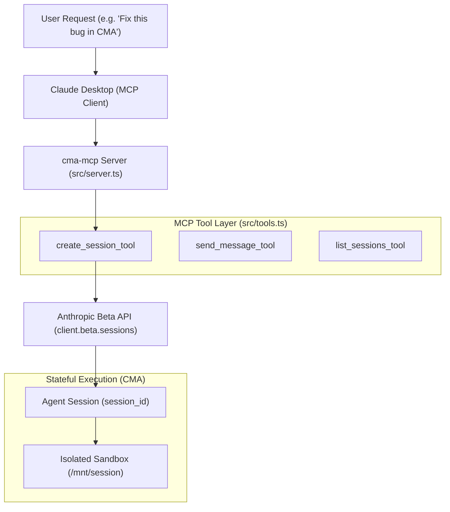
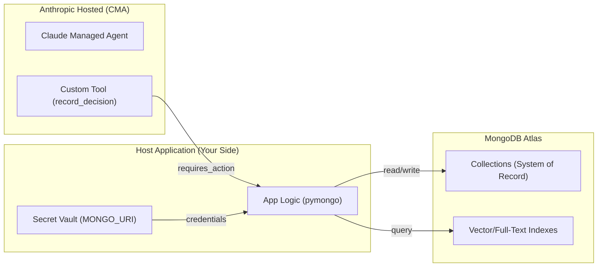

<!-- source: DeepWiki mcp.deepwiki.com · repo anthropics/claude-cookbooks · page 8.6 CMA Integration Connectors · fetched 2026-10-26 -->

# CMA Integration Connectors

Relevant source files

The following files were used as context for generating this wiki page:

- [images/cma_with_mongodb_atlas.jpg](images/cma_with_mongodb_atlas.jpg)
- [managed_agents/.env.example](managed_agents/.env.example)
- [managed_agents/.gitignore](managed_agents/.gitignore)
- [managed_agents/CMA_with_mongodb_atlas.ipynb](managed_agents/CMA_with_mongodb_atlas.ipynb)
- [managed_agents/cma-mcp/.env.example](managed_agents/cma-mcp/.env.example)
- [managed_agents/cma-mcp/.gitignore](managed_agents/cma-mcp/.gitignore)
- [managed_agents/cma-mcp/CLAUDE.md](managed_agents/cma-mcp/CLAUDE.md)
- [managed_agents/cma-mcp/Dockerfile](managed_agents/cma-mcp/Dockerfile)
- [managed_agents/cma-mcp/README.md](managed_agents/cma-mcp/README.md)
- [managed_agents/cma-mcp/package.json](managed_agents/cma-mcp/package.json)
- [managed_agents/cma-mcp/skill.md](managed_agents/cma-mcp/skill.md)
- [managed_agents/cma-mcp/src/cma.ts](managed_agents/cma-mcp/src/cma.ts)
- [managed_agents/cma-mcp/src/server-http.ts](managed_agents/cma-mcp/src/server-http.ts)
- [managed_agents/cma-mcp/src/server.ts](managed_agents/cma-mcp/src/server.ts)
- [managed_agents/cma-mcp/src/tools.ts](managed_agents/cma-mcp/src/tools.ts)
- [managed_agents/example_data/OVERVIEW.md](managed_agents/example_data/OVERVIEW.md)
- [managed_agents/example_data/mongodb_on_cma/seed_transactions.jsonl](managed_agents/example_data/mongodb_on_cma/seed_transactions.jsonl)
- [managed_agents/linear/.env.example](managed_agents/linear/.env.example)
- [managed_agents/linear/.gitignore](managed_agents/linear/.gitignore)
- [managed_agents/linear/CLAUDE.md](managed_agents/linear/CLAUDE.md)
- [managed_agents/linear/README.md](managed_agents/linear/README.md)
- [managed_agents/linear/package.json](managed_agents/linear/package.json)
- [managed_agents/linear/setup/create-agent.ts](managed_agents/linear/setup/create-agent.ts)
- [managed_agents/linear/skill.md](managed_agents/linear/skill.md)
- [managed_agents/linear/src/agent.ts](managed_agents/linear/src/agent.ts)
- [managed_agents/linear/src/cma-webhook.ts](managed_agents/linear/src/cma-webhook.ts)
- [managed_agents/linear/src/main.ts](managed_agents/linear/src/main.ts)
- [managed_agents/linear/src/oauth.ts](managed_agents/linear/src/oauth.ts)
- [managed_agents/mongodb_on_cma/README.md](managed_agents/mongodb_on_cma/README.md)
- [managed_agents/mongodb_on_cma/__init__.py](managed_agents/mongodb_on_cma/__init__.py)
- [managed_agents/mongodb_on_cma/ap2_mandates.py](managed_agents/mongodb_on_cma/ap2_mandates.py)
- [managed_agents/mongodb_on_cma/config.py](managed_agents/mongodb_on_cma/config.py)
- [managed_agents/mongodb_on_cma/tools.py](managed_agents/mongodb_on_cma/tools.py)
- [managed_agents/pyproject.toml](managed_agents/pyproject.toml)
- [managed_agents/sentry/.env.example](managed_agents/sentry/.env.example)
- [managed_agents/sentry/.gitignore](managed_agents/sentry/.gitignore)
- [managed_agents/sentry/CLAUDE.md](managed_agents/sentry/CLAUDE.md)
- [managed_agents/sentry/README.md](managed_agents/sentry/README.md)
- [managed_agents/sentry/agent_config.py](managed_agents/sentry/agent_config.py)
- [managed_agents/sentry/cma.py](managed_agents/sentry/cma.py)
- [managed_agents/sentry/deploy.py](managed_agents/sentry/deploy.py)
- [managed_agents/sentry/pyproject.toml](managed_agents/sentry/pyproject.toml)
- [managed_agents/sentry/run_now.py](managed_agents/sentry/run_now.py)
- [managed_agents/slack/.env.example](managed_agents/slack/.env.example)
- [managed_agents/slack/.gitignore](managed_agents/slack/.gitignore)
- [managed_agents/slack/CLAUDE.md](managed_agents/slack/CLAUDE.md)
- [managed_agents/slack/README.md](managed_agents/slack/README.md)
- [managed_agents/slack/package.json](managed_agents/slack/package.json)
- [managed_agents/slack/setup/create-agent.ts](managed_agents/slack/setup/create-agent.ts)
- [managed_agents/slack/skill.md](managed_agents/slack/skill.md)
- [managed_agents/slack/src/agent.ts](managed_agents/slack/src/agent.ts)
- [managed_agents/slack/src/cma-webhook.ts](managed_agents/slack/src/cma-webhook.ts)
- [managed_agents/slack/src/main.ts](managed_agents/slack/src/main.ts)
- [managed_agents/slack/src/slack-events.ts](managed_agents/slack/src/slack-events.ts)

This section documents ready-to-deploy integration connectors for Claude Managed Agents (CMA). These connectors bridge the gap between CMA's hosted execution runtime and common production environments like Slack, Linear, MongoDB Atlas, and Sentry. They demonstrate patterns for webhook routing, OAuth-backed tool use, and utilizing CMA as an MCP server for local desktop applications.

## Slack Bot (Bolt for Python)

The Slack connector utilizes the Slack Bolt framework to route events to CMA sessions. It uses session metadata to maintain a 1:1 mapping between Slack threads and CMA session IDs, allowing for stateful, multi-turn conversations within Slack channels or DMs.

### Communication Flow
1. **Event Reception**: The Slack app receives a `mention` or `message` event.
2. **Session Lookup**: The bot checks session metadata to see if a `slack_thread_ts` already exists for a CMA session.
3. **Event Routing**: If found, it resumes the session; otherwise, it creates a new session.
4. **Metadata Persistence**: The bot stores `slack_channel_id` and `slack_thread_ts` in the session's metadata during creation [managed_agents/.env.example:3-10]().

### Sources:
- [managed_agents/pyproject.toml:12-16]()
- [managed_agents/.env.example:8-10]()

---

## Linear Bot (OAuth & Comment Integration)

The Linear connector demonstrates how an agent can operate on behalf of a user using OAuth. The agent can be triggered by @mentions on Linear issues and responds by posting comments or updating issue states.

### Key Components
*   **OAuth Flow**: Handles the exchange of Linear auth codes for access tokens [managed_agents/linear/src/oauth.ts]().
*   **Webhook Handler**: Processes incoming webhooks from Linear when the agent is mentioned [managed_agents/linear/src/cma-webhook.ts]().
*   **Agent Logic**: Defined in `agent.ts`, which uses the Linear SDK to interact with the workspace [managed_agents/linear/src/agent.ts]().

### Sources:
- [managed_agents/linear/README.md:1-20]()
- [managed_agents/linear/src/main.ts:1-15]()

---

## CMA-as-MCP-Server

The `cma-mcp` connector wraps the Anthropic Sessions API into a Model Context Protocol (MCP) server. This allows tools like Claude Desktop to control Managed Agents as if they were local tools.

### Implementation Diagram: Natural Language to Tool Execution
The following diagram illustrates how a user request in a local IDE/Desktop app is translated into a CMA session operation.

"CMA-as-MCP Logic Flow"

### Nine Tools for Session Management
The server exports tools for the full session lifecycle:
1. `create_session`: Initialize a new CMA instance.
2. `send_message`: Provide input to an active agent.
3. `list_sessions`: Inventory active runs.
4. `retrieve_session`: Check status (idle, busy, requires_action).
5. `terminate_session`: Immediate shutdown.
6. `archive_session`: Cleanup resources.
7. `list_files`: View outputs in `/mnt/session/outputs/`.
8. `download_file`: Retrieve artifacts.
9. `get_events`: Stream logs and tool execution events.

### Sources:
- [managed_agents/cma-mcp/src/tools.ts:1-50]()
- [managed_agents/cma-mcp/src/server.ts:1-11]()

---

## MongoDB Atlas Integration

This connector demonstrates using MongoDB Atlas as a multi-modal retrieval engine and system of record for CMA. It avoids platform-level integrations by using the `pymongo` driver within the agent's host-side data path [managed_agents/CMA_with_mongodb_atlas.ipynb:16-24]().

### Retrieval Patterns
The integration supports four retrieval modes within a single engine:
*   **Vector Search**: Semantic retrieval using `$vectorSearch` [managed_agents/mongodb_on_cma/tools.py:207-215]().
*   **Full-Text Search**: Keyword matching via `$search` [managed_agents/mongodb_on_cma/config.py:15-16]().
*   **Hybrid Search**: Combining vector and lexical results using Reciprocal Rank Fusion (RRF) [managed_agents/CMA_with_mongodb_atlas.ipynb:19-22]().
*   **Graph Traversal**: Discovering relationships using `$graphLookup`.

### Data Flow & Security
"MongoDB Atlas Agent Data Path"

### Key Functions
*   `ensure_indexes`: Validates that vector and search indexes are queryable before the agent starts [managed_agents/mongodb_on_cma/tools.py:126-140]().
*   `wait_for_index_sync`: Polls the index to ensure eventual consistency has resolved after seeding data [managed_agents/mongodb_on_cma/tools.py:154-165]().
*   `build_decision_doc`: Standardizes the schema for decisions written back to the database [managed_agents/mongodb_on_cma/tools.py:36-46]().

### Sources:
- [managed_agents/mongodb_on_cma/config.py:14-26]()
- [managed_agents/mongodb_on_cma/tools.py:126-165]()
- [managed_agents/CMA_with_mongodb_atlas.ipynb:9-35]()

---

## Sentry Error Monitoring Agent

The Sentry connector implements an automated triage agent that pulls issues from Sentry, prioritizes them, and generates a report.

### Deployment Pattern
The agent is deployed with a server-side cron schedule (e.g., `0 9 * * 1-5`), eliminating the need for a persistent host process [managed_agents/sentry/README.md:3-6](). It uses an egress proxy to substitute opaque placeholder tokens with real Sentry auth tokens stored in a CMA Vault [managed_agents/sentry/README.md:16-17]().

### Operation Lifecycle
1. **Trigger**: A CMA Deployment runs according to the cron schedule or a manual trigger via `client.beta.deployments.run` [managed_agents/sentry/run_now.py:15]().
2. **Execution**: The agent runs `sentry-cli` inside the sandbox to fetch issues from the last 24 hours.
3. **Artifact Creation**: The agent writes a `TRIAGE_REPORT.md` to `/mnt/session/outputs/` [managed_agents/sentry/README.md:13]().
4. **Retrieval**: The host script uses `client.beta.files.list` and `client.beta.files.download` to fetch the report after the session goes idle [managed_agents/sentry/run_now.py:26-45]().

### Sources:
- [managed_agents/sentry/README.md:1-17]()
- [managed_agents/sentry/run_now.py:13-46]()
- [managed_agents/sentry/cma.py:42-68]()

---

