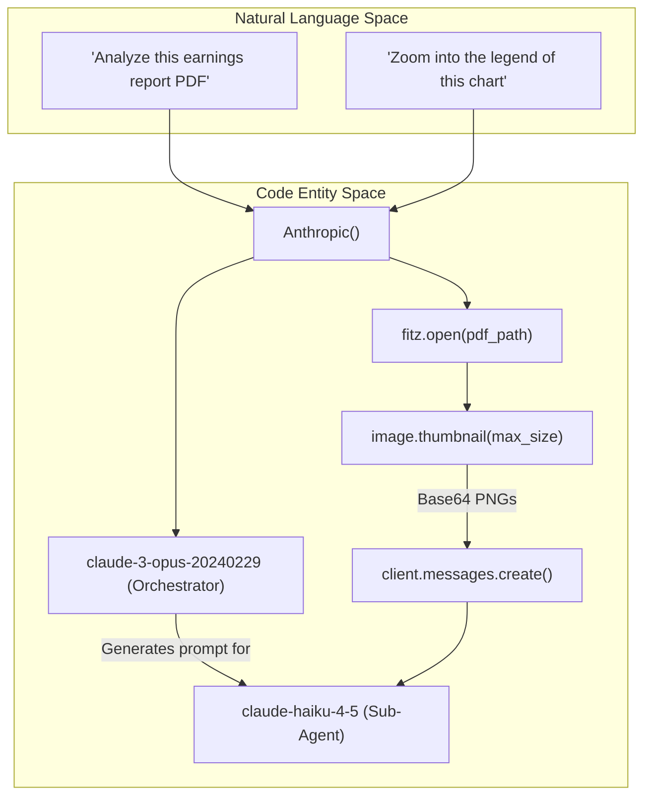
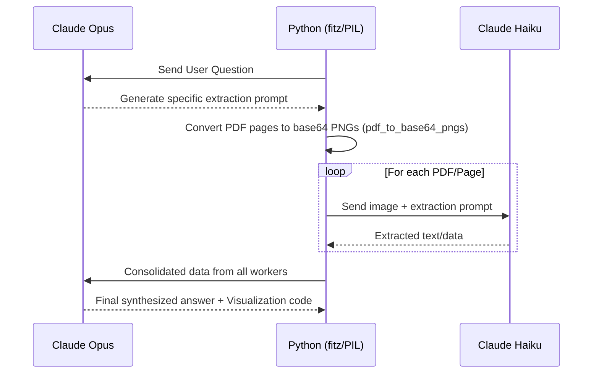

<!-- source: DeepWiki mcp.deepwiki.com · repo anthropics/claude-cookbooks · page 9 Multimodal Capabilities · fetched 2026-10-26 -->

# Multimodal Capabilities

Relevant source files

The following files were used as context for generating this wiki page:

- [images/crop_tool/architecture_diagram.png](images/crop_tool/architecture_diagram.png)
- [images/crop_tool/example_problem.png](images/crop_tool/example_problem.png)
- [images/crop_tool/results_accuracy.png](images/crop_tool/results_accuracy.png)
- [images/crop_tool/zoom_demo.gif](images/crop_tool/zoom_demo.gif)
- [images/using_sub_agents/FY23_Q1_Consolidated_Financial_Statements.pdf](images/using_sub_agents/FY23_Q1_Consolidated_Financial_Statements.pdf)
- [images/using_sub_agents/FY23_Q2_Consolidated_Financial_Statements.pdf](images/using_sub_agents/FY23_Q2_Consolidated_Financial_Statements.pdf)
- [images/using_sub_agents/FY23_Q3_Consolidated_Financial_Statements.pdf](images/using_sub_agents/FY23_Q3_Consolidated_Financial_Statements.pdf)
- [images/using_sub_agents/FY23_Q4_Consolidated_Financial_Statements.pdf](images/using_sub_agents/FY23_Q4_Consolidated_Financial_Statements.pdf)
- [misc/building_moderation_filter.ipynb](misc/building_moderation_filter.ipynb)
- [misc/how_to_make_sql_queries.ipynb](misc/how_to_make_sql_queries.ipynb)
- [misc/read_web_pages_with_haiku.ipynb](misc/read_web_pages_with_haiku.ipynb)
- [multimodal/crop_tool.ipynb](multimodal/crop_tool.ipynb)
- [multimodal/using_sub_agents.ipynb](multimodal/using_sub_agents.ipynb)

## Purpose and Scope

This page provides a high-level introduction to Claude's multimodal features, which enable the processing and analysis of visual inputs alongside text. Claude supports two primary multimodal modalities:
1.  **Vision:** Direct analysis of images (PNG, JPEG, WebP, GIF) to identify objects, read text (OCR), and interpret visual context.
2.  **Document Analysis:** Visual and structural processing of PDF documents, including charts, tables, and complex layouts.

For implementational depth, refer to the following child pages:
- [Vision and Image Processing](#9.1) — Covers image analysis with tools, nutrition label extraction, and the "Zoom" (crop) tool for fine detail.
- [Document and Chart Analysis](#9.2) — Covers PDF/PowerPoint analysis and the orchestrator-worker pattern for large-scale document processing.

## Core Multimodal Interfaces

Claude interacts with multimodal data via the Messages API using specific content block types.

### Content Block Structure
Input data is passed as base64-encoded strings within the `messages` array.

*   **Image Blocks:** Used for standard image files. Claude can process multiple images in a single turn for comparative analysis [multimodal/crop_tool.ipynb:15-23]().
*   **Document Blocks:** Specifically for PDFs. This allows Claude to "see" the visual layout of a document, which is superior to standard text extraction for tables and charts [multimodal/using_sub_agents.ipynb:82-84]().

### Visual Tool Use
A powerful pattern in the cookbook is combining vision with **Tool Use**. For example, Claude can use a crop tool to request a high-resolution sub-section of an image if the initial resolution is insufficient to read small text or chart labels [multimodal/crop_tool.ipynb:13-15]().

**Sources:** [multimodal/crop_tool.ipynb:7-23](), [multimodal/using_sub_agents.ipynb:82-85]()

## Multimodal Architecture: Request to Execution

The following diagram illustrates how natural language queries involving visual media are routed through the SDK to specific processing entities.

**Sources:** [multimodal/using_sub_agents.ipynb:41-49](), [multimodal/using_sub_agents.ipynb:88-92](), [multimodal/using_sub_agents.ipynb:129-143]()

## Key Multimodal Patterns

### 1. Hierarchical Sub-Agent Pattern
For multi-page documents, an "Orchestrator-Worker" pattern is used. A high-reasoning model like **Opus** acts as the orchestrator, defining extraction tasks. Faster, vision-capable models like **Haiku** act as workers, processing individual pages or documents in parallel to extract data [multimodal/using_sub_agents.ipynb:7-9]().

### 2. Interactive Segmentation and "Lean-In"
Claude's effective resolution is fixed. To overcome this, the **Zoom Tool** pattern allows Claude to emit pixel coordinates for a region of interest. The application then crops the original high-resolution image and sends it back to Claude as a new message, effectively allowing the model to "lean in" [multimodal/crop_tool.ipynb:11-15]().

### 3. PDF-to-Image Conversion
For complex financial documents where traditional PDF parsers fail on tables, the recommended pattern is converting PDF pages to images using libraries like `PyMuPDF` (`fitz`) [multimodal/using_sub_agents.ipynb:41-43]() and passing those images to Claude [multimodal/using_sub_agents.ipynb:82-84]().

## Multimodal Logic Flow

This diagram shows the logic for a visual sub-agent workflow, such as analyzing financial reports.

**Sources:** [multimodal/using_sub_agents.ipynb:88-92](), [multimodal/using_sub_agents.ipynb:129-143](), [multimodal/using_sub_agents.ipynb:161-180]()

## Recommended Models for Multimodal Tasks

| Model | Primary Use Case | Key Strength |
| :--- | :--- | :--- |
| **Claude 3.5 Sonnet** | General Multimodal | Balanced performance for vision and complex reasoning [multimodal/crop_tool.ipynb:53-55](). |
| **Claude 3 Haiku** | High-volume Extraction | Fast OCR and table extraction from images/PDFs [multimodal/using_sub_agents.ipynb:7-9](). |
| **Claude 3 Opus** | Orchestration | Strategic planning and synthesis of multimodal data [multimodal/using_sub_agents.ipynb:106-107](). |

## Next Steps

- **Fine-Detail Analysis:** For reading small labels or dense technical drawings, see [Vision and Image Processing](#9.1).
- **Large Document Sets:** For handling multiple multi-page reports or slide decks, see [Document and Chart Analysis](#9.2).

**Sources:** [multimodal/crop_tool.ipynb:53-57](), [multimodal/using_sub_agents.ipynb:7-9](), [multimodal/using_sub_agents.ipynb:48-50]()

---

