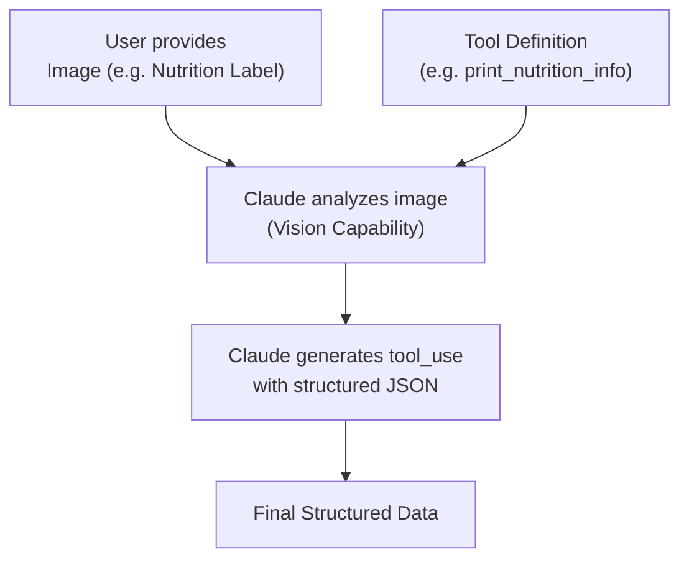
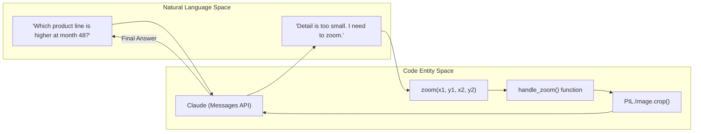

<!-- source: DeepWiki mcp.deepwiki.com · repo anthropics/claude-cookbooks · page 9.1 Vision and Image Processing · fetched 2026-10-26 -->

# Vision and Image Processing

<details>
<summary>Relevant source files</summary>

The following files were used as context for generating this wiki page:

- [images/crop_tool/architecture_diagram.png](images/crop_tool/architecture_diagram.png)
- [images/crop_tool/example_problem.png](images/crop_tool/example_problem.png)
- [images/crop_tool/results_accuracy.png](images/crop_tool/results_accuracy.png)
- [images/crop_tool/zoom_demo.gif](images/crop_tool/zoom_demo.gif)
- [misc/building_evals.ipynb](misc/building_evals.ipynb)
- [misc/how_to_enable_json_mode.ipynb](misc/how_to_enable_json_mode.ipynb)
- [multimodal/best_practices_for_vision.ipynb](multimodal/best_practices_for_vision.ipynb)
- [multimodal/crop_tool.ipynb](multimodal/crop_tool.ipynb)
- [multimodal/getting_started_with_vision.ipynb](multimodal/getting_started_with_vision.ipynb)
- [multimodal/how_to_transcribe_text.ipynb](multimodal/how_to_transcribe_text.ipynb)

</details>


## Purpose and Scope

This document covers Claude's multimodal vision capabilities, specifically how to analyze images, extract structured information from visual content, and use tools to enhance image processing workflows. Topics include basic image analysis, combining vision with tool use for structured data extraction, best practices for visual inputs, transcription, and implementing agentic loops for reading fine detail using a zoom/crop tool.

Claude's vision support extends to standard image formats and, in specific model versions, PDF documents, allowing for advanced reasoning over charts, graphs, and dense technical schematics.

---

## Image Input Format

Claude accepts images encoded as base64 strings. Supported image formats include PNG, JPEG, WEBP, and GIF.

### Basic Image Message Structure

Images are provided in message content blocks with `type: "image"` and a source specification.

```python
{
    "role": "user",
    "content": [
        {
            "type": "image",
            "source": {
                "type": "base64",
                "media_type": "image/png",
                "data": "<base64_encoded_image_data>"
            }
        },
        {
            "type": "text",
            "text": "What do you see in this image?"
        }
    ]
}
```

**Sources:** [multimodal/getting_started_with_vision.ipynb:7-9](), [multimodal/best_practices_for_vision.ipynb:36-42]()

---

## Vision with Tools for Structured Extraction

Claude's vision capabilities can be combined with tool use to extract structured data from images. This is highly effective for processing nutrition labels, invoices, or forms into machine-readable formats.

### Extraction Workflow

The extraction workflow involves defining a tool schema (often using Pydantic or JSON Schema) that represents the desired output. Claude analyzes the image and generates a tool call containing the extracted data.



**Diagram: Vision-Based Structured Extraction Flow**

**Sources:** [multimodal/how_to_transcribe_text.ipynb:7-9](), [misc/how_to_enable_json_mode.ipynb:184-191]()

---

## Agentic Zoom: The Crop Tool Pattern

When image details (like chart labels or small peak annotations) are too small for Claude to resolve at its standard effective resolution, a "zoom tool" can be implemented. This allows Claude to request a closer look at specific coordinates, which the system then crops and returns as a new high-resolution image.

### Implementation Architecture

The zoom tool uses an agentic loop where Claude emits pixel coordinates, and a Python handler performs the crop.



**Diagram: Bridging Natural Language to Zoom Tool Entities**

**Sources:** [multimodal/crop_tool.ipynb:9-15](), [multimodal/crop_tool.ipynb:30-32]()

### Accuracy Improvements
In benchmarks such as **Chartography**, adding a zoom tool significantly increases accuracy for dense real-world charts:
*   **Claude 3.5 Sonnet**: Accuracy rose from 13% to 44% (+31 points).
*   **Claude 3 Opus**: Accuracy rose from 29% to 73% (+44 points).

**Sources:** [multimodal/crop_tool.ipynb:51-53]()

---

## Transcription and Best Practices

### Transcribing Text
Claude 3 is capable of turning unstructured text within images into structured text. Unlike traditional OCR, Claude's reasoning allows it to filter content (e.g., "transcribe just the code in the answer") or interpret messy layouts.

**Sources:** [multimodal/how_to_transcribe_text.ipynb:7-9](), [multimodal/how_to_transcribe_text.ipynb:47-50]()

### Best Practices for Vision
1. **Role Prompting**: Hallucinations in visual tasks (like counting) can be mitigated by assigning a specific expert role to Claude.
2. **Pre-resizing**: Images should be resized using reference implementations (like `resized_size()`) so that pixel coordinates emitted by Claude map 1:1 to the source image.
3. **JSON Mode**: For reliable structured output without tool use, use "prefilling" by starting the assistant message with `{`.
4. **Handling Truncation**: When using thinking-heavy agentic loops, implement `stop_reason` handling to prevent silent truncation of long turns.

**Sources:** [multimodal/best_practices_for_vision.ipynb:48-52](), [multimodal/crop_tool.ipynb:17-21](), [misc/how_to_enable_json_mode.ipynb:198-201]()

---

## Evaluation of Vision Tasks

Optimizing vision performance is an empirical process. Evals typically include an input prompt, the model output, a "golden answer," and a score.

### Eval Grading Methods

| Method | Description | Best For |
|--------|-------------|----------|
| **Code-based** | String matching or regex (e.g., `exact_match`). | Integers, categories, specific keywords. |
| **Model-based** | Claude acts as a grader using a *grader prompt*. | Tone, transcription accuracy, free-form answers. |
| **Human** | Manual review by experts. | Ground truth establishment, high-stakes tasks. |

**Sources:** [misc/building_evals.ipynb:17-32](), [misc/building_evals.ipynb:39-42]()

---

## API Reference Summary

### Key Functions and Variables

| Symbol | Location | Purpose |
|--------|----------|---------|
| `client.messages.create()` | [misc/building_evals.ipynb:129]() | Core method for sending vision and text requests. |
| `get_base64_encoded_image()` | [multimodal/how_to_transcribe_text.ipynb:35-40]() | Utility to prepare image files for the API. |
| `extract_json()` | [misc/how_to_enable_json_mode.ipynb:184-191]() | Utility to parse JSON from a raw text response. |
| `resized_size()` | [multimodal/crop_tool.ipynb:19]() | Reference implementation for image scaling. |
| `MODEL_NAME` | [multimodal/how_to_transcribe_text.ipynb:32]() | Variable defining the Claude model version used. |

**Sources:** [multimodal/how_to_transcribe_text.ipynb:31-40](), [misc/how_to_enable_json_mode.ipynb:184-191](), [multimodal/crop_tool.ipynb:17-21]()

---

