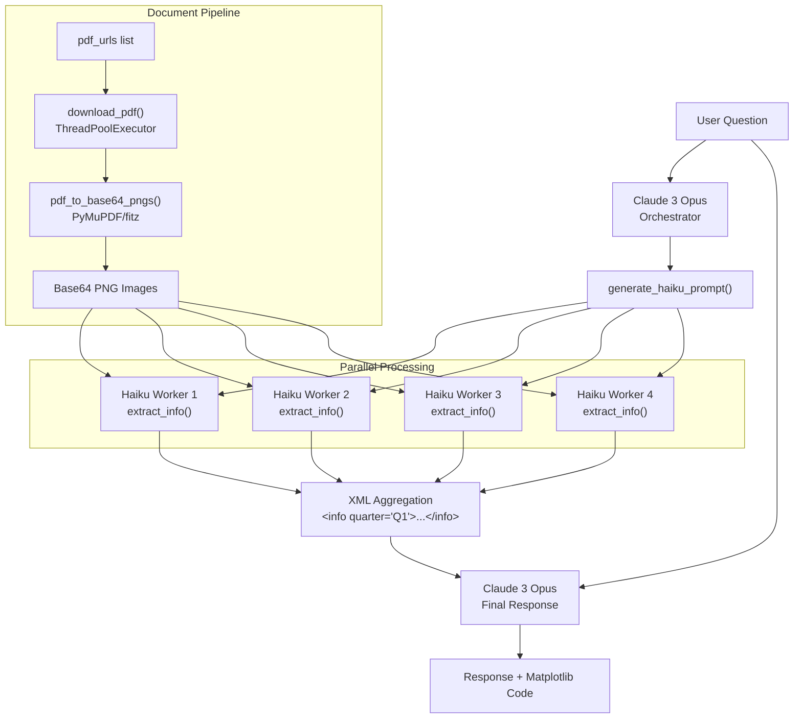

<!-- source: DeepWiki mcp.deepwiki.com · repo anthropics/claude-cookbooks · page 9.2 Document and Chart Analysis · fetched 2026-10-26 -->

# Document and Chart Analysis

<details>
<summary>Relevant source files</summary>

The following files were used as context for generating this wiki page:

- [images/using_sub_agents/FY23_Q1_Consolidated_Financial_Statements.pdf](images/using_sub_agents/FY23_Q1_Consolidated_Financial_Statements.pdf)
- [images/using_sub_agents/FY23_Q2_Consolidated_Financial_Statements.pdf](images/using_sub_agents/FY23_Q2_Consolidated_Financial_Statements.pdf)
- [images/using_sub_agents/FY23_Q3_Consolidated_Financial_Statements.pdf](images/using_sub_agents/FY23_Q3_Consolidated_Financial_Statements.pdf)
- [images/using_sub_agents/FY23_Q4_Consolidated_Financial_Statements.pdf](images/using_sub_agents/FY23_Q4_Consolidated_Financial_Statements.pdf)
- [misc/building_moderation_filter.ipynb](misc/building_moderation_filter.ipynb)
- [misc/how_to_make_sql_queries.ipynb](misc/how_to_make_sql_queries.ipynb)
- [misc/pdf_upload_summarization.ipynb](misc/pdf_upload_summarization.ipynb)
- [misc/read_web_pages_with_haiku.ipynb](misc/read_web_pages_with_haiku.ipynb)
- [multimodal/documents/constitutional-ai-paper.pdf](multimodal/documents/constitutional-ai-paper.pdf)
- [multimodal/documents/cvna_2021_annual_report.pdf](multimodal/documents/cvna_2021_annual_report.pdf)
- [multimodal/documents/twilio_q4_2023.pdf](multimodal/documents/twilio_q4_2023.pdf)
- [multimodal/reading_charts_graphs_powerpoints.ipynb](multimodal/reading_charts_graphs_powerpoints.ipynb)
- [multimodal/using_sub_agents.ipynb](multimodal/using_sub_agents.ipynb)

</details>


## Purpose and Scope

This page documents the techniques and patterns for analyzing complex visual documents using Claude. It covers direct PDF and image ingestion for charts, graphs, and slide decks, as well as the hierarchical sub-agent pattern for processing multiple documents in parallel. The sub-agent pattern uses Claude 3 Opus as an orchestrator to coordinate multiple Claude 3 Haiku workers, each analyzing a separate document. This is specifically designed for multimodal document analysis where documents (such as financial reports) are converted to images to preserve table structures and visual layouts.

**Sources:** [multimodal/reading_charts_graphs_powerpoints.ipynb:9-10](), [multimodal/using_sub_agents.ipynb:1-10]()

## Direct PDF and Image Analysis

Claude supports direct ingestion of PDFs and images for visual reasoning tasks. This is particularly effective for interpreting data visualizations and slide decks.

### Ingestion and API Usage
To analyze charts or graphs, the recommended approach is to provide Claude with a PDF document or image along with a text question.

*   **Model Support:** Only specific models like `claude-3-5-sonnet-20241022` (referenced as `claude-sonnet-4-6` in the cookbooks) support the PDF feature.
*   **Beta Headers:** Since PDF support is often in beta, the `anthropic-beta` header (e.g., `pdfs-2024-09-25`) must be provided.
*   **Data Format:** PDFs are passed as base64-encoded strings within a `document` block in the `messages` array.

**Sources:** [multimodal/reading_charts_graphs_powerpoints.ipynb:29-33](), [multimodal/reading_charts_graphs_powerpoints.ipynb:64-66](), [misc/pdf_upload_summarization.ipynb:60-66]()

### Implementation Example: PDF Summarization
The following pattern is used to send a PDF to Claude for multi-task analysis:

[misc/pdf_upload_summarization.ipynb:120-134]()
```python
messages = [
    {
        "role": 'user',
        "content": [
            {"type": "document", "source": {"type": "base64", "media_type": "application/pdf", "data": base64_string}},
            {"type": "text", "text": prompt}
        ]
    }
]
```

**Sources:** [misc/pdf_upload_summarization.ipynb:120-134](), [multimodal/reading_charts_graphs_powerpoints.ipynb:130-145]()

## Hierarchical Sub-Agent Pattern

For large-scale analysis of multiple documents, the repository demonstrates a hierarchical pattern using an orchestrator and workers.

### Architecture Overview



**Sources:** [multimodal/using_sub_agents.ipynb:1-362]()

### Model Selection Strategy

| Role | Model | Rationale |
|------|-------|-----------|
| Orchestrator | `claude-3-opus-20240229` | High-level reasoning, prompt generation, cross-document synthesis. |
| Workers | `claude-3-haiku-20240307` | Fast, cost-effective parallel extraction from multimodal inputs. |

**Sources:** [multimodal/using_sub_agents.ipynb:48,142,323]()

## Document Preparation Pipeline

### PDF to Image Conversion
Documents are converted to images because financial PDFs often contain complex tables that are difficult to parse with traditional text-based PDF parsers. Image-based analysis allows Claude to interpret visual layouts directly.

```mermaid
flowchart LR
    URLs["pdf_urls list"]
    TE["ThreadPoolExecutor"]
    Download["download_pdf(url, folder)"]
    Files["PDF files<br/>../images/using_sub_agents/"]
    
    Convert["pdf_to_base64_pngs(pdf_path)"]
    Fitz["fitz.open(pdf_path)"]
    Pages["page.get_pixmap()"]
    PIL["PIL.Image.frombytes()"]
    B64["base64.b64encode()"]
    
    URLs --> TE
    TE --> Download
    Download --> Files
    Files --> Convert
    Convert --> Fitz
    Fitz --> Pages
    Pages --> PIL
    PIL --> B64
```



The `pdf_to_base64_pngs()` function renders pages at 300 DPI using `fitz.Matrix(300 / 72, 300 / 72)` and resizes them to a maximum of 1024x1024 for token efficiency.

**Sources:** [multimodal/using_sub_agents.ipynb:82-92,92-93]()

## Orchestrator and Worker Implementation

### Dynamic Prompt Generation
The orchestrator generates task-specific prompts for workers using `generate_haiku_prompt()`. This ensures that workers extract only the information relevant to the user's specific query.

[multimodal/using_sub_agents.ipynb:129-149]()
```python
def generate_haiku_prompt(question):
    messages = [
        {
            "role": "user",
            "content": [
                {
                    "type": "text",
                    "text": f"Based on the following question, please generate a specific prompt for an LLM sub-agent to extract relevant information from an earning's report PDF... Question: {question}",
                }
            ],
        }
    ]
    # ... call Opus ...
```

**Sources:** [multimodal/using_sub_agents.ipynb:129-149]()

### Parallel Extraction
Workers execute in parallel using `ThreadPoolExecutor`. Each worker calls `extract_info()`, which constructs a multimodal message containing all page images of a single document and the generated prompt.

[multimodal/using_sub_agents.ipynb:215-244]()
```python
def extract_info(pdf_path, haiku_prompt):
    base64_encoded_pngs = pdf_to_base64_pngs(pdf_path)
    messages = [
        {
            "role": "user",
            "content": [
                *[
                    {"type": "image", "source": {"type": "base64", "media_type": "image/png", "data": img}}
                    for img in base64_encoded_pngs
                ],
                {"type": "text", "text": haiku_prompt},
            ],
        }
    ]
    # ... call Haiku ...
```

**Sources:** [multimodal/using_sub_agents.ipynb:215-244,247-249]()

### Result Aggregation and Synthesis
Results from workers are aggregated into an XML structure. The orchestrator then synthesizes the final response and generates Python code (e.g., `matplotlib`) for visualization.

[multimodal/using_sub_agents.ipynb:251-258]()
```python
extracted_info = ""
for info in extracted_info_list:
    quarter = info[1].split("/")[-1].split("_")[1]
    extracted_info += f'<info quarter="{quarter}">{info[0]}</info>\n'
```

The final response is generated by passing this `extracted_info` back to Opus.

**Sources:** [multimodal/using_sub_agents.ipynb:251-258,323-342]()

## Key Code Components

| Component | Function/Class | Purpose |
|-----------|---------------|---------|
| PDF Download | `download_pdf(url, folder)` | Fetches PDFs via `requests.get()` and saves locally. |
| Image Conversion | `pdf_to_base64_pngs(pdf_path, ...)` | Converts PDF pages to base64 PNG using `PyMuPDF` (fitz). |
| Prompt Generation | `generate_haiku_prompt(question)` | Uses Opus to create worker prompts based on user intent. |
| Worker Extraction | `extract_info(pdf_path, haiku_prompt)` | Haiku analyzes images and extracts structured text. |
| Result Parsing | `extract_code_and_response(response)` | Separates natural language response from generated `<code>` blocks. |

**Sources:** [multimodal/using_sub_agents.ipynb:92-362]()

---

