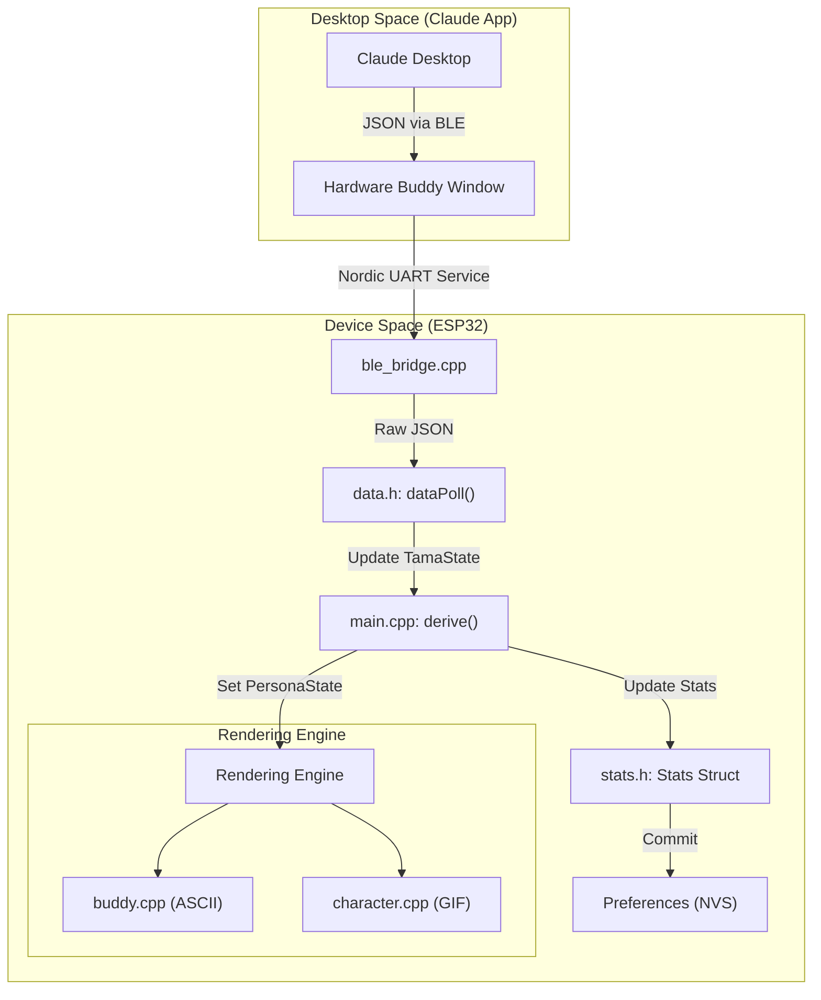
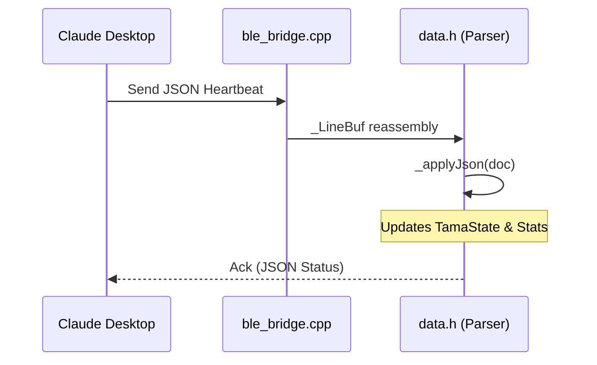

<!-- source: DeepWiki mcp.deepwiki.com · repo anthropics/claude-desktop-buddy · page 1 Overview · fetched 2026-10-26 -->

# Overview

Relevant source files

The following files were used as context for generating this wiki page:

- [CONTRIBUTING.md](CONTRIBUTING.md)
- [LICENSE](LICENSE)
- [README.md](README.md)

The `claude-desktop-buddy` project is a reference implementation of a physical companion device for Claude (macOS and Windows). It allows developers to connect hardware to Claude via Bluetooth Low Energy (BLE) to display permission prompts, track session status, and interact with a digital "pet" that reacts to Claude's activity.

The system is designed to provide a tangible interface for AI interactions, moving "Human-in-the-loop" approvals from a desktop notification to a dedicated hardware device.

## System Architecture

The project consists of an ESP32 firmware application and a set of desktop integration points within the Claude app. The firmware manages a state machine that transitions between different "Persona States" based on JSON telemetry received over BLE.

### High-Level Component Interaction
This diagram illustrates how the "Natural Language Space" (Claude's reasoning and tool use) translates into "Code Entity Space" on the device.

**Sources:** [README.md:1-18](), [src/main.cpp:156-156](), [src/data.h:161-161](), [src/stats.h:163-163]()

## Hardware Target

The firmware is specifically written for the **M5StickC Plus**, an ESP32-based development board. It leverages the following integrated components:
*   **Display:** 135x240 color TFT for rendering ASCII or GIF characters.
*   **Input:** Two physical buttons (Button A on the front, Button B on the right).
*   **IMU:** Used for gesture detection (shaking the device or placing it face-down).
*   **LED:** Used for visual alerts during `attention` states (e.g., pending approvals).
*   **Power:** Managed via an AXP192 PMU, supporting auto-dimming and deep sleep.

For details on physical interactions and UI modes, see **[Hardware & UI Reference](#1.2)**.

**Sources:** [README.md:23-28](), [README.md:69-82]()

## Core Concepts

### The Seven Persona States
The "Buddy" exists in one of seven functional states determined by the desktop's activity or physical interaction. These states are defined by the `PersonaState` enum in the firmware.

| State | Code Identifier | Triggering Logic |
| :--- | :--- | :--- |
| **Sleep** | `STATE_SLEEP` | BLE bridge is disconnected [README.md:144](). |
| **Idle** | `STATE_IDLE` | Connected, but no active sessions or prompts [README.md:145](). |
| **Busy** | `STATE_BUSY` | Claude Code or Cowork is actively running tools [README.md:146](). |
| **Attention** | `STATE_ATTENTION` | A tool use permission prompt is waiting for user approval [README.md:147](). |
| **Celebrate** | `STATE_CELEBRATE` | Triggered on level-up (every 50k tokens processed) [README.md:148](). |
| **Dizzy** | `STATE_DIZZY` | Detected via IMU `getAccelData` when the user shakes the device [README.md:149](). |
| **Heart** | `STATE_HEART` | User approves a prompt in under 5 seconds [README.md:150](). |

### Communication & Protocol
The device communicates using the **Nordic UART Service (NUS)** over BLE. The desktop sends a `heartbeat` snapshot containing token counts, session status, and permission requests. The device responds with user decisions (Approve/Deny) or status acknowledgments.

**Sources:** [README.md:10-12](), [src/data.h:161-161](), [src/ble_bridge.cpp:159-159]()

## Project Structure & Subsystems

The codebase is organized into modular subsystems that handle communication, state management, and graphics:

*   **Firmware Core:** Managed by `main.cpp`, which coordinates the main loop and UI transitions.
*   **BLE & Data:** `ble_bridge.cpp` handles the wireless link, while `data.h` and `xfer.h` handle the JSON protocol and file transfers.
*   **Visuals:** 
    *   `buddy.cpp` handles the 18 built-in **ASCII species**.
    *   `character.cpp` manages **GIF-based characters** stored in LittleFS.
*   **Persistence:** `stats.h` manages non-volatile storage (NVS) for token counts, levels, and user settings.

For setup and deployment instructions, see **[Getting Started](#1.1)**.

**Sources:** [README.md:152-166]()

---

