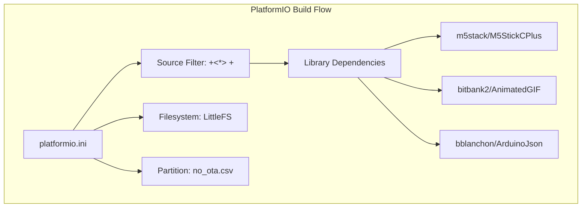
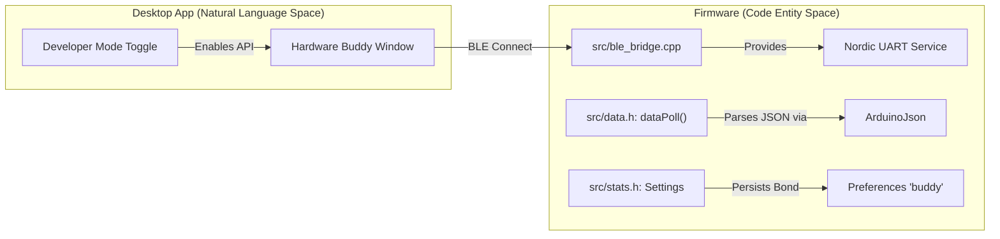
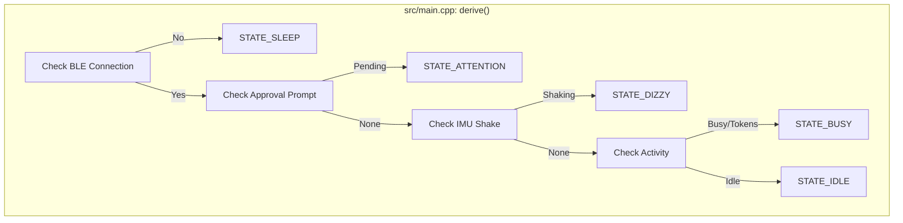

<!-- source: DeepWiki mcp.deepwiki.com · repo anthropics/claude-desktop-buddy · page 1.1 Getting Started · fetched 2026-10-26 -->

# Getting Started

<details>
<summary>Relevant source files</summary>

The following files were used as context for generating this wiki page:

- [.gitignore](.gitignore)
- [README.md](README.md)
- [platformio.ini](platformio.ini)

</details>


The `claude-desktop-buddy` is an ESP32-based hardware companion designed to interact with the Claude desktop application. It serves as a physical manifestation of Claude's state, providing visual feedback through animations (ASCII or GIF), handling permission prompts via physical buttons, and tracking usage statistics like token counts and "levels."

## Hardware Requirements

The firmware is specifically architected for the **M5StickC Plus**. While it uses the Arduino framework on an ESP32, it has hard dependencies on the `M5StickCPlus` library for display drivers, Power Management IC (AXP192), IMU (MPU6886), and button handling.

| Component | Specification | Role in System |
| :--- | :--- | :--- |
| **MCU** | ESP32-PICO | Executes firmware, manages BLE stack. |
| **Display** | 1.14" LCD (135x240) | Renders `PersonaState` animations and system info. |
| **IMU** | MPU6886 | Detects `dizzy` (shake) and `nap` (face-down) states. |
| **Buttons** | A (Front), B (Right) | User input for approvals, navigation, and menus. |
| **PMIC** | AXP192 | Manages power, screen brightness, and deep sleep. |

Sources: [README.md:23-28](), [platformio.ini:1-16]()

---

## Build Environment Setup

The project uses **PlatformIO** for dependency management and compilation. 

1.  **Install PlatformIO Core**: Follow the [official installation guide](https://docs.platformio.org/en/latest/core/installation/).
2.  **Clone the Repository**: Ensure you have the full source, including the `src/buddies/` directory.
3.  **Configuration**: The `platformio.ini` file defines the environment, including the `littlefs` partition for character storage and a `no_ota.csv` partition table to maximize space for firmware and assets.

### Build Configuration Overview
The build process is governed by `platformio.ini`, which specifies the CPU frequency (160MHz) and necessary libraries.


Sources: [platformio.ini:1-16](), [README.md:32-34]()

---

## Flashing Firmware

Flashing involves two potential steps: uploading the firmware binary and (optionally) uploading the filesystem image if using custom GIF characters.

### Standard Flash
To compile and upload the firmware to the M5StickC Plus:
```bash
pio run -t upload
```

### Clean Flash
If the device has existing NVS (Non-Volatile Storage) data that needs to be cleared (e.g., to reset species choice or tokens):
```bash
pio run -t erase && pio run -t upload
```

### Character Pack Flash (USB)
While character packs are usually sent over BLE, developers can flash them directly over USB to the `data/` directory:
```bash
python tools/flash_character.py characters/bufo
```
This script stages the files and executes `pio run -t uploadfs`.

Sources: [README.md:36-44](), [README.md:136-138]()

---

## Enabling Developer Mode

The Claude desktop application (macOS/Windows) does not expose the Hardware Buddy interface by default. It must be enabled via **Developer Mode**.

1.  Open the Claude Desktop App.
2.  Navigate to **Help** → **Troubleshooting** → **Enable Developer Mode**.
3.  A new **Developer** menu will appear in the menu bar.
4.  Select **Developer** → **Open Hardware Buddy...** to open the connection window.

Sources: [README.md:51-55](), [README.md:170-173]()

---

## Pairing and Connection

The connection between the desktop and the device utilizes the **Nordic UART Service (NUS)** over Bluetooth Low Energy (BLE).

### Connection Flow
1.  **Wake Device**: Ensure the M5StickC Plus is awake (press any button).
2.  **Enable Bluetooth**: In the device menu (**Hold A** → **settings** → **bluetooth**), ensure it is toggled ON.
3.  **Initiate Pairing**: Click **Connect** in the Hardware Buddy desktop window.
4.  **Security**: The device uses LE Secure Connections. If prompted on the desktop, confirm the passkey displayed on the M5StickC Plus screen.

### System Interaction Diagram
This diagram maps the high-level pairing components to the code entities responsible for the connection.



Sources: [README.md:49-68](), [src/ble_bridge.cpp:1-20](), [src/data.h:10-30](), [src/stats.h:1-25]()

---

## Controls & Navigation

Once flashed and paired, the device uses a context-aware button mapping. The `PersonaState` (managed in `main.cpp`) determines how inputs are handled.

| Action | Normal/Pet Mode | Approval Mode |
| :--- | :--- | :--- |
| **Button A (Front)** | Next UI Screen | **Approve Request** |
| **Button B (Right)** | Scroll/Next Page | **Deny Request** |
| **Hold A** | Open Settings Menu | Open Settings Menu |
| **Power (Short)** | Toggle Screen Off | Toggle Screen Off |
| **Shake** | Trigger `dizzy` state | N/A |
| **Face-down** | Trigger `nap` (Energy) | N/A |

### State Transition Logic
The `derive()` function in `main.cpp` calculates the current `PersonaState` based on BLE heartbeat data and IMU inputs.



Sources: [README.md:69-83](), [README.md:140-151](), [src/main.cpp:50-120]()

---

