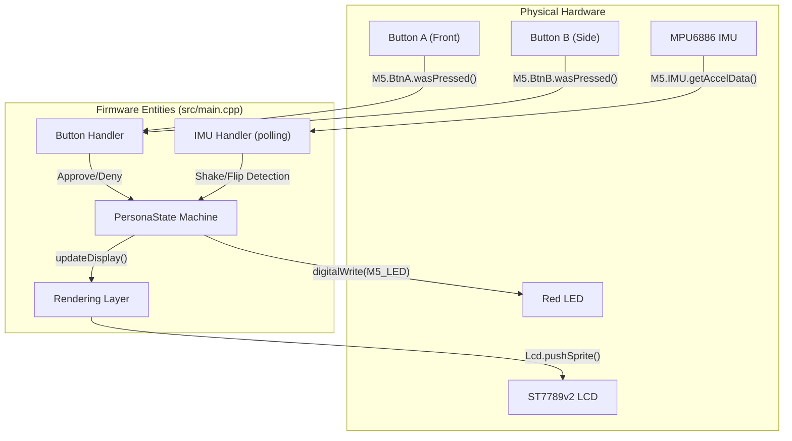
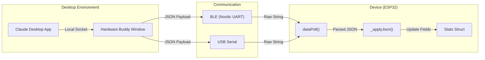

<!-- source: DeepWiki mcp.deepwiki.com · repo anthropics/claude-desktop-buddy · page 1.2 Hardware & UI Reference · fetched 2026-10-26 -->

# Hardware & UI Reference

Relevant source files

The following files were used as context for generating this wiki page:

- [docs/device.jpg](docs/device.jpg)
- [docs/hardware-buddy-window.png](docs/hardware-buddy-window.png)
- [docs/manual.html](docs/manual.html)
- [docs/menu.png](docs/menu.png)

This page provides a technical overview of the physical interface, sensor interactions, and desktop software UI for the Claude Desktop Buddy. The system utilizes the M5StickC Plus hardware platform, leveraging its integrated buttons, IMU, and LED to provide a tactile interface for AI interactions.

## Physical Device Layout

The Claude Desktop Buddy is built on the **M5StickC Plus** (ESP32-PICO-D4). The firmware maps physical components to specific logic within the `src/main.cpp` state machine.

### Button Mapping
The device features two primary interaction buttons and a power/reset button.

| Component | Code Identifier | Primary Function | Secondary Function |
|:---|:---|:---|:---|
| **Button A** (Front) | `M5.BtnA` | **Approve Request**: Sends "once" or "always" permission to Claude. | **Wake**: Wakes device from dim/sleep mode. |
| **Button B** (Side) | `M5.BtnB` | **Deny Request**: Sends "deny" signal to desktop. | **Toggle View**: Cycles between `DISP_NORMAL`, `PET`, and `INFO` modes. |
| **Power Button** | `M5.Axp.GetBtnPress()` | **Reset/Power**: Short press resets; long press (6s) powers off. | N/A |

### LED Indicators
The red LED located at the top of the device (near the IR transmitter) is used to signal attention or processing states.

*   **Blinking**: Occurs when the `PersonaState` is set to `STATE_ATTENTION` (waiting for user approval) or `STATE_BUSY` (Claude is generating) [src/main.cpp:525-535]().
*   **Implementation**: Controlled via `digitalWrite(M5_LED, ...)` logic in the `loop()` [src/main.cpp:528]().

### Hardware Interaction Flow
The following diagram maps physical hardware components to their respective classes and handlers in the firmware.

**Diagram: Hardware to Code Entity Mapping**

Sources: [src/main.cpp:455-510](), [src/main.cpp:525-535]()

---

## IMU Gestures

The device uses the onboard MPU6886 Inertial Measurement Unit (IMU) to detect physical gestures, which influence the Buddy's mood and state.

### Shake Detection
*   **Logic**: The firmware calculates the magnitude of acceleration. If it exceeds a defined threshold, it triggers `STATE_DIZZY` [src/main.cpp:498-505]().
*   **Code**: `if (abs(accX) + abs(accY) + abs(accZ) > 4.0)` triggers the dizzy state.

### Face-Down (Sleep)
*   **Logic**: When the device is placed face-down (Z-axis acceleration is positive/inverted), the device enters a sleep/nap state [src/main.cpp:485-495]().
*   **Implementation**: This increments `napSeconds` in the `Stats` struct [src/stats.h:35-45](), which recovers "Energy" for the character.

---

## Display & UI Modes

The 1.14" LCD (135x240) supports three distinct rendering modes, toggled via **Button B**.

| Mode | Identifier | Description |
|:---|:---|:---|
| **Normal** | `DISP_NORMAL` | Displays the character (ASCII or GIF) with a status bar showing token velocity and clock [src/main.cpp:115-120](). |
| **Pet** | `DISP_PET` | Full-screen character view. Removes UI elements for maximum visibility [src/main.cpp:121](). |
| **Info** | `DISP_INFO` | Technical stats: Total tokens, lifetime approvals, BLE signal strength, and firmware version [src/main.cpp:122](). |

### Screen Orientation
The device supports automatic 180-degree rotation based on gravity.
*   **Function**: `derive()` in `src/main.cpp` [src/main.cpp:250-280]().
*   **Logic**: If `accY < -0.5`, orientation is set to `3` (Standard). If `accY > 0.5`, orientation is set to `1` (Inverted). This ensures the "Clock" and Buddy are always upright regardless of which way the USB cable is pointing.

---

## Desktop UI (Hardware Buddy)

The companion desktop application provides a window for managing the connection and monitoring the Buddy's health.

### Desktop Window Features
The "Hardware Buddy" window (Electron-based) acts as the bridge between the Claude Desktop App and the ESP32.

1.  **Connection Status**: Shows if the device is paired via BLE or Serial.
2.  **Snapshot Stats**: Displays "Tokens Today", "Velocity", and "Current Task" (mirrored from the device) [docs/hardware-buddy-window.png]().
3.  **Character Management**: Allows dragging and dropping `.tar.gz` character packs for BLE transfer to the device [docs/menu.png]().

**Diagram: UI Data Flow (Desktop to Device)**

Sources: [src/data.h:80-150](), [src/ble_bridge.cpp:50-90]()

### Menu & Settings
The system tray menu (accessible via the Buddy icon) provides:
*   **Pairing Mode**: Triggers the BLE passkey display on the M5StickC LCD.
*   **Unpair**: Clears the bond information on both the desktop and the device `Preferences` storage [src/ble_bridge.cpp:145-160]().
*   **Force Sync**: Pushes current RTC time and owner name to the device.

Sources: [docs/menu.png](), [src/data.h:110-120]()

---

