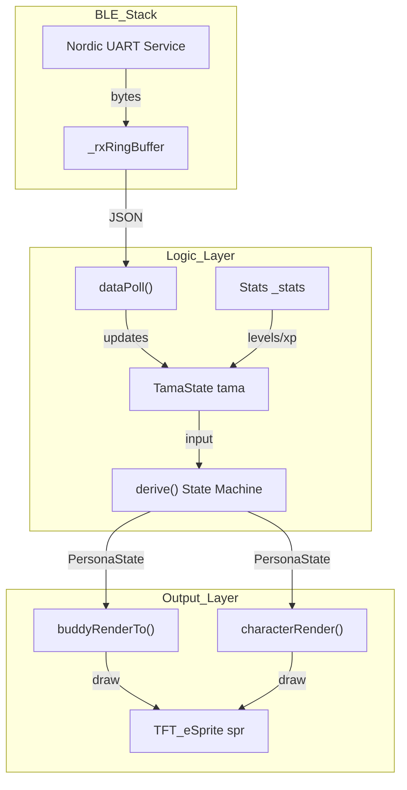
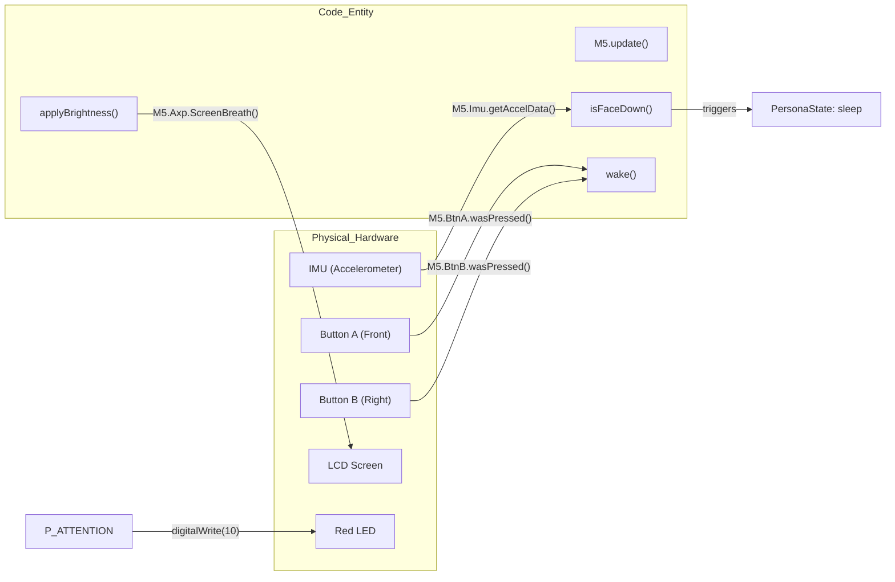

<!-- source: DeepWiki mcp.deepwiki.com · repo anthropics/claude-desktop-buddy · page 2 Firmware Architecture · fetched 2026-10-26 -->

# Firmware Architecture

Relevant source files

The following files were used as context for generating this wiki page:

- [README.md](README.md)
- [src/main.cpp](src/main.cpp)

The Claude Desktop Buddy firmware is an ESP32-based application built on the Arduino framework. It manages a real-time animation system, a Bluetooth Low Energy (BLE) communication bridge, and a persistent state machine that tracks "pet" metrics (tokens, energy, and level).

### System Overview

The firmware is structured around a central polling loop in `src/main.cpp`. It coordinates several independent subsystems that communicate via shared state structures, primarily `TamaState` (for session data) and `Stats` (for persistent metrics).

#### Key Components
| Component | Responsibility |
| :--- | :--- |
| **Main Loop** | Handles hardware I/O (IMU, Buttons), UI state transitions, and power management. |
| **BLE Bridge** | Implements the Nordic UART Service (NUS) for bi-directional communication with the desktop. |
| **Data Layer** | Parses incoming JSON commands and updates the global `tama` state. |
| **Persistence** | Manages NVS (Non-Volatile Storage) for user settings and long-term buddy stats. |
| **Rendering** | Dispatches drawing commands to either the ASCII buddy engine or the GIF character player. |

### Component Interaction

The following diagram illustrates how the core entities interact to process data from the desktop app and update the physical device.

**Firmware Data Flow & Entity Mapping**

Sources: [src/main.cpp:32-37](), [src/ble_bridge.cpp:16-25](), [src/data.h:134-140](), [src/stats.h:112-120]()

---

### Core Subsystems

#### 1. Main Loop & State Machine
The state machine in `src/main.cpp` uses a `PersonaState` enum to determine the current animation (e.g., `P_IDLE`, `P_BUSY`, `P_ATTENTION`). Transitions are derived from `TamaState` values or physical triggers like the IMU.
*   **For details, see [Main Loop & State Machine](#2.1)**

#### 2. BLE Bridge
Communication is handled by `src/ble_bridge.cpp`, which sets up the ESP32 as a BLE peripheral. It uses the Nordic UART Service UUIDs to create a transparent serial-like bridge for JSON data.
*   **For details, see [BLE Bridge](#2.2)**

#### 3. Data Layer & Wire Protocol
Incoming packets are reassembled in a line buffer and parsed using `ArduinoJson`. The `_applyJson` function maps desktop events (like new messages or token counts) into the `tama` object.
*   **For details, see [Data Layer & Wire Protocol](#2.3)**

#### 4. Persistence & Settings
The `stats.h` module handles reading and writing to ESP32 NVS. It tracks "Tokens Processed" as XP and manages the level-up logic. It also stores user preferences like screen brightness and species selection.
*   **For details, see [Persistence & Settings (stats.h)](#2.4)**

#### 5. File Transfer Protocol (Folder Push)
The firmware supports a custom "Folder Push" protocol in `src/xfer.h` to receive character packs (GIFs and manifests) over BLE. It manages LittleFS writes and Base64 decoding of file chunks.
*   **For details, see [File Transfer Protocol (xfer.h)](#2.5)**

### System Hardware Integration

The firmware specifically targets the **M5StickC Plus** hardware. It utilizes the `M5StickCPlus` library to interface with the ST7789 LCD, the SH200Q/MPU6886 IMU, and the AXP192 power management IC.

**Hardware to Code Mapping**

Sources: [src/main.cpp:91-108](), [src/main.cpp:26-30](), [README.md:71-79]()

### Memory and Filesystem
The firmware uses **LittleFS** for storing character packs. The partition table is configured to provide approximately 1.8MB of space for the `/characters/` directory.
*   **ASCII Buddies:** Compiled into the binary (flash).
*   **GIF Characters:** Stored in LittleFS (SPIFFS/Flash).
*   **Stats/Settings:** Stored in NVS (EEPROM emulation).

Sources: [src/main.cpp:1-6](), [src/xfer.h:60-75](), [README.md:131-133]()

---

