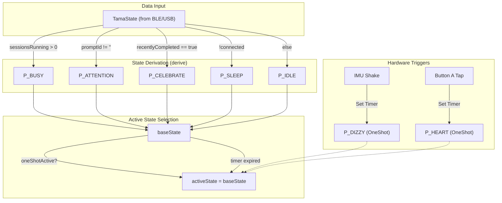
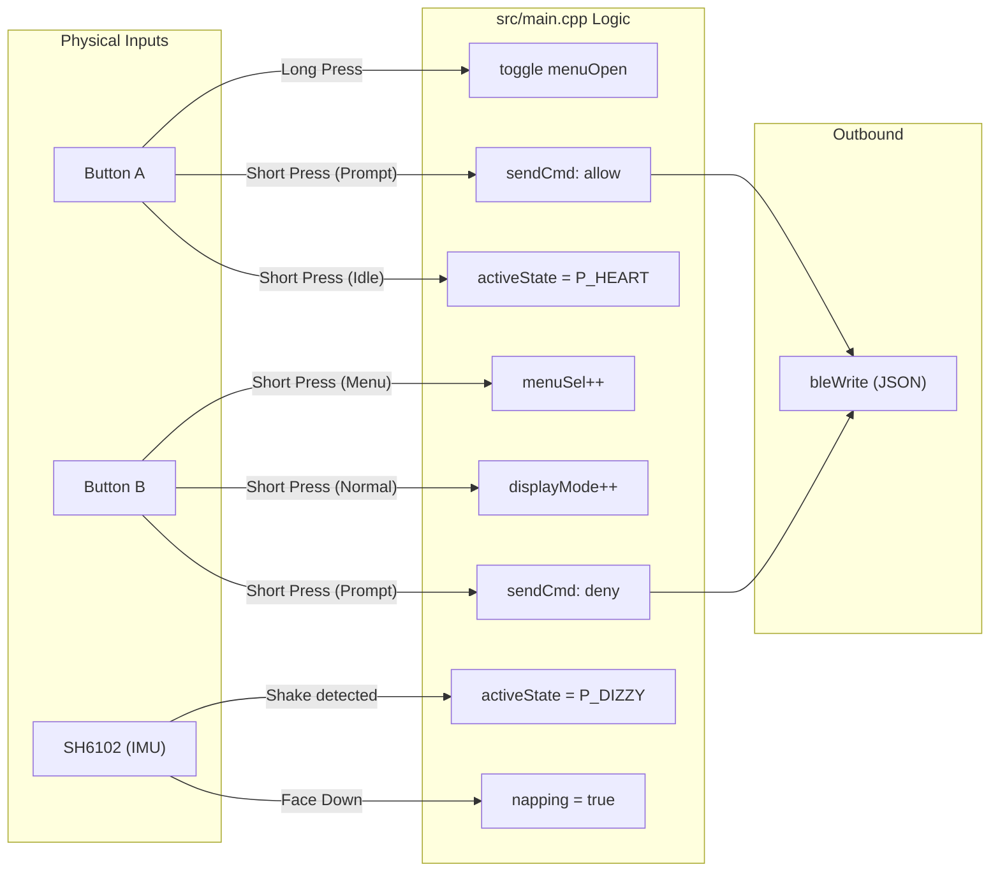

<!-- source: DeepWiki mcp.deepwiki.com · repo anthropics/claude-desktop-buddy · page 2.1 Main Loop & State Machine · fetched 2026-10-26 -->

# Main Loop & State Machine

Relevant source files

The following files were used as context for generating this wiki page:

- [src/data.h](src/data.h)
- [src/main.cpp](src/main.cpp)

The main loop in `src/main.cpp` serves as the central orchestrator for Claude Desktop Buddy. It manages the transitions between emotional states (Persona States), handles physical hardware interrupts (buttons and IMU), coordinates the display modes, and implements power-saving logic.

## Persona State Machine

The buddy's behavior is driven by a state machine defined by the `PersonaState` enum [src/main.cpp:32-32](). The system distinguishes between a `baseState` (the persistent emotional state derived from data) and an `activeState` (which may include temporary "one-shot" animations).

### State Definitions
| State | Enum | Description |
|:---|:---|:--- |
| **Sleep** | `P_SLEEP` | Default state when no desktop app is connected or during "nap" mode. |
| **Idle** | `P_IDLE` | Connected and waiting; no active sessions or prompts. |
| **Busy** | `P_BUSY` | Desktop app is actively running sessions/processing. |
| **Attention** | `P_ATTENTION` | A permission prompt is pending user approval. |
| **Celebrate** | `P_CELEBRATE` | Triggered briefly when a session completes successfully. |
| **Dizzy** | `P_DIZZY` | Triggered by physical shaking of the device. |
| **Heart** | `P_HEART` | Triggered by a "petting" interaction (Button A tap). |

### State Derivation Logic
The `derive()` function (called within `loop`) calculates the `baseState` based on the current `TamaState` [src/data.h:7-22]() received from the desktop.

*   **Logic Flow**:
    1.  If not connected: `P_SLEEP`.
    2.  If `promptId` is not empty: `P_ATTENTION`.
    3.  If `sessionsRunning > 0`: `P_BUSY`.
    4.  If `recentlyCompleted` is true: `P_CELEBRATE`.
    5.  Otherwise: `P_IDLE`.

### One-Shot Transitions
One-shot states (`P_DIZZY`, `P_HEART`, `P_CELEBRATE`) override the `baseState` for a fixed duration. The variable `oneShotUntil` [src/main.cpp:38-38]() stores the timestamp when the override expires, at which point the `activeState` reverts to `baseState`.

**State Transition Flow**

**Sources:** [src/main.cpp:32-42](), [src/data.h:7-22](), [src/main.cpp:1134-1160]() (approximate loop logic).

## Display & Screen Management

The device supports three primary `DisplayMode` settings [src/main.cpp:49-50]() which determine the layout and information density on the 135x240 TFT screen.

### Display Modes
1.  **DISP_NORMAL**: Full-screen character animation.
2.  **DISP_PET**: Character is shrunk to a "peek" size at the bottom to show stats (tokens, level, velocity).
3.  **DISP_INFO**: Technical debug and system info pages (BLE status, RTC, Credits).

### Clock & Orientation
The system utilizes the M5StickC Plus IMU to handle screen rotation.
*   **Clock Orientation**: If the device is tilted, the UI can rotate to remain upright.
*   **Face-Down Detection**: The `isFaceDown()` function [src/main.cpp:91-95]() checks if the Z-axis is dominant and negative. If the device is placed face-down, it triggers "Nap Mode" (dimming the screen and silencing notifications).

**Sources:** [src/main.cpp:49-53](), [src/main.cpp:91-95](), [src/main.cpp:125-135]().

## Power Management: Auto-Dim & Screen-Off

To preserve the small LiPo battery and prevent OLED burn-in, the main loop implements a multi-stage power management strategy.

*   **Activity Tracking**: `lastInteractMs` [src/main.cpp:57-57]() is updated on button presses, IMU movement, or incoming BLE data.
*   **Dimming**: After a period of inactivity, `M5.Axp.ScreenBreath` is lowered [src/main.cpp:97-97]().
*   **Screen Off**: After `SCREEN_OFF_MS` (default 30s), the display LDO2 power rail is disabled [src/main.cpp:101-104]().
*   **Waking**: Any interaction or a new `P_ATTENTION` state triggers `wake()` [src/main.cpp:99-108](), restoring brightness and the power rail.

**Sources:** [src/main.cpp:57-60](), [src/main.cpp:83-84](), [src/main.cpp:97-108]().

## Input Handling

### Button Mapping
The firmware uses a "swallow" pattern to prevent button presses from triggering multiple actions when navigating menus.

*   **Button A (Big Front Button)**:
    *   *Normal*: Pet the buddy (trigger `P_HEART`).
    *   *Long Press*: Open/Close the main menu [src/main.cpp:47-47]().
    *   *Prompt Active*: Approve the pending permission request.
*   **Button B (Side Button)**:
    *   *Normal*: Cycle `DisplayMode` (Normal -> Pet -> Info).
    *   *Prompt Active*: Deny the pending permission request.
    *   *Menu Open*: Scroll through menu items.

### IMU Polling
The IMU is polled every loop iteration to detect:
1.  **Shakes**: Calculated by comparing current acceleration against `accelBaseline` [src/main.cpp:40-40](). High variance triggers `P_DIZZY`.
2.  **Orientation**: Updates the `s.clockRot` setting if the device is rotated.

**Input-to-Command Mapping**

**Sources:** [src/main.cpp:43-61](), [src/main.cpp:115-120](), [src/main.cpp:1111-1130]() (approximate input polling logic).

---

