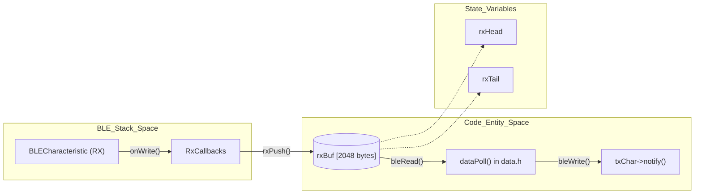
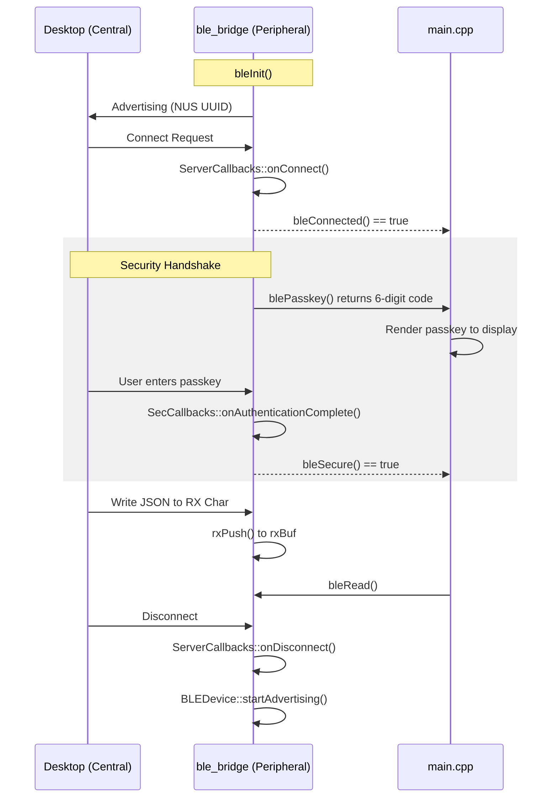

<!-- source: DeepWiki mcp.deepwiki.com · repo anthropics/claude-desktop-buddy · page 2.2 BLE Bridge · fetched 2026-10-26 -->

# BLE Bridge

Relevant source files

The following files were used as context for generating this wiki page:

- [REFERENCE.md](REFERENCE.md)
- [src/ble_bridge.cpp](src/ble_bridge.cpp)
- [src/ble_bridge.h](src/ble_bridge.h)

The BLE Bridge implements a wireless serial-over-BLE transport using the industry-standard **Nordic UART Service (NUS)**. This allows the Claude desktop application to communicate with the ESP32 using the same JSON-based wire protocol used over physical USB serial. The implementation handles MTU negotiation, LE Secure Connections (MITM protection with passkeys), and provides a ring-buffered API for the main application loop.

## Service Specification

The bridge advertises three specific UUIDs that allow standard BLE terminals and the Claude desktop app to identify the device as a serial-capable peripheral [src/ble_bridge.cpp:10-15]().

| Entity | UUID | Role |
| :--- | :--- | :--- |
| **Service** | `6e400001-b5a3-f393-e0a9-e50e24dcca9e` | NUS Service Container |
| **RX Characteristic** | `6e400002-b5a3-f393-e0a9-e50e24dcca9e` | Desktop → Device (Write) |
| **TX Characteristic** | `6e400003-b5a3-f393-e0a9-e50e24dcca9e` | Device → Desktop (Notify) |

To ensure the desktop app can filter for relevant devices, the bridge advertises a name starting with `Claude` [REFERENCE.md:31-33]().

**Sources:** [src/ble_bridge.cpp:10-15](), [REFERENCE.md:23-33]()

## Data Flow & Buffering

The bridge maintains a 2048-byte ring buffer (`rxBuf`) to decouple BLE radio events from the main application processing loop [src/ble_bridge.cpp:20-23]().

### Incoming Data (RX)
When the desktop writes to the RX characteristic, the `RxCallbacks::onWrite` function is triggered. It pushes bytes into the ring buffer via `rxPush` [src/ble_bridge.cpp:42-47](). If the buffer is full, bytes are dropped to prevent memory corruption, relying on the GATT layer for flow control [src/ble_bridge.cpp:33-40]().

### Outgoing Data (TX)
The `bleWrite` function handles fragmentation. Since BLE notifications are limited by the negotiated Maximum Transmission Unit (MTU), `bleWrite` chunks data into segments of `mtu - 3` bytes (up to a hard cap of 180 bytes for compatibility) [src/ble_bridge.cpp:162-175](). A small 4ms delay is inserted between chunks to allow the BLE stack to flush the transmit buffer [src/ble_bridge.cpp:177]().

### Code Entity Bridge: Data Path
This diagram maps the internal buffer variables to the external API used by the system.

**Sources:** [src/ble_bridge.cpp:20-47](), [src/ble_bridge.cpp:151-180](), [src/ble_bridge.h:5-15]()

## Security & Pairing

The bridge implements **LE Secure Connections** with Man-In-The-Middle (MITM) protection using a 6-digit passkey flow [src/ble_bridge.cpp:69-72]().

1.  **Authentication Mode**: Set to `ESP_LE_AUTH_REQ_SC_MITM_BOND`, requiring both secure connections and bonding [src/ble_bridge.cpp:121]().
2.  **IO Capabilities**: The device identifies as `ESP_IO_CAP_OUT` (DisplayOnly), while the desktop acts as KeyboardOnly [src/ble_bridge.cpp:122]().
3.  **Passkey Flow**: The BLE stack generates a random passkey and triggers `onPassKeyNotify` [src/ble_bridge.cpp:77-80](). The value is stored in the `passkey` variable, which the main UI loop polls via `blePasskey()` to display on the screen [src/ble_bridge.h:24-26]().
4.  **Encryption**: Access to the NUS characteristics is restricted to encrypted links only (`ESP_GATT_PERM_READ_ENCRYPTED` | `ESP_GATT_PERM_WRITE_ENCRYPTED`) [src/ble_bridge.cpp:106-115]().

### Bond Management
Bonds (Long Term Keys) are persisted in the ESP32 NVS. The `bleClearBonds()` function allows the application to programmatically erase all stored pairings, which is triggered by the `unpair` JSON command from the desktop [src/ble_bridge.cpp:140-149]().

**Sources:** [src/ble_bridge.cpp:69-87](), [src/ble_bridge.cpp:120-126](), [src/ble_bridge.h:19-29]()

## Connection Lifecycle

The bridge manages its own advertising state to ensure it remains discoverable when not connected.

### MTU Negotiation
The bridge requests a maximum MTU of 517 bytes during initialization [src/ble_bridge.cpp:92](). While macOS typically negotiates down to 185 bytes, the bridge dynamically adjusts its `bleWrite` chunking logic based on the `onMtuChanged` callback to ensure maximum throughput without truncating packets [src/ble_bridge.cpp:63-67]().

**Sources:** [src/ble_bridge.cpp:49-67](), [src/ble_bridge.cpp:89-98](), [src/ble_bridge.cpp:162-168]()

## API Reference

The bridge provides a simplified serial-like API defined in `ble_bridge.h`.

| Function | Description |
| :--- | :--- |
| `bleInit(name)` | Initializes the BLE stack, sets up NUS characteristics, and starts advertising [src/ble_bridge.cpp:89](). |
| `bleConnected()` | Returns `true` if a central device is currently connected [src/ble_bridge.cpp:136](). |
| `bleSecure()` | Returns `true` if the current link is encrypted and bonded [src/ble_bridge.cpp:137](). |
| `blePasskey()` | Returns the active 6-digit pairing code, or `0` if no pairing is in progress [src/ble_bridge.cpp:138](). |
| `bleAvailable()` | Returns the number of bytes waiting in the `rxBuf` [src/ble_bridge.cpp:151](). |
| `bleRead()` | Pops a single byte from the `rxBuf`. Returns `-1` if empty [src/ble_bridge.cpp:155](). |
| `bleWrite(data, len)` | Chunks and sends data to the desktop via the TX characteristic [src/ble_bridge.cpp:162](). |
| `bleClearBonds()` | Erases all pairing information from the ESP32's non-volatile storage [src/ble_bridge.cpp:140](). |

**Sources:** [src/ble_bridge.h:17-32](), [src/ble_bridge.cpp:136-180]()

---

