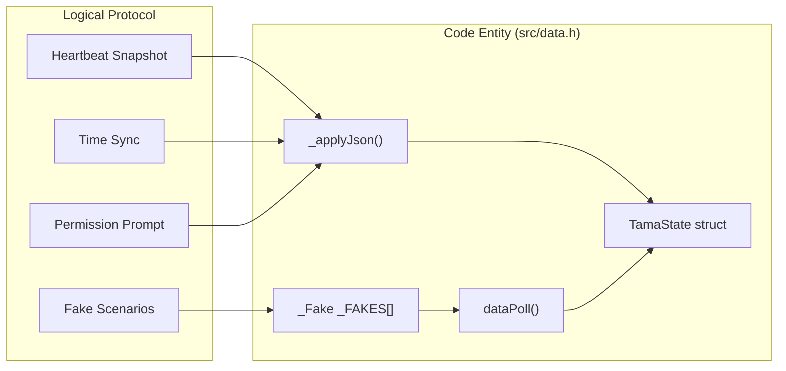

<!-- source: DeepWiki mcp.deepwiki.com · repo anthropics/claude-desktop-buddy · page 2.3 Data Layer & Wire Protocol · fetched 2026-10-26 -->

# Data Layer & Wire Protocol

<details>
<summary>Relevant source files</summary>

The following files were used as context for generating this wiki page:

- [REFERENCE.md](REFERENCE.md)
- [src/data.h](src/data.h)

</details>


The Data Layer is responsible for ingesting, buffering, and parsing the JSON-based wire protocol sent from the Claude desktop application. It abstracts the transport medium (USB Serial or BLE) into a unified `TamaState` structure that the rest of the firmware uses to drive animations and UI elements.

## Data Structures & State

The core of the data layer is the `TamaState` struct, which represents a snapshot of the current Claude desktop activity.

| Field | Type | Description |
| :--- | :--- | :--- |
| `sessionsTotal` | `uint8_t` | Total number of open Claude conversations. |
| `sessionsRunning` | `uint8_t` | Number of sessions currently generating text or calling tools. |
| `sessionsWaiting` | `uint8_t` | Number of sessions blocked on a user permission prompt. |
| `tokensToday` | `uint32_t` | Cumulative output tokens generated since local midnight. |
| `msg` | `char[24]` | A short status string (e.g., "approve: Bash") for the HUD. |
| `lines` | `char[8][92]` | A buffer of the 8 most recent transcript entries. |
| `promptId` | `char[40]` | The unique ID for a pending permission request. |

### Data Flow Diagram
The following diagram illustrates how raw bytes from different hardware interfaces are processed into the central state.

"Data Ingestion and Parsing Flow"
```mermaid
graph TD
    subgraph "Transport Layer"
        USB["Serial (USB)"]
        BLE["ble_bridge (BLE)"]
    end

    subgraph "Line Buffering"
        USB_BUF["_usbLine (_LineBuf)"]
        BT_BUF["_btLine (_LineBuf)"]
    end

    subgraph "Processing"
        JSON["_applyJson()"]
        XFER["xferCommand()"]
        RTC["M5.Rtc.SetTime()"]
    end

    STATE[("TamaState struct")]

    USB -->|feed()| USB_BUF
    BLE -->|bleRead()| BT_BUF
    USB_BUF -->|newline| JSON
    BT_BUF -->|newline| JSON
    
    JSON -->|is xfer cmd?| XFER
    JSON -->|is time sync?| RTC
    JSON -->|is heartbeat?| STATE
```
Sources: [src/data.h:7-22](), [src/data.h:130-145](), [src/data.h:160-175]()

## Line-Buffered Reassembly

Because BLE packets are often fragmented at the MTU boundary (typically 20-247 bytes) and Serial data can arrive byte-by-byte, the firmware uses a `_LineBuf` template to reassemble complete JSON objects.

- **Mechanism**: The `feed()` function and the `bleRead()` loop accumulate characters into a internal buffer until a `\n` or `\r` is encountered [src/data.h:133-143]().
- **Validation**: Once a line is complete, the code checks if the first character is `{` before attempting to parse it with `ArduinoJson` [src/data.h:137](), [src/data.h:169]().
- **Capacity**: The buffers are sized at 1024 bytes to accommodate large "turn" events or transcript entries [src/data.h:145]().

## Protocol Implementation (`_applyJson`)

The `_applyJson` function is the central dispatcher for all incoming JSON objects. It handles three primary categories of data:

### 1. File Transfer & Commands
It first passes the JSON document to `xferCommand()` in `src/xfer.h`. If the object contains file transfer logic (e.g., `char_begin`, `chunk`), it is consumed there and processing stops [src/data.h:73]().

### 2. RTC Time Synchronization
The desktop app sends a one-shot time sync on connection: `{"time": [epoch_sec, tz_offset_sec]}`.
- The firmware calculates the local time by adding the offset to the epoch [src/data.h:79]().
- It uses `gmtime_r` to break the epoch into components and updates the M5StickC Plus internal hardware clock via `M5.Rtc.SetTime()` and `M5.Rtc.SetDate()` [src/data.h:80-85]().
- This sets `_rtcValid = true`, enabling the clock display in the UI [src/data.h:88]().

### 3. Heartbeat Snapshots
Most incoming data consists of status updates. The function extracts:
- **Session Counts**: `total`, `running`, and `waiting` fields [src/data.h:93-95]().
- **Token Metrics**: Updates the global stats via `statsOnBridgeTokens()` [src/data.h:98]().
- **Transcript**: Iterates through the `entries` array to populate the `lines` buffer [src/data.h:103-115]().
- **Prompts**: If a `prompt` object is present, it stores the `id`, `tool`, and `hint` to allow the user to approve/deny the action via physical buttons [src/data.h:116-124]().

Sources: [src/data.h:70-127](), [REFERENCE.md:40-60](), [REFERENCE.md:108-114]()

## The Data Poll Loop

The `dataPoll(TamaState* out)` function is called every frame by the main loop. It manages the lifecycle of the connection.

### Connection State Logic
The system tracks liveness using `_lastLiveMs`.
- **Live**: If JSON arrived in the last 30 seconds, the device is "connected" [src/data.h:51]().
- **Asleep**: If no data arrives for >30s, the state is cleared, and the message "No Claude connected" is displayed [src/data.h:178-183]().
- **BT vs USB**: `dataBtActive()` checks for traffic in the last 15s to distinguish between a wired and wireless connection for the UI [src/data.h:54-57]().

### Demo Mode
For testing and photography, the device includes a Demo Mode triggered by `dataSetDemo(true)`.
- It ignores all incoming serial/BLE data [src/data.h:150]().
- It cycles through a static array of `_Fake` scenarios (e.g., "busy", "attention", "completed") every 8 seconds [src/data.h:151-157]().
- Each scenario simulates different session counts and token totals to exercise the state machine [src/data.h:38-42]().

### Entity Mapping
The following diagram maps the logical protocol concepts to the specific code entities in `src/data.h`.

"Protocol Logic to Code Entity Mapping"

Sources: [src/data.h:7-22](), [src/data.h:37-42](), [src/data.h:70-73](), [src/data.h:147-158]()

---

