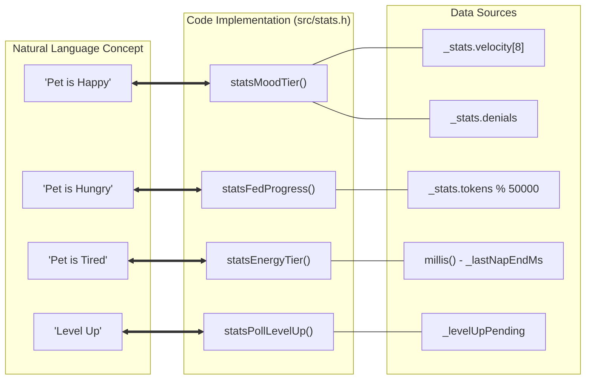

<!-- source: DeepWiki mcp.deepwiki.com · repo anthropics/claude-desktop-buddy · page 2.4 Persistence & Settings (stats.h) · fetched 2026-10-26 -->

# Persistence & Settings (stats.h)

<details>
<summary>Relevant source files</summary>

The following files were used as context for generating this wiki page:

- [src/stats.h](src/stats.h)

</details>


The `src/stats.h` file implements a lightweight, NVS-backed persistence layer for tracking user interactions, pet metrics, and device settings. It uses the ESP32 `Preferences` library to store data across reboots, targeting the `buddy` namespace.

## Data Structures

The system differentiates between **Stats** (cumulative pet metrics) and **Settings** (user-configurable device behavior).

### Stats Struct
The `Stats` struct contains the core data driving the pet's growth and "personality" metrics.

| Field | Type | Description |
| :--- | :--- | :--- |
| `napSeconds` | `uint32_t` | Cumulative time spent in a face-down (sleeping) orientation. |
| `approvals` | `uint16_t` | Total number of times the user pressed Button A to approve a prompt. |
| `denials` | `uint16_t` | Total number of times the user pressed Button B to deny a prompt. |
| `velocity[8]`| `uint16_t[]`| A ring buffer storing the last 8 response times (in seconds). |
| `velIdx` | `uint8_t` | Current write index for the velocity ring buffer. |
| `velCount` | `uint8_t` | Number of valid entries in the velocity ring buffer (up to 8). |
| `level` | `uint8_t` | The current pet level, derived from total tokens. |
| `tokens` | `uint32_t` | Cumulative output tokens processed by the desktop app. |

Sources: [src/stats.h:14-23]()

### Settings Struct
The `Settings` struct manages hardware preferences and UI toggles.

| Field | Type | Key | Description |
| :--- | :--- | :--- | :--- |
| `sound` | `bool` | `s_snd` | Toggle for buzzer feedback. |
| `bt` | `bool` | `s_bt` | Toggle for Bluetooth connectivity. |
| `wifi` | `bool` | `s_wifi` | Placeholder for future WiFi functionality. |
| `led` | `bool` | `s_led` | Toggle for the M5StickC LED indicator. |
| `hud` | `bool` | `s_hud` | Toggle for the Heads-Up Display (stats overlay). |
| `clockRot`| `uint8_t`| `s_crot`| Screen orientation: 0=Auto, 1=Portrait, 2=Landscape. |

Sources: [src/stats.h:179-186](), [src/stats.h:191-198]()

## NVS Persistence Logic

To preserve the lifespan of the ESP32's flash memory (~100k write cycles), the system does not save on a timer. Instead, it employs a "save on significant event" strategy.

### Loading and Saving
*   **`statsLoad()`**: Opens the `buddy` namespace in read-only mode and populates the `_stats` struct [src/stats.h:29-46]().
*   **`statsSave()`**: Only performs a write if the `_dirty` flag is set to true. It saves all fields and clears the flag [src/stats.h:48-61]().
*   **Level Backfilling**: If `tokens` is 0 but `level` is > 0 (e.g., from an older firmware version), `statsLoad()` calculates the required tokens to maintain that level [src/stats.h:43-45]().

### Token Tracking & Leveling
The pet levels up every 50,000 tokens [src/stats.h:12](). 

The desktop app sends its cumulative token count since its own process started. The firmware must reconcile this with its internal persistent total:
1.  **First Sight**: On the first packet after a device reboot, the firmware latches the current bridge total to `_lastBridgeTokens` without adding it to the persistent total to avoid double-counting previous sessions [src/stats.h:84-88]().
2.  **Deltas**: Subsequent updates calculate the delta between the new total and `_lastBridgeTokens` [src/stats.h:93]().
3.  **Bridge Restart**: If the incoming total is lower than the last seen total, the firmware assumes the desktop app restarted and resets the latch [src/stats.h:89-92]().
4.  **Milestone Persistence**: To avoid NVS wear, token deltas are kept in RAM. `statsSave()` is only triggered when a level-up milestone is crossed [src/stats.h:104-108]().

Sources: [src/stats.h:79-109]()

## Derived Metrics (Mood, Energy, Fed)

The pet's visible state is calculated dynamically from the persistent stats.

### Mood Calculation (`statsMoodTier`)
Mood is a tier from 0 to 4 based on response velocity and the approval/denial ratio.
1.  **Velocity**: The median of the `velocity` ring buffer is calculated using an insertion sort [src/stats.h:127-139]().
2.  **Base Tier**: Faster responses (lower median seconds) result in higher base tiers (e.g., <15s = Tier 4) [src/stats.h:146-150]().
3.  **Denial Penalty**: If the user has made at least 3 decisions, a high denial rate drags the mood down. If `denials > approvals`, the tier drops by 2. If `denials * 2 > approvals`, it drops by 1 [src/stats.h:151-156]().

### Energy and Hunger
*   **Energy**: Starts at 3/5 on boot. It tops up to 5/5 when a "nap" (face-down orientation) ends. It drains by 1 tier every 2 hours [src/stats.h:161-171]().
*   **Fed Progress**: Calculated as the progress toward the next level-up milestone, represented as 10 "pips" (5,000 tokens per pip) [src/stats.h:173-175]().

## System Data Flow

The following diagram illustrates how external events interact with the `Stats` and `Settings` entities and how they are persisted to the `Preferences` NVS storage.

### Data Flow: Persistence and Calculation
Title: Persistence and Metric Calculation Flow
```mermaid
graph TD
    subgraph "External Inputs"
        [BLE_Bridge] -- "statsOnBridgeTokens()" --> T[Token Delta Logic]
        [Button_A] -- "statsOnApproval()" --> V[Velocity Ring Buffer]
        [IMU_Sensor] -- "statsOnNapEnd()" --> N[Nap Accumulator]
    end

    subgraph "Code Entity Space (src/stats.h)"
        T --> S_STRUCT["struct Stats"]
        V --> S_STRUCT
        N --> S_STRUCT
        
        S_STRUCT -- "statsMoodTier()" --> M_CALC["Mood Calculation"]
        S_STRUCT -- "statsFedProgress()" --> F_CALC["Fed Tier Calculation"]
        
        DIRTY{_dirty == true?}
        S_STRUCT --> DIRTY
    end

    subgraph "Hardware Space"
        DIRTY -- "statsSave()" --> NVS["ESP32 NVS (Namespace: 'buddy')"]
        NVS -- "statsLoad()" --> S_STRUCT
    end

    M_CALC --> UI["Display (Mood Icon)"]
    F_CALC --> UI
```
Sources: [src/stats.h:25-61](), [src/stats.h:142-158](), [src/stats.h:173-175]()

### Logic Mapping: Natural Language to Code
Title: Metric Logic Mapping

Sources: [src/stats.h:111-115](), [src/stats.h:142-158](), [src/stats.h:166-171](), [src/stats.h:173-175]()

---

