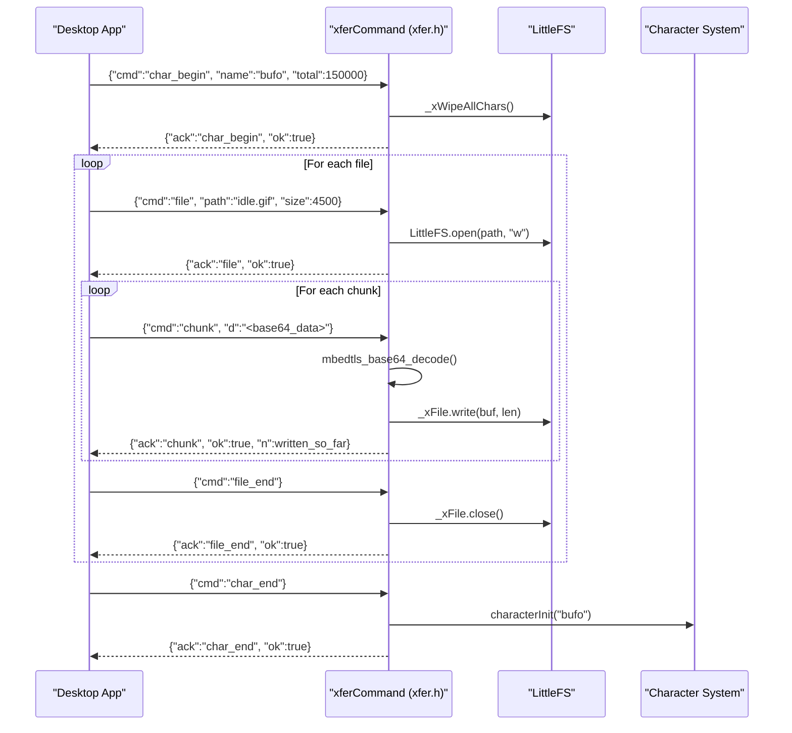
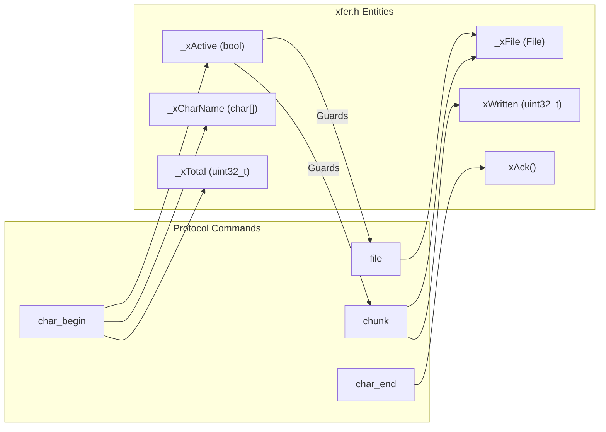
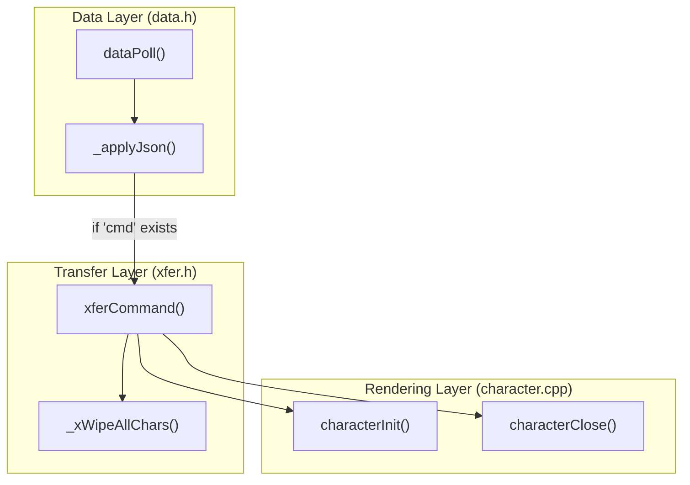

<!-- source: DeepWiki mcp.deepwiki.com · repo anthropics/claude-desktop-buddy · page 2.5 File Transfer Protocol (xfer.h) · fetched 2026-10-26 -->

# File Transfer Protocol (xfer.h)

Relevant source files

The following files were used as context for generating this wiki page:

- [REFERENCE.md](REFERENCE.md)
- [src/xfer.h](src/xfer.h)

The Folder Push transport, implemented in `src/xfer.h`, provides a reliable mechanism for streaming arbitrary file content (primarily GIF-based character packs) from the Claude desktop application to the device's internal Flash storage via LittleFS. It uses a sequential, chunked command-response pattern over the BLE Bridge or USB Serial to accommodate memory constraints and ensure data integrity.

## Protocol Sequence

The protocol follows a strict sequential flow. The desktop application (the sender) must wait for an acknowledgment (`ack`) for each command before sending the next. This flow control prevents the device's RX buffers from overflowing during Flash write operations.

### Command Flow Overview

1.  **`char_begin`**: Initializes the transfer, specifies the character name, and provides the total payload size for a space check.
2.  **`file`**: Specifies the name and size of the individual file about to be streamed.
3.  **`chunk`**: Contains a Base64-encoded segment of the current file's data.
4.  **`file_end`**: Finalizes the current file and closes the file handle.
5.  **`char_end`**: Signals the completion of the entire folder transfer and triggers character initialization.

### Data Flow Diagram
The following diagram illustrates the interaction between the Desktop application and the `xferCommand` handler.

"File Transfer Command Sequence"

Sources: `[src/xfer.h:77-240]()`, `[REFERENCE.md:159-181]()`

## Implementation Details

### Space Management and Wiping
Before a transfer begins, the device performs a "Fit Check" in `xferCommand` under the `char_begin` block. It calculates the available space by summing the current free space and the space that would be reclaimed by wiping existing characters `[src/xfer.h:148-165]()`.

*   **`_xWipeAllChars()`**: Iterates through the `/characters` directory and deletes all subdirectories and files `[src/xfer.h:44-63]()`.
*   **`_xWipeDir()`**: A helper function that deletes all files within a specific directory before removing the directory itself `[src/xfer.h:24-39]()`.

### Base64 Decoding
Since the wire protocol is JSON-based, binary data must be encoded as text. The desktop app uses Base64 encoding for the `d` field in `chunk` commands. The device utilizes `mbedtls_base64_decode` to convert this back to raw bytes before writing to Flash `[src/xfer.h:201-210]()`.

### Flow Control and Acknowledgment
The `_xAck` function is responsible for sending standardized JSON responses back to the desktop. It writes the acknowledgment to both the Hardware Serial (USB) and the BLE Bridge `[src/xfer.h:17-22]()`.

| Field | Description |
| :--- | :--- |
| `ack` | Echoes the `cmd` name being acknowledged. |
| `ok` | Boolean indicating success or failure. |
| `n` | Numeric status (e.g., total bytes written for `chunk`, final size for `file_end`). |
| `error` | (Optional) String message describing the failure reason. |

Sources: `[src/xfer.h:17-22]()`, `[src/xfer.h:167-175]()`, `[REFERENCE.md:122-132]()`

## Code Entity Mapping

The following diagram maps the logical protocol commands to the specific implementation variables and functions within `xfer.h`.

"Logic to Code Entity Mapping"

Sources: `[src/xfer.h:8-12]()`, `[src/xfer.h:141-240]()`

## Transfer Completion & Character Initialization

When the `char_end` command is received, the transfer state is finalized:
1.  The `_xActive` flag is set to `false` `[src/xfer.h:236]()`.
2.  The `characterInit(_xCharName)` function is called `[src/xfer.h:237]()`.

`characterInit` (defined in `character.h` and implemented in `character.cpp`) parses the `manifest.json` file within the newly created character directory. This manifest defines the GIF assets associated with each `PersonaState` (e.g., idle, busy, attention) and configures the rendering palette `[src/character.cpp:115-165]()`.

### System Integration
The `xferCommand` function is called directly from the data parsing layer in `src/data.h` whenever a JSON object containing a `cmd` key is received `[src/data.h:60-65]()`. This allows the file transfer protocol to preempt standard state updates.

"System Integration Diagram"

Sources: `[src/data.h:60-65]()`, `[src/xfer.h:77-80]()`, `[src/xfer.h:178-179]()`, `[src/xfer.h:237]()`

---

