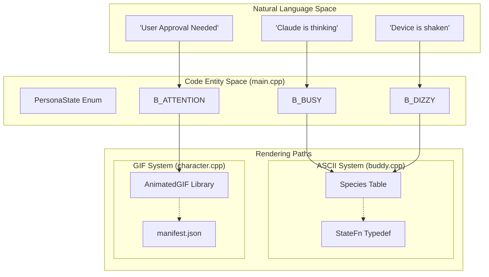
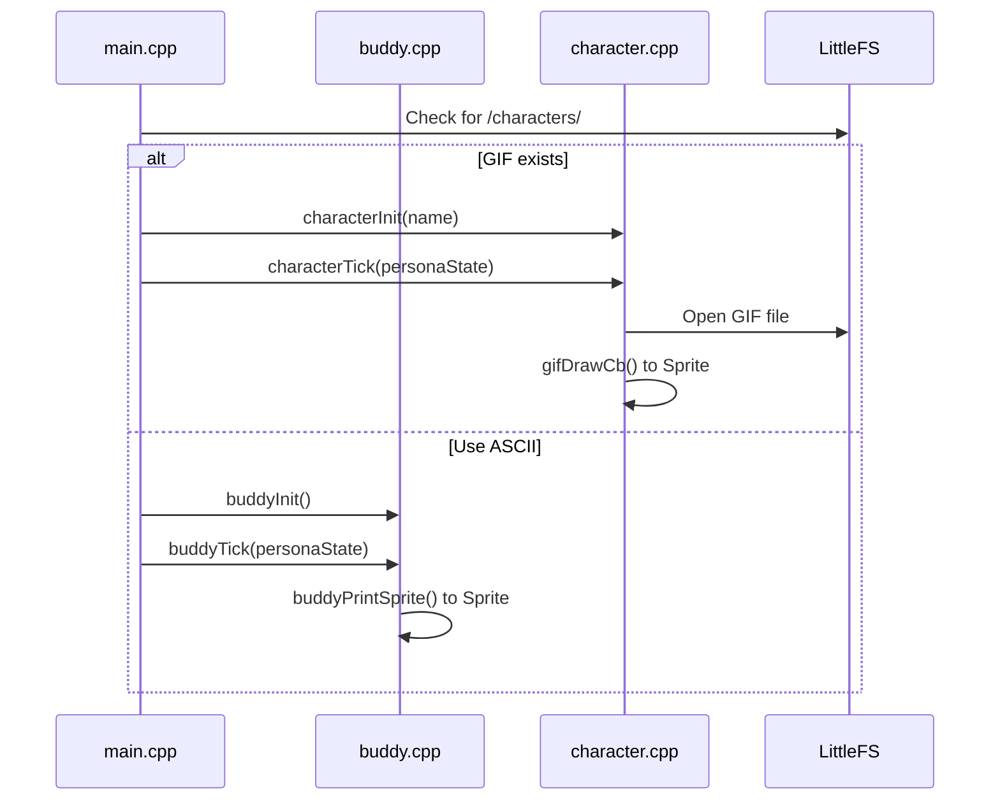

<!-- source: DeepWiki mcp.deepwiki.com · repo anthropics/claude-desktop-buddy · page 3 Character & Rendering System · fetched 2026-10-26 -->

# Character & Rendering System

Relevant source files

The following files were used as context for generating this wiki page:

- [README.md](README.md)
- [src/buddy.cpp](src/buddy.cpp)
- [src/character.cpp](src/character.cpp)

The **Character & Rendering System** is the visual engine of the `claude-desktop-buddy`. It is responsible for translating the device's logical state (e.g., "busy", "sleep", "attention") into animated visual feedback. The system supports two distinct rendering paths: a lightweight, built-in **ASCII Buddy System** and a customizable, file-based **GIF Character System**. Both systems consume the same `PersonaState` enum and provide a unified interface for the main application loop.

## System Architecture

The rendering logic is decoupled from the state machine. `src/main.cpp` determines the current `PersonaState` [src/main.cpp:8-8](), and then calls the appropriate rendering module based on whether a custom character pack is installed in LittleFS.

### Shared Persona States
Both systems implement animations for the following seven states:
*   `sleep`: Device disconnected or napping.
*   `idle`: Connected, waiting for tasks.
*   `busy`: Claude is actively processing.
*   `attention`: A permission prompt is waiting for user approval.
*   `celebrate`: Triggered by a level-up event.
*   `dizzy`: Triggered by shaking the device.
*   `heart`: Triggered by a rapid approval (<5s).

### Rendering Logic Flow

The following diagram illustrates how the system dispatches state information to the visual layers.

**Rendering Dispatch & State Association**

**Sources:** [src/main.cpp:8-8](), [src/buddy.cpp:9-9](), [src/character.cpp:9-12]()

## ASCII Buddy System

The ASCII Buddy system is the default rendering path. It uses 18 built-in "species" (e.g., `AXOLOTL`, `CAPYBARA`, `CAT`) defined in `src/buddies/`. Each species is a collection of C++ functions that print character art using standard ASCII symbols.

*   **Dispatch Mechanism**: The `buddyTick` function [src/buddy.cpp:173-196]() uses a `SPECIES_TABLE` [src/buddy.cpp:91-97]() to look up the current species and call the specific function associated with the `PersonaState`.
*   **Animation**: Animations are driven by a `tickCount` that increments every 200ms [src/buddy.cpp:104-104]().
*   **Geometry**: Shared constants in `buddy_common.h` and `buddy.cpp` (like `BUDDY_X_CENTER`) ensure all species are aligned correctly on the 135x240 M5StickC Plus screen [src/buddy.cpp:12-17]().

For details, see [ASCII Buddy System](#3.1).

## GIF Character System

The GIF Character system allows users to replace ASCII art with custom animated GIFs. This system is activated when a character folder (containing a `manifest.json`) is found in the device's LittleFS partition.

*   **Manifest Parsing**: The system reads `manifest.json` to map GIF filenames to `PersonaState` keys [src/character.cpp:199-200]().
*   **Animation Engine**: It utilizes the `AnimatedGIF` library to decode and render frames [src/character.cpp:37-37]().
*   **Idle Variants**: To prevent repetitive loops, the system supports "variant carousels" for the idle state, rotating through multiple GIFs over time [src/character.cpp:58-60]().
*   **Memory Management**: Because the ESP32 has limited RAM, GIFs are rendered scanline-by-scanline via a callback [src/character.cpp:102-136]().

For details, see [GIF Character System](#3.2).

## Rendering Interface Comparison

The two systems share a similar API pattern to allow `main.cpp` to switch between them seamlessly.

| Feature | ASCII Buddy (`buddy.cpp`) | GIF Character (`character.cpp`) |
| :--- | :--- | :--- |
| **Storage** | Compiled in Flash (PROGMEM) | LittleFS Filesystem |
| **Scaling** | 1x (Peek) or 2x (Home) [src/buddy.cpp:40-40]() | 1:1 or 2:1 Downsample [src/character.cpp:48-49]() |
| **Color Control** | Shared `BUDDY_` constants [src/buddy.cpp:20-29]() | `Palette` struct from manifest [src/character.cpp:27-27]() |
| **Update Loop** | `buddyTick(state)` [src/buddy.cpp:173]() | `characterTick(state)` |
| **Target** | `TFT_eSprite` or `M5.Lcd` [src/buddy.cpp:36-36]() | `TFT_eSprite` or `M5.Lcd` [src/character.cpp:47-47]() |

**Rendering Data Flow**

**Sources:** [src/main.cpp:155-162](), [src/buddy.cpp:108-113](), [src/character.cpp:140-168]()

**Sources:**
* [src/main.cpp:8-8]()
* [src/buddy.cpp:9-104]()
* [src/buddy.cpp:173-196]()
* [src/character.cpp:9-60]()
* [src/character.cpp:140-168]()
* [README.md:92-123]()

---

