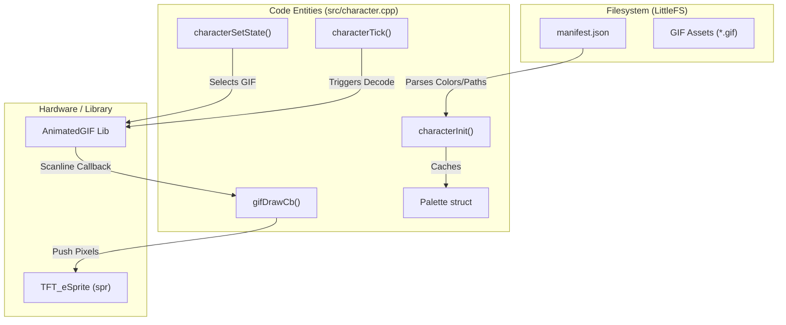
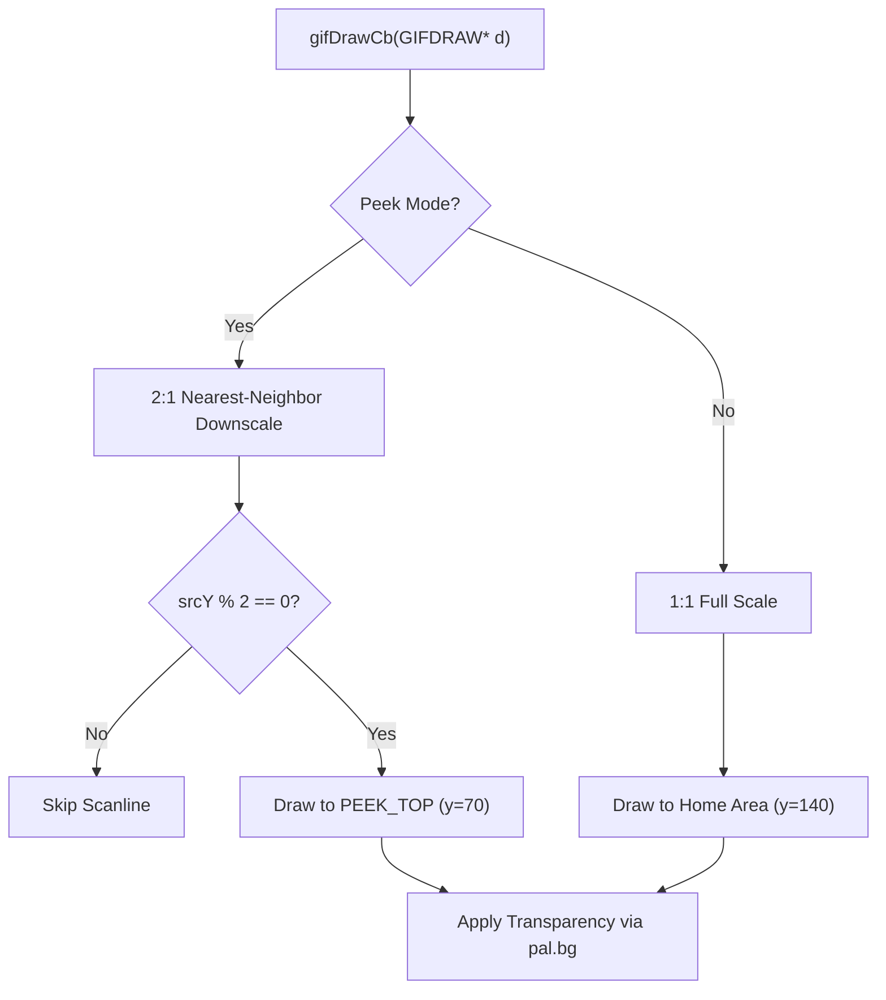

<!-- source: DeepWiki mcp.deepwiki.com · repo anthropics/claude-desktop-buddy · page 3.2 GIF Character System · fetched 2026-10-26 -->

# GIF Character System

Relevant source files

The following files were used as context for generating this wiki page:

- [src/character.cpp](src/character.cpp)
- [src/character.h](src/character.h)

The GIF Character System provides a data-driven rendering pipeline for high-fidelity animated characters stored on the ESP32's internal flash memory (LittleFS). Unlike the procedurally drawn ASCII Buddy system, this system uses the `AnimatedGIF` library to decode and render multi-frame assets based on a JSON manifest.

## System Architecture

The system is centered around `src/character.cpp`, which manages the lifecycle of GIF decoding, state transitions, and display scaling. It interfaces with `LittleFS` for asset retrieval and uses a custom scanline callback to pipe decoded pixels into the M5StickC Plus display buffer.

### Key Components & Data Flow

The following diagram illustrates the relationship between the character manifest, the state machine, and the rendering output.

**GIF System Entity Map**

Sources: [src/character.cpp:1-62](), [src/character.h:1-31]()

## Manifest Parsing & Initialization

Initialization occurs via `characterInit(const char* name)`. If no name is provided, the system scans the `/characters/` directory for the first available folder [src/character.cpp:152-168]().

### The Palette Struct
The system extracts a global `Palette` from the manifest's `colors` object. This palette defines the UI theme colors used by other system components (like the status bars and text) to ensure visual consistency with the character [src/character.cpp:189-195]().

| Field | Description |
| :--- | :--- |
| `body` | Primary character color (used for UI accents). |
| `bg` | Background color (used for transparency filling). |
| `text` | Primary text color. |
| `textDim` | Secondary/dimmed text color. |
| `ink` | High-contrast detail color. |

Sources: [src/character.h:4-6](), [src/character.cpp:27](), [src/character.cpp:63-68]()

### State Mapping
The system supports 7 logical states defined in `STATE_NAMES`: `sleep`, `idle`, `busy`, `attention`, `celebrate`, `dizzy`, and `heart` [src/character.cpp:9-12](). The manifest maps these states to one or more GIF files. If multiple GIFs are assigned to a state (common for `idle`), the system performs a "carousel rotation" [src/character.cpp:31-33]().

## Animation & Rendering Pipeline

The rendering pipeline uses a non-blocking `characterTick()` loop. It checks if the current time exceeds `nextFrameAt` and calls the `AnimatedGIF::decodeFrame` method [src/character.cpp:19]().

### Scanline Rendering (`gifDrawCb`)
The `gifDrawCb` function is the core of the rendering logic. It processes one scanline at a time. To prevent "ghosting" or artifacts from prior frames, the system treats transparent pixels as the background color defined in the `Palette` [src/character.cpp:98-115]().

**Rendering Logic Flow**

Sources: [src/character.cpp:102-136]()

### Display Modes: Peek vs. Full-Size
The system supports two layout modes toggled via `characterSetPeek(bool peek)` [src/character.h:26]():

1.  **Full-Size (Home Mode):** The character is centered in the upper 140px of the screen. This is used for the primary "pet" view [src/character.cpp:41-42]().
2.  **Peek Mode:** The character is rendered at **half scale** (2:1 downscale) and pinned to the top of the info-panel (y=70). This allows the character to remain visible while the user navigates menus or views status details [src/character.cpp:48-55]().

### Idle Variant Carousel
To prevent repetitive animations, the system implements a variant rotation for the `idle` state. Every `VARIANT_DWELL_MS` (5000ms), the system checks if there are multiple GIFs defined for the current state and rotates to the next index in `stateRot` [src/character.cpp:58-60]().

## AnimatedGIF Callbacks
Because GIFs are stored in `LittleFS`, the system provides custom file I/O callbacks to the `AnimatedGIF` library:
*   `gifOpenCb`: Opens the file handle [src/character.cpp:72-77]().
*   `gifReadCb`: Reads data into the library's internal buffer [src/character.cpp:84-89]().
*   `gifSeekCb`: Moves the file pointer for frame jumping [src/character.cpp:91-96]().
*   `gifCloseCb`: Closes the file handle once decoding is complete or the state changes [src/character.cpp:79-82]().

## Technical Constraints
*   **Unoptimized GIFs:** The system requires GIFs to be "unoptimized" (full-frame). The -O2/-O3 optimization paths (sub-rect deltas) were deprecated because they do not compose correctly with the 2:1 downscale sampling in Peek Mode [src/character.cpp:108-112]().
*   **Memory:** GIF paths are cached in a fixed-size array `gifPaths[MAX_GIFS][32]` to avoid heap fragmentation during runtime [src/character.cpp:29-30]().

Sources: [src/character.cpp:1-136](), [src/character.h:1-31]()

---

