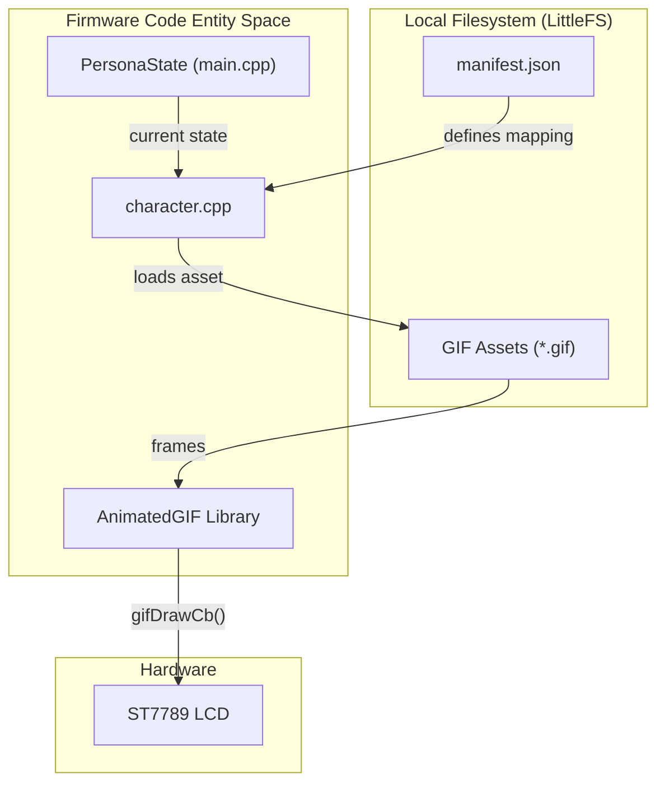
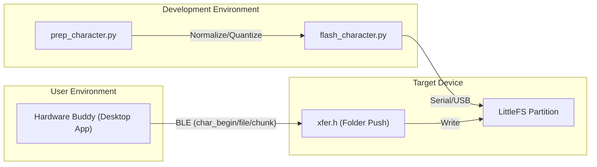

<!-- source: DeepWiki mcp.deepwiki.com · repo anthropics/claude-desktop-buddy · page 4 Character Packs · fetched 2026-10-26 -->

# Character Packs

Relevant source files

The following files were used as context for generating this wiki page:

- [characters/bufo/README.md](characters/bufo/README.md)
- [characters/bufo/manifest.json](characters/bufo/manifest.json)

Character Packs are the asset bundles used by the **GIF Character System** to provide high-fidelity animations on the device. While the **ASCII Buddy System** uses procedural code to draw characters, the Character Pack system relies on a collection of GIF files and a JSON manifest stored on the device's LittleFS filesystem.

## High-Level Architecture

A Character Pack consists of a directory containing a `manifest.json` file and several `.gif` assets. These assets are mapped to the seven core `PersonaState` values defined in the firmware.

### Component Relationship
The following diagram illustrates how the Character Pack assets relate to the firmware's internal state management and the hardware display.

**Character Pack Data Flow**

Sources: [src/character.cpp:1-20](), [characters/bufo/manifest.json:1-30]()

---

## The Manifest Format

The `manifest.json` file is the central configuration for a character. It defines the visual identity of the pack through two primary sections:

1.  **Colors**: A set of hex codes used by the UI overlay (text, battery icons, and backgrounds) to ensure the interface matches the character's aesthetic [characters/bufo/manifest.json:3-9]().
2.  **States**: A mapping of `PersonaState` keys to specific GIF filenames. The system supports single strings for states like `busy` or `sleep`, and arrays of strings for the `idle` state to enable animation variety [characters/bufo/manifest.json:10-28]().

| Field | Description |
| :--- | :--- |
| `name` | The internal identifier for the character. |
| `colors` | Object containing `body`, `bg`, `text`, `textDim`, and `ink` hex codes. |
| `states` | Mapping for `sleep`, `idle`, `busy`, `attention`, `celebrate`, `dizzy`, and `heart`. |

Sources: [characters/bufo/manifest.json:1-30]()

---

## Built-in Character: Bufo

The default character pack provided with the project is **Bufo**, a frog-based emoji set. This pack serves as the reference implementation for custom characters.

*   **Asset Count**: 15 GIF files [characters/bufo/README.md:12-15]().
*   **Idle Strategy**: Uses a 9-variant rotation (`idle_0.gif` through `idle_8.gif`) to provide visual interest while the device is in a resting state [characters/bufo/manifest.json:12-22]().
*   **Licensing**: The Bufo assets are sourced from [bufo.zone](https://bufo.zone) and are subject to specific attribution requirements separate from the project's MIT license [characters/bufo/README.md:8-10]().

For details on the specific animation frames and color configurations, see [Bufo Character Pack](#4.1).

Sources: [characters/bufo/README.md:1-19](), [characters/bufo/manifest.json:1-30]()

---

## Installation Paths

There are two primary methods for deploying a Character Pack to the M5StickC Plus hardware:

### 1. Developer Flash (USB)
Using the Python-based `tools/flash_character.py` script, developers can upload a pack directly over a serial connection. This script prepares the LittleFS image and flashes it to the device's storage partition [characters/bufo/README.md:17-18]().

### 2. Wireless Install (BLE)
For end-users, the **Hardware Buddy** desktop application supports a "Folder Push" protocol. Users can drag a character folder onto the application window, which then transmits the files over the Bluetooth Low Energy (BLE) Nordic UART Service (NUS) [characters/bufo/README.md:17-18]().

**Installation Tooling Interaction**

Sources: [characters/bufo/README.md:17-18](), [src/xfer.h:1-50]()

For details on asset optimization (96px downscaling, palette quantization) and the transfer protocol, see [Character Pack Tooling](#4.2).

---

