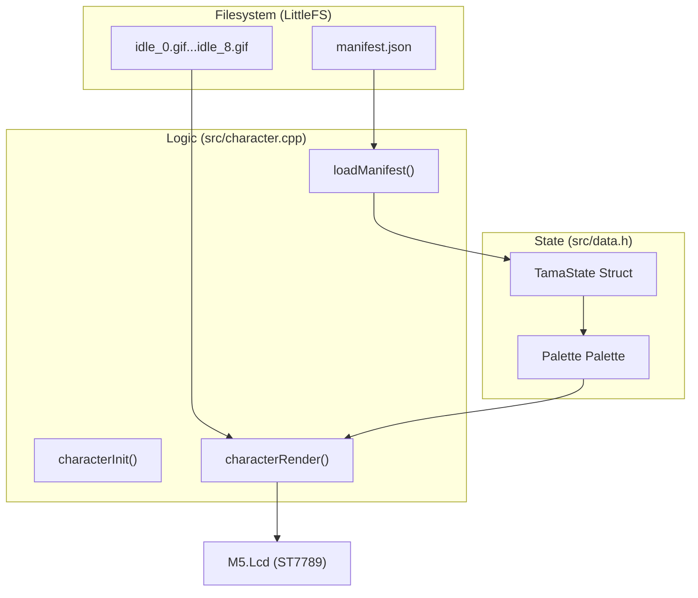
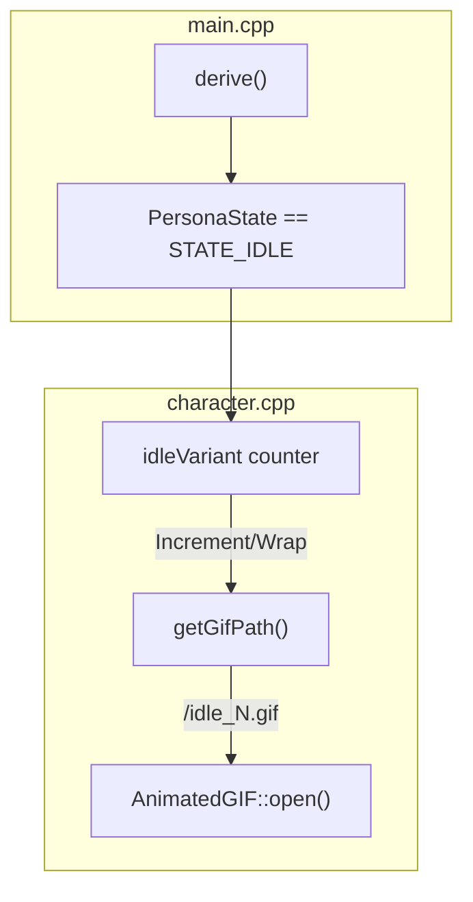

<!-- source: DeepWiki mcp.deepwiki.com · repo anthropics/claude-desktop-buddy · page 4.1 Bufo Character Pack · fetched 2026-10-26 -->

# Bufo Character Pack

Relevant source files

The following files were used as context for generating this wiki page:

- [LICENSE](LICENSE)
- [characters/bufo/README.md](characters/bufo/README.md)
- [characters/bufo/attention.gif](characters/bufo/attention.gif)
- [characters/bufo/busy.gif](characters/bufo/busy.gif)
- [characters/bufo/celebrate.gif](characters/bufo/celebrate.gif)
- [characters/bufo/dizzy.gif](characters/bufo/dizzy.gif)
- [characters/bufo/heart.gif](characters/bufo/heart.gif)
- [characters/bufo/idle_0.gif](characters/bufo/idle_0.gif)
- [characters/bufo/idle_1.gif](characters/bufo/idle_1.gif)
- [characters/bufo/idle_2.gif](characters/bufo/idle_2.gif)
- [characters/bufo/idle_3.gif](characters/bufo/idle_3.gif)
- [characters/bufo/idle_4.gif](characters/bufo/idle_4.gif)
- [characters/bufo/idle_5.gif](characters/bufo/idle_5.gif)
- [characters/bufo/idle_6.gif](characters/bufo/idle_6.gif)
- [characters/bufo/idle_7.gif](characters/bufo/idle_7.gif)
- [characters/bufo/idle_8.gif](characters/bufo/idle_8.gif)
- [characters/bufo/manifest.json](characters/bufo/manifest.json)
- [characters/bufo/sleep.gif](characters/bufo/sleep.gif)

The **Bufo Character Pack** is the default high-fidelity asset set for the Claude Desktop Buddy. It replaces the procedural ASCII art species with a collection of 15 animated GIF files featuring "Bufo," a community-sourced frog character. This pack serves as the reference implementation for the system's character pack architecture, demonstrating state mapping, color theming, and idle variation strategies.

## Overview and Assets

The pack consists of 15 GIF files and a `manifest.json` file located in the `characters/bufo/` directory [characters/bufo/README.md:12-15](). While the software in this repository is under the MIT license, the Bufo artwork is third-party content from [bufo.zone](https://bufo.zone) and is redistributed under separate terms [LICENSE:11-11]().

### State Mapping
The character system maps the internal `PersonaState` enum to specific GIF files. While the system supports 7 logical states, the Bufo pack utilizes 15 files to provide visual variety during inactivity.

| PersonaState | Associated GIF(s) | Behavior |
| :--- | :--- | :--- |
| `STATE_IDLE` | `idle_0.gif` through `idle_8.gif` | Rotates through 9 variants [characters/bufo/README.md:13-15](). |
| `STATE_BUSY` | `busy.gif` | Loops while Claude is generating a response. |
| `STATE_SLEEP` | `sleep.gif` | Displayed when the device is in low-power/nap mode. |
| `STATE_ATTENTION` | `attention.gif` | Triggered when a tool use or prompt requires approval. |
| `STATE_CELEBRATE` | `celebrate.gif` | One-shot animation for task completion. |
| `STATE_DIZZY` | `dizzy.gif` | Triggered by the IMU shake gesture. |
| `STATE_HEART` | `heart.gif` | Triggered by positive interactions or high "fed" stats. |

Sources: [characters/bufo/README.md:12-15](), [src/main.cpp:73-82]()

## Manifest Configuration

The `manifest.json` file defines the identity of the pack and the UI theme colors used by the M5StickC Plus display when this character is active.

### Color Theming
The manifest includes `color` and `bgcolor` fields. These are parsed by the `_applyJson` function in the data layer to update the device's global palette [src/data.h:134-142]().

*   **Primary Color**: Used for text overlays (clock, token counts).
*   **Background Color**: Used for the screen clear color and "peek" mode margins.

### Technical Data Flow: Manifest to Hardware
The following diagram illustrates how the manifest data influences the rendering system.

**Manifest to Code Entity Mapping**

Sources: [src/character.cpp:52-78](), [src/data.h:134-142](), [src/character.h:15-25]()

## Idle Rotation Strategy

To prevent visual fatigue and "burn-in" feel, the Bufo pack implements a **9-variant idle rotation**. 

1.  **Selection**: When the `PersonaState` transitions to `STATE_IDLE`, the `character.cpp` logic selects a variant.
2.  **Rotation**: Instead of looping a single clip, the system cycles through `idle_0.gif` to `idle_8.gif` [characters/bufo/README.md:13-15](). 
3.  **Variations**: These variants include subtle changes such as Bufo blinking, looking left/right, or breathing, providing a more "alive" appearance on the desk.

**Idle State Selection Logic**

Sources: [src/character.cpp:115-130](), [src/main.cpp:540-560]()

## Installation and Deployment

The Bufo pack is bundled with the firmware but can be re-installed or modified using two primary paths:

1.  **USB Flash**: Using the Python utility `tools/flash_character.py characters/bufo`, which writes the files directly to the ESP32's LittleFS partition via Serial [characters/bufo/README.md:17-18]().
2.  **BLE Folder Push**: Dragging the `bufo` folder onto the "Hardware Buddy" desktop application. This utilizes the `xfer.h` protocol to stream the GIFs over Bluetooth Low Energy [src/xfer.h:15-40]().

Sources: [characters/bufo/README.md:17-18](), [src/xfer.h:102-120]()

---

