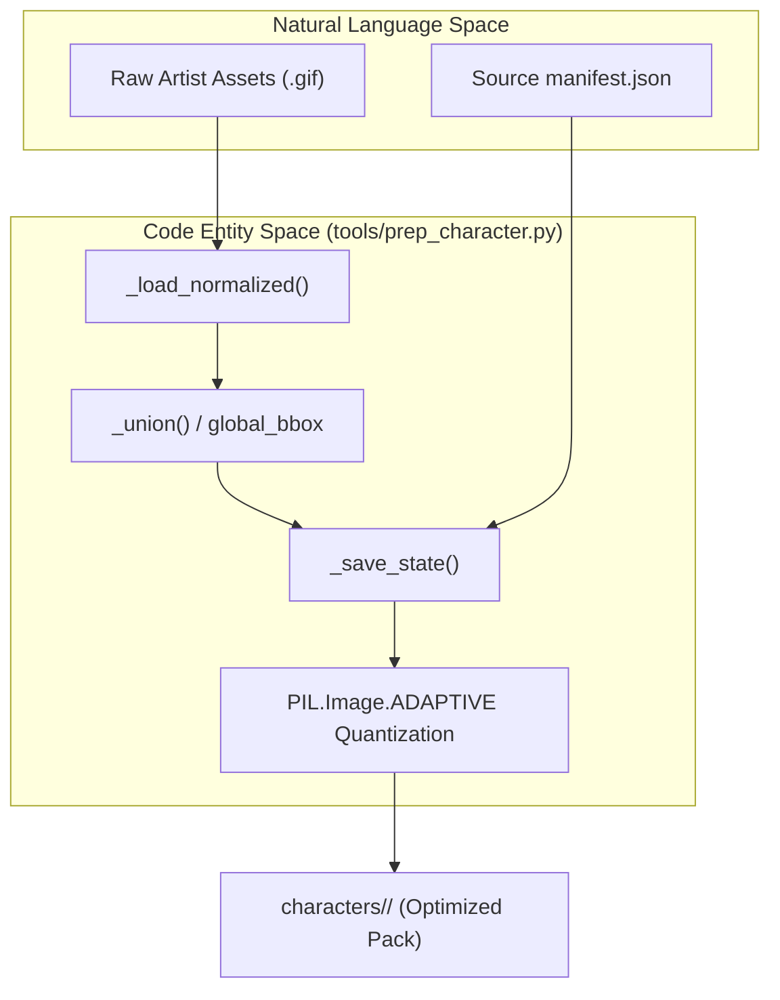
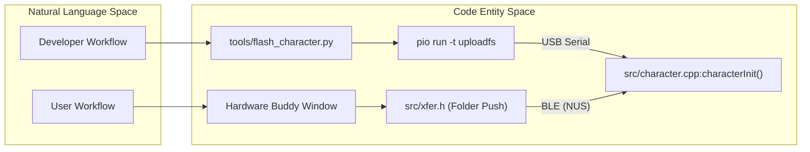

<!-- source: DeepWiki mcp.deepwiki.com · repo anthropics/claude-desktop-buddy · page 4.2 Character Pack Tooling · fetched 2026-10-26 -->

# Character Pack Tooling

Relevant source files

The following files were used as context for generating this wiki page:

- [characters/bufo/README.md](characters/bufo/README.md)
- [tools/flash_character.py](tools/flash_character.py)
- [tools/prep_character.py](tools/prep_character.py)

The Character Pack Tooling provides developers and artists with a pipeline for transforming standard GIF assets into optimized, hardware-compatible character packs for the M5StickC Plus. The tooling addresses hardware constraints such as the 135x240 screen resolution, limited LittleFS storage (approx. 1.8MB), and memory-efficient GIF decoding.

## Processing Pipeline (prep_character.py)

The `tools/prep_character.py` script is the primary entry point for creating a character pack. It processes a source directory containing a `manifest.json` and raw GIF files, performing normalization and quantization to ensure the character appears consistent across different animation states.

### Normalization and Bounding Box Calculation
To prevent the character from "jumping" or changing size when transitioning between states (e.g., from `idle` to `busy`), the tool uses a two-pass normalization strategy:

1.  **Reference Scaling**: All input frames are temporarily scaled to a `REF_W` (1000px) width to maintain high-precision coordinate math `[tools/prep_character.py:22-29]()`.
2.  **Global Bounding Box**: The tool calculates the union of all non-transparent bounding boxes across every frame of every GIF in the pack `[tools/prep_character.py:72-84]()`.
3.  **Consistent Crop**: Every frame is cropped using this `global_bbox` and then downscaled to the `TARGET_W` (96px) width `[tools/prep_character.py:38-47]()`. This ensures that a character that occupies 50% of the frame in one GIF will occupy exactly the same relative space in all others.

### Palette Quantization
The ESP32's `AnimatedGIF` library and the limited SPI RAM benefit from reduced color depth. The tool flattens RGBA frames against the background color defined in the manifest and converts them to an adaptive 64-color palette `[tools/prep_character.py:45-47]()`.

### Tooling Data Flow: Asset Preparation

The following diagram illustrates how raw assets are transformed into a deployment-ready character pack.

"Asset Preparation Flow"

Sources: `[tools/prep_character.py:20-53]()`, `[tools/prep_character.py:70-110]()`

## Deployment Paths

There are two primary methods for installing a prepped character pack onto the device: USB flashing (for development) and BLE transfer (for end-users).

### USB Flashing (flash_character.py)
The `tools/flash_character.py` script provides a fast iteration loop for developers. It bypasses the BLE transfer protocol by staging the character pack directly into the project's `data/` directory and invoking the PlatformIO `uploadfs` target.

*   **Staging**: The script clears the `data/characters` directory to save space and copies the target pack into it `[tools/flash_character.py:28-31]()`.
*   **Validation**: It checks that the total size does not exceed the `CAP` (1,800,000 bytes) to avoid LittleFS overflow `[tools/flash_character.py:22-24]()`.
*   **Execution**: It runs `pio run -t uploadfs` to flash the SPIFFS/LittleFS partition over USB `[tools/flash_character.py:34]()`.

### BLE Drag-and-Drop
The Hardware Buddy desktop application supports a "Folder Push" transport. When a prepped character folder is dropped onto the UI, it uses the `src/xfer.h` protocol to stream the files over the Nordic UART Service (NUS).

1.  **Handshake**: Desktop sends `char_begin`.
2.  **Stream**: Each file is sent in Base64 chunks via `file` and `chunk` commands.
3.  **Finalize**: Device receives `char_end`, triggers `characterInit()`, and reloads the filesystem.

### Deployment Logic and Entities

This diagram maps the deployment commands to the scripts and hardware logic.

"Deployment Path Mapping"

Sources: `[tools/flash_character.py:17-36]()`, `[characters/bufo/README.md:17-18]()`

## Manifest Structure

The tooling generates a modified `manifest.json` for the device. While the source manifest may contain complex paths, the output manifest maps `PersonaState` keys to the specific optimized filenames.

| Field | Description | Source |
| :--- | :--- | :--- |
| `name` | Character identifier used for the folder name. | `[tools/prep_character.py:66]()` |
| `colors.bg` | Hex code for the background; used for GIF flattening. | `[tools/prep_character.py:67-68]()` |
| `states` | Map of `PersonaState` (idle, busy, etc.) to file(s). | `[tools/prep_character.py:106-110]()` |

If a state (like `idle`) has multiple GIFs, the tool names them `idle_0.gif`, `idle_1.gif`, etc., and the device `character.cpp` logic will rotate through them as a carousel `[tools/prep_character.py:81-82]()`.

Sources: `[tools/prep_character.py:65-110]()`, `[characters/bufo/README.md:12-15]()`

---

