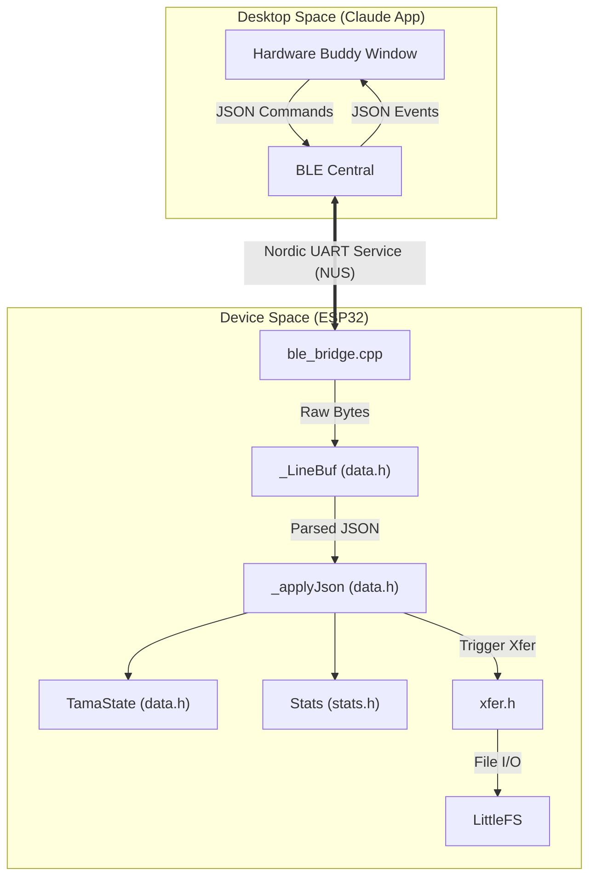
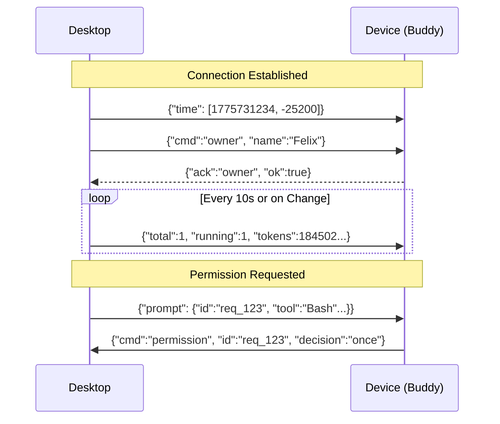

<!-- source: DeepWiki mcp.deepwiki.com · repo anthropics/claude-desktop-buddy · page 5 BLE Protocol Reference · fetched 2026-10-26 -->

# BLE Protocol Reference

Relevant source files

The following files were used as context for generating this wiki page:

- [REFERENCE.md](REFERENCE.md)

The Claude Desktop-to-Device protocol is a lightweight, JSON-based wire format transmitted over the **Nordic UART Service (NUS)**. It enables bi-directional communication between the Claude desktop application and the hardware buddy, facilitating real-time status updates, AI interaction events, and remote file management.

The protocol is designed to be transport-agnostic; while primarily used over Bluetooth LE (BLE), it also supports USB Serial using the same newline-delimited JSON structure.

### Protocol Architecture

The communication follows a reactive model where the desktop acts as the primary orchestrator, pushing state updates ("heartbeats") and commands, while the device provides acknowledgments (acks) and user-initiated decisions (permissions).

#### System Entity Mapping
This diagram maps the logical protocol components to the physical and software entities in the codebase.

Sources: [REFERENCE.md:21-39](), [src/data.h:203-240](), [src/ble_bridge.cpp:1-20]()

### Transport Layer: Nordic UART Service

The protocol utilizes the de-facto standard Nordic UART Service (NUS) for serial-over-BLE communication.

| Characteristic | UUID | Role |
| :--- | :--- | :--- |
| **Service** | `6e400001-b5a3-f393-e0a9-e50e24dcca9e` | Service Discovery |
| **RX** | `6e400002-b5a3-f393-e0a9-e50e24dcca9e` | Desktop → Device (Write) |
| **TX** | `6e400003-b5a3-f393-e0a9-e50e24dcca9e` | Device → Desktop (Notify) |

**Framing:** All messages are UTF-8 encoded JSON objects, one per line, terminated with a newline (`\n`). Because BLE MTU limits may fragment large JSON objects, the device implements a line buffer to reassemble packets before parsing.

Sources: [REFERENCE.md:23-39](), [src/data.h:176-190]()

### Connection Lifecycle & Security

The connection lifecycle is managed through the `ble_bridge.cpp` component, which handles the transition from advertising to a bonded secure state.

1.  **Advertising:** The device advertises a name starting with `Claude` (e.g., `Claude-A1B2`) to be filtered by the desktop app.
2.  **Bonding:** The protocol uses **LE Secure Connections** with a 6-digit passkey displayed on the device screen for Man-in-the-Middle (MITM) protection.
3.  **Persistence:** Bonds are stored in NVS. The desktop can request an unpair via `{"cmd":"unpair"}`, which triggers `bleForget()` on the device.
4.  **Heartbeat Timeout:** If no heartbeat snapshot is received for ~30 seconds, the device considers the connection dead and transitions to a disconnected visual state.

For details on the security implementation and bonding flow, see [Device-to-Desktop Commands & Security](#5.2).

Sources: [REFERENCE.md:31-33](), [REFERENCE.md:78-79](), [src/ble_bridge.cpp:100-140]()

### Message Categories

The protocol exchange consists of four primary message types:

#### 1. Heartbeat & State Snapshots
The desktop pushes a comprehensive state object whenever the Claude session changes (e.g., new message, token count increase) or as a keepalive every 10 seconds. This includes the `total` active sessions, `running` status, and `tokens_today`.

#### 2. Turn Events
One-shot events fired upon completion of an AI turn. These contain the raw content array (text, tool calls) from the assistant.

#### 3. Permission Flow
A request-response pattern where the desktop sends a `prompt` object in the heartbeat, and the device responds with a `permission` command (`once` or `deny`).

#### 4. Folder Push (Xfer)
A sequential command sequence for streaming files (like character GIFs) to the device's LittleFS storage.

For details on the specific JSON schemas for these messages, see [Desktop-to-Device Commands](#5.1).

Sources: [REFERENCE.md:40-107](), [src/data.h:203-240]()

### Acknowledgement Pattern

Any command sent by the desktop containing a `cmd` field requires a matching `ack` from the device to maintain synchronization and flow control, particularly during high-bandwidth operations like Folder Push.

| Device Ack Field | Description |
| :--- | :--- |
| `ack` | Must match the `cmd` string being acknowledged. |
| `ok` | Boolean indicating success or failure. |
| `n` | Generic numeric field (e.g., bytes written in a `chunk` ack). |
| `error` | Optional string describing the failure. |

Sources: [REFERENCE.md:122-132](), [src/xfer.h:70-90]()

---

### Child Pages
- [Desktop-to-Device Commands](#5.1) — Detailed schema for heartbeats, turn events, and administrative commands.
- [Device-to-Desktop Commands & Security](#5.2) — Specification for permission responses, status acks, and the BLE security model.

---

