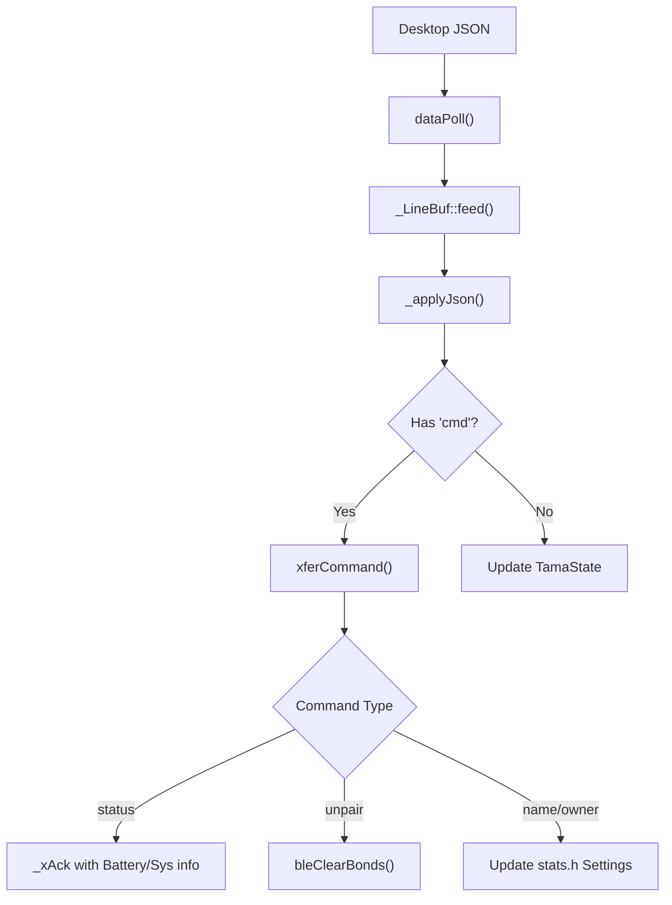
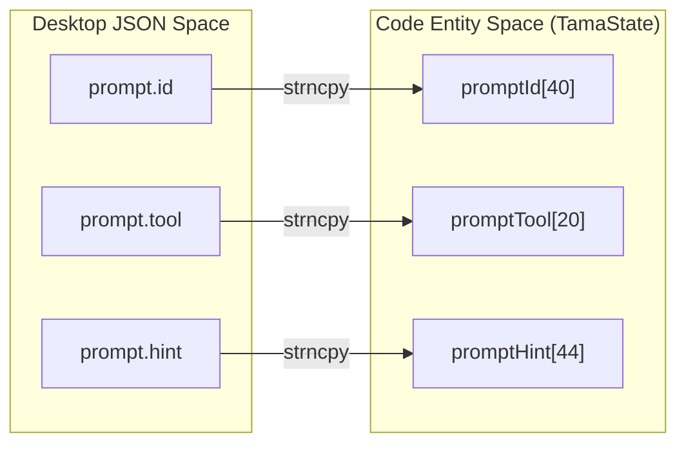

<!-- source: DeepWiki mcp.deepwiki.com · repo anthropics/claude-desktop-buddy · page 5.1 Desktop-to-Device Commands · fetched 2026-10-26 -->

# Desktop-to-Device Commands

<details>
<summary>Relevant source files</summary>

The following files were used as context for generating this wiki page:

- [REFERENCE.md](REFERENCE.md)
- [src/data.h](src/data.h)
- [src/xfer.h](src/xfer.h)

</details>


This page specifies the JSON-over-BLE protocol used by the Claude desktop application to communicate with the device. The protocol facilitates state synchronization, identity management, and real-time event streaming.

## Overview

The desktop application communicates with the device primarily via the **Nordic UART Service (NUS)** [REFERENCE.md:23-29](). All data is exchanged as UTF-8 encoded JSON objects, with each object terminated by a newline (`\n`) character [REFERENCE.md:35-38](). The device uses a line-buffered reassembly mechanism to handle fragmented BLE packets [src/data.h:130-143]().

### Command Flow Architecture

The `dataPoll` loop in the firmware continuously checks for incoming data from both USB Serial and BLE [src/data.h:147-184](). When a complete JSON object is detected, it is passed to `_applyJson` [src/data.h:70-127](), which dispatches it to either the state machine or the transfer handler.

## Heartbeat Snapshot

The desktop sends a heartbeat snapshot whenever the session state changes, or as a keepalive every 10 seconds [REFERENCE.md:42-43](). This snapshot updates the `TamaState` struct, which governs the device's persona and display [src/data.h:7-22]().

### Schema
```json
{
  "total": 3,
  "running": 1,
  "waiting": 1,
  "msg": "approve: Bash",
  "entries": ["10:42 git push", "10:41 yarn test"],
  "tokens": 184502,
  "tokens_today": 31200,
  "prompt": {
    "id": "req_abc123",
    "tool": "Bash",
    "hint": "rm -rf /tmp/foo"
  }
}
```

### Key Fields and Implementation
| Field | Firmware Mapping | Description |
| :--- | :--- | :--- |
| `total` | `sessionsTotal` | Total open Claude sessions [src/data.h:93](). |
| `running` | `sessionsRunning` | Sessions actively generating text/tools [src/data.h:94](). |
| `waiting` | `sessionsWaiting` | Sessions blocked on a permission prompt [src/data.h:95](). |
| `msg` | `msg[24]` | Short status text displayed on the device [src/data.h:101](). |
| `entries` | `lines[8][92]` | Transcript history for the "Info" screen [src/data.h:102-115](). |
| `tokens` | `statsOnBridgeTokens()` | Cumulative session tokens; updates NVS stats [src/data.h:98](). |
| `prompt` | `promptId`, `promptTool` | Permission request details [src/data.h:116-124](). |

**Sources:** [REFERENCE.md:45-76](), [src/data.h:7-22](), [src/data.h:93-124]()

## System Commands

Commands containing a `"cmd"` field require the device to send an acknowledgement (`ack`) [REFERENCE.md:124-128](). These are handled by `xferCommand` in `src/xfer.h` [src/xfer.h:77-225]().

### Command List
*   **`status`**: Requests a full diagnostic report including battery, heap, and filesystem stats [REFERENCE.md:140-155]().
*   **`name`**: Sets the pet's display name [src/xfer.h:81-86]().
*   **`owner`**: Sets the owner's name (retrieved from the Claude account) [src/xfer.h:105-110]().
*   **`unpair`**: Triggers `bleClearBonds()` to erase stored BLE security keys [src/xfer.h:99-103]().
*   **`time`**: Synchronizes the ESP32 internal RTC with the desktop's epoch time and timezone offset [src/data.h:77-91]().

### Data Flow: Command Processing
Title: Desktop Command Dispatch Flow

**Sources:** [src/data.h:147-175](), [src/xfer.h:77-139]()

## Turn Events

The desktop streams raw SDK content blocks via `turn` events. These are one-shot notifications and are not stored in the long-term `TamaState` [REFERENCE.md:81-87]().

```json
{
  "evt": "turn",
  "role": "assistant",
  "content": [{ "type": "text", "text": "I will help you with that." }]
}
```
**Sources:** [REFERENCE.md:88-94]()

## Permission Request Object

When Claude requires tool authorization, the heartbeat includes a `prompt` object. This triggers the "Attention" state on the device [src/data.h:40]().

### Entity Mapping
Title: Permission Request Data Mapping

**Sources:** [src/data.h:19-21](), [src/data.h:116-124]()

### Implementation Detail: Time Sync
The `time` command is unique because it is processed directly in `_applyJson` rather than `xferCommand` [src/data.h:77](). It takes an array `[epoch_seconds, timezone_offset_seconds]` and updates the M5StickC Plus RTC using `M5.Rtc.SetTime` and `M5.Rtc.SetDate` [src/data.h:78-85](). This ensures that the device clock orientation and logging are accurate to the user's local time [src/data.h:88]().

**Sources:** [src/data.h:75-91]()

---

