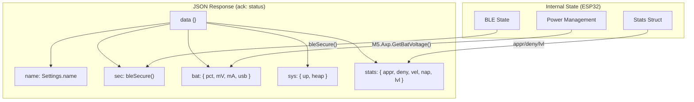
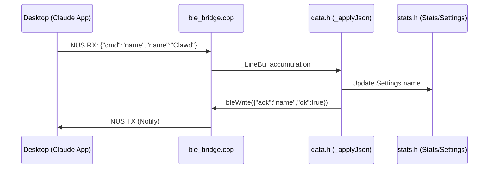

<!-- source: DeepWiki mcp.deepwiki.com · repo anthropics/claude-desktop-buddy · page 5.2 Device-to-Desktop Commands & Security · fetched 2026-10-26 -->

# Device-to-Desktop Commands & Security

<details>
<summary>Relevant source files</summary>

The following files were used as context for generating this wiki page:

- [REFERENCE.md](REFERENCE.md)
- [src/ble_bridge.cpp](src/ble_bridge.cpp)
- [src/ble_bridge.h](src/ble_bridge.h)

</details>


This page details the communication protocol and security model for data traveling from the ESP32 device back to the Claude desktop application. This includes command acknowledgments, permission decisions, and the LE Secure Connections (LESC) handshake.

## Communication Overview

The device communicates with the desktop primarily via the **Nordic UART Service (NUS)**. While the desktop sends snapshots and commands, the device responds with `ack` objects to confirm receipt and execution, or `permission` objects to influence the Claude session state.

### Data Flow: Device to Desktop

| Step | Entity | Action | File Reference |
| :--- | :--- | :--- | :--- |
| 1 | `data.h` | Processes incoming JSON and prepares a response object. | [src/data.h:120-150]() |
| 2 | `bleWrite()` | Serializes JSON and fragments it into MTU-sized chunks. | [src/ble_bridge.cpp:162-180]() |
| 3 | `txChar->notify()` | Sends a BLE Notification to the Desktop (NUS TX Characteristic). | [src/ble_bridge.cpp:174-174]() |

**Sources:** [src/ble_bridge.cpp:162-180](), [src/data.h:120-150](), [REFERENCE.md:21-39]()

---

## Permission Decisions

When the desktop sends a `prompt` object within a heartbeat snapshot, the device enters a "waiting" state. The user can then provide a decision via physical button interaction (Button A for approval).

### Decision Payload
The device sends a JSON object with the `cmd` set to `"permission"`. The `id` must exactly match the `id` provided in the desktop's prompt.

```json
{
  "cmd": "permission",
  "id": "req_abc123",
  "decision": "once"
}
```

| Decision | Effect in Claude |
| :--- | :--- |
| `"once"` | Approves the current tool call. |
| `"deny"` | Rejects the current tool call. |

**Sources:** [REFERENCE.md:96-107](), [src/data.h:125-135]()

---

## Status Acknowledgments

The desktop polls the device every few seconds using `{"cmd":"status"}`. The device responds with a comprehensive state object used to populate the Hardware Buddy desktop UI.

### Status Schema Mapping
The following diagram maps the code entities in `stats.h` and `ble_bridge.cpp` to the JSON fields sent to the desktop.

**Title: Status Payload Generation**


**Sources:** [REFERENCE.md:140-158](), [src/stats.h:20-45](), [src/ble_bridge.cpp:137-137]()

---

## Security & Bonding

The system utilizes **LE Secure Connections (LESC)** with Numeric Comparison/Passkey Entry to ensure the link is encrypted and authenticated.

### Passkey Flow
1. **Request**: When a desktop attempts to bond, the ESP32 stack triggers `onPassKeyNotify`.
2. **Display**: `ble_bridge.cpp` stores the 6-digit code. `main.cpp` polls `blePasskey()` and renders it to the screen.
3. **Verification**: The user enters the code into the Claude desktop app.
4. **Completion**: `onAuthenticationComplete` is called, setting `secure = true`.

### Bonding Lifecycle
The device supports persistent bonding (Long Term Keys). If the user selects "Unpair" in the desktop app, the desktop sends a command that triggers `bleClearBonds()`.

| Function | Role |
| :--- | :--- |
| `bleInit()` | Sets `ESP_LE_AUTH_REQ_SC_MITM_BOND` and `ESP_IO_CAP_OUT`. |
| `onPassKeyNotify()` | Captures the generated passkey for the UI. |
| `bleClearBonds()` | Calls `esp_ble_remove_bond_device` for all stored peers. |

**Sources:** [src/ble_bridge.cpp:69-87](), [src/ble_bridge.cpp:120-126](), [src/ble_bridge.cpp:140-149](), [REFERENCE.md:138-138]()

---

## Protocol Handshake & Acks

The desktop uses a synchronous command-ack pattern for configuration and file transfers. Every command with a `cmd` field requires a response with a matching `ack` field.

### Sequence Diagram: Command Handshake
This diagram illustrates the `_applyJson` processing logic and the resulting `bleWrite` response.

**Title: Desktop-Device Command Handshake**


### Ack Payload Fields
| Field | Type | Description |
| :--- | :--- | :--- |
| `ack` | string | Matches the `cmd` name from the request. |
| `ok` | boolean | `true` if command succeeded, `false` otherwise. |
| `n` | number | Generic counter (e.g., bytes written during `chunk` commands). |
| `error`| string | (Optional) Description of failure if `ok` is false. |

**Sources:** [REFERENCE.md:122-138](), [src/data.h:115-160](), [src/ble_bridge.cpp:162-180]()

---

