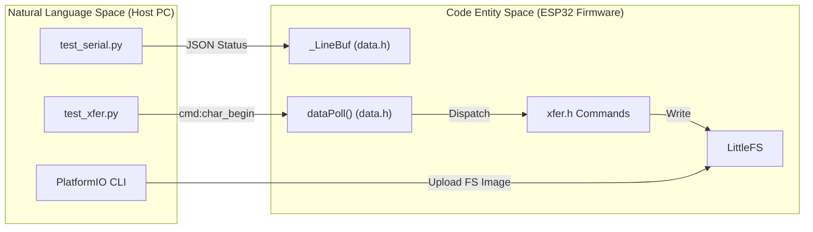

<!-- source: DeepWiki mcp.deepwiki.com · repo anthropics/claude-desktop-buddy · page 6 Developer Tools & Testing · fetched 2026-10-26 -->

# Developer Tools & Testing

Relevant source files

The following files were used as context for generating this wiki page:

- [platformio.ini](platformio.ini)
- [tools/test_serial.py](tools/test_serial.py)
- [tools/test_xfer.py](tools/test_xfer.py)

This section covers the essential utilities and build configurations used to develop, debug, and validate the Claude Desktop Buddy firmware. The project utilizes a combination of PlatformIO for embedded lifecycle management and Python-based automation for testing the device's reactive state machine and file transfer protocols.

## Python Testing Utilities

The `tools/` directory contains Python scripts designed to exercise the device over a USB serial connection. These tools allow developers to simulate desktop app behavior (like sending heartbeats or file transfers) without needing the full Claude Desktop environment.

### Serial & State Testing
The `tools/test_serial.py` script validates the firmware's internal state machine by cycling through different JSON status payloads. It verifies that the device correctly transitions between `PersonaState` values such as `sleep`, `idle`, `busy`, and `attention` based on simulated task counts.

For details, see [Serial & Transfer Test Scripts](#6.1).

### Folder Push & Transfer Validation
The `tools/test_xfer.py` script implements the "Folder Push" protocol over serial. It automates the process of opening a transfer session, streaming files (like GIF assets) in base64-encoded chunks, and verifying acknowledgments (acks) from the device. This is the primary tool for testing the reliability of the LittleFS filesystem integration and the `xfer.h` logic.

For details, see [Serial & Transfer Test Scripts](#6.1).

### Development Flow Overview

The following diagram illustrates how the Python tools interact with the firmware components during a typical testing session.

**System Integration: Python Tools to Firmware Entities**

**Sources:** [tools/test_serial.py:10-18](), [tools/test_xfer.py:17-19](), [tools/test_xfer.py:38-50]()

---

## PlatformIO Build Configuration

The project is managed via PlatformIO, which handles toolchain setup, library dependencies, and partition management. The configuration is centralized in `platformio.ini`.

### Hardware Target & Environment
The firmware is built for the `m5stickc-plus` environment using the `espressif32` platform and the `arduino` framework. The build is optimized for a 160MHz CPU clock to balance performance and power consumption.

### Filesystem & Partitions
To support character packs and GIF storage, the build uses `littlefs` as the filesystem. A custom partition table (`no_ota.csv`) is utilized to maximize available space for the filesystem by removing Over-the-Air (OTA) update overhead.

### Library Dependencies
The project relies on three primary external libraries:
*   `M5StickCPlus`: Hardware abstraction for the display, IMU, and buttons.
*   `AnimatedGIF`: High-performance GIF decoding and rendering.
*   `ArduinoJson`: Efficient parsing of the serial and BLE command stream.

For details, see [PlatformIO Build Configuration](#6.2).

**Build Configuration Mapping**

| Feature | Code Entity / Setting | File Reference |
| :--- | :--- | :--- |
| **CPU Frequency** | `160000000L` | [platformio.ini:8-8]() |
| **Filesystem** | `littlefs` | [platformio.ini:6-6]() |
| **JSON Parser** | `ArduinoJson @ ^7.0.0` | [platformio.ini:15-15]() |
| **GIF Engine** | `AnimatedGIF @ ^2.1.1` | [platformio.ini:14-14]() |
| **Source Filter** | `+<*> +<buddies/>` | [platformio.ini:11-11]() |

**Sources:** [platformio.ini:1-15]()

---

## Child Pages
*   [Serial & Transfer Test Scripts](#6.1) — Detailed usage of `test_serial.py` and `test_xfer.py` for state and protocol verification.
*   [PlatformIO Build Configuration](#6.2) — Deep dive into the `platformio.ini` settings, partition tables, and library management.

---

