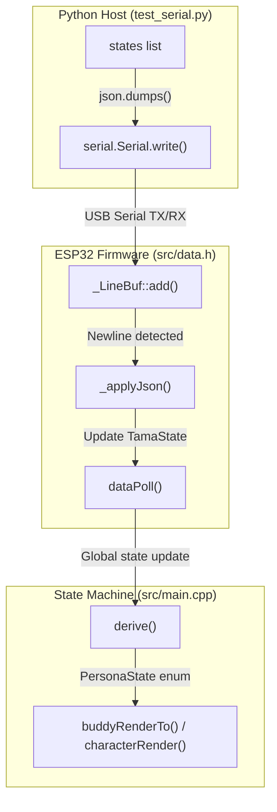
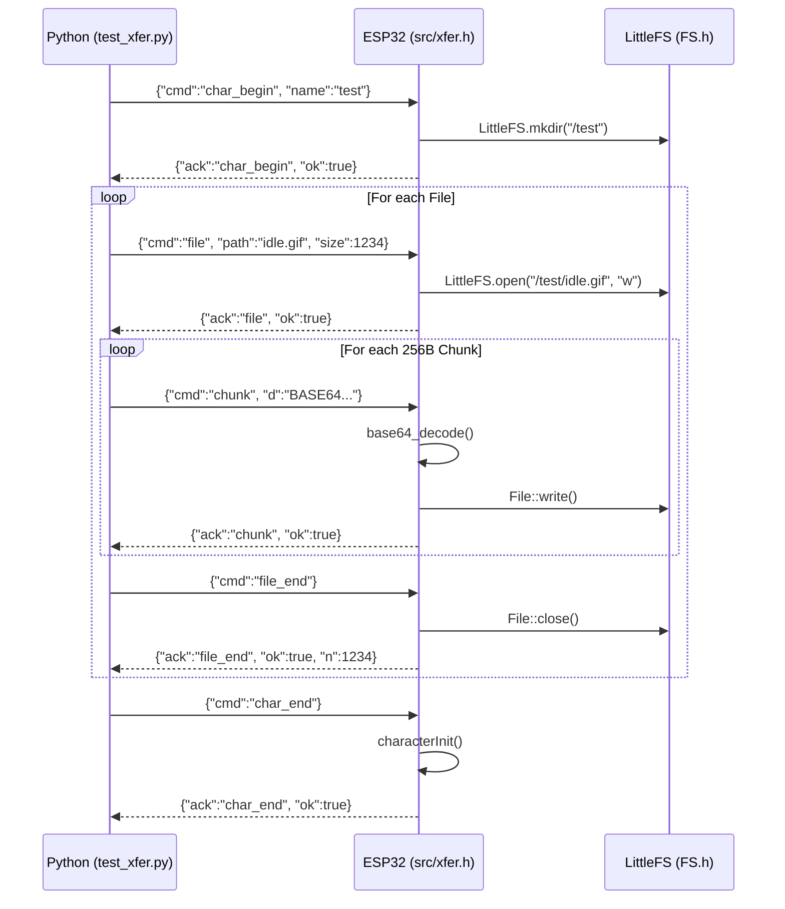

<!-- source: DeepWiki mcp.deepwiki.com · repo anthropics/claude-desktop-buddy · page 6.1 Serial & Transfer Test Scripts · fetched 2026-10-26 -->

# Serial & Transfer Test Scripts

Relevant source files

The following files were used as context for generating this wiki page:

- [tools/test_serial.py](tools/test_serial.py)
- [tools/test_xfer.py](tools/test_xfer.py)

The `claude-desktop-buddy` codebase includes specialized Python utilities in the `tools/` directory designed to exercise the ESP32 firmware's serial communication logic. These scripts bypass the BLE stack to directly test the device's state machine transitions and the "Folder Push" file transfer protocol over a USB serial connection.

## Serial State Verification (`test_serial.py`)

The `tools/test_serial.py` script is a diagnostic tool used to verify that the ESP32 correctly parses JSON status updates and transitions between its internal persona states. It simulates the heartbeat snapshots typically sent by the Claude Desktop application.

### Implementation Details
The script automatically detects the M5StickC Plus by searching for `/dev/cu.usbserial-*` ports `[tools/test_serial.py:5-7]()`. It then iterates through a sequence of JSON objects representing different system loads:

1.  **Sleep State**: `{"total": 0, "running": 0, "waiting": 0}` `[tools/test_serial.py:11]()`
2.  **Idle State**: `{"total": 2, "running": 1, "waiting": 0}` `[tools/test_serial.py:12]()`
3.  **Busy State**: `{"total": 4, "running": 3, "waiting": 0}` `[tools/test_serial.py:13]()`
4.  **Attention State**: `{"total": 2, "running": 1, "waiting": 1}` `[tools/test_serial.py:14]()`

The script writes these JSON strings followed by a newline character to the serial buffer every 3 seconds `[tools/test_serial.py:18-20]()`. This allows developers to visually confirm that the device UI (ASCII or GIF) updates its rendering and LED behavior in response to the simulated workload.

### Data Flow: Serial State Injection
The following diagram illustrates how `test_serial.py` interacts with the firmware's data processing layer.

**Serial to State Machine Flow**

**Sources:** `[tools/test_serial.py:10-20]()`, `[src/data.h:1-100]()`, `[src/main.cpp:1-150]()`

---

## Transfer Protocol Exercise (`test_xfer.py`)

The `tools/test_xfer.py` script implements the full **Folder Push** transport protocol defined in `src/xfer.h`. It is used to stress-test the LittleFS filesystem integration, base64 decoding performance, and the acknowledgment (ACK) flow control mechanism.

### Protocol Sequence
The script follows a strict command-response handshake to ensure data integrity over the serial link:

1.  **Initialization**: Sends `char_begin` with the character name `[tools/test_xfer.py:63]()`.
2.  **File Header**: For each file, sends a `file` command containing the filename and total size `[tools/test_xfer.py:38]()`.
3.  **Chunking**: Breaks file data into 256-byte segments `[tools/test_xfer.py:8]()`, encodes them in base64, and sends them via `chunk` commands `[tools/test_xfer.py:44]()`.
4.  **Verification**: Waits for an `{"ack": "chunk", "ok": true}` response from the device after every segment before proceeding `[tools/test_xfer.py:45-47]()`.
5.  **Finalization**: Sends `file_end` for each file and `char_end` to signal the completion of the entire pack `[tools/test_xfer.py:50, 82]()`.

### Key Functions
| Function | Description |
| :--- | :--- |
| `wait_ack(what, timeout)` | Polls the serial input buffer for a JSON object where the `ack` field matches the expected command `[tools/test_xfer.py:20-33]()`. |
| `send_file(name, path)` | Manages the lifecycle of a single file transfer, including opening the local file, sending chunks, and verifying the written size `[tools/test_xfer.py:35-54]()`. |

### Performance and Throughput
The script calculates and reports throughput in KB/s at the end of the transfer `[tools/test_xfer.py:86]()`. This is critical for optimizing the base64 decoding overhead and LittleFS write latency in `src/xfer.h`.

### Data Flow: Folder Push Protocol
This diagram maps the Python script logic to the C++ handlers in the firmware.

**Folder Push Code Entity Mapping**

**Sources:** `[tools/test_xfer.py:35-85]()`, `[src/xfer.h:1-150]()`

---

