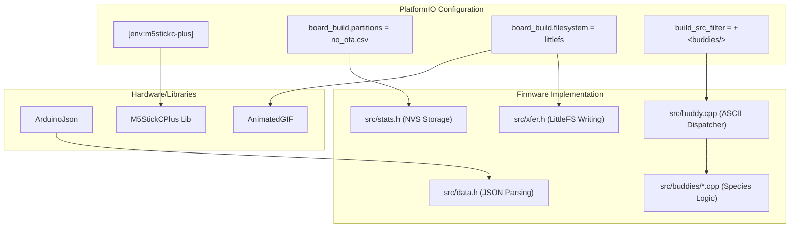
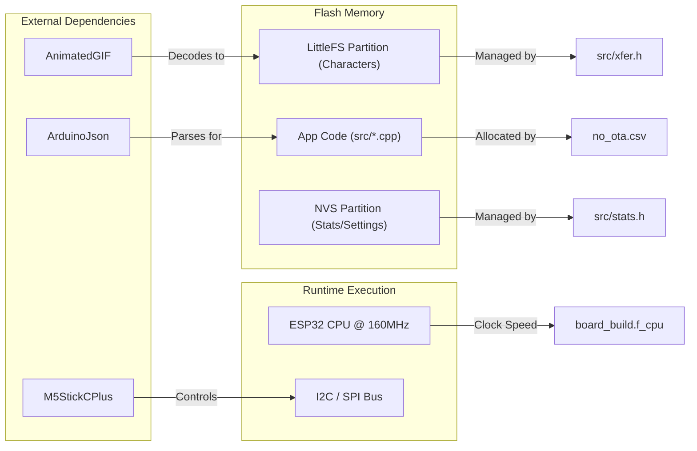

<!-- source: DeepWiki mcp.deepwiki.com · repo anthropics/claude-desktop-buddy · page 6.2 PlatformIO Build Configuration · fetched 2026-10-26 -->

# PlatformIO Build Configuration

Relevant source files

The following files were used as context for generating this wiki page:

- [.gitignore](.gitignore)
- [platformio.ini](platformio.ini)

This page provides a technical breakdown of the `platformio.ini` configuration used to build and deploy the Claude Desktop Buddy firmware. The project targets the M5StickC Plus hardware using the ESP32 platform and the Arduino framework.

## Environment Overview

The project defines a single build environment, `[env:m5stickc-plus]`, which encapsulates all hardware-specific settings, filesystem choices, and library dependencies required for the device to function as a BLE-enabled desktop companion [platformio.ini:1]().

### Hardware & Platform Specification
The build targets the **Espressif32** platform using the **Arduino** framework [platformio.ini:2-4](). While the physical device is an M5StickC Plus, it utilizes the base `m5stick-c` board definition [platformio.ini:3]().

To optimize power consumption and heat dissipation, the CPU frequency is explicitly set to **160MHz** (`160000000L`) [platformio.ini:8](). This provides sufficient performance for rendering animated GIFs and managing BLE stacks while avoiding the higher power draw of the maximum 240MHz clock.

### Partitioning & Filesystem
The firmware uses a specific memory layout to accommodate both the application logic and character assets:

*   **LittleFS Filesystem**: The project uses `littlefs` as the filesystem backend [platformio.ini:6](). This is used to store character packs (manifests and GIF files) uploaded via the "Folder Push" protocol or via the `uploadfs` target.
*   **no_ota Partition Table**: To maximize available space for the application and the filesystem, the `no_ota.csv` partition table is used [platformio.ini:7](). This removes Over-The-Air (OTA) update buffers, providing more contiguous flash space for the `littlefs` partition and the firmware binary.

### Build Logic and Source Filtering
The project employs a specific source filter to include the ASCII species definitions:
*   `build_src_filter = +<*> +<buddies/>`: This ensures that all files in the `src/` root are compiled, along with the contents of the `src/buddies/` directory [platformio.ini:11](). The `buddies/` directory contains the individual C++ implementations for the 18 built-in ASCII species.

## Dependency Management

The firmware relies on three primary external libraries to handle hardware abstraction, graphics, and data serialization.

| Library | Version | Purpose |
| :--- | :--- | :--- |
| `m5stack/M5StickCPlus` | Latest | Hardware abstraction for the display (ST7789), power management (AXP192), and buttons [platformio.ini:13](). |
| `bitbank2/AnimatedGIF` | `^2.1.1` | High-performance GIF decoding used by the GIF Character System to render frame-by-frame animations [platformio.ini:14](). |
| `bblanchon/ArduinoJson` | `^7.0.0` | Parsing and generation of JSON payloads for the BLE and Serial wire protocols [platformio.ini:15](). |

**Sources:**
* [platformio.ini:1-16]()

## Build System Architecture

The following diagram illustrates how the PlatformIO configuration bridges the high-level project requirements to the low-level hardware and software components.

### Build Configuration Flow
"This diagram maps the `platformio.ini` parameters to the internal firmware systems they enable."

**Sources:**
* [platformio.ini:1-16]()
* [src/data.h:1-10]()
* [src/xfer.h:1-20]()
* [src/buddy.cpp:1-15]()

## Resource Mapping

The build configuration dictates how the ESP32's internal resources are allocated to the various subsystems of the Claude Desktop Buddy.

### Memory and Execution Mapping
"This diagram shows the relationship between build-time flags and the runtime execution environment."

**Sources:**
* [platformio.ini:6-8]()
* [platformio.ini:12-15]()
* [src/stats.h:1-30]()
* [src/xfer.h:1-40]()

## Development Workflow

### Build and Upload
The standard PlatformIO commands are used to interact with the device:
*   **Compile**: `pio run`
*   **Upload Firmware**: `pio run -t upload`
*   **Upload Filesystem**: `pio run -t uploadfs` (Targets the `data/` directory for LittleFS initialization).
*   **Serial Monitor**: `pio device monitor` (Configured at 115200 baud [platformio.ini:5]()).

### Directory Exclusions
The project is configured to ignore build artifacts and local data in version control via `.gitignore`, ensuring that `.pio/` environments and local `data/` payloads (used for testing character packs) are not committed [ .gitignore:1-4]().

**Sources:**
* [platformio.ini:1-16]()
* [.gitignore:1-4]()

---

