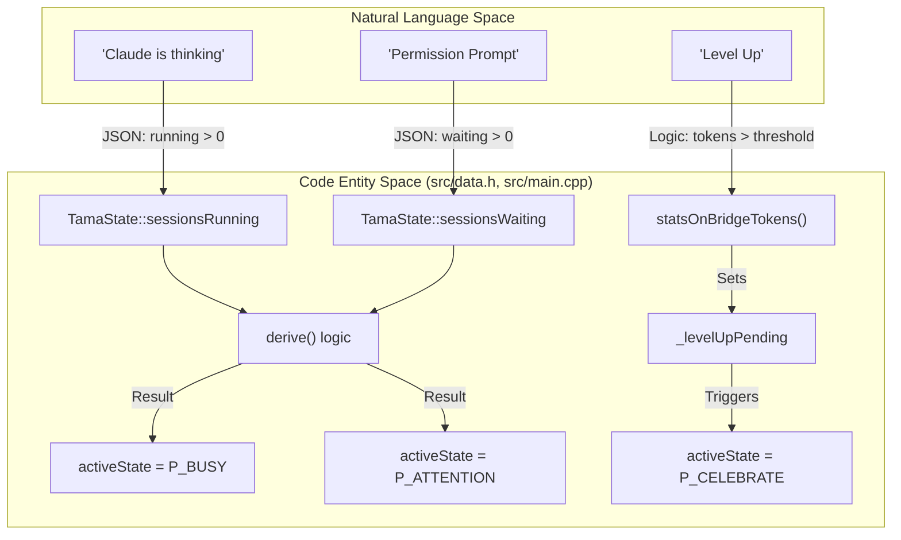
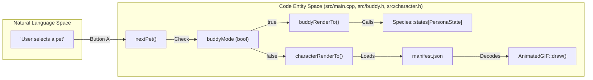

<!-- source: DeepWiki mcp.deepwiki.com · repo anthropics/claude-desktop-buddy · page 7 Glossary · fetched 2026-10-26 -->

# Glossary

Relevant source files

The following files were used as context for generating this wiki page:

- [README.md](README.md)
- [REFERENCE.md](REFERENCE.md)
- [characters/bufo/README.md](characters/bufo/README.md)
- [platformio.ini](platformio.ini)
- [src/ble_bridge.h](src/ble_bridge.h)
- [src/buddy.h](src/buddy.h)
- [src/character.h](src/character.h)
- [src/data.h](src/data.h)
- [src/main.cpp](src/main.cpp)
- [src/stats.h](src/stats.h)
- [src/xfer.h](src/xfer.h)

This glossary provides definitions for codebase-specific terms, architectural concepts, and domain-specific abbreviations used in the `claude-desktop-buddy` firmware and desktop integration.

## Core Concepts

### PersonaState
The central state machine variable that dictates the visual behavior of the buddy (both ASCII and GIF). It is defined as an `enum` in `src/main.cpp` and used to index animation functions or GIF files.

*   **States:** `P_SLEEP`, `P_IDLE`, `P_BUSY`, `P_ATTENTION`, `P_CELEBRATE`, `P_DIZZY`, `P_HEART` [src/main.cpp:32-33]().
*   **Logic:** The state is derived from `TamaState` signals (e.g., `sessionsRunning`, `sessionsWaiting`) in the `derive()` function [src/main.cpp:1152-1175]().

### TamaState
A struct representing the "world state" as synchronized from the Claude desktop app. It contains session counts, token tallies, and pending permission details [src/data.h:7-22]().

### Species
A specific visual identity for an ASCII buddy. Each species is defined by a `Species` struct containing its name, body color, and an array of seven `StateFn` pointers (one per `PersonaState`) [src/buddy.h:25-29]().

## Hardware & Connectivity

### BLE Bridge
The firmware component that implements the **Nordic UART Service (NUS)**. It allows the desktop app to communicate with the ESP32 as if it were a serial port over Bluetooth Low Energy [src/ble_bridge.h:5-15]().

### LE Secure Connections (LESC)
The Bluetooth pairing mode used to ensure an encrypted, authenticated link. The device displays a 6-digit **Passkey** [src/ble_bridge.h:24-26]() which the user must enter on the desktop to complete bonding.

### NVS (Non-Volatile Storage)
The ESP32's persistent storage area (using the `Preferences` library). It stores user settings, bonded Bluetooth keys, and pet statistics [src/stats.h:8-10]().

## Protocols

### Folder Push
A custom sequential transport protocol used to stream character packs (GIFs + manifest) over BLE or Serial. It uses a specific command sequence: `char_begin` -> `file` -> `chunk` (base64) -> `file_end` -> `char_end` [src/xfer.h:166-186]().

### Wire Protocol
The newline-delimited JSON format used for all communication. Every `cmd` sent by the desktop requires an `ack` from the device [REFERENCE.md:35-38](), [REFERENCE.md:122-125]().

## System Mapping: Natural Language to Code

The following diagrams bridge the gap between conceptual "Natural Language" terms and their specific implementation entities in the C++ source.

### State & Data Flow
This diagram shows how desktop events are transformed into physical buddy behaviors.

**Sources:** [src/data.h:7-22](), [src/main.cpp:1152-1175](), [src/stats.h:79-109]()

### Rendering Dispatch
This diagram illustrates how the system chooses between ASCII and GIF rendering paths based on user settings and filesystem state.

**Sources:** [src/main.cpp:68-82](), [src/main.cpp:125-135](), [src/buddy.h:25-29](), [src/character.h:23-28]()

## Technical Terms Table

| Term | Definition | Code Pointer |
| :--- | :--- | :--- |
| **_LineBuf** | A template class that accumulates bytes from a stream until a newline is found to parse JSON. | [src/data.h:130-143]() |
| **Peek Mode** | A rendering state where the buddy is shrunk to the top of the screen to make room for info panels. | [src/character.h:23-26]() |
| **SpeciesIdx** | The NVS-backed integer identifying which ASCII pet is active. `0xFF` indicates GIF mode. | [src/main.cpp:64]() |
| **Velocity** | A ring buffer tracking the median time (in seconds) the user takes to approve prompts. | [src/stats.h:18-20]() |
| **Mood Tier** | A calculated value (0-4) derived from response velocity and denial ratios. | [src/stats.h:142-158]() |
| **LittleFS** | The flash filesystem used to store character GIFs and manifests. | [src/xfer.h:3]() |

**Sources:** [src/data.h:130-143](), [src/character.h:23-26](), [src/main.cpp:64](), [src/stats.h:18-20](), [src/stats.h:142-158](), [src/xfer.h:3]()